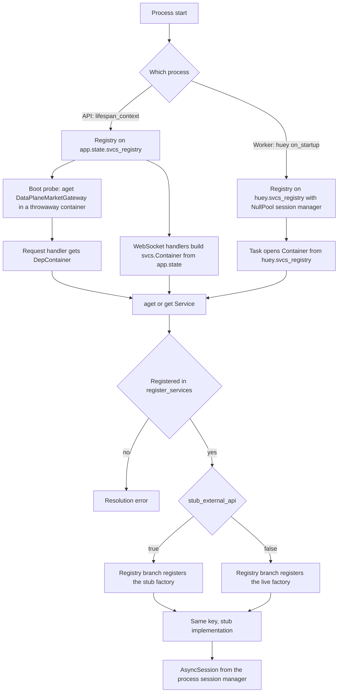

# Configuration, Dependency Injection & Cross-Cutting Runtime

Everything documented here is infrastructure that nearly every feature touches: the `Settings` model, the `svcs` registry that resolves services, the database and Redis session managers, the slowapi limiter, the request-ID/logging middleware and the email service. Per-request control flow itself is owned by the [Architecture Overview](./overview.md); this page covers the seams a change must hook into.

## One `.env`, four consumers

The tracked `.env.example` at the repository root is the single source of configuration. It is copied to a gitignored `.env` (`cp .env.example .env`), and that one file feeds every runtime:

| Consumer | How it reads the root `.env` |
|----------|------------------------------|
| Backend (`src/main.py`) | `env_file=(".env",)` is resolved from the process working directory; `docker-compose.yml` also passes the file via `env_file: [./.env]` |
| Worker (`src/worker.py`) | Same process environment; the `worker` service in `docker-compose.yml` uses `env_file: [./.env]` |
| Docker Compose | Compose interpolates `${ENVIRONMENT}`, `${BACKEND_PORT}`, `${FRONTEND_PORT}`, `${DOCKER_GID}`, the debug ports and the `VITE_*` values from the same file |
| Frontend service | Compose forwards `VITE_API_BASE_URL`, `VITE_INTERNAL_API_URL` and `VITE_ALLOWED_HOSTS` to the `frontend` container, and maps `SECRET_KEY` → `JWT_SECRET` |
| Go sidecars | Compose forwards `ENVIRONMENT` to `indicator-service`, and `BACKEND_BASE_URL`, `MARKET_DATA_SERVICE_TOKEN` and `DATA_PLANE_PATH` to `mcp-gateway` |

The `SECRET_KEY` → `JWT_SECRET` mapping is the load-bearing one: `docker-compose.yml` declares `JWT_SECRET: "${SECRET_KEY:?SECRET_KEY must be set in the root .env}"`, so the SvelteKit SSR route guard in `frontend/src/hooks.server.ts` verifies the `auth_token` cookie with exactly the HS256 key the backend signs with (`UserApi.create_access_token`). Compose fails fast if `SECRET_KEY` is missing, and no second secret exists to drift. See [Authentication](./authentication.md) for the token lifecycle.

`Settings.model_config` deliberately pins `env_file=(".env",)` and `extra="ignore"`: stray files such as `src/.env` are ignored, unknown keys are tolerated, and process environment variables win over file values. `tests/test_settings.py` locks in all four behaviors (root-file loading, `src/.env` being ignored, defaults when no file exists, env-var override). `src/.env` and `frontend/.env` are obsolete — move any leftover overrides into the root file.

Not every key in `.env.example` is a `Settings` field. The `VITE_*` values and the commented port overrides (`BACKEND_PORT`, `FRONTEND_PORT`, `BACKEND_DEBUG_PORT`, `WORKER_DEBUG_PORT`, `POSTGRES_PORT`, `MAILCRAB_PORT`, `INDICATOR_SERVICE_PORT`, `MCP_GATEWAY_PORT`, `DOCKER_GID`) are consumed by Compose interpolation, and `BACKEND_BASE_URL` / `DATA_PLANE_PATH` are read only by the Go `mcp-gateway`. `MCP_GATEWAY_URL` is documentation for MCP clients: no process in this repository reads it.

## The `Settings` model

`src/config/settings.py` holds the whole contract. Defaults are dev-oriented fallbacks, so a missing variable degrades to a working dev value rather than a crash — but the provider/secret validators below refuse to start outside dev/test, which is the important asymmetry. Notable groups and how each is consumed:

- **Runtime mode.** `environment` defaults to `"prod"` and is branched on across the codebase: migrations are skipped in `test`, `debugpy.listen(("0.0.0.0", 5678))` runs only in `dev`, cookie `httponly`/`secure` flags and error-detail redaction are enabled in `prod`, and the worker swaps `RedisHuey` for `MemoryHuey` in `test`.
- **`secret_key`.** Validated by a `model_validator(mode="after")`: outside `dev`/`test` it must be non-empty and at least `MIN_SECRET_KEY_LENGTH = 32` characters, otherwise `Settings()` raises. It signs JWTs (`src/auth/api.py`), email-verification tokens (`URLSafeTimedSerializer` in `src/auth/service.py`), WebSocket tickets (`src/ws/router.py`, `src/worker_dashboard/router.py`) and is the slowapi key-function decode key.
- **`market_data_service_token`.** A second after-validator requires it to be non-empty and non-blank outside `dev`/`test`. It is the shared secret for the service-to-service data plane: `src/auth/api.py::require_service_token` compares the `X-Service-Token` header against it with `secrets.compare_digest` (over bytes, so a non-ASCII header cannot turn the check into a 500). It is deliberately independent of user-JWT auth and has no cookie fallback. See [MCP Gateway](../integrations/mcp-gateway.md).
- **`fmp_api_key` and `polygon_api_key`.** A third after-validator requires both outside `dev`/`test` *unless* `stub_external_api` is true, and names every missing key in the error. These are the data-plane provider credentials: the composite gateway routes prices/search/fundamentals to FMP and options to Polygon. `eodhd_api_key` remains the credential for the legacy EODHD `MarketGateway` binding, read only inside `eodhd_gateway_factory`.
- **`log_level`.** Optional override; `init_logging()` falls back to `WARNING` in `test` and `DEBUG` otherwise.
- **`database_url` / `echo_sql`.** Consumed when constructing the process-wide `DatabaseSessionManager` and passed to the Huey dashboard.
- **CORS.** `cors_allow_origins`, `cors_allow_methods` and `cors_allow_headers` are comma-split at app construction; outside `prod` the app additionally permits `allow_origin_regex=r"https?://.*"`. The settings defaults name the container-internal frontend dev port `http://localhost:8100`, while the shipped `.env.example` sets `CORS_ALLOW_ORIGINS="http://localhost:8101"` and publishes the dev frontend on `8002`. Non-prod tolerates that mismatch through the origin regex; in prod the regex is `None`, so the origin list must be correct.
- **`stub_external_api`.** The stub/live switch described below.
- **`upload_path`.** Root directory for security-document uploads; the router creates it with `mkdir(parents=True, exist_ok=True)` and writes files under generated UUID names.
- **`indicator_service_url` and `ai_api_endpoint` / `ai_api_key` / `ai_api_model`.** Read inside the corresponding factories rather than at construction, so a bad value surfaces as a failed resolution or a stubbed response.
- **Endpoint cache TTLs.** Seven fields, one per data class, all in seconds: `endpoint_ttl_prices_seconds` (3600), `endpoint_ttl_statements_seconds` (86400), `endpoint_ttl_metrics_seconds` (86400), `endpoint_ttl_options_seconds` (1800), `endpoint_ttl_search_seconds` (3600), `endpoint_ttl_quotes_seconds` (30) and `endpoint_ttl_negative_seconds` (300). `src/market/endpoint_cache.py` maps each data class to its field and resolves the value **at call time**, so a change applies without restarting the process; a data class with no configured field logs a warning and falls back to 3600s, and the negative TTL is resolved by its own helper on every miss.
- **Redis.** `redis_url`, plus `sync_ttl_seconds` used as the TTL for the account-sync status key set.
- **TOTP.** `totp_max_attempts` and `totp_lockout_seconds` drive the 2FA attempt counter and Redis lockout.
- **WebAuthn.** `webauthn_rp_id`, `webauthn_rp_name`, `webauthn_origin`, `webauthn_challenge_ttl_seconds` configure passkey registration/assertion and the stored challenge lifetime.
- **Email.** `smtp_host`, `smtp_port`, `smtp_use_tls`, `smtp_user`, `smtp_password`, `smtp_sender_email`, `email_verification_token_expiry_hours`. A `field_validator(mode="before")` on `smtp_sender_email` substitutes `noreply@retail-portfolio.local` when the value is blank.
- **`frontend_url`.** Used to build absolute links in outgoing email (verification links, price-alert deeplinks, external-account error deeplinks).

`Settings()` is instantiated once at import time as the module-level `settings` singleton; every consumer imports that object. Tests monkeypatch attributes on the singleton (`monkeypatch.setattr(settings, "environment", "dev")`, `patch("src.config.logging.settings.environment", "dev")`), so code that branches on settings at call time is testable, while code that captured a value at import time is not. Because `settings` is built at import, any environment that is not `dev`/`test` must export `SECRET_KEY`, `MARKET_DATA_SERVICE_TOKEN`, `FMP_API_KEY` and `POLYGON_API_KEY` before importing `src.main` or `Settings()` validation fails — `tests/conftest.py` sets all four explicitly for exactly this reason.

## Dependency injection: the `svcs` registry

Services are resolved through the `svcs` library. `src/config/services.py::register_services(registry, sessionmanager)` is the one registration entry point, shared by the API process and the worker, and it always:

1. registers the session factory — `registry.register_factory(AsyncSession, sessionmanager.session)` — which is how the database session reaches every repository factory;
2. calls `register_core_services`, which registers a single `EmailService` **value** (not a factory);
3. calls `register_account_services` and `register_auth_services` unconditionally;
4. picks stub or live registrations for the market and integration domains based on `settings.stub_external_api`.

Each domain exports its own `register_*_services(registry)` from a `registry.py` module or package `__init__` (`src/account/registry.py`, `src/auth/__init__.py`, `src/integration/registry.py`, `src/market/__init__.py`, `src/core/registry.py`). **This is the extension point: a new repository, service or domain API must be added to its domain's `register_*_services` function to be resolvable.** Services not registered there cannot be `aget`-ed and will fail at resolution time.

### Registration inventory

| Domain | Registered abstract keys |
|--------|--------------------------|
| Session | `AsyncSession` |
| Core | `EmailService` (value) |
| Account | `AccountRepository`, `InstitutionRepository`, `PortfolioRepository`, `PositionRepository`, `AccountApi`, `InstitutionApi`, `PositionApi`, `AccountService`, `CsvAccountService`, `PortfolioService`, `PositionService`, `GenericCsvParser` (value) |
| Auth | `UserRepository`, `VerificationTokenRepository`, `TotpRepository`, `RecoveryCodeRepository`, `PasskeyRepository`, `EmailVerificationService`, `TotpService`, `PasskeyService`, `AuthorizationApi`, `UserApi` |
| Integration | `WealthsimpleApiGateway`, `IntegrationUserRepository`, `IntegrationUserService`, `IntegrationUserApi`, `IntegrationAccountApi` |
| Market | `MarketGateway`, `DataPlaneMarketGateway`, `PriceRepository`, `IntradayPriceRepository`, `SecurityBrokerRepository`, `SecurityRepository`, `SecurityValuationRepository`, `WatchlistRepository`, `PriceAlertRepository`, `SecurityNoteRepository`, `SecurityDocumentRepository`, `ChartSnapshotRepository`, `IndicatorCache`, `SecuritySearchCache`, `LogoCache`, `FxRateProvider`, `EndpointResponseCache`, `IndicatorServiceClient`, `MarketPricesApi`, `SecurityApi`, `MarketService`, `AIService`, `AlertEvaluationService` |

The market list is the one that grows fastest and is owned by `src/market/__init__.py::register_market_services`: `SecurityValuationRepository`, `ChartSnapshotRepository`, `SecurityDocumentRepository`, `SecurityNoteRepository`, `AlertEvaluationService`, `DataPlaneMarketGateway`, `LogoCache`, `FxRateProvider` and `EndpointResponseCache` are all registered there, and the account domain's `PortfolioRepository`/`PortfolioService` pair lives in `src/account/registry.py`. Keep the registration functions in lockstep with the routes, services and tasks that resolve these keys — a repository resolved by a router but missing from the list fails only at request time. Two live examples of keys resolved directly by handlers are `src/market/data_router.py` (`services.get(DataPlaneMarketGateway)` on every data-plane route) and `src/market/router.py` (`services.get(MarketGateway)` for the legacy price flows).

### Stub vs. live selection

`register_services` short-circuits to `register_integration_stub_services` and `register_market_stub_services` when `settings.stub_external_api` is true, otherwise to `register_integration_services` and `register_market_services`. Both paths register the same abstract keys with the same order, so callers cannot tell which branch ran. Only two factories actually differ:

| Key | Live factory | Stub factory |
|-----|--------------|--------------|
| `WealthsimpleApiGateway` | `wealthsimple_api_wrapper_factory` | `StubWealthsimpleApiGateway` |
| `AIService` | `ai_service_factory` | `StubAIService` |

Everything else in the stub path is the same factory object as in the live path — including `MarketGateway`, which resolves to `eodhd_gateway_factory` in both branches, `PriceRepository`, which resolves to `eodhd_price_repository_factory` in both, and `DataPlaneMarketGateway`, which resolves to `composite_market_gateway_factory` in both.

What differs is *how* the modules are imported. `register_market_stub_services` imports every symbol lazily inside its function body (`from src.market.repository import ...`, `from src.market.service import ...`, `from src.stubs.ai import StubAIService`), and `register_integration_stub_services` does the same, while `register_market_services` and `register_integration_services` import at module scope. Note what this does and does not buy: the vendor SDKs are still imported on the stub path, because the registry keys *are* the live classes (`src/integration/brokers/wealthsimple.py` imports `ws_api`, `src/market/eodhd.py` imports `eodhd.apiclient`, and both are importable in every environment since `ws-api` and `eodhd` are runtime dependencies). Stub mode's guarantee is weaker but still the one that matters: no live client is *constructed*, so no credential is needed. The offline implementations live in `src/stubs/` — `wealthsimple.py`, `eodhd.py`, `fmp.py` and `polygon.py` are deterministic fixtures (shared partly through `src/stubs/market_fixtures.py`) with no network access.

There are three independent factory-level guards in addition to the registry branch: `eodhd_gateway_factory`, `fmp_gateway_factory` and `polygon_gateway_factory` each re-check `settings.stub_external_api` and return their stub instead of the live gateway. So even the live-registration path yields stub providers when the flag is set, and `composite_market_gateway_factory` is fully offline in stub mode. The registry-level and factory-level switches must stay consistent — flipping one without the other changes which implementation callers receive. The integration domain has no equivalent factory-level guard, so stub-vs-live for the Wealthsimple gateway is decided solely by the registry branch. See [External Services](../integrations/external-services.md) for the boundary details.

`STUB_EXTERNAL_API=true` is set in `tests/conftest.py` before the app is imported, so the entire suite runs without EODHD, FMP, Polygon, Wealthsimple, or AI credentials.

### Boot-time data-plane gateway resolution

`src/main.py::lifespan_context` resolves the data-plane gateway **eagerly**, right after `register_services`, inside a throwaway container:

```python
async with svcs.Container(registry) as container:
    await container.aget(DataPlaneMarketGateway)
```

This converts a class of failure from request time to boot time. Without it, an unregistered or mis-wired `DataPlaneMarketGateway` would surface as a 500 on the first data-plane request; with it, the ASGI lifespan startup fails, uvicorn never serves, and Compose (whose `mcp-gateway` waits on `backend: service_healthy`) never brings the dependent services up. It also front-loads provider construction: `composite_market_gateway_factory` builds the FMP gateway and then the Polygon gateway, releasing the FMP client if Polygon construction raises, so a broken provider factory fails loudly at boot instead of mid-request. Because the probe container is closed immediately, its generator teardown closes both provider clients again — the probe costs a short-lived HTTP client and session, not a second permanent gateway.

Two limits are worth knowing. The probe does not validate credentials: `FmpGateway` and `PolygonGateway` accept an empty API key, so a wrong-but-present key still surfaces at request time as `MarketDataConfigurationError` mapped to `503` by `src/market/data_router.py`; that gap is why `Settings` requires `FMP_API_KEY`/`POLYGON_API_KEY` at import. And the same `DataPlaneMarketGateway` key must stay resolvable with a *synchronous* `container.get`, because the data-plane routes use the sync accessor — which is why its factory is a sync generator while the cache and FX/logo factories are async.

### Consumption: HTTP vs. worker

The API process creates the registry in `lifespan_context`, stores it on `app.state.svcs_registry`, enters it with `async with registry:` for the application lifetime, and route handlers receive a request-scoped `svcs.fastapi.DepContainer` and call `await services.aget(SomeService)`. Two non-HTTP handlers build their own container from the same registry object instead: `src/ws/router.py` does `async with svcs.Container(websocket.app.state.svcs_registry)` to reach `UserApi`, and `src/worker_dashboard/router.py` guards on `getattr(websocket.app.state, "svcs_registry", None)` before doing the same.

The Huey worker builds its **own** registry in the `on_startup` handler and hangs it off the `HueyWithRegistry` mixin as `huey.svcs_registry`. That registry story — the `NullPool` session manager, the per-task `Container`, and the `RuntimeError("Worker registry not initialized")` / early-return guards — belongs to [Realtime, Background Jobs & the Worker](../workflows/realtime-and-background-jobs.md).

### Resolution flow



Caption: how a process, then a request or task, reaches a service instance through the registry, and where the stub/live branch applies — note the boot probe on the API path, and that the branch selects a registration *set* while only the gateway and AI factories differ per branch.

## Database, migrations and Redis

`src/config/database.py` defines `DatabaseSessionManager`, which owns one `AsyncEngine` plus an `async_sessionmaker(autocommit=False, bind=..., expire_on_commit=False)`. Two entry points exist: `session()` yields an `AsyncSession`, rolls back on exception and always closes; `connect()` yields an `AsyncConnection` from `engine.begin()`. Both raise `SystemError` if the manager was never initialized or was already closed, and `close()` disposes the engine and nulls both attributes — so a closed manager cannot be silently reused.

A module-level `sessionmanager` is created from `settings.database_url` and `settings.echo_sql`. The API imports that singleton directly; the worker builds its own `NullPool` instance. Test fixtures rebind `sessionmanager._engine` and `_sessionmaker` to a per-test engine and create the schema with `BaseModel.metadata.create_all`, bypassing migrations.

Migrations run automatically: `lifespan_context` calls `run_migrations()` through `asyncio.to_thread` unless `environment == "test"`, and `run_migrations()` runs `alembic.command.upgrade(Config("alembic.ini"), "head")`. `migrations/env.py` imports every domain `model` module for its side effect of registering tables on `BaseModel.metadata`, then overrides `sqlalchemy.url` from the `DATABASE_URL` environment variable, rewriting `postgresql+asyncpg://` to synchronous `postgresql://` because Alembic runs a sync engine with `poolclass=NullPool`. Adding a model class to an already-imported domain module needs no change in `env.py`; adding a whole new domain model module does.

`src/core/redis.py` exposes the `redis_manager = RedisManager(settings.redis_url)` singleton. `RedisManager` keeps **one client per running event loop** in a dict guarded by a `threading.Lock`; the `client()` async context manager prunes and asynchronously closes entries whose loop has already closed, then lazily creates a `decode_responses=True` client for the current loop. That loop-keyed design is what makes the same singleton usable from the request loop, the WebSocket listener and `asyncio.run()` task loops; `close()` drains and closes every tracked client and is called from the API lifespan alongside `ws_manager.close()`. Every loop-scoped client is created with bounded socket timeouts (`DEFAULT_SOCKET_TIMEOUT` / `DEFAULT_SOCKET_CONNECT_TIMEOUT`, both 5 seconds) so a stalled Redis server fails fast and callers can degrade instead of blocking. Consumers are the auth token denylist and 2FA/passkey state, the market indicator, logo, search and endpoint-response caches, account sync status, and the WebSocket fan-out. Two hedge against a different Redis URL: `indicator_cache_factory` builds its own client from `settings.redis_url` with `decode_responses=False` (binary-safe indicator payloads), and `security_search_cache_factory` passes the shared manager. Tests replace the singleton's `client` attribute with an in-memory fake (`tests/fixtures/redis.py`), so no test needs a Redis server — and no test may dial real Redis, HTTP or SMTP.

`/health/ready` in `src/main.py` is the runtime probe for both: it executes `select(1)` through the container-resolved `AsyncSession`, pings Redis via `redis_manager.client()`, and returns `503` with `{"status": "degraded", ...}` unless both report `ok`. `/health/live` is an unconditional liveness probe and is what the Compose healthcheck calls.

## Rate limiting

`src/config/limiter.py` builds a module-level slowapi `Limiter` with `headers_enabled=True`, attached as `app.state.limiter` with `SlowAPIMiddleware` and the `_rate_limit_exceeded_handler` in `src/main.py`. Two behaviors are worth knowing before adding a limited route:

- **Storage is per process and environment-sensitive.** `is_test` is computed from both the `ENVIRONMENT` environment variable and `settings.environment`; in test the storage URI is `memory://`, otherwise it is `settings.redis_url`. In-memory storage is not shared across workers, and slowapi's limiter is constructed at import time, before any test monkeypatching of settings.
- **The key function is `user_or_ip_key_func`.** It prefers the `auth_token` cookie or `Authorization` header, strips a `Bearer ` prefix, and decodes the token with `settings.secret_key` to derive `user:{user_id}` from `user_id` or `sub`; on any failure it falls back to `get_remote_address(request)`. So the limit is per authenticated user when a valid token is present and per source IP otherwise.

Decorators are applied per route and the decorator must sit directly above the handler. Current limits are `5/minute` on `POST /auth/signup`, `10/minute` on `POST /auth/login`, `POST /auth/2fa/login-verify` and the two passkey-authenticate routes, `3/minute` on `POST /auth/resend-verification`, `3/minute` on `POST /accounts/{account_id}/sync`, `3/minute` on `POST /integration/accounts/import` and `POST /integration/positions/import`, and `5/minute` on each of the three AI endpoints under `/securities/{security_id}/ai/*`. `src/main.py` also registers a small `reset_rate_limit_state_middleware` that deletes `request.state._rate_limiting_complete` so slowapi state does not leak between calls. The service-to-service data-plane routes authenticate with `X-Service-Token` and carry no limiter decorators.

## Request IDs, logging and context

`src/core/context.py` is a two-function module over a `ContextVar`: `set_request_id` returns the reset token and `get_request_id` reads it. It is the only correlation primitive in the codebase, and it is shared beyond HTTP — Huey tasks accept a `request_id` argument, call `set_request_id` and reset the token in a `finally` block, so a task's logs inherit the originating request.

`src/core/middleware.py::RequestIdMiddleware` is added first in `src/main.py`. It reuses an inbound `X-Request-ID` header or generates a UUID, stores it on `request.state.request_id`, binds it in the contextvar, logs one line per request at INFO (WARNING for 4xx) including `duration_ms`, echoes the ID back as the `X-Request-ID` response header, logs a 500 line and re-raises on exception, and always resets the contextvar in `finally`. Because it disables nothing, `init_logging()` explicitly disables `uvicorn.access` to avoid double access logs (`src/config/logging.py`).

`init_logging()` chooses one of two shapes:

- **`environment == "prod"`:** a plain `StreamHandler` with `JsonFormatter` and a `RequestIdFilter`. The JSON payload always carries `timestamp`, `level`, `logger`, `message` and `request_id` (defaulting to `"-"`), plus `user_id`, `domain` and `duration_ms` when present on the record, and `exc_info`/`stack_info` when set.
- **anything else:** a `Console` with `force_terminal=True` and a width from the terminal or `COLUMNS`, rich traceback installation with `show_locals=True`, and a `FallbackRichHandler` that falls back to a stderr `StreamHandler` formatted as `[FALLBACK] %(levelname)s: %(message)s` if rich rendering throws.

Both shapes call `logging.basicConfig(..., force=True)`, clear handlers on every existing logger and set `propagate = True` so third-party loggers route through the root handler, and quiet `urllib3`, `httpx`, `watchfiles`, `faker`, `svcs` and `redis` to INFO. `init_logging()` is invoked twice in a normal dev run — at import time in `src/main.py` and again in the worker's `on_startup` — and `tests/test_logging.py` plus `tests/test_request_id.py` cover the formatter, the fallback handler, the generated/preserved request ID and the 4xx warning path.

## Email

`src/core/email.py::EmailService` is the whole outbound-email surface, and it is registered as a **value** by `register_core_services`, so every `aget(EmailService)` in the API, in WebSocket flows and inside Huey tasks returns the same instance. It renders Jinja templates from `src/templates/email/` and sends through `aiosmtplib`, reading `smtp_host`, `smtp_port`, `smtp_use_tls`, `smtp_user`, `smtp_password` and `smtp_sender_email` at send time. TLS is started only when `smtp_use_tls` is set, and credentials are used only when both `smtp_user` and `smtp_password` are non-empty, so the Compose `mailcrab` service works unauthenticated. Any SMTP failure is wrapped in `EmailSendError`, which callers translate (`src/auth/router.py` returns 502 on resend-verification; the broker-sync task path logs and continues).

Two settings drive link construction: `email_verification_token_expiry_hours` bounds both the stored `expires_at` and the serializer's `max_age` for verification tokens, and `frontend_url` builds the absolute verification link and the price-alert / external-account deeplinks. Operationally, a real SMTP server is never contacted by the test suite.

## Where the environment variables are consumed

`ENVIRONMENT` drives debug flags, migration skipping, CORS regex, error-detail redaction, Huey backend choice and the log format. `SECRET_KEY` and `SMTP_*` / `FRONTEND_URL` are read by `src/auth` and `src/core/email.py`. `MARKET_DATA_SERVICE_TOKEN` is read per request by `require_service_token` on the data-plane routes, and the same value is forwarded by Compose to the Go MCP gateway. `FMP_API_KEY` / `POLYGON_API_KEY` are read inside `fmp_gateway_factory` / `polygon_gateway_factory`, and `EODHD_API_KEY` inside `eodhd_gateway_factory`; `INDICATOR_SERVICE_URL` and `AI_API_*` are likewise read inside the market factories, so a bad value surfaces as a failed resolution or a stubbed response rather than at startup — except for the provider keys, which the `Settings` validators now check at import. `ENDPOINT_TTL_*` values are read per cache lookup. `UPLOAD_PATH` is read per upload request. `WEBAUTHN_*`, `TOTP_*` and `SYNC_TTL_SECONDS` are read at call time in `src/auth/service.py` and `src/integration/sync_status.py`.

Operationally, all development commands run inside Docker (`docker compose exec <backend|frontend> <command>`), and changing `.env` requires restarting the containers: the backend and worker load it at process start, and Compose interpolation is resolved at `docker compose up` time, so port and frontend URL changes need a recreate, not just a restart. Environments configured outside Compose (CI, tests) must set `SECRET_KEY` before importing `src.main` or `Settings()` validation fails, as `tests/conftest.py` does explicitly.

## Related pages

- [Architecture Overview](./overview.md) — entry points and per-request flow.
- [Authentication](./authentication.md) — JWT/`SECRET_KEY` lifecycle, TOTP, WebAuthn and the service-token data plane.
- [Backend Domains](./domains.md) — what each domain's services and repositories do.
- [External Services](../integrations/external-services.md) — EODHD, FMP, Polygon, Wealthsimple and AI boundary details, including the `STUB_EXTERNAL_API` matrix.
- [MCP Gateway](../integrations/mcp-gateway.md) — the Go sidecar that consumes `BACKEND_BASE_URL`, `DATA_PLANE_PATH` and `MARKET_DATA_SERVICE_TOKEN`.
- [Realtime, Background Jobs & the Worker](../workflows/realtime-and-background-jobs.md) — the worker-side registry, `NullPool` and task guards.
- [Testing & Verification](../operations/testing.md) — how `test` environment variables and fixtures isolate the suite.
- [Development, CI & Change Workflows](../operations/workflows.md) — running the stack and the worker from the root `.env`.
