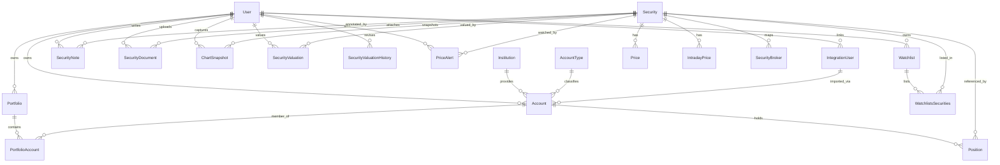
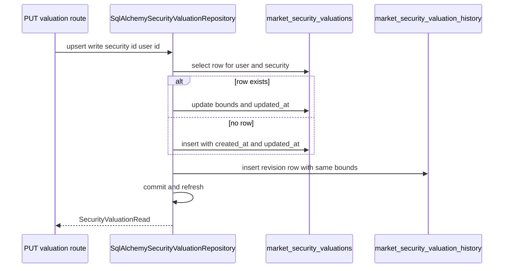
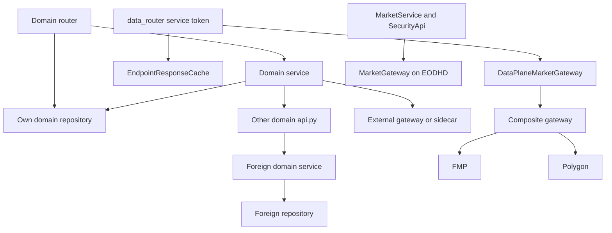

# Backend Domains, Layers & Route Map

The backend under `src/` is organized by business domain. Each domain is self-contained and communicates with other domains only through public APIs; the layered structure itself is described in [Architecture Overview](./overview.md), the identity stack in [Authentication & Authorization](./authentication.md), settings/DI wiring in [Configuration](./configuration.md), the asynchronous runtime in [Realtime, Background Jobs & the Worker](../workflows/realtime-and-background-jobs.md), the per-user preference contract in [User Preferences](../concepts/user-preferences.md), and the market provider layer in [Market Data Plane](./market-data-plane.md). This page is the per-domain catalog.

Inside a domain the call direction is one-way: **router → api (or service) → repository → model**. A router validates the request with a schema and delegates; a service orchestrates repositories and *other* domains' APIs; repositories always return schemas, never ORM models; models exist only to generate migrations and are never returned to a client.

Routers are mounted in `src/main.py` under a single `APIRouter(prefix="/api/v1")`, so every domain path below is relative to `/api/v1`: account (`account_router`, `portfolio_router`), auth, integration (`institutions_router`, `integration_router`), the user-JWT `market_router`, and the service-token `data_router`. The WebSocket and worker-dashboard routers are mounted outside that prefix. The frontend `apiClient` hard-codes the same `/api/v1` base. The market domain is the one domain with **two** serving surfaces, distinguished by authentication rather than by path nesting: `/market/...` is user-JWT, `/market/data/...` is service-token (see [market](#market)).

The app lifespan resolves `DataPlaneMarketGateway` eagerly at boot, before serving traffic, so a missing provider key or a broken gateway registration fails at startup rather than on the first data-plane request.

## Shared conventions

- **Models** live in `model.py` and inherit from `BaseModel` (`src/config/database.py`); they generate Alembic migrations and are never returned to clients. A route returns a `*Read` schema, never an ORM model.
- **Schemas** live in `schema.py`. Repositories and services exchange schemas, never ORM models.
- **Public API types** live in `api_types.py` and are the only types that may cross a domain boundary. A service that needs another domain's data imports that domain's API type, not its `schema.py`.
- **Repositories** define abstract interfaces in `repository.py` and SQLAlchemy implementations in `repository_sqlalchemy.py`. Alternative implementations use `repository_<impl>.py` (for example `repository_eodhd.py`).
- **Services** hold orchestration and calculations; routers delegate to them and must never reach into a *foreign* domain's repositories. Using the router's own domain repositories directly is allowed and is what the market watchlist, alert, note, document, snapshot and valuation routes do — there is no service layer between them and their repository.
- **Exceptions** inherit from `src.core.exception.EntityNotFoundError` or `AuthorizationError` so `src/main.py` can map them to a consistent HTTP status. Domain errors that are not entity/authorization errors are handled explicitly in the router.
- **MANDATORY:** editing a backend model requires a matching Alembic revision shipped in the same change, and every migration file MUST follow the `<hash>_<description>.py` naming convention under `migrations/versions/` (`alembic.ini` sets `script_location = migrations`; autogenerate with `uv run alembic revision --autogenerate -m "message"`; for manual SQL, create a standard revision and use `op.execute()` inside it). `src/main.py` upgrades to `head` at startup except when `settings.environment == "test"`. `migrations/versions/4c2ed77e7738_add_watchlist_sort_membership_added_at_.py` is the worked example of a model change plus its backfill; `migrations/versions/3436586a755f_create_security_valuations.py` and `migrations/versions/b291707f24ca_add_market_security_valuation_history.py` are the plain `create_table` examples for the newer market tables.
- Backend commands run inside Docker (`docker compose exec backend …`), and tests must mock every outbound client — no Redis, HTTP, SMTP or DNS dependency. See [Testing](../operations/testing.md).

## Invariants

Three rules hold across every domain. They are the ones a plausible-looking change breaks first, so treat them as hard constraints rather than style preferences:

1. **No cross-domain repository imports.** A service that needs another domain's data imports that domain's `api.py` (and its `api_types.py` for types), never its `repository.py`/`repository_sqlalchemy.py`/`schema.py`. `PositionService` depending on `MarketPricesApi` and `SecurityApi` instead of `SecurityRepository` is the canonical example; the only permitted direct repository reach is a router to its **own** domain's repository, the router-only pattern described next.
2. **`repository_*.py` means "alternative backend", not "a second copy".** `repository.py` holds the abstract contract, `repository_sqlalchemy.py` the default implementation, and a `repository_<impl>.py` (for example `repository_eodhd.py`) may be registered *instead of* the SQLAlchemy factory behind the same ABC. It may decorate the SQLAlchemy implementation (as `EodhdPriceRepository` does) but must satisfy the identical contract and be swappable through the registry alone.
3. **Every model edit ships with its Alembic revision in the same change.** A model change without a matching `<hash>_<description>.py` under `migrations/versions/` is an incomplete change — see the MANDATORY bullet above for the exact workflow, and `migrations/versions/af3e12e490b4_add_broker_value_to_accounts.py` for a minimal recent example.

## Router-only repositories and the ownership/error taxonomy

Not every feature earns a service layer. Inside the market domain, six per-user resources are thin enough that the router talks to the repository directly: **watchlists** (`WatchlistRepository`), **price alerts** (`PriceAlertRepository`), **security notes** (`SecurityNoteRepository`), **security documents** (`SecurityDocumentRepository`), **chart snapshots** (`ChartSnapshotRepository`), and **security valuations** (`SecurityValuationRepository`). Each is an ABC in `src/market/repository.py` with a `SqlAlchemy*` implementation plus a `sqlalchemy_*_repository_factory` registered in `register_market_services`, and the router resolves it with `services.aget(<Abc>)`. There is no `WatchlistService`, `ValuationService`, and so on.

That shortcut is safe only because the repositories themselves carry the rules a service would otherwise hold:

- **`user_id` is a parameter on every method that touches a user-owned row.** No route passes a client-supplied user id: the handler takes `user.id` from `current_user` and threads it down, so cross-user reads and writes are impossible by construction rather than by an explicit ownership check.
- **A resource that is missing *or* owned by another user is reported identically.** Watchlists raise `WatchlistNotFoundError` in both cases (`_get_owned` filters on `id` *and* `user_id`), and `EntityNotFoundError` maps to a global HTTP 404 in `src/main.py`, so a caller cannot probe whether someone else's id exists. `AuthorizationApi.check_entity_owned_by_user` implements the same policy for the domains that do use it.
- **Errors the router must translate are deliberately *not* `EntityNotFoundError`s.** `WatchlistDuplicateNameError` and `WatchlistOrderIdentityError` extend plain `Exception` (`src/market/exception.py`) precisely so the global handler does not swallow them into a 404; the routes catch them and return 409 and 422 respectively. `SecurityNotFoundError` *is* an `EntityNotFoundError` and correctly becomes a 404.
- **A mutating route proves ownership even when the payload changes nothing.** `PATCH /market/watchlists/{watchlist_id}` with an empty payload re-reads the user's watchlists and raises `WatchlistNotFoundError` when the id is absent.

The full watchlist ownership/error taxonomy is spelled out in [Watchlists](#watchlists) below; the same shape applies to alerts, notes, documents, snapshots and valuations.

## Entity model

The core entities across domains, and how they reference each other:

*Cross-domain entity relationships: user-owned aggregates fan out from `User`, while every market table except account positions holds a real foreign key to `Security`.*

`SecurityBroker` stores the broker symbol/exchange mapping plus the raw EODHD search results used to resolve it. Every market-owned table references `market_securities.id` with a real foreign key; the one cross-domain exception is `account_positions.security_id` in the account domain, which is a plain UUID column so positions can point at a security without a database-level constraint across domains.

The watchlist membership association is an entity in its own right rather than a bare join table: `market_watchlists_securities` carries `added_at` and an application-managed `position`, and `market_watchlists` carries the persisted `sort` mode.

`market_security_valuation_history` is a revision log rather than a child of `market_security_valuations`: it has no foreign key to the current-value table and is correlated to it only by the `(user_id, security_id)` pair it shares, while its own `security_id` cascades from `market_securities`. So deleting a security removes both its current range and its whole revision history, but the two tables are otherwise independent rows.

## account

`src/account` manages accounts, positions, portfolios, institutions, account types, the templated CSV import path, and the per-user preferences endpoints. The user-facing CSV walkthrough lives in [CSV import](../workflows/csv-import.md) and the preferences contract in [User Preferences](../concepts/user-preferences.md).

### Models (source: `src/account/model.py`)

| Entity | Table | Key fields | Notes |
|--------|-------|------------|-------|
| `AccountModel` | `accounts` | `id: UUID`, `external_id`, `integration_user_id` (FK `integration_users.id`, nullable), `name`, `user_id`, `account_type_id`, `institution_id`, `currency`, `broker_display_name`, `net_deposits`, `free_cash`, `broker_value`, `broker_value_at`, `is_active`, `api_sync_enabled`, `last_sync_at`, `created_at`, `updated_at`, `deleted_at` | Unique on `(user_id, institution_id, external_id)` |
| `AccountTypeModel` | `account_types` | `id`, `name`, `country`, `tax_advantaged`, `is_active` | Unique on `(name, country)`; reference data seeded by `src/commands/seed.py` |
| `InstitutionModel` | `account_institutions` | `id`, `name`, `country`, `website`, `is_active`, `integration_enabled`, `csv_import_enabled`, `csv_format` | Unique on `(name, country)`; `csv_format` is the positional column template (see below) |
| `PositionModel` | `account_positions` | `id: int`, `account_id`, `security_id: UUID`, `quantity: DECIMAL(16,8)`, `average_cost` (Float, nullable), `currency(3)`, `updated_at` | Unique on `(account_id, security_id)` |
| `PortfolioModel` | `portfolios` | `id: UUID`, `user_id`, `name`, `created_at`, `updated_at`, `deleted_at` | Unique on `(user_id, name)` |
| `PortfolioAccountModel` | `portfolio_accounts` | `portfolio_id`, `account_id` (composite PK), `created_at` | Many-to-many association |

`AccountModel` cascades `all, delete-orphan` to both `positions` and `portfolio_accounts`; `PortfolioModel` cascades the same way to its `portfolio_accounts`.

Cash is an **account attribute**, not a position: `free_cash` (default `0.0`) is what the CSV parser and the broker sync write, and the totals computation folds it into both sides of cost and value. `broker_value`/`broker_value_at` hold the broker-reported present value and the moment it was read; they are stored for reconciliation, not as a computed field (`migrations/versions/af3e12e490b4_add_broker_value_to_accounts.py`).

### The `csv_format` template contract

`InstitutionModel.csv_format` is a comma-separated, positional template string that maps each column of a broker's CSV export to a standardized placeholder. The documented vocabulary is `{account_name}`, `{account_type}`, `{account_classification}`, `{account_number}`, `{symbol}`, `{exchange}`, `{mic}`, `{name}`, `{security_type}`, `{quantity}`, `{position_direction}`, `{market_price}`, `{market_price_currency}`, `{book_value_cad}`, `{book_value_currency_cad}`, `{book_value}`, `{currency}`, `{market_value}`, `{market_value_currency}`, `{market_unrealized_returns}`, `{market_unrealized_returns_currency}`. `GenericCsvParser` normalizes both the template and the file header to lowercase snake_case, validates the header count and each position against alias sets, and raises a specific `CsvParserError` subclass on mismatch.

Row classification is deliberately conservative and lives in small pure helpers so it can be unit-tested: `is_cash_row` returns `False` for the equity-like security types (`exchange_traded_fund`, `etf`, `equity`, `stock`, `mutual_fund`) and `True` for a blank symbol, a `cash`/`currency` security type, a `cash`/`cad`/`usd` symbol, or a `sec-c-*` symbol; `is_option_row` matches an OCC-style symbol (`is_option_symbol`) or an `option`/`derivative` security type; `is_option_symbol` is also what `CsvAccountService.sync_account_csv_positions` re-checks before resolving a security. Cash rows are dropped from the position list and accumulate into the discovered account's `free_cash` (from quantity, market value or book value, in that order), option rows are dropped, and `average_cost` is `book_value / quantity` quantized to 4 decimals with `ROUND_HALF_UP` — `None` rather than an error when quantity is zero or negative, or when book value is absent.

`CsvAccountService.validate_csv_institution` is the gate: an institution without `csv_import_enabled` or without a `csv_format` raises `CsvImportDisabledError`, so the template is the only per-institution configuration the parser needs.

### Public APIs (source: `src/account/api/`)

- `AccountApi` (`account.py`): `get_all`, `get_by_id`, `get_broker_id_by_id`, `rename`, `update_net_deposits`, `update_free_cash`, `update_broker_value`, `update_last_sync_at`, `import_from_broker`. `import_from_broker` skips accounts that already exist for `(user_id, broker_id)` and maps `BrokerAccount` through `AccountSchema.from_broker`.
- `PositionApi` (`position.py`): `create(positions)` groups by `account_id` and delegates to `PositionRepository.sync_by_account`.
- `InstitutionApi` (`institution.py`): `get_all_enabled_integrations` returns integration-enabled institutions as `Institution` API types.

### Services (source: `src/account/service/`)

- `AccountService` (`account.py`): get, ownership/`check_accounts_belong_to_user`, delete.
- `PositionService` (`position.py`): `sync_account_positions`, `get_total_for_account`, `get_account_holdings`, `get_holdings_by_security`, `get_user_holdings`, plus the `_account_performance`/`_calculate_holdings`/`_calculate_holding`/`_unpriced_holding`/`_currency_convert` helpers. It depends on `MarketPricesApi` and `SecurityApi` (market), `IntegrationAccountApi`/`IntegrationUserApi` (integration), and `FxRateProvider.converter()` (market) for FX — it no longer constructs `CurrencyConverter()` itself.
- `PortfolioService` (`portfolio.py`): CRUD and account-membership sync with ownership validation.
- `CsvAccountService` (`csv_account.py`): `inspect_csv`, `import_accounts`, `sync_account_from_csv`, `sync_account_csv_positions`. It resolves every position through `SecurityApi.get_or_create_from_broker`, wraps failures in `SecurityResolutionError`, and stamps `update_last_sync_at`.

### Background task (source: `src/account/task.py`)

`recalculate_all_account_totals_task` iterates active accounts, recomputes totals through `PositionService`, and emits an `AccountTotalsUpdatedMessage` over the WebSocket manager. It is enqueued at the end of the hourly market job (see the market background tasks below), and per-account failures are logged and skipped so one bad account cannot abort the sweep.

### Router (source: `src/account/router.py`)

`portfolio_router` (prefix `/portfolios`):

- `GET /` — portfolios for the current user
- `POST /` — create
- `PUT /{portfolio_id}/accounts` — sync portfolio account membership (validates every account belongs to the user)
- `PATCH /{portfolio_id}` — rename
- `DELETE /{portfolio_id}` — delete (204)

`account_router` (prefix `/accounts`):

- `GET /` — accounts for the current user
- `GET /sync-status` — `{"account_ids": [...]}` for accounts with an active sync job, read from Redis (`account_syncs:active:<user_id>`); returns 503 on `redis.RedisError`
- `GET|PUT|PATCH /me/preferences` — per-user chart preferences stored on `auth_users.preferences` via `UserApi`. GET returns `{}` when nothing is saved; PUT replaces with `model_dump(exclude_none=True)`; PATCH merges (JSONB `||`) and returns the merged document. The full read/write matrix for every key lives in [User Preferences](../concepts/user-preferences.md).
- `POST /csv/inspect` — multipart upload, returns `CsvDiscoveredAccount` previews with `exists`/`currency` filled for accounts the user already has
- `POST /csv/import` — multipart upload of selected `account_numbers` with optional `currencies` JSON map
- `POST /{account_id}/csv-sync` — re-import one existing account from a CSV export
- `PATCH /{account_id}/rename`, `DELETE /{account_id}` (204)
- `GET /{account_id}/totals` — optional `currency` query param, validated against `SUPPORTED_DISPLAY_CURRENCIES` (`CAD`, `USD`, `EUR`, `GBP`) with 422 otherwise; defaults to the account's own currency
- `GET /holdings` (user-wide holdings across every account, `PaginatedResponse[UserHoldingRead]`), `GET /holdings/{security_id}`, `GET /{account_id}/holdings`
- `POST /{account_id}/sync` — rate-limited `3/minute`; enqueues broker position sync and returns `{"accepted": true}`

`POST /csv/inspect` and `POST /csv/import` accept `institution_id` either as a multipart `Form` field or as a query parameter with the same alias; `csv/import` additionally accepts `account_numbers` and `currencies` (both form-or-query), and both `csv/import` and `POST /{account_id}/csv-sync` accept `net_deposits`. `institution_id` and `account_numbers` are required (422 otherwise). Account numbers accept a JSON list string, a comma-separated string, or repeated values, deduplicated in order. `net_deposits` is parsed strictly as a `{account_number: number | null}` JSON object: malformed JSON, a non-object, or a non-numeric value is a 422 rather than a silent drop, because dropping an amount would quietly change the P/L basis. `POST /{account_id}/csv-sync` takes only a `net_deposits` form field — the account and institution come from the path and the stored account. Every account-scoped route (`csv-sync`, `rename`, `delete`, `totals`, `holdings`, `sync`) resolves the account, runs `AuthorizationApi.check_entity_owned_by_user`, then acts.

### Business rules

- Account identity is `(user_id, institution_id, external_id)`.
- `api_sync_enabled=False` accounts (CSV-imported ones) refuse `POST /{account_id}/sync` with 400 and `PositionService.sync_account_positions` raises `ApiSyncDisabledError`; accounts with `integration_user_id IS NULL` are a silent no-op.
- Position sync is a full replace: `sync_by_account` deletes all rows for the account then re-inserts, so partial syncs cannot leave stale holdings.
- Holdings and totals are computed in the security/position currency and then converted to the account currency; values round-trip through `stockholm.Money`. Money semantics are covered in [Money and currency](../concepts/money-and-currency.md).
- **P/L is computed against an explicit basis.** `_account_performance` uses `net_deposits` as the basis when they are set (`basis = "net_deposits"`, `profit_loss = value - net_deposits`) and falls back to the positions cost basis otherwise (`basis = "cost"`); `return_percent` is `None` whenever the denominator is zero. `AccountTotals` therefore carries `cost`, `value`, `cash`, `net_deposits`, `profit_loss`, `return_percent`, `basis`, `unpriced_positions` and `pricing_incomplete` rather than a single profit/loss number.
- `free_cash` is converted to the requested currency and folded into **both** cost and value, so cash moves the total without creating artificial P/L.
- **Unpriced positions degrade rather than lie.** A position whose security cannot be resolved is logged, skipped and counted; a position whose security has no stored price is still returned as a row (`total_value=0`, `profit_loss=None`) but excluded from value, cost and P/L. Both increment `unpriced_positions`, and `pricing_incomplete` is `unpriced_positions > 0`, so a totals read can say "this understates the account" instead of silently under-reporting.
- **Currency display is split from currency storage.** Holding rows carry `total_value`/`currency` in the account currency plus `display_total_value`/`display_currency`; account-scoped holdings default the display currency to the account currency, while user-wide holdings pass the user's `display_currency` preference (default `CAD`) so cross-currency rows can be aggregated without adding unlike currencies.
- `get_holdings_by_security` returns an empty list and a zero total when the security itself cannot be resolved, and each row's `account_percentage` is only computed when that account's total is greater than zero (a TODO notes the empty-list case is ambiguous with "no holdings").

## auth

`src/auth` owns users, credentials, sessions, and resource authorization. The deep dive — token inventory, TOTP/passkey ceremonies, Redis challenge state, SSR guard — lives in [Authentication & Authorization](./authentication.md); this section only records the domain surface.

### Models (source: `src/auth/model.py`)

| Entity | Table | Notes |
|--------|-------|-------|
| `UserModel` | `auth_users` | `id: UUID`, unique indexed `email`, `_password_hash` (argon2 via the `password` property), `is_active`, `is_verified`, `last_login_at`, `preferences` (JSON), `created_at` |
| `VerificationTokenModel` | `auth_verification_tokens` | `id: str`, indexed `user_id`, unique `token`, `expires_at`, `is_used` |
| `TotpModel` | `auth_totp` | Unique per `user_id`, `secret`, `is_verified`, `ondelete="CASCADE"` |
| `RecoveryCodeModel` | `auth_recovery_codes` | `code_hash` (argon2), `is_used`, `used_at`, cascade on user delete |
| `PasskeyModel` | `auth_passkeys` | Unique indexed `credential_id`/`public_key` (LargeBinary), `sign_count`, `name`, `transports` (JSON), cascade on user delete |

### APIs and services (source: `src/auth/api.py`, `src/auth/service.py`)

- `UserApi`: `signup`, `login` (returns either `AuthResponse` or `LoginChallengeResponse`), `create_access_token`, `create_mfa_token`/`verify_mfa_token`, `get_current_user_from_token`, `verify_email`/`resend_verification`, `revoke_token`, `update_last_login`, plus preference `get_/save_/patch_preferences` and `get_email_for_user`.
- `AuthorizationApi.check_entity_owned_by_user(user, entity, field="user_id")`: raises HTTP 404 (not 403) when the entity is missing or not owned, deliberately hiding existence.
- `EmailVerificationService`, `TotpService`, `PasskeyService` hold the verification, TOTP, and WebAuthn logic.
- FastAPI dependencies: `get_token` (cookie `auth_token` or OAuth2 bearer header), `current_user`, and `require_service_token` — the service-to-service guard that reads only the `X-Service-Token` header and constant-time-compares it against `settings.market_data_service_token` (401 otherwise, no cookie fallback). It is deliberately independent of user JWT auth; it is the auth of the market `data_router`.

### Router (source: `src/auth/router.py`, prefix `/auth`)

- `POST /signup` (`5/minute`), `POST /login` (`10/minute`), `POST /logout`
- `POST /2fa/login-verify` (`10/minute`) — exchanges a `mfa_pending` JWT plus a TOTP code for an access token
- `POST /verify-email`, `POST /resend-verification` (`3/minute`)
- `POST /ws-ticket` — signed 30-second, single-use WebSocket ticket
- `GET /2fa/status`, `POST /2fa/totp/setup|activate|disable`, `POST /2fa/totp/recovery-codes/regenerate`
- `POST /passkey/register/options|verify`, `GET /passkeys`, `DELETE|PATCH /passkeys/{passkey_id}`, `POST /passkey/authenticate/options|verify`

Login and 2FA verification set the `httponly`/`secure` `auth_token` cookie (7-day `max_age`) in production; the passkey authentication endpoint does the same and updates `last_login_at`.

## market

`src/market` manages securities, daily and intraday prices, watchlists, price alerts, security notes, documents, chart snapshots, per-user security valuations, technical indicators, AI analysis, FX rates, and the provider-agnostic market data plane. The data-flow walkthrough lives in [Market data and indicators](../workflows/market-data-and-indicators.md); the valuation feature has its own page at [Security Valuations](../concepts/security-valuation.md); the provider layer has its own page at [Market Data Plane](./market-data-plane.md).

### Two serving surfaces

The market domain answers two different callers, and the split is by authentication, not by feature area:

| | `market_router` | `data_router` |
|---|---|---|
| Prefix | `/market` | `/market/data` |
| Auth | `current_user` (user JWT cookie or bearer) on every route | `require_service_token` — shared secret in the `X-Service-Token` header compared with `secrets.compare_digest`, with no cookie fallback |
| Consumers | the SPA | trusted services (the Go MCP gateway) |
| Data source | the domain's repositories, plus `MarketGateway` (EODHD) for search and the legacy price flows | `DataPlaneMarketGateway` — the composed FMP/Polygon gateway |
| Caching | `SecuritySearchCache`, `IndicatorCache`, `LogoCache` and per-feature Redis keys | `EndpointResponseCache` (`market:ep`) is the single canonical cache for every route |
| Errors | domain errors mapped per route (`EntityNotFoundError` → 404 globally) | `MarketDataNotFoundError` → 404, `MarketDataConfigurationError` → 503, any other provider failure → 502, never naming the provider |

`data_router` (`src/market/data_router.py`) serves, all through `EndpointResponseCache`:

- `GET /prices/{symbol}` — `from`, `to`, `interval` (`1d|1w|1m|1h|4h`), `exchange`; daily bars are aggregated in-process and every price-bearing response carries a required top-level `currency`
- `GET /quote/{symbol}` — live quote snapshot (`exchange` optional)
- `GET /indicators/{symbol}` — `indicator` (`sma|ema|rsi|macd|bollinger`), `period`, `fast`, `slow`, `signal`, `std_dev`, `from`, `to`, `exchange`; candles are fetched with a warm-up window (three times the longest lookback) and computed by the Go indicator sidecar
- `GET /symbols/search` — `q`
- `GET /options/{symbol}` — `expiry` (required), `option_type`, `strike_min`, `strike_max` (422 when `strike_min > strike_max`), plus `GET /options/{symbol}/expirations`
- `GET /fundamentals/{symbol}` — canonical `profile` plus nullable `key_metrics` and `ratios`
- `GET /fundamentals/{symbol}/statements` — `statement` (`income|balance|cashflow`), `period` (`annual|quarter`), `limit`, `exchange`

The paths and query parameter names are a **stable contract for the MCP gateway**: do not rename them. `tests/market/contracts/data_plane_openapi.json` is a committed OpenAPI artifact diffed against the live FastAPI schema, so adding, renaming or re-parameterizing a data-plane route fails that test until the artifact is regenerated (`UPDATE_CONTRACTS=1` or `uv run python -m src.commands.export_data_plane_contract`).

The data plane is synchronous underneath: `MarketGateway` reads are blocking provider HTTP, so every `data_router` handler bridges them with `asyncio.to_thread` and gathers independent reads (prices plus listing currency) with `asyncio.gather`. `resolve_listing_currency` resolves a symbol's currency from the company profile and falls back to a deterministic exchange map (`TSX → CAD`, `LSE → GBX`, US or unknown → `USD`), caching the result under the `metrics`/`listing_currency` cache entry.

**Gateway bindings.** `MarketGateway` and `DataPlaneMarketGateway` are two svcs registration keys over the same ABC. `MarketGateway` stays bound to EODHD (`eodhd_gateway_factory`) so existing price-fetch flows (`EodhdPriceRepository`, `MarketService`, `SecurityApi` broker resolution) are untouched; `DataPlaneMarketGateway` is a behaviour-free subclass that exists only to give the provider-agnostic data plane a distinct key and resolves `composite_market_gateway_factory`. The composite routes prices, search, symbol lookup and every fundamentals capability to FMP and options chains to Polygon, adds no caching of its own (the cache sits above it), and releases both provider HTTP clients when its container is torn down. Both keys are registered in the live `register_market_services` and in the stub `register_market_stub_services` in `src/config/services.py`, so `settings.stub_external_api` swaps the providers but never the key layout.

### Models (source: `src/market/model.py`)

| Entity | Table | Key fields | Notes |
|--------|-------|------------|-------|
| `SecurityModel` | `market_securities` | `id: UUID`, `symbol`, `exchange`, `currency`, `name`, `isin`, `is_active`, `updated_at` | Unique `(symbol, exchange)` as `symbol_exchange_unique` |
| `SecurityBrokerModel` | `market_securities_broker` | `id: BigInteger`, `institution_id`, `broker_symbol`, `broker_exchange`, `broker_name`, `mapped_symbol`, `mapped_exchange`, `security_id` (FK), `search_results` (JSON), `created_at` | Indexed on `(institution_id, broker_symbol, broker_exchange)` |
| `PriceModel` | `market_prices` | `security_id` (FK), `date`, OHLC + `adjusted_close` as `DECIMAL(16,8)`, `volume` | Unique `(security_id, date)` |
| `IntradayPriceModel` | `market_intraday_prices` | `security_id` (FK), `timestamp: timestamptz`, OHLCV | Unique `(security_id, timestamp)`; 1-hour candles |
| `WatchlistModel` | `market_watchlists` | `id: UUID`, `user_id`, `name`, `sort` (`server_default="custom"`), `securities` relationship via `lazy="selectin"` | Unique `(user_id, name)`; the user's default list is the one literally named `"Default"` |
| `WatchlistsSecuritiesModel` | `market_watchlists_securities` | composite PK, `added_at`, `position` (application-managed), `ondelete="CASCADE"` both sides | Many-to-many with membership metadata; read paths query the association explicitly because a `secondary` relationship cannot order by or carry these columns |
| `PriceAlertModel` | `market_price_alerts` | `security_id` (FK, cascade), `user_id`, `target_price`, `condition`, `source` (default `manual`), `triggered_at`, `created_at` | Null `triggered_at` = active |
| `SecurityNoteModel` | `market_security_notes` | `security_id` (FK, cascade), `user_id`, nullable `title`, `content`, timestamps | Title filled asynchronously by AI |
| `SecurityDocumentModel` | `market_security_documents` | `security_id` (FK, cascade), `user_id`, `filename`, `file_path`, `file_size`, `file_type` | File bytes under `settings.upload_path` |
| `ChartSnapshotModel` | `market_chart_snapshots` | `id: UUID`, `security_id` (FK, cascade), `user_id`, `drawings` (JSON), `data_window` (JSON), `captured_at`, `created_at` | Indexed `(security_id, user_id, captured_at)` |
| `SecurityValuationModel` | `market_security_valuations` | `id: int`, `user_id`, `security_id` (FK, cascade), `lower_bound`/`upper_bound` as `DECIMAL(16,8)`, `created_at`, `updated_at` | Unique `(user_id, security_id)` as `valuation_user_security_unique`; index `ix_market_security_valuations_user_security` |
| `SecurityValuationHistoryModel` | `market_security_valuation_history` | `id: int`, `user_id`, `security_id` (FK, cascade), `lower_bound`/`upper_bound` as `DECIMAL(16,8)`, `created_at` | Append-only revision log; index `ix_market_security_valuation_history_user_security_created` on `(user_id, security_id, created_at)`; no unique constraint, so one row per write |

`src/market/enum.py` holds `PriceInterval` (`1h`, `4h`, `1d`, `1w`, `1m`) and `WatchlistSortMode` (`custom`, `name_asc`, `price_change_desc`, `price_change_asc`, `date_added`, `date_added_asc`).

### Public APIs (source: `src/market/api.py`)

- `MarketPricesApi`: `get_latest_close` (returns `Money | None`) and `get_latest_price` (returns `PriceSchema | None`).
- `SecurityApi`: `get_by_id`, `get_or_create_from_broker`, `create_or_get_from_search`.
  - `get_or_create_from_broker` checks `SecurityBrokerRepository` for an existing mapping, otherwise maps the broker symbol (`.` → `-`) and exchange (`CSE→CA`, `TSX→TO`, `NYSE→US`, `NASDAQ→US`), searches EODHD through `SecuritySearchCache`, takes the first result, upserts the security, warms prices via `MarketPricesApi.get_latest_close`, and persists the mapping with the raw search results. Zero search results raise `ValueError`.
  - `create_or_get_from_search` returns `has_price_data` for existing securities and calls `MarketService.fetch_and_save_price_history` for new ones.

### Services and supporting modules (source: `src/market/service.py`, `ai_service.py`, `alert_service.py`, `indicators.py`, `cache.py`, `fx.py`, `endpoint_cache.py`)

- `MarketService`: `update_daily_prices_for_all_securities` (one-year window, `asyncio.gather`, returns success/failure counts), `update_intraday_prices_for_all_securities` (7-day window), `fetch_and_save_intraday_prices`, `fetch_and_save_price_history` (2000-01-03 → today). Gateway calls are pushed through `asyncio.to_thread` and per-security failures are swallowed so one bad symbol cannot abort a batch.
- Module-level aggregation helpers, also exposed as `PriceAggregationService` static methods: `aggregate_weekly_prices` (ISO week buckets), `aggregate_monthly_prices`, `aggregate_4h_candles` (4-hour buckets of 1h candles), and `convert_to_heikin_ashi`.
- `IndicatorServiceClient`: HTTP client for the external Go indicator sidecar at `settings.indicator_service_url`, posting `{interval, candles, indicators}` to `/compute`. It maps timeouts to 504, connect/network errors to 503, upstream 400s to 400, upstream 5xx to 503, and unwraps an `indicators` envelope. Registered as a request-scoped async-generator factory so it owns and closes its own `httpx.AsyncClient`.
- `AIService`: wraps `AsyncOpenAI` against `ai_api_endpoint`/`ai_api_key`/`ai_api_model`; `_gather_context` collects the security, latest price, the user's notes, and ~90 days of closes. Public methods: `analyze_fundamentals`, `summarize_notes`, `generate_note_title`, `analyze_portfolio_fit`.
- `AlertEvaluationService`: pure `evaluate(active_alerts, latest_prices)` plus `dispatch_alert_email` used by the staged alert pipeline.
- `IndicatorCache` (Redis, 1 h TTL) and `SecuritySearchCache` back indicator computation and EODHD search respectively; the indicator cache key includes a canonical digest of the indicator specs and normalized date bounds.
- `indicators.py`: SMA/EMA style 50/200 day and 50/200 week MAs, MACD, RSI.
- `FxRateProvider` (`fx.py`): builds a `CurrencyConverter` from a daily ECB snapshot stored in Redis (`fx:ecb:zip`, `fx:ecb:fetched_at`) by the `daily_fx_refresh` Huey task, caches the parsed converter per fetch date at module level (providers are request-scoped, so an instance cache would re-parse the CSV per request), warns once the freshest rate is more than three business days old, and falls back to the package's bundled snapshot when Redis is empty or unreachable. `PositionService` gets its converter through it, so FX rates refresh without a redeploy.
- `EndpointResponseCache` (`endpoint_cache.py`): the data plane's single cache layer under the `market:ep` prefix, keyed by data class, endpoint and a canonical hash of the request parameters. TTLs come from the per-data-class settings (`endpoint_ttl_prices_seconds`, `…_statements_…`, `…_metrics_…`, `…_options_…`, `…_search_…`, `…_quotes_…`, default 3600) and are read at call time; a provider-reported miss is negative-cached for `endpoint_ttl_negative_seconds` so a re-read returns the same 404 instead of burning upstream quota; every Redis failure degrades to a live fetch.
- `currency.py`: `resolve_listing_currency` / `normalize_currency` produce the canonical listing currency (including pence as `GBX`) used by every price-bearing data-plane response.
- `price_aggregation.py`: the data plane's `PriceInterval`, `aggregate_bars` and `resolve_price_range` helpers — the interval aggregation the service-to-service routes use instead of the price repository's in-process helpers.
- Provider clients: `eodhd.py` (legacy `MarketGateway`), `fmp.py` (prices, search, symbol lookup, fundamentals, institutional ownership, quotes), `polygon.py` (options), and `composite.py` (the capability router). See [Market Data Plane](./market-data-plane.md).

### Background tasks (source: `src/market/task.py`)

The market domain owns the scheduled pipeline, and the schedule is where its cross-domain edges live:

- `daily_price_update` (`crontab(hour="0", minute="0")`) runs `MarketService.update_daily_prices_for_all_securities`.
- `hourly_intraday_price_update` (`crontab(minute="0")`) runs the 1-hour intraday update and then enqueues `recalculate_all_account_totals_task` (account domain) and `check_and_dispatch_price_alerts` in two separate try/except blocks, so failing to enqueue one cannot abort the other.
- `check_and_dispatch_price_alerts` is stage 2: it loads the active alerts (`triggered_at IS NULL`), reads the latest intraday close per security in a single query, delegates evaluation to `AlertEvaluationService.evaluate`, and enqueues `alert_email_dispatch_task(alert_id, run_ts)` per triggered alert — isolated per alert, so one enqueue failure does not drop the rest.
- `alert_email_dispatch_task` (`retries=3`) is stage 3: it delegates to `AlertEvaluationService.dispatch_alert_email`, which sends the mail and marks the alert triggered; a transient SMTP or DB failure is retried before giving up.
- `daily_fx_refresh` (`crontab(hour="17", minute="30")`, interpreted in UTC, i.e. after the ECB publishes reference rates) downloads the ECB history into Redis for `FxRateProvider`.
- `generate_note_title_task` is the on-demand AI title job the note routes enqueue.

### Read-through price repository (source: `src/market/repository_eodhd.py`)

`EodhdPriceRepository` wraps the SQLAlchemy `PriceRepository` and the `MarketGateway`. `get_prices` merges DB rows with fresh EODHD rows (EODHD wins per date) and persists the union; `get_latest_price` only refetches when the stored close predates the last NYSE trading day (computed with `holidays.NYSE()`); `get_price_on_date` falls back to EODHD and saves the result. `save_price`/`save_prices` deliberately raise `NotImplementedError` — writes must go through the inner DB repository or `MarketService`. It is the registered `PriceRepository` in both stub and live service registration, and its factory builds the EODHD gateway directly (`eodhd_gateway_factory()`) rather than resolving the `MarketGateway` key, so the legacy price path can never accidentally pick up the composed data-plane gateway.

### Router (source: `src/market/router.py`, prefix `/market`)

Requires `current_user` on every route. Endpoint surface:

- `GET /prices/{security_id}/last-close`
- `GET /prices/{security_id}` — `interval` ∈ `1d|1w|1m|1h|4h`. Daily/weekly/monthly require `from_date` and `to_date` (422 otherwise) and aggregate in-process; intraday reads `market_intraday_prices` and lazily backfills via `MarketService.fetch_and_save_intraday_prices` when the window is stale.
- `GET /search` and `GET /securities/search` — EODHD search, cached
- `GET /securities/{security_id}`, `POST /security` (create-or-get)
- `GET /logo` (`symbol`, `exchange`) and `GET /securities/{security_id}/logo` — PNG bytes proxied from FMP through `LogoCache`, with a negative sentinel so a missing logo is a cached 404 and a one-week `Cache-Control`
- `GET /securities/{security_id}/institutional-ownership` — FMP institutional-ownership summary plus quarterly history, read through `DataPlaneMarketGateway` on a thread, Redis-cached for 24 h under `market:institutional_ownership:{security_id}`. The route is a user route that reads through the data-plane gateway: it resolves the security from the repository first (unknown id → 404) and then calls the gateway with the security's symbol and exchange. Both a `MarketDataNotFoundError` and a `MarketDataProviderError` degrade to an **empty payload** (`current_ownership_percent`, `investors_count` and `total_invested` all `None`, `history: []`) with the symbol echoed back, and only the provider error skips the cache write — so a provider outage is never cached but a genuine "no data for this symbol" is.
- Watchlists: `GET /watchlists` (each item embeds its securities), `POST /watchlists` (201), `PATCH /watchlists/{watchlist_id}` (rename and/or change the sort mode), `DELETE /watchlists/{watchlist_id}` (204), `GET /watchlists/{watchlist_id}/securities` (paginated), `POST|DELETE /watchlists/{watchlist_id}/securities/{security_id}`, `PUT /watchlists/{watchlist_id}/securities/order` (full manual-order replacement), and the default-watchlist shortcuts `POST|DELETE /watchlists/securities/{security_id}`
- `GET|POST /securities/{security_id}/alerts`, `DELETE /securities/{security_id}/alerts/{alert_id}`
- `GET|POST /securities/{security_id}/notes`, `PUT|DELETE /securities/{security_id}/notes/{note_id}`
- `GET|POST /securities/{security_id}/documents`, `DELETE /securities/{security_id}/documents/{doc_id}`
- `GET|POST /securities/{security_id}/snapshots` (POST returns 201), `DELETE /securities/{security_id}/snapshots/{snapshot_id}` (204)
- `GET /securities/{security_id}/indicators` — in-process indicator calculation, Redis-cached
- `POST /securities/{security_id}/indicators/compute` — candle-series computation delegated to the Go sidecar; accepts caller-supplied `candles` (which bypasses and skips the cache) and validates `from_date <= to_date` (422)
- `GET /securities/{security_id}/valuation` — the current user's fair-value range for one security; 404 when none exists
- `PUT /securities/{security_id}/valuation` — upsert the range (`SecurityValuationWrite`: `lower_bound`, `upper_bound`)
- `GET /securities/valuation/batch` — `security_ids` repeated query params
- `POST /securities/valuation/batch` — body `SecurityValuationBatchRequest`; both batch forms return the subset of the user's valuations that exist
- `POST /securities/{security_id}/ai/fundamentals`, `/ai/summarize-notes`, `/ai/portfolio-debate` — each rate-limited `5/minute`, mapping `TimeoutError` → 504 and `RuntimeError` → 503

The batch routes are declared before the `{security_id}` routes so `/securities/valuation/batch` is not captured as a security id.

### Security valuations

`SecurityValuationRepository` (`src/market/repository.py`) is one of the market's router-only repository contracts — there is no valuation service between it and the routes. `SqlAlchemySecurityValuationRepository` (`src/market/repository_sqlalchemy.py`) implements four methods:

| Method | Behaviour |
|--------|-----------|
| `get_by_security_and_user(security_id, user_id)` | Single-row lookup returning `SecurityValuationRead \| None`; the route turns `None` into 404 |
| `upsert(valuation, security_id, user_id)` | Updates `lower_bound`/`upper_bound` and `updated_at` when the `(user_id, security_id)` row exists, otherwise inserts with both timestamps set to now; in **both** branches it also appends a `SecurityValuationHistoryModel` row with the same bounds and timestamp, then commits and refreshes before returning |
| `get_history(security_id, user_id)` | All revision rows for that `(security_id, user_id)`, ordered by `created_at` then `id` ascending, as `SecurityValuationHistoryRead`; scoped to `user_id` |
| `get_batch_by_user_and_securities(security_ids, user_id)` | Short-circuits to `[]` for an empty id list, otherwise one `IN` query scoped to `user_id`, so a caller can never read another user's valuations |

The unique constraint `(user_id, security_id)` is what makes the upsert safe to call repeatedly: the current-value table keeps exactly one row per pair, while `market_security_valuation_history` grows one row per write and is the append-only revision log. `get_history` is implemented but **not exposed by any route** — the valuation HTTP surface is read-current plus upsert only — so history is currently reachable only from code that resolves the repository itself. The history table arrived later than the valuation table, in `migrations/versions/b291707f24ca_add_market_security_valuation_history.py`. The full feature — model, routes, frontend client and sidebar modal — is documented on [Security Valuations](../concepts/security-valuation.md).

*Every valuation write touches two tables: the unique-keyed current row and one appended revision row.*

### Watchlists

Watchlists are the one market feature with a full CRUD surface rather than per-security sub-resources. `WatchlistRepository` (`src/market/repository.py`) is the contract the router talks to directly — there is no watchlist service — and `SqlAlchemyWatchlistRepository` implements it:

| Method | Behaviour |
|--------|-----------|
| `get_by_user(user_id)` | All watchlists for the user; each read is built from an explicit association join ordered by `position` (then `added_at`), and every returned security is price-enriched |
| `create(user_id, name)` | Insert; an `IntegrityError` from the `(user_id, name)` unique constraint becomes `WatchlistDuplicateNameError` (rolled back, session still usable) |
| `rename(watchlist_id, user_id, name)` | Ownership check, then rename; duplicate names raise the same error |
| `update_sort(watchlist_id, user_id, sort)` | Ownership check, then persist the `WatchlistSortMode` value. The repository stores the mode but never orders by it: reads return membership ordered by `position`, so the mode is a preference applied above the repository. |
| `set_security_order(watchlist_id, user_id, ordered_security_ids)` | Ownership check, then rewrite membership `position`s to `0..n-1`. The payload must be an exact permutation of the current membership: a repeated id is caught by the length check, and validation runs before any write so a rejected payload leaves every position untouched (`WatchlistOrderIdentityError` → 422). A payload equal to the current order is a no-op. |
| `delete(watchlist_id, user_id)` | Ownership check, then delete; membership rows disappear through `ondelete="CASCADE"` |
| `create_default(user_id)` | Creates the literal `"Default"` watchlist; part of the repository contract but not currently invoked by any router |
| `add_security` / `remove_security` | Default-watchlist shortcuts: they resolve the user's `"Default"` watchlist (creating it on first add, tolerating a concurrent-create `IntegrityError` by re-reading) and then delegate to the per-watchlist methods; `remove_security` with no default watchlist raises `WatchlistNotFoundError` for the nil UUID |
| `add_security_to_watchlist` / `remove_security_from_watchlist` | Membership edits on one watchlist; unknown `security_id` raises `SecurityNotFoundError`, and removing a non-member is a successful no-op. An add appends at `max(position) + 1`, which is not concurrency-safe under simultaneous adds — acceptable for single-user watchlists. |
| `get_securities(watchlist_id, user_id, offset, limit)` | Ownership check, then a `symbol`-ordered page plus total, price-enriched |

Three invariants matter when changing this code. First, **every operation is scoped to the owning `user_id`, and a watchlist that does not exist *or* is owned by another user is reported as `WatchlistNotFoundError`** — deliberately indistinguishable, so a caller cannot probe for other users' watchlist IDs; the global `EntityNotFoundError` handler turns that into a 404. `PATCH /watchlists/{watchlist_id}` with a payload that changes nothing still proves ownership by re-reading the user's lists before it answers. `WatchlistDuplicateNameError` and `WatchlistOrderIdentityError`, by contrast, are plain `Exception`s (not `EntityNotFoundError`s) precisely so the router can translate them to 409 and 422 instead of letting the global handler emit 404. Second, `WatchlistRead` responses carry `sort` and embed `WatchlistSecuritySchema` items — each security plus its `added_at` and `position` — already enriched with `current_price`, `daily_price_change`, and `daily_price_change_percent`, computed in one batched window query over the latest two closes per security (`_fetch_price_metrics`), so a watchlist read is not a bare join. Third, ordering is split: the stored `position` is authoritative for manual (`custom`) order, `get_securities` pages by `symbol`, and the sort mode is a persisted preference the client applies.

### Business rules

- Securities are unique by `(symbol, exchange)`, allowing the same ticker on different venues. New searches accept the first EODHD hit.
- Price reads are read-through EODHD by default, so a missing daily bar is transparently fetched and persisted.
- **The two gateway bindings stay separate.** Broker security resolution, `EodhdPriceRepository` and `MarketService` keep using the EODHD `MarketGateway`; only the `data_router` routes and the institutional-ownership route resolve `DataPlaneMarketGateway`. `MarketGateway`'s non-price capabilities (`lookup_symbol`, fundamentals, options, quotes, institutional ownership) are deliberately **non-abstract**, defaulting to `MarketDataProviderError("capability not supported by this provider")`, so the EODHD gateway stays concrete and instantiable while the composite overrides what FMP/Polygon can serve.
- **Provider identity never leaks.** Data-plane failures are mapped in the router, not in the gateway: `MarketDataNotFoundError` → 404, `MarketDataConfigurationError` → 503, anything else → 502, all with a generic detail string, and the domain exception types themselves are documented as provider-agnostic. A provider name in a response body is a bug.
- **Negative results are cached deliberately.** An empty price window, an unknown symbol and a missing option chain are raised *after* the cache wrapper (or re-raised from a cached negative entry) so a stable 404 is served from cache for the TTL instead of re-hitting the provider on every request.
- The institutional-ownership Redis cache is best-effort: a read or write failure is logged at warning level and the request proceeds against the gateway, so a Redis outage degrades latency, not correctness.
- Note create and update both enqueue `generate_note_title_task(note_id, request_id=...)`, which regenerates the title with AI in the worker.
- Documents are written to `settings.upload_path` under a random `uuid4` filename with the original extension; only metadata goes to the database.
- Price alerts are evaluated only when `triggered_at IS NULL`.
- Security valuations are per `(user_id, security_id)`; the upsert is idempotent for the current-value row because of that unique constraint, every read path filters by `user_id`, and each upsert additionally appends a revision row to `market_security_valuation_history` — so the current-value table is bounded and the history table is unbounded by design.
- AI endpoints surface upstream failures as 503/504 rather than 500.
- Changing a market model means shipping its migration in the same change: `market_watchlists.sort` and `market_watchlists_securities.added_at`/`position` arrived together in `migrations/versions/4c2ed77e7738_add_watchlist_sort_membership_added_at_.py`, which backfills deterministically before enforcing `NOT NULL`; `market_security_valuations` arrived in `migrations/versions/3436586a755f_create_security_valuations.py`; and the revision log arrived separately in `migrations/versions/b291707f24ca_add_market_security_valuation_history.py`.

## integration

`src/integration` connects to broker APIs. Wealthsimple is the only implemented broker. The end-to-end broker flow is described in [Broker sync](../workflows/broker-sync.md).

### Model and types

- `IntegrationUserModel` (`src/integration/model.py`, table `integration_users`): `id: UUID`, `user_id`, `institution_id`, `external_user_id`, `display_name`, `last_used_at`; unique on `(user_id, institution_id, external_user_id)`.
- `IntegrationUser` public API type and `IntegrationUserId` live in `src/integration/api_types.py`; `BrokerAccount`/`BrokerPosition`/`BrokerAccountId` in `src/integration/brokers/api_types.py`.
- `src/integration/sync_status.py` owns the Redis active-sync marker: `mark_sync_started` / `mark_sync_finished` maintain the set `account_syncs:active:<user_id>` with `settings.sync_ttl_seconds`, and `get_active_syncs(user_id)` is what `GET /accounts/sync-status` reads.

### Broker gateway (source: `src/integration/brokers/__init__.py`, `wealthsimple.py`)

- `BrokerApiGateway` ABC declares `login(username, password, otp)`, `get_accounts(integration_user)`, and `get_positions_by_account(integration_user, broker_account_id)` plus `_keyring_prefix`/`_institution` class attributes. `get_cash_balances(integration_user, broker_account_id)` is deliberately **non-abstract** and returns `{}`: a gateway that cannot report cash inherits the no-op, and callers must read `{}` as "cash not reported" rather than zero, so a CSV-imported `free_cash` is never cleared by a broker sync.
- The ABC constructor forces `keyring.set_keyring(PlaintextKeyring())`, flagged with a `TODO secure this before staging deployment` — sessions are stored in plaintext on disk.
- `WealthsimpleApiGateway` wraps `ws_api`, maps Wealthsimple account types to `AccountTypeEnum`, skips the `sec-c-cad` cash position, and overrides `get_cash_balances`.
- `get_broker_gateway_class(institution_id)` (`src/integration/api.py`) is the single registry mapping `InstitutionEnum.WEALTHSIMPLE` to the gateway class; adding a broker means adding a branch there.

### APIs (source: `src/integration/api.py`)

- `IntegrationUserApi`: `get_by_id` (raises `IntegrationUserNotFoundError`), `get_by_user_and_institution`.
- `IntegrationAccountApi.sync_account_positions`: enqueues `sync_account_positions_task` with the gateway class resolved from the account's institution.

### Background task (source: `src/integration/task.py`)

`_sync_account_positions_task` runs inside the Huey worker with its own `svcs` container; the public entrypoint is the `sync_account_positions_task` Huey task, which forwards the request id and calls it through `asyncio.run`. Ordering and failure semantics:

1. `mark_sync_started(user_id, account_id)` — a Redis set member with `settings.sync_ttl_seconds`, best-effort (a failure is logged, not raised).
2. Emit `ACCOUNT_SYNC_STARTED` over the WebSocket manager.
3. `_do_sync_positions`: resolve the `IntegrationUser`, fetch broker positions, resolve each security via `SecurityApi.get_or_create_from_broker`, replace positions via `PositionApi.create`, then refresh the account from the broker account — `free_cash` (only when the gateway overrides `get_cash_balances`, converted per currency into the account currency and summed), `net_deposits`, `broker_value` and `last_sync_at`.
4. `_reconcile_broker_value` compares the broker's reported value with `PositionService.get_total_for_account` and logs a warning when they differ by more than 1% of the broker value — the signal that cash, a price or an FX rate is missing. It resolves `PositionService` with a function-local import because `src.integration.api` (which imports this module) is itself imported by the position service.
5. Emit `ACCOUNT_SYNC_FINISHED`; on any exception, send a mapped plain-language error email (via `_format_sync_error_message`, which maps `SessionExpiredError`, `SessionDoesNotExistError`, `OTPRequiredError`, `LoginFailedError`, `IntegrationUserNotFoundError` and `ExternalAPIError` to user-facing text and falls back to a generic message) and emit `ACCOUNT_SYNC_FAILED`, then re-raise.
6. `finally`: `mark_sync_finished` always clears the Redis marker, and an `@huey.signal(SIGNAL_INTERRUPTED)` handler clears it for interrupted tasks.

### Router (source: `src/integration/router.py`)

`institutions_router` (prefix `/integration`):

- `GET /institutions` — institutions with `integration_enabled`

`integration_router` (prefix `/external`):

- `GET /users`, `PATCH /users/{external_user_id}/display_name`
- `POST /{institution}/login` — accepts `otp`; maps `OTPRequiredError` to 400 `OTP_REQUIRED` and `LoginFailedError` to 401 `INVALID_CREDENTIALS`
- `GET /users/{external_user_id}/accounts`
- `POST /accounts/import` (`3/minute`) — filters broker accounts by the requested IDs, imports through `AccountApi.import_from_broker`, and enqueues one sync task per newly created account
- `POST /positions/import` (`3/minute`) — synchronous import for a single account

Every `/external` route that touches an `IntegrationUser` calls `AuthorizationApi.check_entity_owned_by_user` before doing anything else.

### Business rules

- Passwords are never persisted: only an `IntegrationUser` row and keyring session tokens survive a login.
- Account import deduplicates on `(user_id, external_id)` via `AccountApi.import_from_broker`; existing accounts are skipped (with a TODO to refresh `net_deposits` instead).
- `/accounts/import` returns 202-style semantics via an `imported_count` response while position fetching continues asynchronously in the worker.

## ws

`src/ws` provides user-scoped WebSocket fan-out across backend and worker processes. It is the fan-out both the account and integration background tasks push through; the topology, ticket auth and frontend consumer are documented in [Realtime, Background Jobs & the Worker](../workflows/realtime-and-background-jobs.md).

- `ConnectionManager` (`src/ws/manager.py`) keeps `active_connections: dict[UserId, list[WebSocket]]`, maintains one Redis client per running event loop, and subscribes to Pub/Sub channel `ws_messages`. `send_personal_message` publishes `{"user_id", "message"}` to Redis, lazily initializing Redis when needed and falling back to `_send_to_local_connections` if publishing fails. `send_personal_message_sync` bridges the non-async Huey context.
- The module exposes a process-wide `ws_manager` singleton, initialized in the FastAPI lifespan and closed on shutdown.
- `ws_router` (`src/ws/router.py`) serves `/api/ws` (outside the `/api/v1` prefix). It authenticates by signed ticket query param (verified with `max_age=30`, salt `ws-ticket`, and single-use guarded by the Redis key `ws-ticket-used:<sha256>` with a 30 s expiry) or by the `auth_token` cookie / `sec-websocket-protocol` header; failures close with code 1008.
- Event types are declared in `src/ws/api_types.py`: `ACCOUNT_SYNC_STARTED`, `ACCOUNT_SYNC_FINISHED`, `ACCOUNT_SYNC_FAILED`, `ACCOUNT_TOTALS_UPDATED`, carried by `AccountSyncMessage` and `AccountTotalsUpdatedMessage`.

## core

Shared building blocks.

- `src/core/exception.py`: `EntityNotFoundError` (abstract, `entity_id`/`entity_name`, rendered as "Entity X with ID Y not found.") and `AuthorizationError` (abstract, requires `log_message()`). `src/main.py` maps the former to 404 with `{"error": ...}` and the latter to 404 as well.
- `src/core/email.py`: `EmailService` with Jinja2 templates under `src/templates/email/`, including `ExternalAccountErrorEmailData` for broker sync failures; `EmailSendError` is caught by the auth router and returned as 502.
- `src/core/redis.py`: the `redis_manager` singleton used by token denylisting, sync status, WebSocket tickets, and caches.
- `src/core/pagination.py`: `PaginationParams` (`offset ≥ 0`, `1 ≤ limit ≤ 100`, default 50) and generic `PaginatedResponse[T]`, the shape used by alerts, notes, watchlist securities, user-wide holdings, and account holdings.
- `src/core/context.py`: request-ID context var helpers (`get_request_id`, `set_request_id`, `request_id_ctx_var`).
- `src/core/middleware.py` / `src/core/logging.py`: `RequestIdMiddleware` and logging initialization.
- `src/core/enum.py`: `InstitutionEnum` (`WEALTHSIMPLE = 1`) and `AccountTypeEnum` (`TFSA`, `RRSP`, `FHSA`, `NON_REGISTERED`, `SPOUSAL_RRSP`).
- `src/core/registry.py`: `register_core_services` registers `EmailService` as a value.

## config

`src/config` holds settings, the database session manager, the DI registry, the rate limiter, and logging. Full detail is in [Configuration](./configuration.md).

- `src/config/services.py`: `register_services(registry, sessionmanager)` binds `AsyncSession` to the session manager factory, registers core/account/auth services, then branches on `settings.stub_external_api` to register either live or stub integration and market services.
- `src/config/database.py`: `DatabaseSessionManager` (async engine + `async_sessionmaker`, `expire_on_commit=False`) plus the declarative `BaseModel`.
- `src/config/limiter.py`: the `slowapi` limiter used by per-route decorators and the `SlowAPIMiddleware` in `src/main.py`.
- `settings.upload_path` (documents), `settings.indicator_service_url` (indicator sidecar), `settings.redis_url`, `settings.secret_key`, and the EODHD/AI credentials all flow in from here, as do the data-plane settings: `market_data_service_token` (required outside dev/test), `fmp_api_key`/`polygon_api_key` (required outside dev/test unless `stub_external_api` is on), and the per-data-class `endpoint_ttl_*` cache TTLs including the negative-cache TTL.

## Cross-domain dependencies

Dependencies are one-directional in practice; the table lists who calls whom.

| Consumer | Uses | Purpose |
|----------|------|---------|
| `account.PositionService` | `MarketPricesApi`, `SecurityApi` | Pricing and security resolution for totals/holdings |
| `account.PositionService` | `market.FxRateProvider` | FX conversion rates from the daily ECB snapshot |
| `account.PositionService` | `IntegrationAccountApi`, `IntegrationUserApi` | Enqueue broker position sync |
| `account.CsvAccountService` | `SecurityApi`, `PositionApi` | Resolve securities and persist CSV positions |
| `account.service.AccountService` | `auth.AuthorizationApi` (via routers) | Ownership checks |
| `account.router` | `integration.sync_status.get_active_syncs` | `GET /accounts/sync-status` Redis read |
| `integration.router` | `AccountApi`, `PositionApi`, `SecurityApi` | Account/position import |
| `integration.task` | `SecurityApi`, `PositionApi`, `AccountApi` (`update_free_cash`, `update_broker_value`), `IntegrationUserRepository`, `EmailService`, `ws_manager` | Background broker sync, cash/broker-value refresh, error email, progress events |
| `integration.task` | `account.PositionService` (function-local import) | Broker-value vs computed-value reconciliation |
| `market.SecurityApi` | `MarketGateway`, `MarketPricesApi`, `MarketService` | Broker security resolution and price backfill |
| `market.data_router` | `DataPlaneMarketGateway`, `EndpointResponseCache`, `IndicatorServiceClient` | Service-to-service market data reads |
| `market.router` | `DataPlaneMarketGateway` | Institutional-ownership read for a user route |
| `market.AIService` | `SecurityRepository`, `PriceRepository`, `SecurityNoteRepository` | AI context gathering |
| `market.task` | `MarketService`, `AlertEvaluationService`, `account.task`, `redis_manager` | Scheduled price update, alert pipeline, totals refresh, ECB FX refresh |
| `src/main.py` lifespan | `DataPlaneMarketGateway` | Resolve the data-plane gateway eagerly so misconfiguration fails at boot |
| `account.task`, `integration.task` | `ws_manager` | Push sync/totals events to subscribed clients |

*A router may call its own domain's repository directly for thin CRUD routes, but any cross-domain reach goes through the other domain's `api.py`; external providers sit behind gateway clients, and the two market gateway keys resolve different provider stacks.*

## Extension points

- **Adding a new domain.** Create a folder under `src/` following `model.py` / `schema.py` / `api_types.py` / `repository.py` / `repository_sqlalchemy.py` / `api.py` / `service.py` / `router.py` / `enum.py` / `exception.py`; export a `register_<domain>_services(registry)` function; call it from `register_services` in `src/config/services.py`; and include the router in the `/api/v1` router in `src/main.py`. Generate the Alembic migration for every new model (`<hash>_<description>.py`).
- **Adding a new broker integration.** Add the `InstitutionEnum` value, seed the institution in `src/commands/seed.py`, implement `BrokerApiGateway`, add it to `get_broker_gateway_class` in `src/integration/api.py`, and (for tests) provide a stub under `src/stubs/`. Override `get_cash_balances` only if the broker actually reports cash — inheriting the `{}` no-op is what keeps an existing `free_cash` intact.
- **Adding a new market gateway.** Implement `MarketGateway` (`search`, `get_price_on_date`, `get_prices`, `get_intraday_prices` are abstract; every other capability is optional and defaults to `MarketDataProviderError`) and decide *which key* it belongs to: a drop-in replacement for the EODHD flows repoints the `MarketGateway` registration, while a provider for the service-to-service data plane repoints the `DataPlaneMarketGateway` registration. Both live in `src/config/services.py` (live and stub variants) and `src/market/__init__.py` (`register_market_services`), and a provider added to the data plane also needs its stub under `src/stubs/` so the offline test suite keeps working.
- **Adding a data-plane endpoint.** Add the route to `src/market/data_router.py` behind `Depends(require_service_token)`, resolve `DataPlaneMarketGateway`, serve through `EndpointResponseCache`, and map provider errors with `_map_market_error`. The paths and query parameter names are a frozen contract for the MCP gateway, so the committed OpenAPI artifact under `tests/market/contracts/` must be regenerated in the same change.
- **Adding CSV support for a new institution.** Set `csv_format` to the positional template matching the broker export and set `csv_import_enabled = True`; the seed command's `WEALTHSIMPLE_CSV_FORMAT` is the worked example. No parser code changes are needed unless new placeholder vocabulary is required.
- **Adding a background job.** Define it in the owning domain's `task.py` with `@huey.task()` or `@huey.periodic_task(...)`, import the module in `src/worker.py` so it registers, and resolve services through `huey.svcs_registry` inside the task.
- **Adding a watchlist-sort mode.** Extend `WatchlistSortMode` in `src/market/enum.py`; the repository persists whatever value it is given, so a new mode needs no schema change but does need a client that knows how to order by it.
- **Adding a router-only repository feature.** For a thin per-user resource inside an existing domain (the watchlist, alert, note, document, snapshot and valuation pattern), add the ABC to the domain's `repository.py`, the SQLAlchemy class plus its `sqlalchemy_*_repository_factory` to `repository_sqlalchemy.py`, and register the factory in the domain's `register_*_services`; then call it directly from the router. Because no service sits in between, the repository must itself filter every statement by `user_id` and raise the domain's `EntityNotFoundError` subclass for a missing-or-unowned row; any error the route must translate to a non-404 status must be a plain `Exception` so the global handler does not claim it.

## Focused tests

Tests are grouped by concern rather than strictly by domain:

- Router-level: `tests/routers/test_accounts.py`, `test_account_unauth.py`, `test_auth.py` (2FA and passkey flows), `test_chart_snapshots.py`, `test_csv_account_endpoints.py`, `test_csv_inspect.py`, `test_documents.py`, `test_integration.py`, `test_market.py` (prices and the full watchlist surface including `PUT .../securities/order`), `test_notes.py`, `test_portfolios.py`, `test_rate_limit.py`, `test_sync_status.py`, `test_worker_dashboard.py`.
- Service-level: `tests/services/test_account_api.py`, `test_account_service.py`, `test_auth_api.py`, `test_auth_services.py`, `test_csv_account_service.py`, `test_market_service.py`, `test_position_api.py`, `test_position_service.py`.
- Repository-level: `tests/repositories/test_repository_sqlalchemy.py` covers watchlist create/rename/delete, sort and membership metadata, `set_security_order` acceptance and rejection, cross-user `WatchlistNotFoundError`, and price enrichment.
- Task-level: `tests/tasks/test_account.py`, `test_integration.py`, `test_market.py`, `test_redis_concurrency.py`.
- Data-plane level: `tests/market/test_data_router.py` (the full service-token route surface, including auth rejection and error mapping), `test_endpoint_cache.py` (keys, TTLs and negative caching), `test_data_plane_contract.py` (the committed OpenAPI artifact under `tests/market/contracts/data_plane_openapi.json` must match the live FastAPI schema, and the contract must cover exactly the expected routes and parameters), `test_gateway_registration.py` (both registration keys resolve in live *and* stub mode, and the legacy key never resolves the composite), `test_composite_gateway.py` and `test_gateway_contract.py` (capability routing, provider-agnostic errors, and the rule that no provider name leaks into a public type or message), `test_fmp.py`, `test_polygon.py`, `test_currency.py`, `test_fx.py`, `test_price_aggregation.py`.
- Domain unit tests: `tests/account/test_models_and_sync.py`, `tests/account/csv/test_parser.py`, and `tests/market/` — `test_alert_evaluation_service.py`, `test_alert_email_dispatch_task.py`, `test_check_and_dispatch_price_alerts.py`, `test_eodhd.py`, `test_heikin_ashi.py`, `test_indicator_cache.py`, `test_indicator_client.py`, `test_indicator_compute_api.py`, `test_indicators.py`, `test_price_alert_repository.py`, `test_search_router.py`, `test_security_api.py`, `test_security_search_cache.py`, `test_security_valuation_repository.py` (which pins the idempotent upsert, the empty-batch short circuit, cross-user isolation of the batch read, and that two upserts for one `(user, security)` produce exactly two history rows in ascending `created_at` order).
- Broker tests: `tests/integration/brokers/test_wealthsimple.py`. WebSocket tests: `tests/ws/test_manager.py`, `test_router.py`.

Tests must not depend on external services — no Redis, HTTP, or SMTP — see [Testing](../operations/testing.md).
