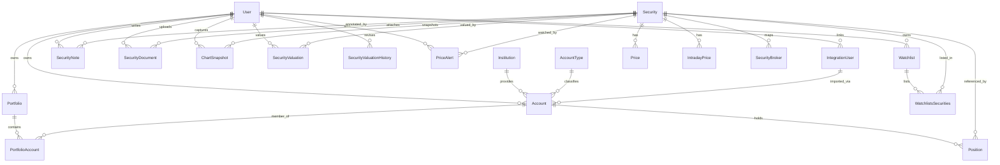
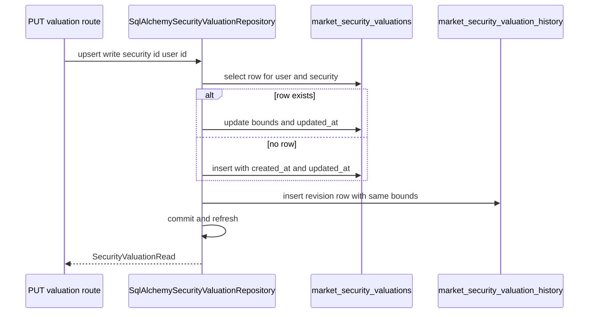
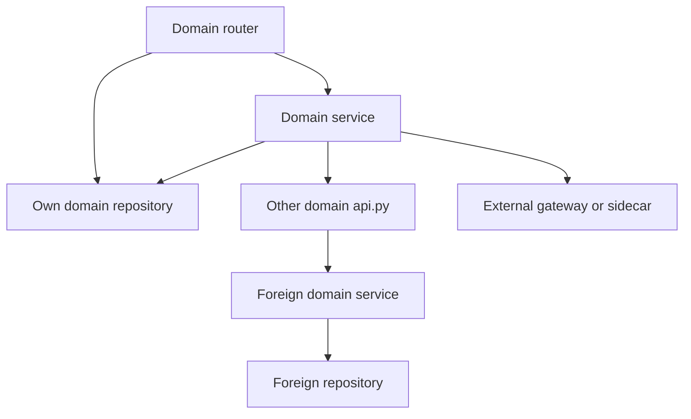

# Backend Domains

The backend under `src/` is organized by business domain. Each domain is self-contained and communicates with other domains only through public APIs; the layered structure itself is described in [Architecture Overview](./overview.md), the identity stack in [Authentication & Authorization](./authentication.md), settings/DI wiring in [Configuration](./configuration.md), the asynchronous runtime in [Realtime, Background Jobs & the Worker](../workflows/realtime-and-background-jobs.md), and the per-user preference contract in [User Preferences](../concepts/user-preferences.md). This page is the per-domain catalog.

Routers are mounted in `src/main.py` under a single `APIRouter(prefix="/api/v1")` — account, portfolio, auth, institutions, integration, market and the market data-plane router — so every domain path below is relative to `/api/v1`; the WebSocket and worker-dashboard routers are mounted outside that prefix. The frontend `apiClient` hard-codes the same `/api/v1` base, and the Go MCP gateway consumes the data-plane routes under `/api/v1/market/data` (see [Market data providers](./market-data-providers.md)). The application lifespan also resolves `DataPlaneMarketGateway` eagerly at boot (plus the Alembic upgrade to `head` outside tests), so a missing provider key or a broken registration fails at startup rather than on the first request.

The data-plane router is the one HTTP surface that does not use `current_user`: it authenticates with the shared-secret `require_service_token` dependency (`X-Service-Token`, constant-time compared against `settings.market_data_service_token`) and is deliberately separate from the user-JWT `market_router`.

## Shared conventions

- **Models** live in `model.py` and inherit from `BaseModel` (`src/config/database.py`); they generate Alembic migrations and are never returned to clients. A route returns a `*Read` schema, never an ORM model.
- **Schemas** live in `schema.py`. Repositories and services exchange schemas, never ORM models — "repositories ALWAYS return schemas" is a critical rule, not a convention.
- **Public API types** live in `api_types.py` and are the only types that may cross a domain boundary. A service that needs another domain's data imports that domain's API type, not its `schema.py`.
- **Repositories** define abstract interfaces in `repository.py` and SQLAlchemy implementations in `repository_sqlalchemy.py`. Alternative implementations use `repository_<impl>.py` (for example `repository_eodhd.py`, the read-through EODHD price repository).
- **Services** hold orchestration and calculations; routers delegate to them and must never reach into a *foreign* domain's repositories. Using the router's own domain repositories directly is allowed and is what the market watchlist, alert, note, document, snapshot and valuation routes do — there is no service layer between them and their repository.
- **Errors** are domain exceptions, not HTTP responses: **a service must not raise `HTTPException` (the authorization service is the documented exception)** — it raises a custom exception and the router translates it, or the exception derives from `src.core.exception.EntityNotFoundError` / `AuthorizationError` so `src/main.py` can map it to a consistent status. `AuthorizationApi.check_entity_owned_by_user` therefore raises `HTTPException(404)` itself, and `UserApi` raises 401 from token decoding; domain errors that are neither entity nor authorization errors are handled explicitly in the router or in the route-level mapping helper (as the data-plane router's `_map_market_error` does).
- **MANDATORY:** editing a backend model requires a matching Alembic revision shipped in the same change, and every migration file MUST follow the `<hash>_<description>.py` naming convention under `migrations/versions/` (`alembic.ini` sets `script_location = migrations`; autogenerate with `uv run alembic revision --autogenerate -m "message"`; for manual SQL, create a standard revision and use `op.execute()` inside it). `src/main.py` upgrades to `head` at startup except when `settings.environment == "test"`. `migrations/versions/4c2ed77e7738_add_watchlist_sort_membership_added_at_.py` is the worked example of a model change plus its backfill; `migrations/versions/3436586a755f_create_security_valuations.py` and `migrations/versions/b291707f24ca_add_market_security_valuation_history.py` are the plain `create_table` examples for the newer market tables, and `migrations/versions/7e9699e1590e_add_free_cash_to_accounts.py`, `migrations/versions/af3e12e490b4_add_broker_value_to_accounts.py` and `migrations/versions/c2a9f7b17e13_add_source_to_market_price_alerts.py` are the add-a-column examples shipped alongside their model edits.
- Backend commands run inside Docker (`docker compose exec backend …`), and tests must mock every outbound client — no Redis, HTTP, SMTP or DNS dependency. See [Testing](../operations/testing.md).

## Router-only repositories and the ownership/error taxonomy

Not every feature earns a service layer. Inside the market domain, six per-user resources are thin enough that the router talks to the repository directly: **watchlists** (`WatchlistRepository`), **price alerts** (`PriceAlertRepository`), **security notes** (`SecurityNoteRepository`), **security documents** (`SecurityDocumentRepository`), **chart snapshots** (`ChartSnapshotRepository`), and **security valuations** (`SecurityValuationRepository`). Each is an ABC in `src/market/repository.py` with a `SqlAlchemy*` implementation plus a `sqlalchemy_*_repository_factory` registered in `register_market_services`, and the router resolves it with `services.aget(<Abc>)`. There is no `WatchlistService`, `ValuationService`, and so on.

That shortcut is safe only because the repositories themselves carry the rules a service would otherwise hold:

- **`user_id` is a parameter on every method that touches a user-owned row.** No route passes a client-supplied user id: the handler takes `user.id` from `current_user` and threads it down, so cross-user reads and writes are impossible by construction rather than by an explicit ownership check.
- **A resource that is missing *or* owned by another user is reported identically.** Watchlists raise `WatchlistNotFoundError` in both cases (`_get_owned` filters on `id` *and* `user_id`), and `EntityNotFoundError` maps to a global HTTP 404 in `src/main.py`, so a caller cannot probe whether someone else's id exists. `AuthorizationApi.check_entity_owned_by_user` implements the same policy for the domains that do use it.
- **Errors the router must translate are deliberately *not* `EntityNotFoundError`s.** `WatchlistDuplicateNameError` and `WatchlistOrderIdentityError` extend plain `Exception` (`src/market/exception.py`) precisely so the global handler does not swallow them into a 404; the routes catch them and return 409 and 422 respectively. `SecurityNotFoundError` *is* an `EntityNotFoundError` and correctly becomes a 404.
- **A mutating route proves ownership even when the payload changes nothing.** `PATCH /market/watchlists/{watchlist_id}` with an empty payload re-reads the user's watchlists and raises `WatchlistNotFoundError` when the id is absent.

The full watchlist ownership/error taxonomy is spelled out in [Watchlists](#watchlists) below; the same shape applies to alerts, notes, documents, snapshots and valuations.

Note what is *not* in that list: no repository in any domain is allowed to guess the caller. Every repository method that touches a user-owned row takes `user_id` as a parameter, and the route binds it from `current_user`.

The market data-plane router (`src/market/data_router.py`) is the opposite extreme of the same design: it is service-token authenticated rather than user-scoped, so its routes resolve a **gateway plus a cache** instead of any repository, and all persistence stays in the existing market repositories. Its 404/422/502/503 translation lives in a route-level helper because the gateway errors are deliberately not `EntityNotFoundError`s.

## Entity model

The core entities across domains, and how they reference each other:

*Cross-domain entity relationships: user-owned aggregates fan out from `User`, while every market table except account positions holds a real foreign key to `Security`.*

`SecurityBroker` stores the broker symbol/exchange mapping plus the raw EODHD search results used to resolve it. Every market-owned table references `market_securities.id` with a real foreign key; the one cross-domain exception is `account_positions.security_id` in the account domain, which is a plain UUID column so positions can point at a security without a database-level constraint across domains.

The watchlist membership association is an entity in its own right rather than a bare join table: `market_watchlists_securities` carries `added_at` and an application-managed `position`, and `market_watchlists` carries the persisted `sort` mode.

`market_security_valuation_history` is a revision log rather than a child of `market_security_valuations`: it has no foreign key to the current-value table and is correlated to it only by the `(user_id, security_id)` pair it shares, while its own `security_id` cascades from `market_securities`. So deleting a security removes both its current range and its whole revision history, but the two tables are otherwise independent rows.

The diagram is the complete set of domain tables. The provider-agnostic data plane added in the market domain is deliberately **stateless in Postgres**: FMP/Polygon responses, resolved listing currencies and logo bytes live in Redis (endpoint cache, logo cache), so a new data-plane capability never requires a migration — only a model edit does.

## account

`src/account` manages accounts, positions, portfolios, institutions, account types, the templated CSV import path, and the per-user preferences endpoints. The user-facing CSV walkthrough lives in [CSV import](../workflows/csv-import.md) and the preferences contract in [User Preferences](../concepts/user-preferences.md).

### Models (source: `src/account/model.py`)

| Entity | Table | Key fields | Notes |
|--------|-------|------------|-------|
| `AccountModel` | `accounts` | `id: UUID`, `external_id`, `integration_user_id` (FK `integration_users.id`, nullable), `name`, `user_id`, `account_type_id`, `institution_id`, `currency`, `broker_display_name`, `net_deposits`, `free_cash` (default `0.0`), `broker_value`/`broker_value_at`, `is_active`, `api_sync_enabled`, `last_sync_at`, `created_at`, `updated_at`, `deleted_at` | Unique on `(user_id, institution_id, external_id)` |
| `AccountTypeModel` | `account_types` | `id`, `name`, `country`, `tax_advantaged`, `is_active` | Unique on `(name, country)`; reference data seeded by `src/commands/seed.py` |
| `InstitutionModel` | `account_institutions` | `id`, `name`, `country`, `website`, `is_active`, `integration_enabled`, `csv_import_enabled`, `csv_format` | Unique on `(name, country)`; `csv_format` is the positional column template (see below) |
| `PositionModel` | `account_positions` | `id: int`, `account_id`, `security_id: UUID`, `quantity: DECIMAL(16,8)`, `average_cost` (Float, nullable), `currency(3)`, `updated_at` | Unique on `(account_id, security_id)` |
| `PortfolioModel` | `portfolios` | `id: UUID`, `user_id`, `name`, `created_at`, `updated_at`, `deleted_at` | Unique on `(user_id, name)` |
| `PortfolioAccountModel` | `portfolio_accounts` | `portfolio_id`, `account_id` (composite PK), `created_at` | Many-to-many association |

`AccountModel` cascades `all, delete-orphan` to both `positions` and `portfolio_accounts`; `PortfolioModel` cascades the same way to its `portfolio_accounts`.

### The `csv_format` template contract

`InstitutionModel.csv_format` is a comma-separated, positional template string that maps each column of a broker's CSV export to a standardized placeholder. The documented vocabulary is `{account_name}`, `{account_type}`, `{account_classification}`, `{account_number}`, `{symbol}`, `{exchange}`, `{mic}`, `{name}`, `{security_type}`, `{quantity}`, `{position_direction}`, `{market_price}`, `{market_price_currency}`, `{book_value_cad}`, `{book_value_currency_cad}`, `{book_value}`, `{currency}`, `{market_value}`, `{market_value_currency}`, `{market_unrealized_returns}`, `{market_unrealized_returns_currency}`. `GenericCsvParser` normalizes both the template and the file header to lowercase snake_case, validates the header count and each position against alias sets, and raises a specific `CsvParserError` subclass on mismatch. Cash rows (`sec-c-*`, blank/`cash` symbol, `security_type == "cash"`) and option rows (OCC-style symbols, `option`/`derivative` security types) are dropped; `average_cost` is derived as `book_value / quantity` quantized to 4 decimals (`ROUND_HALF_UP`), and cash rows found during parsing accumulate into the discovered account's `free_cash`.

`CsvAccountService.validate_csv_institution` is the gate: an institution without `csv_import_enabled` or without a `csv_format` raises `CsvImportDisabledError`, so the template is the only per-institution configuration the parser needs.

### Public APIs (source: `src/account/api/`)

- `AccountApi` (`account.py`): `get_all`, `get_by_id`, `get_broker_id_by_id`, `rename`, `update_net_deposits`, `update_free_cash`, `update_broker_value`, `update_last_sync_at`, `import_from_broker`. `import_from_broker` skips accounts that already exist for `(user_id, broker_id)` and maps `BrokerAccount` through `AccountSchema.from_broker`.
- `PositionApi` (`position.py`): `create(positions)` groups by `account_id` and delegates to `PositionRepository.sync_by_account`.
- `InstitutionApi` (`institution.py`): `get_all_enabled_integrations` returns integration-enabled institutions as `Institution` API types.

### Services (source: `src/account/service/`)

- `AccountService` (`account.py`): get, ownership/`check_accounts_belong_to_user`, delete.
- `PositionService` (`position.py`): `sync_account_positions`, `get_total_for_account`, `get_account_holdings`, `get_holdings_by_security`, `get_user_holdings`, plus the `_calculate_holdings`/`_calculate_holding`/`_unpriced_holding`/`_account_performance`/`_currency_convert` helpers. It depends on `MarketPricesApi` and `SecurityApi` (market), `IntegrationAccountApi`/`IntegrationUserApi` (integration), and a `CurrencyConverter` built from the market domain's `FxRateProvider.converter()` — `position_service_factory` awaits the provider, which falls back to the bundled ECB snapshot when Redis has no fresh rates. Because the provider is awaited per request and the parsed converter is cached per ECB fetch date, the account domain never bundles its own FX data.
- `PortfolioService` (`portfolio.py`): CRUD and account-membership sync with ownership validation.
- `CsvAccountService` (`csv_account.py`): `inspect_csv`, `import_accounts`, `sync_account_from_csv`, `sync_account_csv_positions`. It refreshes `free_cash` from the parsed cash rows and `net_deposits` from the request, resolves every position through `SecurityApi.get_or_create_from_broker`, wraps resolution failures in `SecurityResolutionError`, and stamps `update_last_sync_at`.

### Background task (source: `src/account/task.py`)

`recalculate_all_account_totals_task` iterates active accounts, recomputes totals through `PositionService`, and emits an `AccountTotalsUpdatedMessage` over the WebSocket manager. It is enqueued at the end of the hourly market job.

### Router (source: `src/account/router.py`)

`portfolio_router` (prefix `/portfolios`):

- `GET /` — portfolios for the current user
- `POST /` — create
- `PUT /{portfolio_id}/accounts` — sync portfolio account membership (validates every account belongs to the user)
- `PATCH /{portfolio_id}` — rename
- `DELETE /{portfolio_id}` — delete (204)

`account_router` (prefix `/accounts`):

- `GET /` — accounts for the current user
- `GET /sync-status` — `{"account_ids": [...]}` for accounts with an active sync job, read from Redis (`account_syncs:active:<user_id>`); returns 503 on `redis.RedisError`
- `GET|PUT|PATCH /me/preferences` — per-user chart preferences stored on `auth_users.preferences` via `UserApi`. GET returns `{}` when nothing is saved; PUT replaces with `model_dump(exclude_none=True)`; PATCH merges (JSONB `||`) and returns the merged document. The full read/write matrix for every key lives in [User Preferences](../concepts/user-preferences.md).
- `POST /csv/inspect` — multipart upload plus `institution_id` (form field or `institution_id` query parameter), returns `CsvDiscoveredAccount` previews with `exists`/`currency`/`net_deposits` filled for accounts the user already has
- `POST /csv/import` — multipart upload of selected `account_numbers` with an optional `currencies` JSON map (invalid JSON is dropped silently) and an optional `net_deposits` JSON map `{account_number: number | null}` (malformed JSON or non-numeric values raise 422, because a dropped amount would silently change the P/L basis)
- `POST /{account_id}/csv-sync` — re-import one existing account from a CSV export, with an optional plain `net_deposits` form field
- `PATCH /{account_id}/rename`, `DELETE /{account_id}` (204)
- `GET /{account_id}/totals` — optional `currency` query parameter restricted to `account.api_types.SUPPORTED_DISPLAY_CURRENCIES` (`CAD`, `USD`, `EUR`, `GBP`); an unsupported code is 422 and the default is the account's own currency
- `GET /holdings` (user-wide holdings across every account, paginated), `GET /holdings/{security_id}`, `GET /{account_id}/holdings`
- `POST /{account_id}/sync` — rate-limited `3/minute`; enqueues broker position sync and returns `{"accepted": true}`

The CSV endpoints accept their parameters either as multipart `Form` fields or as query parameters with the same alias. `institution_id` (form or query) is the only parameter of `csv/inspect`, and `csv/import` additionally takes `account_numbers`, `currencies` and `net_deposits`; `csv-sync` takes only the plain `net_deposits` float as a form field. `institution_id` and `account_numbers` are required (422 otherwise). Account numbers accept a JSON list string, a comma-separated string, or repeated values, deduplicated in order. Every account-scoped route (`csv-sync`, `rename`, `delete`, `totals`, `holdings`, `sync`) resolves the account, runs `AuthorizationApi.check_entity_owned_by_user`, then acts.

Both holdings reads that are not account-scoped take their display currency from the user's stored `display_currency` preference through `UserApi.get_display_currency` (default `CAD`), so rows from accounts in different currencies can be aggregated without mixing them.

### Business rules

- Account identity is `(user_id, institution_id, external_id)`.
- `api_sync_enabled=False` accounts (CSV-imported ones) refuse `POST /{account_id}/sync` with 400 and `PositionService.sync_account_positions` raises `ApiSyncDisabledError`; accounts with `integration_user_id IS NULL` are a silent no-op.
- Position sync is a full replace: `sync_by_account` deletes all rows for the account then re-inserts, so partial syncs cannot leave stale holdings. A CSV sync with no resolvable positions still calls it with an empty list, so the account is emptied rather than left stale.
- Holdings and totals are computed in the security/position currency and then converted to the account currency with `CurrencyConverter` and `stockholm.Money`. Money semantics are covered in [Money and currency](../concepts/money-and-currency.md).
- `_account_performance` is the single place account totals are assembled, and it picks an explicit **profit/loss basis**: `net_deposits` when `AccountModel.net_deposits` is known (P/L = `value - net_deposits`, with `return_percent` omitted when net deposits are zero) and `cost` otherwise (P/L = `positions_value - positions_cost`, with `return_percent` omitted when the cost basis is zero). `AccountTotals` echoes that choice as `basis` and also carries `cash`, `net_deposits`, `unpriced_positions` and `pricing_incomplete`.
- `free_cash` is converted from the account currency into the requested currency and folded into **both** `value` and `cost`, so cash moves the totals but not the positions P/L.
- A position whose security is missing, or which has no stored price, is still returned as a holdings row (`total_value = 0`, `profit_loss = None`) but is excluded from value, cost and P/L, counted in `unpriced_positions`, and reported through `pricing_incomplete = unpriced_positions > 0` — a missing price degrades the totals visibly instead of silently understating them.
- `get_holdings_by_security` returns an empty list and a zero total when the security itself cannot be resolved (a TODO notes this is ambiguous with "no holdings"), while `_calculate_holdings` logs and skips an individual position whose security is missing so one bad row cannot abort a holdings read.
- `broker_value`/`broker_value_at` are written by the broker sync task and reconciled against our computed present value; a deviation larger than 1% is logged as a warning (usually a valuation gap: missing cash, a stale price or a bad FX rate) but never blocks the sync.

## auth

`src/auth` owns users, credentials, sessions, and resource authorization. The deep dive — token inventory, TOTP/passkey ceremonies, Redis challenge state, SSR guard — lives in [Authentication & Authorization](./authentication.md); this section only records the domain surface.

### Models (source: `src/auth/model.py`)

| Entity | Table | Notes |
|--------|-------|-------|
| `UserModel` | `auth_users` | `id: UUID`, unique indexed `email`, `_password_hash` (argon2 via the `password` property), `is_active`, `is_verified`, `last_login_at`, `preferences` (JSON), `created_at` |
| `VerificationTokenModel` | `auth_verification_tokens` | `id: str`, indexed `user_id`, unique `token`, `expires_at`, `is_used` |
| `TotpModel` | `auth_totp` | Unique per `user_id`, `secret`, `is_verified`, `ondelete="CASCADE"` |
| `RecoveryCodeModel` | `auth_recovery_codes` | `code_hash` (argon2), `is_used`, `used_at`, cascade on user delete |
| `PasskeyModel` | `auth_passkeys` | Unique indexed `credential_id`/`public_key` (LargeBinary), `sign_count`, `name`, `transports` (JSON), cascade on user delete |

### APIs and services (source: `src/auth/api.py`, `src/auth/service.py`)

- `UserApi`: `signup`, `login` (returns either `AuthResponse` or `LoginChallengeResponse`), `create_access_token`, `create_mfa_token`/`verify_mfa_token`, `get_current_user_from_token`, `verify_email`/`resend_verification`, `revoke_token`, `update_last_login`, plus preference `get_/save_/patch_preferences` and `get_email_for_user`.
- `AuthorizationApi.check_entity_owned_by_user(user, entity, field="user_id")`: raises HTTP 404 (not 403) when the entity is missing or not owned, deliberately hiding existence.
- `EmailVerificationService`, `TotpService`, `PasskeyService` hold the verification, TOTP, and WebAuthn logic.
- FastAPI dependencies: `get_token` (cookie `auth_token` or OAuth2 bearer header) and `current_user`.

### Router (source: `src/auth/router.py`, prefix `/auth`)

- `POST /signup` (`5/minute`), `POST /login` (`10/minute`), `POST /logout`
- `POST /2fa/login-verify` (`10/minute`) — exchanges a `mfa_pending` JWT plus a TOTP code for an access token
- `POST /verify-email`, `POST /resend-verification` (`3/minute`)
- `POST /ws-ticket` — signed 30-second, single-use WebSocket ticket
- `GET /2fa/status`, `POST /2fa/totp/setup|activate|disable`, `POST /2fa/totp/recovery-codes/regenerate`
- `POST /passkey/register/options|verify`, `GET /passkeys`, `DELETE|PATCH /passkeys/{passkey_id}`, `POST /passkey/authenticate/options|verify`

Login and 2FA verification set the `httponly`/`secure` `auth_token` cookie (7-day `max_age`) in production; the passkey authentication endpoint does the same and updates `last_login_at`.

## market

`src/market` manages securities, daily and intraday prices, watchlists, price alerts, security notes, documents, chart snapshots, per-user security valuations, technical indicators, AI analysis, FX rates, and the provider-agnostic market data plane. The data-flow walkthrough lives in [Market data and indicators](../workflows/market-data-and-indicators.md); the valuation feature has its own page at [Security Valuations](../concepts/security-valuation.md); the provider stack and the data-plane contract are detailed in [Market data providers](./market-data-providers.md).

The domain deliberately runs **two parallel provider stacks behind one `MarketGateway` interface**:

| Stack | svcs key | Provider(s) | Consumers |
|-------|----------|-------------|-----------|
| Legacy price/search stack | `MarketGateway` → `eodhd_gateway_factory` | EODHD | `SecurityApi`, `MarketPricesApi`, `MarketService`, `EodhdPriceRepository`, `GET /market/search` |
| Provider-agnostic data plane | `DataPlaneMarketGateway` → `composite_market_gateway_factory` | FMP (prices, search, symbol lookup, fundamentals, quotes) and Polygon (options) | `src/market/data_router.py`, institutional-ownership reads |

Both keys are registered in live and stub mode (`src/market/__init__.py` and `src/config/services.py`), so `settings.stub_external_api=true` swaps in the offline stub gateways for either stack without touching call sites. The legacy key must keep pointing at EODHD: existing price-fetch and broker-security-resolution flows depend on it.

### Models (source: `src/market/model.py`)

| Entity | Table | Key fields | Notes |
|--------|-------|------------|-------|
| `SecurityModel` | `market_securities` | `id: UUID`, `symbol`, `exchange`, `currency`, `name`, `isin`, `is_active`, `updated_at` | Unique `(symbol, exchange)` as `symbol_exchange_unique` |
| `SecurityBrokerModel` | `market_securities_broker` | `id: BigInteger`, `institution_id`, `broker_symbol`, `broker_exchange`, `broker_name`, `mapped_symbol`, `mapped_exchange`, `security_id` (FK), `search_results` (JSON), `created_at` | Indexed on `(institution_id, broker_symbol, broker_exchange)` |
| `PriceModel` | `market_prices` | `security_id` (FK), `date`, OHLC + `adjusted_close` as `DECIMAL(16,8)`, `volume` | Unique `(security_id, date)` |
| `IntradayPriceModel` | `market_intraday_prices` | `security_id` (FK), `timestamp: timestamptz`, OHLCV | Unique `(security_id, timestamp)`; 1-hour candles |
| `WatchlistModel` | `market_watchlists` | `id: UUID`, `user_id`, `name`, `sort` (`server_default="custom"`), `securities` relationship via `lazy="selectin"` | Unique `(user_id, name)`; the user's default list is the one literally named `"Default"` |
| `WatchlistsSecuritiesModel` | `market_watchlists_securities` | composite PK, `added_at`, `position` (application-managed), `ondelete="CASCADE"` both sides | Many-to-many with membership metadata; read paths query the association explicitly because a `secondary` relationship cannot order by or carry these columns |
| `PriceAlertModel` | `market_price_alerts` | `security_id` (FK, cascade), `user_id`, `target_price`, `condition`, `source` (default `manual`), `triggered_at`, `created_at` | Null `triggered_at` = active |
| `SecurityNoteModel` | `market_security_notes` | `security_id` (FK, cascade), `user_id`, nullable `title`, `content`, timestamps | Title filled asynchronously by AI |
| `SecurityDocumentModel` | `market_security_documents` | `security_id` (FK, cascade), `user_id`, `filename`, `file_path`, `file_size`, `file_type` | File bytes under `settings.upload_path` |
| `ChartSnapshotModel` | `market_chart_snapshots` | `id: UUID`, `security_id` (FK, cascade), `user_id`, `drawings` (JSON), `data_window` (JSON), `captured_at`, `created_at` | Indexed `(security_id, user_id, captured_at)` |
| `SecurityValuationModel` | `market_security_valuations` | `id: int`, `user_id`, `security_id` (FK, cascade), `lower_bound`/`upper_bound` as `DECIMAL(16,8)`, `created_at`, `updated_at` | Unique `(user_id, security_id)` as `valuation_user_security_unique`; index `ix_market_security_valuations_user_security` |
| `SecurityValuationHistoryModel` | `market_security_valuation_history` | `id: int`, `user_id`, `security_id` (FK, cascade), `lower_bound`/`upper_bound` as `DECIMAL(16,8)`, `created_at` | Append-only revision log; index `ix_market_security_valuation_history_user_security_created` on `(user_id, security_id, created_at)`; no unique constraint, so one row per write |

`src/market/enum.py` holds `PriceInterval` (`1h`, `4h`, `1d`, `1w`, `1m`) and `WatchlistSortMode` (`custom`, `name_asc`, `price_change_desc`, `price_change_asc`, `date_added`, `date_added_asc`).

### Public APIs (source: `src/market/api.py`)

Both public APIs are bound to the **legacy** `MarketGateway` key (EODHD), never to the data-plane key.

- `MarketPricesApi`: `get_latest_close` (returns `Money | None`) and `get_latest_price` (returns `PriceSchema | None`).
- `SecurityApi`: `get_by_id`, `get_or_create_from_broker`, `create_or_get_from_search`.
  - `get_or_create_from_broker` checks `SecurityBrokerRepository` for an existing mapping, otherwise maps the broker symbol (`.` → `-`) and exchange (`CSE→CA`, `TSX→TO`, `NYSE→US`, `NASDAQ→US`), searches EODHD through `SecuritySearchCache`, takes the first result, upserts the security, warms prices via `MarketPricesApi.get_latest_close`, and persists the mapping with the raw search results. Zero search results raise `ValueError`.
  - `create_or_get_from_search` returns `has_price_data` for existing securities and calls `MarketService.fetch_and_save_price_history` for new ones.

### Services (source: `src/market/service.py`, `ai_service.py`, `alert_service.py`, `indicators.py`, `fx.py`, `cache.py`)

- `MarketService`: `update_daily_prices_for_all_securities` (one-year window, `asyncio.gather`, returns success/failure counts), `update_intraday_prices_for_all_securities` (7-day window), `fetch_and_save_intraday_prices`, `fetch_and_save_price_history` (2000-01-03 → today). Gateway calls are pushed through `asyncio.to_thread` and per-security failures are swallowed so one bad symbol cannot abort a batch.
- Module-level aggregation helpers, also exposed as `PriceAggregationService` static methods: `aggregate_weekly_prices` (ISO week buckets), `aggregate_monthly_prices`, `aggregate_4h_candles` (4-hour buckets of 1h candles), and `convert_to_heikin_ashi`.
- `IndicatorServiceClient`: HTTP client for the external Go indicator sidecar at `settings.indicator_service_url`, posting `{interval, candles, indicators}` to `/compute`. It maps timeouts to 504, connect/network errors to 503, upstream 400s to 400, upstream 5xx to 503, and unwraps an `indicators` envelope. Registered as a request-scoped async-generator factory so it owns and closes its own `httpx.AsyncClient`.
- `AIService`: wraps `AsyncOpenAI` against `ai_api_endpoint`/`ai_api_key`/`ai_api_model`; `_gather_context` collects the security, latest price, the user's notes, and ~90 days of closes. Public methods: `analyze_fundamentals`, `summarize_notes`, `generate_note_title`, `analyze_portfolio_fit`.
- `AlertEvaluationService`: pure `evaluate(active_alerts, latest_prices)` plus `dispatch_alert_email` used by the staged alert pipeline. The task layer feeds it the active alerts and one batched `get_latest_intraday_close_by_security()` map, so evaluation itself performs no I/O.
- `FxRateProvider` (`fx.py`): owns the FX rates every currency conversion in the backend uses. A daily Huey task (`daily_fx_refresh`, 17:30 UTC) downloads the ECB history and stores the base64 zip plus its fetch date in Redis under `fx:ecb:zip` / `fx:ecb:fetched_at` with `MSET` so the pair cannot drift; `FxRateProvider.converter()` builds and returns a `CurrencyConverter` from that snapshot, caching parsed converters at module level keyed by fetch date (providers are request-scoped, so an instance cache would re-parse the whole CSV per request). A missing, unreachable or unreadable snapshot falls back to the bundled `currencyconverter` ECB data, and rates older than three business days log a staleness warning. `as_of()` reports the freshest rate date.
- `IndicatorCache` (Redis, 1 h TTL), `SecuritySearchCache` (30 days) and `LogoCache` (30 days, with a one-day negative sentinel) back indicator computation, EODHD search and logo proxying respectively; the indicator cache key includes the requested interval, chart style and a canonical digest of the indicator specs plus normalized date bounds.
- `indicators.py`: SMA/EMA style 50/200 day and 50/200 week MAs, MACD, RSI.
- `price_aggregation.py` (`PriceInterval = Literal["day", "week", "month"]`): the data-plane aggregation helpers — `resolve_price_range` (defaults `to` to today, `from` to 365 days earlier, and rejects `from > to` or an estimated bar count above `MAX_PRICE_BARS = 2000` with 422) and `aggregate_bars` (ISO-week / calendar-month OHLCV buckets).

### Read-through price repository (source: `src/market/repository_eodhd.py`)

`EodhdPriceRepository` wraps the SQLAlchemy `PriceRepository` and the `MarketGateway`. `get_prices` merges DB rows with fresh EODHD rows (EODHD wins per date) and persists the union; `get_latest_price` only refetches when the stored close predates the last NYSE trading day (computed with `holidays.NYSE()`); `get_price_on_date` falls back to EODHD and saves the result. `save_price`/`save_prices` deliberately raise `NotImplementedError` — writes must go through the inner DB repository or `MarketService`. It is the registered `PriceRepository` in both stub and live service registration.

### Market data plane (source: `src/market/composite.py`, `endpoint_cache.py`, `currency.py`, `data_router.py`)

The data plane is the provider-agnostic half of the market domain: one gateway interface, one cache, one set of service-token routes, and no provider name leaking into a response body. Deep provider detail (per-provider mapping, capability matrix, stub fixtures) lives in [Market data providers](./market-data-providers.md); this is the architectural summary.

- **Gateway.** `CompositeMarketGateway` implements `MarketGateway` by delegating prices, search, symbol lookup, quotes and every fundamentals capability to the FMP gateway and options chains/expirations to the Polygon gateway. It adds no caching of its own, and `get_intraday_prices` surfaces FMP's "capability not supported" `MarketDataProviderError` unchanged. It is resolved under the distinct `DataPlaneMarketGateway` svcs key — a behaviour-less `MarketGateway` subclass that exists only so the legacy EODHD binding stays untouched. `composite_market_gateway_factory` is a **sync** closeable generator factory (svcs refuses async factories through sync `get`) that builds both providers directly, yields the bare composite, and closes both provider clients on container teardown; if Polygon construction fails it closes the already-built FMP client before re-raising. Because it is registered as a factory under a container-lifetime key, `src/main.py` can resolve it eagerly in the lifespan to fail fast on a missing provider key.
- **Cache.** `EndpointResponseCache` is the single canonical data-plane cache and the only place responses are stored. Keys are readable and scan-friendly — `market:ep:<data_class>:<endpoint>:<sha256-prefix>` where the data class and endpoint stay in the clear and the request parameters are content-hashed after canonicalization (so `date` and midnight `datetime` bounds collide while intraday windows keep hour/minute precision), which also makes pattern invalidation (`market:ep:*`) possible. TTLs are per data class from settings (`endpoint_ttl_prices_seconds`, `_statements_`, `_metrics_`, `_options_`, `_search_`, `_quotes_`, read at call time, defaulting to 1 h). `cached_response(data_class, endpoint, params, fetch, model)` serves a hit, otherwise awaits `fetch` and stores the result; a `MarketDataNotFoundError` from `fetch` is stored as a single-key negative marker under the much shorter `endpoint_ttl_negative_seconds` (default 5 min) and re-raised, so repeat lookups of a missing symbol never reach the provider. Every Redis read/write failure is logged and degrades to a live fetch — the cache never fails a request. A successful-but-empty result (empty price window, empty search) is turned into a 404 *after* the cache wrapper so it too is cached.
- **Currency.** Every price-bearing data-plane response has a required top-level `currency`, resolved once by `resolve_listing_currency`: read the company profile through the gateway, normalize provider pence values (`GBp`/`GBX` → `GBX`), and fall back to the deterministic exchange default (`TSX → CAD`, `LSE → GBX`, US/None → `USD`) when the profile 404s or the provider fails. The resolved code is itself cached through the endpoint cache under data class `metrics` / endpoint `listing_currency`.
- **Routes** (`data_router`, prefix `/market/data`, mounted under `/api/v1`, so paths are `/api/v1/market/data/...`): `GET /prices/{symbol}` (`from`, `to`, `interval` ∈ `day|week|month`, `exchange`), `GET /quote/{symbol}`, `GET /indicators/{symbol}` (`indicator` ∈ sma/ema/rsi/macd/bollinger with defaulted params, resolved and trimmed server-side, fetched with a 3×-lookback warm-up window), `GET /symbols/search`, `GET /options/{symbol}` and `/options/{symbol}/expirations`, `GET /fundamentals/{symbol}`, and `GET /fundamentals/{symbol}/statements` (`statement` ∈ `income|balance|cashflow`, `period` ∈ `annual|quarter`, `limit` ≤ 20). All are GET-only and authenticated with `require_service_token`.
- **Error mapping** lives in `_map_market_error`: `MarketDataNotFoundError` → 404, `MarketDataConfigurationError` → 503, any other `MarketDataProviderError` → 502, all with generic details that never name a provider or echo an upstream message. Invalid query values are FastAPI 422s, and `resolve_price_range` and the options routes add their own 422s for an inverted range or `strike_min > strike_max`.
- **Contract.** The data-plane paths and query parameter names are a stable contract for the Go MCP gateway: they are pinned byte-for-byte by a committed OpenAPI artifact (`tests/market/contracts/data_plane_openapi.json`, produced by `src/commands/export_data_plane_contract.py`) and asserted against the live FastAPI schema, including the exact expected route set, by `tests/market/test_data_plane_contract.py`. Renaming a data-plane route or parameter is therefore a deliberate contract change with a regeneration step, not an incidental edit.
- **No persistence.** Nothing in the data plane writes to Postgres: prices, currencies, options, fundamentals and logos live only in Redis (endpoint cache, `LogoCache`), so these capabilities never need an Alembic revision.

The user-facing market routes consume the data plane in exactly two places so far: the logo proxy routes and `GET /market/securities/{security_id}/institutional-ownership`.

### Router (source: `src/market/router.py`, prefix `/market`)

Requires `current_user` on every route. Endpoint surface:

- `GET /prices/{security_id}/last-close`
- `GET /prices/{security_id}` — `interval` ∈ `1d|1w|1m|1h|4h`. Daily/weekly/monthly require `from_date` and `to_date` (422 otherwise) and aggregate in-process; intraday reads `market_intraday_prices` and lazily backfills via `MarketService.fetch_and_save_intraday_prices` when the window is stale.
- `GET /search` and `GET /securities/search` — EODHD search through the **legacy** `MarketGateway` key, cached in `SecuritySearchCache`
- `GET /securities/{security_id}`, `POST /security` (create-or-get)
- `GET /logo?symbol=&exchange=` and `GET /securities/{security_id}/logo` — PNG logo proxying through FMP (`fetch_logo_image`, `map_to_fmp_ticker`) with `LogoCache` (30-day entries, one-day negative sentinel) and a one-week `Cache-Control` header
- `GET /securities/{security_id}/institutional-ownership` — institutional ownership summary plus quarterly history from the data-plane gateway, cached in Redis for a day (`market:institutional_ownership:<security_id>`); a provider 404 or provider error degrades to an all-null response with an empty history (and is not cached on a provider error)
- Watchlists: `GET /watchlists` (each item embeds its securities), `POST /watchlists` (201), `PATCH /watchlists/{watchlist_id}` (rename and/or change the sort mode), `DELETE /watchlists/{watchlist_id}` (204), `GET /watchlists/{watchlist_id}/securities` (paginated), `POST|DELETE /watchlists/{watchlist_id}/securities/{security_id}`, `PUT /watchlists/{watchlist_id}/securities/order` (full manual-order replacement), and the default-watchlist shortcuts `POST|DELETE /watchlists/securities/{security_id}`
- `GET|POST /securities/{security_id}/alerts`, `DELETE /securities/{security_id}/alerts/{alert_id}`
- `GET|POST /securities/{security_id}/notes`, `PUT|DELETE /securities/{security_id}/notes/{note_id}`
- `GET|POST /securities/{security_id}/documents`, `DELETE /securities/{security_id}/documents/{doc_id}`
- `GET|POST /securities/{security_id}/snapshots` (POST returns 201), `DELETE /securities/{security_id}/snapshots/{snapshot_id}` (204)
- `GET /securities/{security_id}/indicators` — in-process indicator calculation, Redis-cached
- `POST /securities/{security_id}/indicators/compute` — candle-series computation delegated to the Go sidecar; accepts caller-supplied `candles` (which bypasses and skips the cache) and validates `from_date <= to_date` (422)
- `GET /securities/{security_id}/valuation` — the current user's fair-value range for one security; 404 when none exists
- `PUT /securities/{security_id}/valuation` — upsert the range (`SecurityValuationWrite`: `lower_bound`, `upper_bound`)
- `GET /securities/valuation/batch` — `security_ids` repeated query params
- `POST /securities/valuation/batch` — body `SecurityValuationBatchRequest`; both batch forms return the subset of the user's valuations that exist
- `POST /securities/{security_id}/ai/fundamentals`, `/ai/summarize-notes`, `/ai/portfolio-debate` — each rate-limited `5/minute`, mapping `TimeoutError` → 504 and `RuntimeError` → 503

The batch routes are declared before the `{security_id}` routes so `/securities/valuation/batch` is not captured as a security id.

### Security valuations

`SecurityValuationRepository` (`src/market/repository.py`) is one of the market's router-only repository contracts — there is no valuation service between it and the routes. `SqlAlchemySecurityValuationRepository` (`src/market/repository_sqlalchemy.py`) implements four methods:

| Method | Behaviour |
|--------|-----------|
| `get_by_security_and_user(security_id, user_id)` | Single-row lookup returning `SecurityValuationRead \| None`; the route turns `None` into 404 |
| `upsert(valuation, security_id, user_id)` | Updates `lower_bound`/`upper_bound` and `updated_at` when the `(user_id, security_id)` row exists, otherwise inserts with both timestamps set to now; in **both** branches it also appends a `SecurityValuationHistoryModel` row with the same bounds and timestamp, then commits and refreshes before returning |
| `get_history(security_id, user_id)` | All revision rows for that `(security_id, user_id)`, ordered by `created_at` then `id` ascending, as `SecurityValuationHistoryRead`; scoped to `user_id` |
| `get_batch_by_user_and_securities(security_ids, user_id)` | Short-circuits to `[]` for an empty id list, otherwise one `IN` query scoped to `user_id`, so a caller can never read another user's valuations |

The unique constraint `(user_id, security_id)` is what makes the upsert safe to call repeatedly: the current-value table keeps exactly one row per pair, while `market_security_valuation_history` grows one row per write and is the append-only revision log. `get_history` is implemented but **not exposed by any route** — the valuation HTTP surface is read-current plus upsert only — so history is currently reachable only from code that resolves the repository itself. The history table arrived later than the valuation table, in `migrations/versions/b291707f24ca_add_market_security_valuation_history.py`. The full feature — model, routes, frontend client and sidebar modal — is documented on [Security Valuations](../concepts/security-valuation.md).

*Every valuation write touches two tables: the unique-keyed current row and one appended revision row.*

### Watchlists

Watchlists are the one market feature with a full CRUD surface rather than per-security sub-resources. `WatchlistRepository` (`src/market/repository.py`) is the contract the router talks to directly — there is no watchlist service — and `SqlAlchemyWatchlistRepository` implements it:

| Method | Behaviour |
|--------|-----------|
| `get_by_user(user_id)` | All watchlists for the user; each read is built from an explicit association join ordered by `position` (then `added_at`), and every returned security is price-enriched |
| `create(user_id, name)` | Insert; an `IntegrityError` from the `(user_id, name)` unique constraint becomes `WatchlistDuplicateNameError` (rolled back, session still usable) |
| `rename(watchlist_id, user_id, name)` | Ownership check, then rename; duplicate names raise the same error |
| `update_sort(watchlist_id, user_id, sort)` | Ownership check, then persist the `WatchlistSortMode` value. The repository stores the mode but never orders by it: reads return membership ordered by `position`, so the mode is a preference applied above the repository. |
| `set_security_order(watchlist_id, user_id, ordered_security_ids)` | Ownership check, then rewrite membership `position`s to `0..n-1`. The payload must be an exact permutation of the current membership: a repeated id is caught by the length check, and validation runs before any write so a rejected payload leaves every position untouched (`WatchlistOrderIdentityError` → 422). A payload equal to the current order is a no-op. |
| `delete(watchlist_id, user_id)` | Ownership check, then delete; membership rows disappear through `ondelete="CASCADE"` |
| `create_default(user_id)` | Creates the literal `"Default"` watchlist; part of the repository contract but not currently invoked by any router |
| `add_security` / `remove_security` | Default-watchlist shortcuts: they resolve the user's `"Default"` watchlist (creating it on first add, tolerating a concurrent-create `IntegrityError` by re-reading) and then delegate to the per-watchlist methods; `remove_security` with no default watchlist raises `WatchlistNotFoundError` for the nil UUID |
| `add_security_to_watchlist` / `remove_security_from_watchlist` | Membership edits on one watchlist; unknown `security_id` raises `SecurityNotFoundError`, and removing a non-member is a successful no-op. An add appends at `max(position) + 1`, which is not concurrency-safe under simultaneous adds — acceptable for single-user watchlists. |
| `get_securities(watchlist_id, user_id, offset, limit)` | Ownership check, then a `symbol`-ordered page plus total, price-enriched |

Three invariants matter when changing this code. First, **every operation is scoped to the owning `user_id`, and a watchlist that does not exist *or* is owned by another user is reported as `WatchlistNotFoundError`** — deliberately indistinguishable, so a caller cannot probe for other users' watchlist IDs; the global `EntityNotFoundError` handler turns that into a 404. `PATCH /watchlists/{watchlist_id}` with a payload that changes nothing still proves ownership by re-reading the user's lists before it answers. `WatchlistDuplicateNameError` and `WatchlistOrderIdentityError`, by contrast, are plain `Exception`s (not `EntityNotFoundError`s) precisely so the router can translate them to 409 and 422 instead of letting the global handler emit 404. Second, `WatchlistRead` responses carry `sort` and embed `WatchlistSecuritySchema` items — each security plus its `added_at` and `position` — already enriched with `current_price`, `daily_price_change`, and `daily_price_change_percent`, computed in one batched window query over the latest two closes per security (`_fetch_price_metrics`), so a watchlist read is not a bare join. Third, ordering is split: the stored `position` is authoritative for manual (`custom`) order, `get_securities` pages by `symbol`, and the sort mode is a persisted preference the client applies.

### Business rules

- Securities are unique by `(symbol, exchange)`, allowing the same ticker on different venues. New searches accept the first EODHD hit.
- Price reads are read-through EODHD by default, so a missing daily bar is transparently fetched and persisted.
- The two provider stacks are independent on purpose: switching or adding a data-plane provider is a change to `composite_market_gateway_factory` and the FMP/Polygon factories, and must not repoint the legacy `MarketGateway` key, which `SecurityApi`/`MarketService` depend on.
- Data-plane responses carry a required `currency` and never name a provider; a missing symbol is a negative-cached 404 and a provider outage a generic 502/503. Everything a data-plane route serves is Redis-backed and disposable — no Postgres row is written.
- FX rates are refreshed once a day (`daily_fx_refresh`, 17:30 UTC) into Redis; both `PositionService` in the account domain and broker cash conversion in the integration task read them through `FxRateProvider`, so a stale or missing ECB snapshot degrades every conversion to the bundled snapshot rather than failing the request.
- Note create and update both enqueue `generate_note_title_task(note_id, request_id=...)`, which regenerates the title with AI in the worker.
- Documents are written to `settings.upload_path` under a random `uuid4` filename with the original extension; only metadata goes to the database.
- Price alerts are evaluated only when `triggered_at IS NULL`.
- Security valuations are per `(user_id, security_id)`; the upsert is idempotent for the current-value row because of that unique constraint, every read path filters by `user_id`, and each upsert additionally appends a revision row to `market_security_valuation_history` — so the current-value table is bounded and the history table is unbounded by design.
- AI endpoints surface upstream failures as 503/504 rather than 500.
- Changing a market model means shipping its migration in the same change: `market_watchlists.sort` and `market_watchlists_securities.added_at`/`position` arrived together in `migrations/versions/4c2ed77e7738_add_watchlist_sort_membership_added_at_.py`, which backfills deterministically before enforcing `NOT NULL`; `market_security_valuations` arrived in `migrations/versions/3436586a755f_create_security_valuations.py`; and the revision log arrived separately in `migrations/versions/b291707f24ca_add_market_security_valuation_history.py`.

## integration

`src/integration` connects to broker APIs. Wealthsimple is the only implemented broker. The end-to-end broker flow is described in [Broker sync](../workflows/broker-sync.md).

### Model and types

- `IntegrationUserModel` (`src/integration/model.py`, table `integration_users`): `id: UUID`, `user_id`, `institution_id`, `external_user_id`, `display_name`, `last_used_at`; unique on `(user_id, institution_id, external_user_id)`.
- `IntegrationUser` public API type and `IntegrationUserId` live in `src/integration/api_types.py`; `BrokerAccount`/`BrokerPosition`/`BrokerAccountId` in `src/integration/brokers/api_types.py`.
- `src/integration/sync_status.py` owns the Redis active-sync marker: `mark_sync_started` / `mark_sync_finished` maintain the set `account_syncs:active:<user_id>` with `settings.sync_ttl_seconds`, and `get_active_syncs(user_id)` is what `GET /accounts/sync-status` reads.

### Broker gateway (source: `src/integration/brokers/__init__.py`, `wealthsimple.py`)

- `BrokerApiGateway` ABC declares `login(username, password, otp)`, `get_accounts(integration_user)`, and `get_positions_by_account(integration_user, broker_account_id)` plus `_keyring_prefix`/`_institution` class attributes, and offers a non-abstract `get_cash_balances(integration_user, broker_account_id) -> dict[str, Decimal]` whose default returns `{}` to mean "cash not reported" — a gateway that cannot report cash therefore leaves `free_cash` untouched instead of clearing it.
- The ABC constructor forces `keyring.set_keyring(PlaintextKeyring())`, flagged with a `TODO secure this before staging deployment` — sessions are stored in plaintext on disk.
- `WealthsimpleApiGateway` wraps `ws_api`, maps Wealthsimple account types to `AccountTypeEnum`, skips the `sec-c-cad` cash position, and implements `get_cash_balances` on top of the broker's cash balances.
- `get_broker_gateway_class(institution_id)` (`src/integration/api.py`) is the single registry mapping `InstitutionEnum.WEALTHSIMPLE` to the gateway class; adding a broker means adding a branch there.
- `register_integration_services` registers the gateway class as an svcs factory (stub mode swaps in `StubWealthsimpleApiGateway` under the same `WealthsimpleApiGateway` key).

### APIs (source: `src/integration/api.py`)

- `IntegrationUserApi`: `get_by_id` (raises `IntegrationUserNotFoundError`), `get_by_user_and_institution`.
- `IntegrationAccountApi.sync_account_positions`: enqueues `sync_account_positions_task` with the gateway class resolved from the account's institution.

### Background task (source: `src/integration/task.py`)

`_sync_account_positions_task` runs inside the Huey worker with its own `svcs` container. Ordering and failure semantics:

1. `mark_sync_started(user_id, account_id)` — a Redis set member with `settings.sync_ttl_seconds`, best-effort.
2. Emit `ACCOUNT_SYNC_STARTED` over the WebSocket manager.
3. `_do_sync_positions`: resolve the `IntegrationUser`, fetch broker positions, resolve each security via `SecurityApi.get_or_create_from_broker`, replace positions via `PositionApi.create`; then, if the gateway overrides `get_cash_balances`, sum every currency balance converted into the account currency through `FxRateProvider` and write it as `free_cash`; finally re-read the broker account to refresh `net_deposits`, `broker_value`/`broker_value_at` and `last_sync_at`, logging a warning when `broker_value` deviates from our computed totals by more than 1%.
4. Emit `ACCOUNT_SYNC_FINISHED`; on any exception, send a mapped plain-language error email and emit `ACCOUNT_SYNC_FAILED`, then re-raise.
5. `finally`: `mark_sync_finished` always clears the Redis marker, and an `@huey.signal(SIGNAL_INTERRUPTED)` handler clears it for interrupted tasks.

### Router (source: `src/integration/router.py`)

`institutions_router` (prefix `/integration`):

- `GET /institutions` — institutions with `integration_enabled`

`integration_router` (prefix `/external`):

- `GET /users`, `PATCH /users/{external_user_id}/display_name`
- `POST /{institution}/login` — accepts `otp`; maps `OTPRequiredError` to 400 `OTP_REQUIRED` and `LoginFailedError` to 401 `INVALID_CREDENTIALS`
- `GET /users/{external_user_id}/accounts`
- `POST /accounts/import` (`3/minute`) — filters broker accounts by the requested IDs, imports through `AccountApi.import_from_broker`, and enqueues one sync task per newly created account
- `POST /positions/import` (`3/minute`) — synchronous import for a single account

Every `/external` route that touches an `IntegrationUser` calls `AuthorizationApi.check_entity_owned_by_user` before doing anything else.

### Business rules

- Passwords are never persisted: only an `IntegrationUser` row and keyring session tokens survive a login.
- Cash is an account attribute, not a position: a gateway that reports cash balances has them converted into the account currency and stored as `free_cash`; a gateway that does not override `get_cash_balances` leaves whatever `free_cash` it had (often from a CSV import) alone.
- Broker sync is the only writer of `net_deposits`, `broker_value`, `broker_value_at` and `last_sync_at` on the account side, and `broker_value` is reconciled (warn-only, 1% tolerance) against `PositionService.get_total_for_account` so a valuation gap surfaces as a log line rather than a broken sync.
- Account import deduplicates on `(user_id, external_id)` via `AccountApi.import_from_broker`; existing accounts are skipped (with a TODO to refresh `net_deposits` instead).
- `/accounts/import` returns 202-style semantics via an `imported_count` response while position fetching continues asynchronously in the worker.

## ws

`src/ws` provides user-scoped WebSocket fan-out across backend and worker processes. It is the fan-out both the account and integration background tasks push through; the topology, ticket auth and frontend consumer are documented in [Realtime, Background Jobs & the Worker](../workflows/realtime-and-background-jobs.md).

- `ConnectionManager` (`src/ws/manager.py`) keeps `active_connections: dict[UserId, list[WebSocket]]`, maintains one Redis client per running event loop, and subscribes to Pub/Sub channel `ws_messages`. `send_personal_message` publishes `{"user_id", "message"}` to Redis, lazily initializing Redis when needed and falling back to `_send_to_local_connections` if publishing fails. `send_personal_message_sync` bridges the non-async Huey context.
- The module exposes a process-wide `ws_manager` singleton, initialized in the FastAPI lifespan and closed on shutdown.
- `ws_router` (`src/ws/router.py`) serves `/api/ws` (outside the `/api/v1` prefix). It authenticates by signed ticket query param (verified with `max_age=30`, salt `ws-ticket`, and single-use guarded by the Redis key `ws-ticket-used:<sha256>` with a 30 s expiry) or by the `auth_token` cookie / `sec-websocket-protocol` header; failures close with code 1008.
- Event types are declared in `src/ws/api_types.py`: `ACCOUNT_SYNC_STARTED`, `ACCOUNT_SYNC_FINISHED`, `ACCOUNT_SYNC_FAILED`, `ACCOUNT_TOTALS_UPDATED`, carried by `AccountSyncMessage` and `AccountTotalsUpdatedMessage`.

## core

Shared building blocks.

- `src/core/exception.py`: `EntityNotFoundError` (abstract, `entity_id`/`entity_name`, rendered as "Entity X with ID Y not found.") and `AuthorizationError` (abstract, requires `log_message()`). `src/main.py` maps the former to 404 with `{"error": ...}` and the latter to 404 as well.
- `src/core/email.py`: `EmailService` with Jinja2 templates under `src/templates/email/`, including `ExternalAccountErrorEmailData` for broker sync failures; `EmailSendError` is caught by the auth router and returned as 502.
- `src/core/redis.py`: the `redis_manager` singleton used by token denylisting, sync status, WebSocket tickets, and caches.
- `src/core/pagination.py`: `PaginationParams` (`offset ≥ 0`, `1 ≤ limit ≤ 100`, default 50) and generic `PaginatedResponse[T]`, the shape used by alerts, notes, watchlist securities, user-wide holdings, and account holdings.
- `src/core/context.py`: request-ID context var helpers (`get_request_id`, `set_request_id`, `request_id_ctx_var`).
- `src/core/middleware.py` / `src/core/logging.py`: `RequestIdMiddleware` and logging initialization.
- `src/core/enum.py`: `InstitutionEnum` (`WEALTHSIMPLE = 1`) and `AccountTypeEnum` (`TFSA`, `RRSP`, `FHSA`, `NON_REGISTERED`).
- `src/core/registry.py`: `register_core_services` registers `EmailService` as a value.

## config

`src/config` holds settings, the database session manager, the DI registry, the rate limiter, and logging. Full detail is in [Configuration](./configuration.md).

- `src/config/services.py`: `register_services(registry, sessionmanager)` binds `AsyncSession` to the session manager factory, registers core/account/auth services, then branches on `settings.stub_external_api` to register either live or stub integration and market services.
- `src/config/database.py`: `DatabaseSessionManager` (async engine + `async_sessionmaker`, `expire_on_commit=False`) plus the declarative `BaseModel`.
- `src/config/limiter.py`: the `slowapi` limiter used by per-route decorators and the `SlowAPIMiddleware` in `src/main.py`.
- `settings.upload_path` (documents), `settings.indicator_service_url` (indicator sidecar), `settings.redis_url`, `settings.secret_key`, and the EODHD/AI credentials all flow in from here.

## Cross-domain dependencies

Dependencies are one-directional in practice; the table lists who calls whom.

| Consumer | Uses | Purpose |
|----------|------|---------|
| `account.PositionService` | `MarketPricesApi`, `SecurityApi` | Pricing and security resolution for totals/holdings |
| `account.PositionService` | `IntegrationAccountApi`, `IntegrationUserApi` | Enqueue broker position sync |
| `account.CsvAccountService` | `SecurityApi`, `PositionApi` | Resolve securities and persist CSV positions |
| `account.service.AccountService` | `auth.AuthorizationApi` (via routers) | Ownership checks |
| `account.router` | `integration.sync_status.get_active_syncs` | `GET /accounts/sync-status` Redis read |
| `integration.router` | `AccountApi`, `PositionApi`, `SecurityApi` | Account/position import |
| `integration.task` | `SecurityApi`, `PositionApi`, `AccountApi`, `IntegrationUserRepository`, `EmailService`, `ws_manager` | Background broker sync, error email, progress events |
| `market.SecurityApi` | `MarketGateway`, `MarketPricesApi`, `MarketService` | Broker security resolution and price backfill |
| `market.AIService` | `SecurityRepository`, `PriceRepository`, `SecurityNoteRepository` | AI context gathering |
| `market.task` | `MarketService`, `AlertEvaluationService`, `account.task` | Scheduled price update, alert pipeline, totals refresh |
| `account.task`, `integration.task` | `ws_manager` | Push sync/totals events to subscribed clients |

*A router may call its own domain's repository directly for thin CRUD routes, but any cross-domain reach goes through the other domain's `api.py`; external providers sit behind gateway clients.*

## Extension points

- **Adding a new domain.** Create a folder under `src/` following `model.py` / `schema.py` / `api_types.py` / `repository.py` / `repository_sqlalchemy.py` / `api.py` / `service.py` / `router.py` / `enum.py` / `exception.py`; export a `register_<domain>_services(registry)` function; call it from `register_services` in `src/config/services.py`; and include the router in the `/api/v1` router in `src/main.py`. Generate the Alembic migration for every new model (`<hash>_<description>.py`).
- **Adding a new broker integration.** Add the `InstitutionEnum` value, seed the institution in `src/commands/seed.py`, implement `BrokerApiGateway`, add it to `get_broker_gateway_class` in `src/integration/api.py`, and (for tests) provide a stub under `src/stubs/`.
- **Adding a new market gateway.** Implement `MarketGateway` (`search`, `get_price_on_date`, `get_prices`, `get_intraday_prices`, plus the optional capabilities) and point the `MarketGateway` registration in `src/config/services.py` and `src/market/__init__.py` at the new factory. That key is the legacy EODHD stack, and `SecurityApi`, `MarketPricesApi`, `MarketService` and `EodhdPriceRepository` all consume it.
- **Adding or switching a data-plane provider.** Add the provider client, route the capability inside `CompositeMarketGateway`, and extend `composite_market_gateway_factory` (both registrations) — never by repointing `MarketGateway`. Because the composite only fans capabilities out, a new provider also has to decide whether `endpoint_cache` TTLs need a new data class, and the data-plane routes and their parameter names are pinned by the committed OpenAPI contract, so adding a capability means regenerating `tests/market/contracts/data_plane_openapi.json`.
- **Adding CSV support for a new institution.** Set `csv_format` to the positional template matching the broker export and set `csv_import_enabled = True`; the seed command's `WEALTHSIMPLE_CSV_FORMAT` is the worked example. No parser code changes are needed unless new placeholder vocabulary is required.
- **Adding a background job.** Define it in the owning domain's `task.py` with `@huey.task()` or `@huey.periodic_task(...)`, import the module in `src/worker.py` so it registers, and resolve services through `huey.svcs_registry` inside the task.
- **Adding a watchlist-sort mode.** Extend `WatchlistSortMode` in `src/market/enum.py`; the repository persists whatever value it is given, so a new mode needs no schema change but does need a client that knows how to order by it.
- **Adding a router-only repository feature.** For a thin per-user resource inside an existing domain (the watchlist, alert, note, document, snapshot and valuation pattern), add the ABC to the domain's `repository.py`, the SQLAlchemy class plus its `sqlalchemy_*_repository_factory` to `repository_sqlalchemy.py`, and register the factory in the domain's `register_*_services`; then call it directly from the router. Because no service sits in between, the repository must itself filter every statement by `user_id` and raise the domain's `EntityNotFoundError` subclass for a missing-or-unowned row; any error the route must translate to a non-404 status must be a plain `Exception` so the global handler does not claim it.

## Focused tests

Tests are grouped by concern rather than strictly by domain:

- Router-level: `tests/routers/test_accounts.py`, `test_account_unauth.py`, `test_auth.py` (2FA and passkey flows), `test_chart_snapshots.py`, `test_csv_account_endpoints.py`, `test_csv_inspect.py`, `test_documents.py`, `test_integration.py`, `test_market.py` (prices and the full watchlist surface including `PUT .../securities/order`), `test_notes.py`, `test_portfolios.py`, `test_rate_limit.py`, `test_sync_status.py`, `test_worker_dashboard.py`.
- Service-level: `tests/services/test_account_api.py`, `test_account_service.py`, `test_auth_api.py`, `test_auth_services.py`, `test_csv_account_service.py`, `test_market_service.py`, `test_position_api.py`, `test_position_service.py`.
- Repository-level: `tests/repositories/test_repository_sqlalchemy.py` covers watchlist create/rename/delete, sort and membership metadata, `set_security_order` acceptance and rejection, cross-user `WatchlistNotFoundError`, and price enrichment.
- Task-level: `tests/tasks/test_account.py`, `test_integration.py`, `test_market.py`, `test_redis_concurrency.py`.
- Domain unit tests: `tests/account/test_models_and_sync.py`, `tests/account/csv/test_parser.py`, and `tests/market/` — `test_alert_evaluation_service.py`, `test_alert_email_dispatch_task.py`, `test_check_and_dispatch_price_alerts.py`, `test_eodhd.py`, `test_heikin_ashi.py`, `test_indicator_cache.py`, `test_indicator_client.py`, `test_indicator_compute_api.py`, `test_indicators.py`, `test_price_alert_repository.py`, `test_search_router.py`, `test_security_api.py`, `test_security_search_cache.py`, `test_security_valuation_repository.py` (which pins the idempotent upsert, the empty-batch short circuit, cross-user isolation of the batch read, and that two upserts for one `(user, security)` produce exactly two history rows in ascending `created_at` order).
- Broker tests: `tests/integration/brokers/test_wealthsimple.py`. WebSocket tests: `tests/ws/test_manager.py`, `test_router.py`.

Tests must not depend on external services — no Redis, HTTP, or SMTP — see [Testing](../operations/testing.md).
