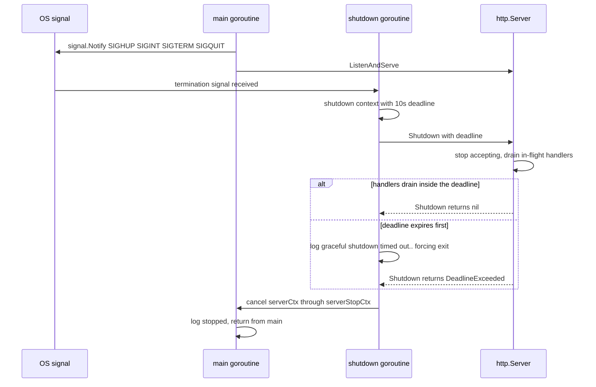

# Go Microservices: Conventions & Service Inventory

`services/` contains exactly two Go modules, and they share conventions rather than code.
[`services/README.md`](../../services/README.md) is the written contract (piloted in `indicator-service`,
with `mcp-gateway` aligning through later work); this page records what is actually implemented today, where the two services
deliberately differ, and where their ownership stops. Per-service behaviour lives in
[Market Data & Indicators](../workflows/market-data-and-indicators.md),
[Charting](./charting.md) and the [MCP Gateway](../integrations/mcp-gateway.md) page — this page is
the cross-service boundary view.

## Inventory and ownership boundary

| Module | Entrypoint | Listener surface | Responsibility |
| ------ | ---------- | ---------------- | -------------- |
| `services/indicator-service` (`retail-portfolio/services/indicator-service`) | `cmd/indicator-service/main.go` | `GET /health`, `POST /compute` on `PORT` (default `8080`) | Stateless technical-indicator calculator; the FastAPI backend's `IndicatorServiceClient` in `src/market/service.py` is its only intended client |
| `services/mcp-gateway` (`retail-portfolio/services/mcp-gateway`) | `cmd/mcp-gateway/main.go` | `GET /health`, MCP streamable HTTP at `/mcp` on `PORT` (default `8080`) | MCP transport + backend data-plane client; holds no provider credentials and calls no provider directly |

The two services never call each other. Traffic is one-directional in both cases: the backend
drives `indicator-service`, and `mcp-gateway` drives the backend's service-to-service data plane
(`BACKEND_BASE_URL + DATA_PLANE_PATH`) with `X-Service-Token`. Neither sidecar owns data — the
backend owns candles, indicator specs and provider access.

Where the internals live, so this page stays at the boundary:

- `indicator-service`'s compute contract, validation bounds and interval scaling:
  [Market Data & Indicators](../workflows/market-data-and-indicators.md) and [Charting](./charting.md).
- `mcp-gateway`'s tool surface, error taxonomy and data-plane routes:
  [MCP Gateway](../integrations/mcp-gateway.md).
- Compose/dev runtime details: [Workflows & CI](../operations/workflows.md) and [Quickstart](../quickstart.md).
- Test commands and CI wiring: [Testing](../operations/testing.md).

## Module and layout conventions

Each service is an independent Go module (`go.mod` declares `go 1.27`) with a thin `cmd/`
entrypoint and an `internal/` tree. `internal/` is the enforcement mechanism: Go's package
visibility rules make it impossible for another module to import these packages, so nothing in
`src/` or `frontend/` can couple to a sidecar's internals.

```text
services/<service>/
  cmd/<service>/main.go   # wiring only: config, logger, router/server, lifecycle
  internal/
    config/               # Config struct + Load(getenv)
    logging/              # slog handler selection and log-level parsing
    httpapi/ | server/    # HTTP handlers, router, middleware, wire DTOs
    <domain>/             # domain logic; no net/http dependency
  Dockerfile
  go.mod
  go.sum
  README.md
```

The domain package of a service stays free of HTTP concerns: `services/indicator-service/internal/indicators`
(calculator, spec/parameter resolution, `ScalePeriod`) imports no `net/http`, so the math is
independent of the transport that exposes it. `mcp-gateway` mirrors this with
`internal/backend` (transport, market client, error classes) and `internal/tools` (tool
registration) sitting behind `internal/server`.

## Configuration via injected `Load(getenv)`

Every service exposes one constructor, called from `main` as `config.Load(os.Getenv)`, and takes
the environment lookup as a parameter so parsing rules are unit-testable without mutating the
process environment:

```go
func Load(getenv func(string) string) (Config, error)
```

Fail-fast validation is the invariant: a missing required value or an unusable format aborts
startup with an error that names the offending variable (`invalid LOG_LEVEL "nope"`,
`invalid MAX_CONCURRENCY "0"`, `BACKEND_BASE_URL is required`). `mcp-gateway` never echoes the
token value in such an error, and its config tests assert exactly that.

### Variable surface

| Variable | `indicator-service` | `mcp-gateway` |
| -------- | ------------------- | ------------- |
| `PORT` | optional, default `8080` | optional, default `8080` |
| `ENVIRONMENT` | optional, default `dev` (lower-cased/trimmed) | optional, default `dev` |
| `LOG_LEVEL` | optional; must be `DEBUG`, `INFO`, `WARN`/`WARNING` or `ERROR` | same |
| `BACKEND_BASE_URL` | — | required; must parse as an `http`/`https` origin with a host |
| `MARKET_DATA_SERVICE_TOKEN` | — | required shared secret; never logged or embedded in errors |
| `DATA_PLANE_PATH` / `MARKET_DATA_PATH` | — | optional, default `/api/v1/market/data`; `DATA_PLANE_PATH` wins, trailing `/` trimmed, leading `/` added |
| `MAX_CONCURRENCY` | — | optional, default `10`; must be a positive integer |
| `SESSION_IDLE_TIMEOUT` | — | optional, default `30m`; must be a positive Go duration |

The one visible divergence is the failure channel at the very start of `main`: `indicator-service`
has no logger until configuration parses, so it writes the load error to `os.Stderr` and calls
`os.Exit(1)`; `mcp-gateway` reports the same class of error through `slog.Error` against the
default logger before `logging.Init` replaces it. Both are still fail-fast, both exit `1`.

## Structured logging (`slog`)

Both services use the standard library `log/slog` with the same selection rules, implemented by
near-identical `ParseLogLevel` helpers:

- `ENVIRONMENT=prod` → `slog.NewJSONHandler` with default level `INFO`.
- `ENVIRONMENT=dev` (or unset) → `slog.NewTextHandler` with default level `DEBUG`.
- A valid `LOG_LEVEL` overrides that default; an invalid one fails configuration loading rather
  than falling back silently.

Wiring differs only in shape. `indicator-service` calls `logging.SetupLogger(env, level, os.Stdout)`
and installs the result with `slog.SetDefault`; `mcp-gateway` calls `logging.Init(cfg)` for the same
effect, then derives a service-scoped logger carrying `service`, `port`, `backend_url`,
`data_plane_path`, `environment` and `max_concurrency` attributes that every subsequent record
inherits.

Log level and environment gate different things, which matters when debugging in production.
`indicator-service` gates its `/compute` body dump on the level alone, and `mcp-gateway` gates
outbound request/response tracing and tool invocation/completion records on the level alone — so
`LOG_LEVEL=DEBUG` under `ENVIRONMENT=prod` re-enables those records, emitted as JSON lines. The
one exception is `mcp-gateway`'s inbound request dump (headers, query, body): it is gated on
`ENVIRONMENT=dev` via `config.IsDev`, so it stays off in prod regardless of the log level.

## HTTP access logging

The shared shape is a middleware that wraps the router's `http.Handler`, wraps the
`http.ResponseWriter` to capture the final status code (both wrappers expose `Unwrap`, and the
gateway's also tracks bytes written and implements `http.Flusher` pass-through so MCP
server-sent events flush immediately), and emits one completion record per request with
`method`, `path`, `status` and `duration`.

| Aspect | `indicator-service` | `mcp-gateway` |
| ------ | ------------------- | ------------- |
| Middleware applied in | `httpapi.NewRouter(logger)`, so every route is covered | `main`, wrapping the router returned by `server.NewRouter` |
| Completion level | status-derived: `>= 500` → `ERROR`, `>= 400` → `WARN`, otherwise `INFO` | always `INFO`, with `status` as a field |
| Per-request detail | at `DEBUG` level: `remote_addr`, `duration_ms`, and the request body for `/compute` (read up to 10MB and re-buffered) | at `DEBUG` level, dev only: `headers`, `query` and body (read up to 64KB and re-buffered) |
| Redaction | none — the service accepts no secret-bearing request headers | `Authorization`, `X-Service-Token`, `Cookie`, `Set-Cookie` become `[REDACTED]` in header dumps |
| Correlation | `request_id` attribute on every record | no request ID (see below) |

Status-derived severity is the documented convention; `mcp-gateway` currently logs every
completion at `INFO` and relies on the `status` field instead, which is why an operational alert
on gateway 5xx responses must key on the field, not the level.

## `X-Request-ID` contract

`indicator-service` implements the correlation-ID convention end to end:

1. Read `X-Request-ID` from the incoming request (trimmed); if absent, generate one.
2. Generation is an RFC 4122 version 4 UUID drawn from `crypto/rand`; the only fallback is a
   `req-<unix-nano>` string if the entropy read fails.
3. Echo the value on the response as `X-Request-ID`.
4. Attach both the ID and a logger pre-populated with `request_id` to the request
   `context.Context`; handlers read them back through `RequestIDFromContext` /
   `LoggerFromContext` (the latter falls back to `slog.Default()`), so handler and middleware
   records share the same ID.

`mcp-gateway` does not implement request-ID propagation yet — no `X-Request-ID` handling or
`request_id` field exists in that module. `services/README.md` records the adoption as pending
work tied to its OpenTelemetry tracing follow-up, so a change that adds request IDs there should
extend the same header contract rather than inventing a second one.

## Server lifecycle and graceful shutdown

Both entrypoints use the same lifecycle: parse config, build the logger, build the router/handler,
construct `http.Server`, register the signal handler, then `ListenAndServe` with a `serverCtx` that
keeps `main` blocked until shutdown completes. `SIGHUP`, `SIGINT`, `SIGTERM` and `SIGQUIT` all
trigger the same path.



Graceful shutdown as implemented in both `cmd` entrypoints.

Invariants and failure semantics:

- The grace period is hard-coded at **10 seconds** (`context.WithTimeout(serverCtx, 10*time.Second)`).
- A watcher goroutine logs when the deadline expires before connections drain — `WARN` in
  `indicator-service`, `ERROR` in `mcp-gateway`. The "forcing exit" wording is aspirational: the
  process still exits only after `Shutdown` returns, and a `Shutdown` error is logged separately
  as `server shutdown error`.
- `http.ErrServerClosed` is ignored; any other `ListenAndServe` error is logged and exits `1`. A
  clean shutdown returns from `main` normally (exit `0`) after logging `stopped`.

| Server timeout | `indicator-service` | `mcp-gateway` |
| -------------- | ------------------- | ------------- |
| `ReadTimeout` | `15s` | `15s` |
| `WriteTimeout` | `15s` | `0` (unlimited) — deliberate, so the MCP streamable HTTP transport can keep SSE responses open for the life of a session; `IdleTimeout` still reaps dead connections |
| `IdleTimeout` | `60s` | `60s` |

## Security posture

Both listeners are unauthenticated and unthrottled, and both are meant to be reachable only from
the internal Docker network:

- **`indicator-service`** exposes no authentication and no rate limiting; `services/indicator-service/README.md`
  states it is internal-only and must never be exposed publicly. Dev Compose publishes it on
  `127.0.0.1:${INDICATOR_SERVICE_PORT:-8004}` → container `8080`; prod Compose publishes no host
  port at all.
- **`mcp-gateway`** `/mcp` is unauthenticated by design — the shared-secret trust boundary is the
  backend data plane (`X-Service-Token` on outbound calls), not the MCP listener. Browser
  cross-origin requests are rejected: `/mcp` is wrapped in `http.NewCrossOriginProtection()`, so a
  request carrying `Sec-Fetch-Site: cross-site` or a mismatched `Origin` gets `403`, while
  non-browser agents without those headers connect normally. Dev Compose publishes it on
  `127.0.0.1:${MCP_GATEWAY_PORT:-8005}`; prod publishes no host port.

Secrets handling follows one rule in both modules: values arrive only from the environment and
never reach logs or error strings.

- `mcp-gateway` never logs `MARKET_DATA_SERVICE_TOKEN` or any `X-Service-Token` header value;
  config errors name the variable but not the value, request-log header dumps redact it, and
  outbound transport logging omits auth headers.
- Diagnostic detail is split from user-facing output: backend status/body detail is retained only
  for Go-side logging (truncated) and is excluded from error strings and tool results.
- Tool names, descriptions, titles, schemas, results and log lines stay provider-agnostic, and
  dedicated compliance tests scan tool metadata, results and log output for upstream provider
  brands.

## Docker build target

Both images are byte-for-byte parallel in structure — a dependency-caching builder stage, a
minimal runtime stage, a non-root user, and a `wget`-based healthcheck against `/health`:

```dockerfile
FROM golang:1.27-alpine AS builder
WORKDIR /app
COPY go.mod go.sum ./
RUN go mod download
COPY . .
RUN CGO_ENABLED=0 GOOS=linux go build -ldflags="-s -w" -o <service> ./cmd/<service>

FROM alpine:3.21
WORKDIR /app
RUN apk --no-cache add ca-certificates tzdata wget && \
    addgroup -S appgroup && adduser -S appuser -G appgroup
COPY --from=builder /app/<service> .
USER appuser
EXPOSE 8080
HEALTHCHECK --interval=30s --timeout=5s --start-period=5s --retries=3 \
  CMD wget -qO- http://localhost:8080/health || exit 1
CMD ["./<service>"]
```

Two invariants matter when editing a Dockerfile: the build target must be `./cmd/<service>` (the
entrypoint is never the module root), and the runtime stage must keep running as `appuser` with a
`/health` probe that needs neither credentials nor the backend. Compose healthchecks use the same
endpoint and timing in both the dev and prod files.

## Why there is no shared module

A shared Go module across the sidecars was evaluated and rejected. The services have distinct
lifecycles and minimal code overlap, so a shared internal module would buy version lockstep,
cross-service coupling and build complexity in exchange for little. Each module keeps its own
dependency tree — `indicator-service` depends only on `github.com/cinar/indicator/v2`,
`mcp-gateway` only on `github.com/modelcontextprotocol/go-sdk` plus its transitive set — and the
conventions above are shared through documentation rather than through imports. A new convention
therefore belongs in `services/README.md` and in both services, not in a common library.

## Verifying changes

Go checks run on the host toolchain or through `just`, never inside Docker (the container rule
applies to the Python and Node guides). `just lint-go` is the formatting/analysis gate and runs
over **both** modules; `just check` adds the backend/frontend Gate 0 pass.

| Command | What it covers |
| ------- | -------------- |
| `just lint-go` | `gofmt -l` over `services/indicator-service` and `services/mcp-gateway`, then `staticcheck@v0.8.1` and `govulncheck@v1.8.0` in each module |
| `just test-indicator-service` | `go test ./...` in `services/indicator-service` |
| `just test-mcp-gateway` | `go test ./...` in `services/mcp-gateway` |
| `just test-all` | parallel backend, frontend, both Go suites and the Node script tests |
| `just check` | Gate 0 for the auto-detected ecosystems plus `just lint-go` |
| `cd services/<service> && go vet ./... && go build ./... && go test ./...` | the raw per-module equivalents |

CI keeps the two modules independent: `.github/workflows/ci.yml` declares separate
`indicator-service` and `mcp-gateway` jobs with identical step order — `go mod download`,
`go vet ./...`, a `gofmt -l .` check, `staticcheck@v0.8.1`, `govulncheck@v1.8.0`, `go build ./...`,
`go test ./...` — each caching against its own `go.sum`. The Go toolchain is pinned to `1.27.1`
for staticcheck compatibility, and the vulnerability step therefore tolerates scans whose only
findings are Go standard-library CVEs fixed in Go 1.27.2: the job exits `0` only when the output
mentions the standard library and no module-scoped vulnerability (`from <n> module`). Any
module-level finding still fails CI.

Tests follow the repository rule that no test may depend on an external service: the Go suites use
`httptest` and injected `getenv` functions, never a live backend, database or provider. The tests
that pin the conventions on this page are `internal/config/config_test.go` and
`internal/logging/logger_test.go` in both modules, plus
`services/indicator-service/internal/httpapi/middleware_test.go` (request-ID propagation and
generation, status-derived levels, dev payload logging), the `mcp-gateway`
`internal/logging/middleware_test.go` (inbound records, dev redaction, provider-name compliance)
and `internal/server/server_test.go` (health, MCP initialize/tool listing, session timeout, 403
cross-origin rejection).
