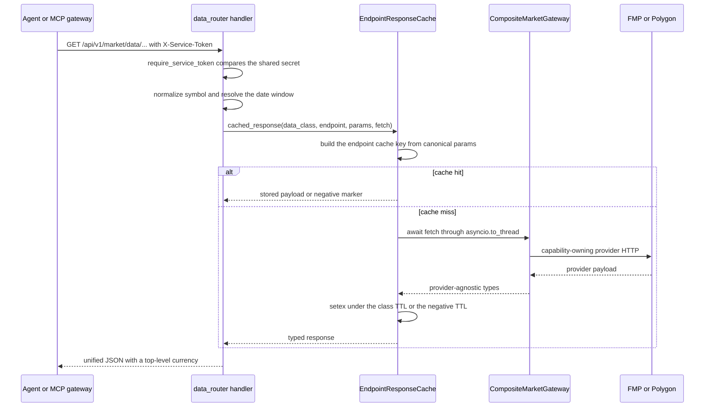
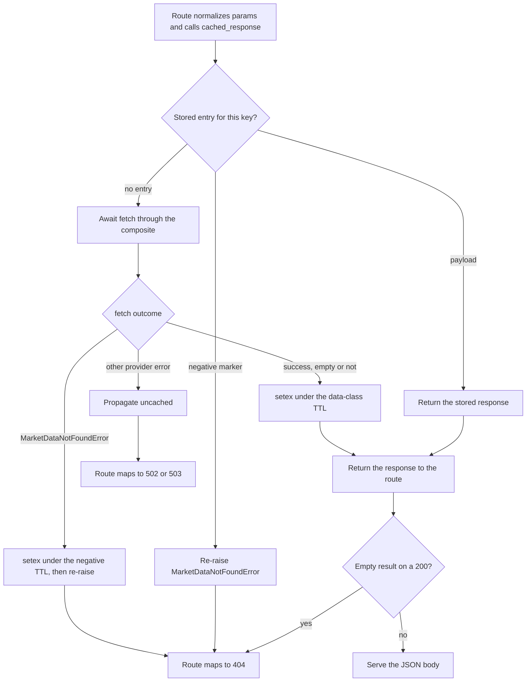

# Market Data Plane: Providers, Caching & the Service Endpoint Contract

`src/market/data_router.py` is the backend's provider-agnostic **service-to-service data plane**: eight
read-only routes under `/api/v1/market/data` that a trusted service (the Go MCP gateway) calls with a
shared secret instead of a user JWT. The plane exists so no downstream consumer ever needs to know which
upstream vendor serves a given dataset: routes, parameters, response shapes, currencies and error bodies
are all provider-neutral, and the routing to a concrete provider happens behind a single svcs key.

Its four defining responsibilities are:

1. **A frozen route contract** — paths and query-parameter names consumed by a Go client, pinned by a
   committed OpenAPI snapshot and two independent test suites.
2. **One gateway key with two providers** — `DataPlaneMarketGateway` resolves a composite that routes
   each capability to its owning provider, while the legacy `MarketGateway` binding stays untouched.
3. **Exactly one cache layer** — `EndpointResponseCache` (`market:ep`) above an uncached composite.
4. **Provider-agnostic output** — a required top-level `currency` on every price-bearing response, and
   error bodies that never name a vendor.

Authentication, the token setting and the router's place in the app are covered by
[Authentication](authentication.md); the user-JWT `/market/*` surface is covered by [Domains](domains.md);
the calling Go service is covered by [MCP Gateway](../integrations/mcp-gateway.md).

## Two gateway keys, one ABC

`MarketGateway` (`src/market/gateway.py`) is the abstract gateway contract. Only four capabilities are
abstract — `search`, `get_price_on_date`, `get_prices`, `get_intraday_prices` — so an existing
prices-and-search gateway stays concrete and instantiable; every newer capability (`lookup_symbol`,
`get_company_profile`, the three statement reads, `get_key_metrics`, `get_financial_ratios`,
`get_institutional_ownership`, `get_options_chain`, `get_option_expirations`, `get_quote`) is a
non-abstract method whose default body raises `MarketDataProviderError("capability not supported by this
provider")`. That default is the reason the two-key design works: a provider that only serves prices
cannot accidentally be asked for options.

Two svcs registration keys sit over that ABC, and the split is the whole point:

| Key | Factory | Serves |
|---|---|---|
| `MarketGateway` | `eodhd_gateway_factory` (`src/market/eodhd.py`) | The legacy price-fetch flows: `EodhdPriceRepository`, `MarketService`, `SecurityApi` broker resolution |
| `DataPlaneMarketGateway` | `composite_market_gateway_factory` (`src/market/composite.py`) | The provider-agnostic data plane: the `data_router` routes, plus the user-facing institutional-ownership route in `src/market/router.py` |

`DataPlaneMarketGateway` is a behaviour-free subclass of `MarketGateway` that exists **solely as a
distinct registration key**. Without it, repointing the plane at FMP/Polygon would have silently repointed
every EODHD price fetch with it; with it, `register_market_services` (`src/market/__init__.py`) can bind
both keys in the same registry and each resolves its own provider stack. `tests/market/test_gateway_registration.py`
asserts exactly that: the data-plane key resolves a `CompositeMarketGateway`, the legacy key still resolves
the EODHD gateway (its stub in stub mode) and never the composite, and the two are different objects.
Both keys are registered in the live registry and in `register_market_stub_services`
(`src/config/services.py`), so `settings.stub_external_api` swaps the providers but never the key layout.

### Why the key is resolved eagerly at boot

The app lifespan (`src/main.py`) resolves the key inside a throwaway container before serving traffic:

```python
# Resolve the provider-agnostic data-plane gateway eagerly so a missing
# provider key or a broken registration fails at boot, not on first request.
async with svcs.Container(registry) as container:
    await container.aget(DataPlaneMarketGateway)
```

This is a deliberate startup probe, not the serving path: the temporary container is entered and exited
immediately, which constructs the composite, validates that the provider factories work (including that a
missing provider credential raises there rather than on the first agent request) and then tears it down
again. Serving requests resolve the key separately, through each request's `svcs.fastapi.DepContainer`.

### Closeable-generator lifecycle

`composite_market_gateway_factory` is a **sync closeable generator factory**, mirroring the cleanup
contract of `indicator_service_client_factory`:

- it constructs the FMP and Polygon gateways directly (the same shape as
  `eodhd_price_repository_factory` calling `eodhd_gateway_factory()`), yields the bare composite, and its
  `finally` calls `gateway.close()`;
- `CompositeMarketGateway.close()` invokes each provider's `close()` hook **defensively** — provider
  lifecycle hooks are structural, not part of the `MarketGateway` contract, so a provider without `close`
  is skipped instead of raising mid-teardown;
- if the Polygon factory raises, the already-built FMP client is closed before the original error
  propagates, and a failing cleanup is suppressed so the construction error still wins;
- it is **sync, not async**, because `data_router` resolves the key with the sync `services.get(...)` and
  svcs refuses to enter an async factory through a sync `get`. A dedicated test
  (`test_data_plane_gateway_resolves_through_sync_container_get`) pins this, because converting the
  factory to an async generator would break every route.

The providers are only closed on this path. Direct `fmp_gateway_factory` / `polygon_gateway_factory` call
sites keep caller-owned lifecycle behaviour. Container teardown and the per-request container shape are
covered in [Configuration](configuration.md).

## Capability routing: FMP vs Polygon

`CompositeMarketGateway` implements the ABC by delegating each capability to the provider that owns it,
adding no caching, no currency resolution, no error translation and no retries of its own.

| Capability | Provider | Notes |
|---|---|---|
| `search`, `lookup_symbol` | FMP | Two FMP endpoints (`stable/search-symbol`, then `stable/search-name` as a fallback) behind one capability |
| `get_prices`, `get_price_on_date` | FMP | Daily historical read; the range/cap logic lives in the route, not the provider |
| `get_quote` | FMP | Live snapshot |
| `get_company_profile`, `get_key_metrics`, `get_financial_ratios`, `get_institutional_ownership` | FMP | `exchange` forwarded for non-US ticker suffixing |
| `get_income_statement`, `get_balance_sheet`, `get_cash_flow_statement` | FMP | `period` / `limit` pass straight through |
| `get_options_chain`, `get_option_expirations` | Polygon | The only Polygon-routed capabilities |
| `get_intraday_prices` | FMP (unsupported) | FMP keeps this capability unsupported, so the provider-agnostic "capability not supported" error surfaces unchanged |

`tests/market/test_composite_gateway.py` makes the routing falsifiable in both directions: the fake
Polygon gateway raises an assertion if it ever receives a search, price, intraday or quote call, and the
tests assert repeated reads reach the providers every time — the composite caches nothing.
`tests/market/test_gateway_registration.py` adds that a data-plane gateway writes no `market:gw:*` keys.

Exchange suffixing is provider-internal: `map_to_fmp_ticker` (`src/market/fmp.py`) leaves US/primary
venues (`NYSE`, `NASDAQ`, `NYSEARCA`, `AMEX`) and unknown codes bare and appends a market suffix for known
non-US venues (`TSX` → `.TO`, `LSE` → `.L`), never double-suffixing. That is why every route that accepts
`exchange` forwards it: the caller passes a canonical venue, and the provider-specific ticker shape stays
behind the gateway. Provider HTTP behaviour and credential handling are described in
[External Services](../integrations/external-services.md).

## The eight routes

`data_router = APIRouter(prefix="/market/data")` is included in the `/api/v1` router in `src/main.py`, so
every path below is relative to `/api/v1`. Each route declares
`_svc: Annotated[None, Depends(require_service_token)]` and resolves `DataPlaneMarketGateway` plus
`EndpointResponseCache` from the request container.

| Route | Query parameters | Cache data class / endpoint | Response |
|---|---|---|---|
| `GET /api/v1/market/data/prices/{symbol}` | `from`, `to`, `interval` (`day`/`week`/`month`, default `day`), `exchange` | `prices` / `history` | `PriceHistoryResponse` |
| `GET /api/v1/market/data/quote/{symbol}` | `exchange` | `quotes` / `quote` | `Quote` |
| `GET /api/v1/market/data/indicators/{symbol}` | `indicator` (required), `period`, `fast`, `slow`, `signal`, `std_dev`, `from`, `to`, `exchange` | `prices` / `indicator` | `IndicatorSeriesResponse` |
| `GET /api/v1/market/data/symbols/search` | `q` (required, 1–100 characters) | `search` / `symbol_lookup` | `list[SymbolLookupResult]` |
| `GET /api/v1/market/data/options/{symbol}/expirations` | — | `options` / `expirations` | `OptionExpirations` |
| `GET /api/v1/market/data/options/{symbol}` | `expiry` (required), `option_type` (`call`/`put`), `strike_min`, `strike_max` | `options` / `chain` | `OptionsChain` |
| `GET /api/v1/market/data/fundamentals/{symbol}` | `exchange` | `metrics` / `fundamentals` | `CompanyFundamentals` |
| `GET /api/v1/market/data/fundamentals/{symbol}/statements` | `statement` (required), `period` (default `annual`), `limit` (1–20, default 5), `exchange` | `statements` / `statements` | statement list union |

Behavioural notes that matter to a caller:

- **`exchange` is the canonical venue, not a free-form code.** Every route that accepts it types it as
  `SupportedExchange` = `NYSE`, `NASDAQ`, `NYSEARCA`, `AMEX`, `TSX`, `LSE`. Anything else is a FastAPI 422
  whose detail lists the accepted codes — rejected before any gateway call.
- **`interval` on the prices route is `day`/`week`/`month`** (`PriceInterval` from
  `src/market/price_aggregation.py`), *not* the chart-side `1h|4h|1d|1w|1m` enum of
  `src/market/enum.py`; the route fetches daily bars and aggregates them in-process.
- **Indicator bounds.** `period`, `fast`, `slow`, `signal` are constrained to 2–400 and `std_dev` to
  `> 0`. Resolved defaults are `sma`/`ema`/`rsi` → `period=14`; `macd` → `fast=12`, `slow=26`, `signal=9`;
  `bollinger` → `period=20`, `std_dev=2.0`. The resolved values are echoed in the response's `params`.
- **Options.** `strike_min > strike_max` is a 422 raised in the handler before the cache is consulted;
  `expiry` is required. The chain response carries a `truncated` boolean that survives a cache round-trip,
  set when the provider's pagination hit its page cap.
- **Fundamentals.** `profile` is required; `key_metrics` and `ratios` are nullable and are read
  concurrently with the profile. A `MarketDataNotFoundError` for either optional section degrades to
  `null` instead of failing the request, so ETFs and recent IPOs return a usable overview.
- **Statements.** The response is a bare list whose item type depends on `statement`
  (`income`/`balance`/`cashflow`), matching the search route's bare-list shape. The handler passes
  `model=None` to the cache, so a cache hit returns the stored dicts and the route's return annotation is
  the schema of record.
- **Symbols are upper-cased** in every handler before they reach the gateway or the cache key.

### The contract is frozen

Route paths and query-parameter names are a **stable contract** for the Go MCP gateway, and three
artifacts enforce it:

- `tests/market/contracts/data_plane_openapi.json` — a committed OpenAPI 3 snapshot titled
  `Market Data Plane Contract`, version `1.0.0`, sliced from the live FastAPI app by
  `src/commands/export_data_plane_contract.py` (`get_data_plane_openapi` selects routes whose path starts
  with `/api/v1/market/data`) and serialized with `indent=2, sort_keys=True` plus a trailing newline.
- `tests/market/test_data_plane_contract.py` — asserts the snapshot matches the live schema
  **byte-for-byte**, that the path set is exactly the eight routes with a GET operation each, that every
  expected path and query parameter exists with the right `in`/`required` flags, that `currency` is
  required on `PriceHistoryResponse` / `IndicatorSeriesResponse` / `OptionsChain` / `Quote`, that
  `OptionsChain` exposes `truncated`, and that no provider name appears anywhere in either the live schema
  or the snapshot.
- `services/mcp-gateway/internal/backend/contract_test.go` — loads the same JSON and drives the Go
  `MarketClient` against a stub server that validates each outbound request against the contract: the path
  must match a contract path template, every query parameter must be declared, every required query
  parameter must be present, and `X-Service-Token` must be non-empty. `TestMarketClientOpenAPIParity`
  fails if any contract route is never exercised, and `TestMarketClientOpenAPINegativeDrift` covers the
  rejection cases (unknown route, missing required parameter, undeclared parameter).

**Consequence:** renaming a path or a query parameter requires regenerating the snapshot
(`UPDATE_CONTRACTS=1` or `uv run python -m src.commands.export_data_plane_contract`) **and** updating the
Go client in `services/mcp-gateway/internal/backend/market.go` in the same change. The Go side also owns
the response-shape edge cases the contract cannot express: `DecodeStatementList` decodes the bare statement
list and rejects an item missing a non-empty `date` or `symbol`, and a decode failure is mapped to the
generic provider-failure result rather than to "no data".

## One request end to end



*A data-plane request: the shared secret is checked first, then the endpoint cache decides between a
stored response and a live provider read through the composite; the route always answers with the
provider-agnostic JSON shape.*

Because the gateway reads are blocking provider HTTP, every handler bridges them with `asyncio.to_thread`
and gathers independent reads (the dataset plus its listing currency) with `asyncio.gather`. That is also
why the composite factory must stay sync: the key is resolved with `services.get(...)` on the event loop.

## Caching layering

`EndpointResponseCache` (`src/market/endpoint_cache.py`) is the **single canonical data-plane cache**. The
composite below it is uncached, so each data-plane response is stored exactly once — there is no
gateway-level cache to invalidate and no double serialization. The cache is async-native: it awaits
`redis_manager.client()` directly with no thread hopping, because the endpoints already run on the loop.



*The cache decision for one data-plane read: a hit, a negative hit, a miss that stores, and the two
distinct paths to a 404.*

### Keys

`market:ep:{data_class}:{endpoint}:{digest}`. The prefix, data class and endpoint stay in the clear so
entries can be found and invalidated by pattern (`market:ep:*`); the request parameters are
content-hashed (`sha256`, first 40 hex characters) after canonicalization, so equivalent inputs share one
entry while genuinely different requests do not:

- `date(2024, 1, 2)` and a midnight `datetime` collapse to the same value; a non-midnight `datetime` keeps
  hour/minute precision so two intraday windows on the same day never collide;
- `Decimal("10.5")` and `Decimal("10.50")` are equal; dict key order is irrelevant;
- the `query` parameter is normalized (trimmed, case-folded) before hashing.

### TTLs

Resolved from settings **at call time**, so a configuration change applies without a restart. Each data
class maps to one settings field; an unrecognized data class logs a warning and falls back to 3600 seconds.

| Data class | Setting | Default |
|---|---|---|
| `prices` | `endpoint_ttl_prices_seconds` | 3 600 s |
| `search` | `endpoint_ttl_search_seconds` | 3 600 s |
| `quotes` | `endpoint_ttl_quotes_seconds` | 30 s |
| `options` | `endpoint_ttl_options_seconds` | 1 800 s |
| `metrics` | `endpoint_ttl_metrics_seconds` | 86 400 s |
| `statements` | `endpoint_ttl_statements_seconds` | 86 400 s |
| any (negative entries) | `endpoint_ttl_negative_seconds` | 300 s |

### Negative caching and empty results

Two distinct mechanisms produce a stable 404 (both visible in the diagram above), and a caller cannot tell
them apart from the status code:

- **Negative caching.** When `fetch` raises `MarketDataNotFoundError`, the wrapper stores
  `{"__market_data_not_found__": <label>}` under the **negative TTL** and re-raises. A later request with
  the same cache key is a hit on that marker and re-raises an equivalent `MarketDataNotFoundError`
  **without touching the provider**; the route translates it to the 404. The label is the error's symbol,
  or the `symbol`/`query` parameter when the error carries none. The marker shape is
  one-key by construction, so no legitimate payload can be mistaken for it, and the raw marker is never
  returned through the direct `get` API.
- **Empty successful results.** An empty-but-successful read (no price bars, no search results, no
  statements, no indicator points) is cached as an ordinary successful payload under the *class* TTL, and
  the handler raises its 404 **after** the cache wrapper. Repeat requests therefore get the same 404 for
  the class TTL rather than a negative entry. This is deliberate: re-fetching an empty window on every
  request would burn provider quota for a result that will not change within the TTL.

Transient failures are never cached — a `MarketDataProviderError` or `MarketDataConfigurationError`
propagates uncached, so the next request retries the provider. A legitimately `None` result is cached via
a `{"null": true}` sentinel, so "no result" is a hit rather than a permanent miss. The negative-cached 404
for the symbols-search route reuses the generic `for symbol '<q>'` wording, while the empty-result 404
names the query (`No market data found for query '<q>'.`).

### Redis failure semantics

Every Redis interaction is wrapped so the plane degrades to live fetches and never fails a request because
of the cache:

- a **read** failure (connection error, timeout) logs a warning and is treated as a miss;
- a **write** failure logs a warning and the response is still served — the request simply stays uncached,
  so the next call fetches again;
- a **malformed** stored payload is logged and treated as a miss rather than surfacing as a 500.

`tests/market/test_endpoint_cache.py` exercises all three paths plus TTL selection, key equivalence and
negative-cache re-raise semantics against an in-memory Redis fake — no server, no network.

## Listing currency

Every price-bearing data-plane response carries a **required top-level `currency`** (asserted for
`PriceHistoryResponse`, `IndicatorSeriesResponse`, `OptionsChain` and `Quote` by the OpenAPI contract
test). `resolve_listing_currency` (`src/market/currency.py`) is the one resolver:

1. **Company profile first.** It reads `gateway.get_company_profile(symbol, exchange=exchange)` and
   normalizes the result with `normalize_currency`: `None`/blank → `None`, `GBp` and `GBX` (any case) →
   `GBX`, everything else upper-cased.
2. **Deterministic exchange fallback.** When the profile has no usable currency — or the profile read
   reports the symbol missing — the currency comes from `EXCHANGE_DEFAULT_CURRENCY`: `TSX` → `CAD`,
   `LSE` → `GBX`, `NYSE`/`NASDAQ`/`NYSEARCA`/`AMEX`/`None` → `USD`, with `or "USD"` as the final catch-all.

The resolved string is itself cached through `EndpointResponseCache` under data class `metrics`, endpoint
`listing_currency`, keyed by `(symbol, exchange)` — which is why a repeat prices request for a *different*
date range still shares one currency lookup. Failure behaviour is asymmetric on purpose:

| Situation | Result |
|---|---|
| Profile reports a currency | Normalized profile currency |
| Profile is missing (`MarketDataNotFoundError`) | Exchange fallback, **cached** — so the lookup is not repeated and a missing profile never turns a prices request into a 404 |
| Provider or configuration error | Exchange fallback returned and logged at warning level, **not cached** |
| Any other exception | Exchange fallback returned and logged at warning level, **not cached** |

Because the currency read is independent of the dataset read, the prices, quote and indicator handlers run
both concurrently, and `resolve_listing_currency` swallows its own provider errors — so a currency lookup
can never turn a data-bearing request into an error. The options-chain handler resolves currency with
`exchange=None` (the route has no `exchange` parameter), so an options response is profile-or-`USD`.

`GBX` is the plane's canonical pence unit: a London listing quoted in provider pence is reported as `GBX`
rather than `GBp` or `GBP`, so consumers never have to guess whether a value is pounds or pence. The
broader currency concept is covered in [Money and Currency](../concepts/money-and-currency.md).

## Price aggregation and range caps

`resolve_price_range(from_, to, interval)` (`src/market/price_aggregation.py`) runs **before** any provider
read, so an over-large request costs nothing:

- `to` defaults to today (UTC); `from` defaults to `to - 365 days`.
- `from > to` is a 422 with detail `from must be less than or equal to to`.
- The estimated bar count depends on the interval — weekdays (Mon–Fri) for `day`, distinct ISO weeks for
  `week`, distinct calendar months for `month` — and anything above `MAX_PRICE_BARS = 2000` is a 422:

  ```
  Requested range spans ~2609 bars, exceeding the limit of 2000. Narrow the date range or use a coarser interval ('week' or 'month').
  ```

  The trailing suggestion is interval-aware: `day` offers `'week'` or `'month'`, `week` offers only
  `'month'`, and `month` offers none (it is the coarsest supported interval). A 120-month monthly request
  is comfortably under the cap; a 2,609-weekday daily request is not.

`aggregate_bars(bars, interval)` then buckets the daily bars in-process:

| Field | Weekly / monthly bucket value |
|---|---|
| `date` | Last trading date in the bucket |
| `open` | First open in the bucket |
| `high` | Maximum high in the bucket |
| `low` | Minimum low in the bucket |
| `close` | Last close in the bucket |
| `volume` | Sum of volume in the bucket |
| `adjusted_close` | Last adjusted close in the bucket |

Weeks are ISO calendar weeks (`isocalendar()[:2]`), months are calendar months, buckets are ordered by
date, and `day` returns the date-sorted bars unchanged. Partial buckets at the start or end of a range are
aggregated from whatever bars exist — a two-day partial week still becomes one bar.

The indicator route shares the same cap (it resolves its window with `"day"`) and additionally fetches a
**warm-up window** so the computed series is not blank at the start of the requested range:

```
warmup_bars = 3 * longest_lookback
warmup_days = int(warmup_bars * 7 / 5) + 10
fetch_from  = resolved_from - timedelta(days=warmup_days)
```

`longest_lookback` is the resolved period for `sma`/`ema`/`rsi`/`bollinger` and `slow + signal` for `macd`
(35 by default). The warm-up bars are fed to the indicator sidecar but **trimmed out of the response**,
which contains only points dated inside `[from, to]`. Candle conversion scales OHLC by the split ratio
`adjusted_close / close` when the two differ, so the sidecar computes over split-adjusted prices while the
`day` price route reports the provider's raw and adjusted values side by side. The sidecar client is
covered in [Market Data and Indicators](../workflows/market-data-and-indicators.md).

## Provider-agnostic error mapping

`_map_market_error(symbol, exc)` is the plane's only error translator and it works on the
provider-agnostic domain exceptions in `src/market/exception.py`:

| Exception | Status | Detail |
|---|---|---|
| `MarketDataNotFoundError` | 404 | `No market data found for symbol '<SYMBOL>'.` |
| `MarketDataConfigurationError` | 503 | `Market data provider is unavailable.` |
| any other provider failure | 502 | `Market data provider is unavailable.` |

The 502 and 503 bodies share a single constant (`_PROVIDER_UNAVAILABLE_DETAIL`). An exception instance may
carry whatever message its provider-side translation layer chose, but the route never copies it into the
body: the providers translate their own failures into these three types before the route sees them, and the
mapping ignores the message entirely. `MarketDataNotFoundError` is deliberately **not** an
`EntityNotFoundError`, so the app's global 404 handler does not claim it and each route decides the
mapping.

The one status a data-plane handler re-raises from a dependency rather than from the gateway is the
indicator sidecar's own: a 503 `Indicator service unavailable` or a 504 timeout from
`IndicatorServiceClient` propagates unchanged and is **not cached**, so a repeat request hits the sidecar
again instead of replaying a transient failure.

### A provider brand must never appear

This is an invariant with teeth, enforced at four independent layers:

- **Response bodies.** `tests/market/test_data_router.py` asserts, for 404s, 502s and 503s, that the
  `detail` contains neither a provider name (`polygon`, `fmp`, `eodhd`, `finnhub`) nor the raw upstream
  text.
- **The contract.** `test_data_plane_contract_has_no_provider_names` scans both the live FastAPI schema and
  the committed snapshot for `fmp`, `financialmodelingprep`, `polygon` and `eodhd`.
- **Public types and messages.** `tests/market/test_gateway_contract.py` asserts the public type names,
  exception names and gateway method names, and the default exception messages, are provider-agnostic.
- **The Go gateway.** `services/mcp-gateway` repeats the check for tool names, titles, descriptions, result
  text, error sentinels and log lines, with the provider list assembled from string fragments so the test
  file itself stays free of the brands it forbids. The gateway's own error taxonomy collapses the backend
  statuses into four agent-safe classes and keeps status/body detail for Go-side diagnostics only.

Practically, this means a log-facing tool error and a route payload are the same vocabulary: an agent can
learn that data is missing, that a request was invalid, or that the provider is unavailable — never which
vendor is behind the plane.

## Extension points

- **Adding a data-plane route.** Add it to `src/market/data_router.py` behind
  `Depends(require_service_token)`, resolve `DataPlaneMarketGateway` with the sync `services.get(...)`,
  serve through `EndpointResponseCache.cached_response` with a `data_class` from `_TTL_SETTING_FIELDS`,
  and map failures with `_map_market_error`. Then regenerate the OpenAPI snapshot and extend the Go client
  — the contract test fails otherwise.
- **Adding a data class.** Add a settings field for its TTL and an entry in `_TTL_SETTING_FIELDS`; an
  unregistered class still works but silently uses the 3600-second default and logs a warning.
- **Adding a capability or provider.** Implement the optional `MarketGateway` method on the provider and
  route it in `CompositeMarketGateway`; add a stub under `src/stubs/` so `STUB_EXTERNAL_API=true` keeps the
  whole suite offline. Which registration key the provider belongs to is the decision that keeps the
  legacy EODHD flows and the data plane from entangling.
- **Changing error semantics.** Do it in the provider's translation layer (into the three domain
  exceptions), not in `_map_market_error`: the route's mapping is deliberately a total function over those
  three types.

## Focused tests

| Test | What it pins |
|---|---|
| `tests/market/test_data_router.py` | The full route surface: unified JSON shapes, currency resolution on all four price-bearing routes, aggregation and the 422s, service-token rejection (including a non-ASCII token that must be 401 and not 500), cache hits per data class, negative caching for prices, quote, options, expirations, search, fundamentals and statements, generic error bodies, and concurrent fundamentals reads |
| `tests/market/test_endpoint_cache.py` | Key composition and equivalence, per-class TTLs read at call time, negative caching and re-raise, the null sentinel, typed round-trips, and Redis read/write/corruption degradation |
| `tests/market/test_data_plane_contract.py` | The committed OpenAPI artifact matches live FastAPI byte-for-byte, covers exactly the eight routes and their parameters, requires `currency` on price-bearing responses, exposes `truncated`, and contains no provider names |
| `services/mcp-gateway/internal/backend/contract_test.go` | The same artifact drives the Go client: full route coverage, no undeclared or missing query parameters, and negative drift rejection |
| `tests/market/test_composite_gateway.py`, `test_gateway_registration.py` | Capability routing in both directions, no caching in the composite, defensive close semantics, partial-construction cleanup, both registration keys in live and stub mode, and sync resolution |
| `tests/market/test_price_aggregation.py`, `test_currency.py` | Bucket arithmetic and the bar cap per interval; the profile → fallback currency order, `GBp`/`GBX` normalization and each fallback path |
| `tests/market/test_fmp.py`, `test_polygon.py` | Provider translation: ticker suffixing, not-found vs provider vs configuration errors, no upstream body leakage, and pagination caps |

## Related pages

- [Domains](domains.md) — the market domain's two serving surfaces and the gateway bindings
- [Configuration](configuration.md) — the service token, TTL settings and container lifecycle
- [Authentication](authentication.md) — `require_service_token` and the service-token boundary
- [External Services](../integrations/external-services.md) — the provider HTTP clients behind the composite
- [MCP Gateway](../integrations/mcp-gateway.md) — the Go client and tool surface that consumes this contract
- [Market Data and Indicators](../workflows/market-data-and-indicators.md) — the user-facing and chart-side data paths
