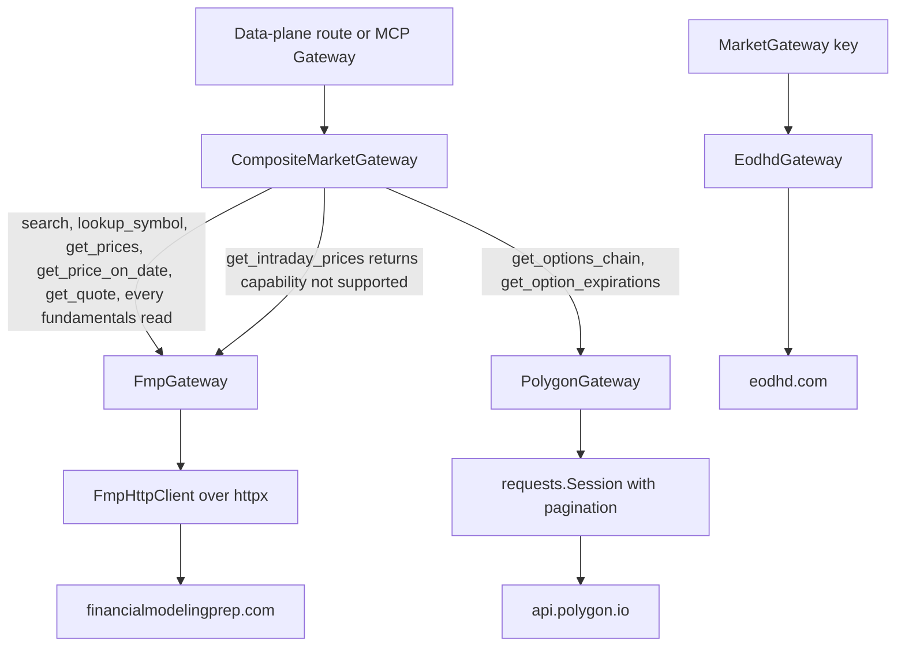
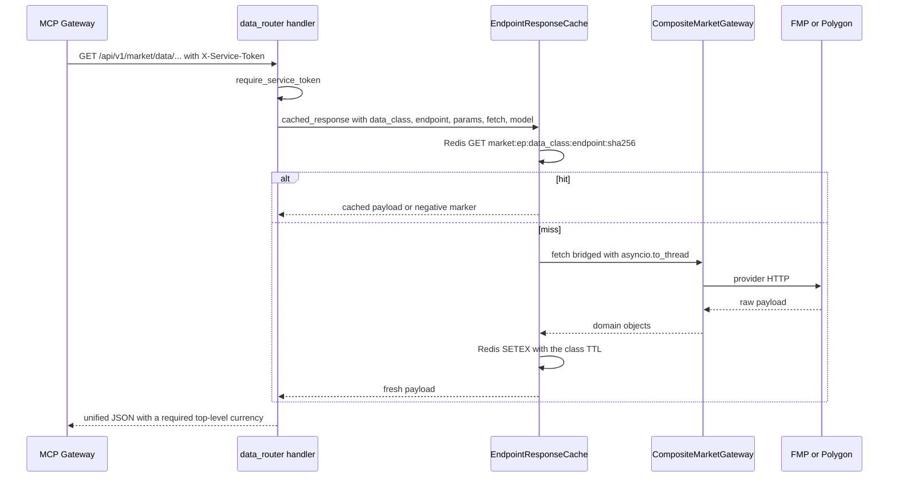

`src/market` talks to three upstream vendors, and the shape of that traffic is deliberately hidden behind one interface. This page covers the provider-agnostic layer: the gateway contract, how each capability is routed to the vendor that owns it, how responses are cached exactly once, how failures are translated into a vendor-free HTTP taxonomy, and how the service-to-service routes that the Go MCP gateway consumes are pinned by a committed OpenAPI snapshot.

The routing and cache work is one half of the market domain; the user-facing half (watchlists, chart snapshots, alerts, AI analysis) lives in [Market data and indicators](../workflows/market-data-and-indicators.md), the outbound credential/stub-switch catalogue in [External Services](../integrations/external-services.md), and the Go consumer in [MCP Gateway](../integrations/mcp-gateway.md).

## The `MarketGateway` contract

`src/market/gateway.py` defines one ABC, `MarketGateway`, and the point of it is that no caller needs to know a vendor name:

- **Required capabilities** are `search`, `get_price_on_date`, `get_prices` and `get_intraday_prices`. `security_id` on the price reads is optional and only labels a result for persistence; a provider-agnostic caller (the data plane) omits it and gets `None` back, while a persisting caller (`EodhdPriceRepository`) supplies it.
- **Optional capabilities** are `lookup_symbol`, `get_company_profile`, `get_income_statement`, `get_balance_sheet`, `get_cash_flow_statement`, `get_key_metrics`, `get_financial_ratios`, `get_institutional_ownership`, `get_options_chain`, `get_option_expirations` and `get_quote`. They are non-abstract on purpose: a gateway that only serves prices and search stays concrete and instantiable, and the default body raises `MarketDataProviderError("capability not supported by this provider")` — the same provider-agnostic error real gateways raise for capabilities they cannot serve.

That default is load-bearing. A wrapper, a new route, or a test can call any capability on any gateway and get one neutral failure instead of an `AttributeError`.

Two `svcs` keys implement this interface, and the split is the reason the interface exists:

| svcs key | Factory | Resolves to |
| --- | --- | --- |
| `MarketGateway` | `eodhd_gateway_factory` | `EodhdGateway` (or `StubEodhdGateway` in stub mode) — the legacy price-fetch/search binding, used by `src/market/router.py` search, `EodhdPriceRepository` and `MarketService` |
| `DataPlaneMarketGateway` | `composite_market_gateway_factory` | the bare `CompositeMarketGateway` over FMP + Polygon |

`DataPlaneMarketGateway` is a `MarketGateway` subclass with no behaviour at all — it exists purely as a distinct registration key so the FMP/Polygon data plane can coexist with the EODHD binding. Both registries (`src/market/__init__.py::register_market_services` for the live path and `src/config/services.py::register_market_stub_services` for `STUB_EXTERNAL_API=true`) register both keys, so switching to stubs changes the gateways behind the keys, not the keys themselves.



Capability routing: one composite, two providers, and a third vendor still serving the legacy key.

## Capability routing in `CompositeMarketGateway`

`CompositeMarketGateway` takes one FMP-typed and one Polygon-typed gateway in its constructor and forwards each method verbatim. The routing table is the whole design:

| Capability | Provider |
| --- | --- |
| `search`, `lookup_symbol` | FMP |
| `get_price_on_date`, `get_prices` | FMP |
| `get_quote` | FMP |
| `get_company_profile`, `get_income_statement`, `get_balance_sheet`, `get_cash_flow_statement`, `get_key_metrics`, `get_financial_ratios`, `get_institutional_ownership` | FMP |
| `get_options_chain`, `get_option_expirations` | Polygon |
| `get_intraday_prices` | delegated to FMP, which keeps the capability unsupported |

Two invariants matter when changing this class:

- **The composite caches nothing.** `test_composite_delegates_every_call_and_adds_no_caching` asserts repeated `get_key_metrics`/`get_options_chain` calls reach the provider every time, and `test_data_plane_gateway_writes_no_gateway_cache_keys` asserts the composed gateway writes no `market:gw:*` keys. The only data-plane cache is `EndpointResponseCache`, one layer above.
- **`get_intraday_prices` stays a delegation, not a translation.** The FMP gateway implements the method concretely only to satisfy the ABC and raises the provider-agnostic capability error; the composite forwards it unchanged so the error text survives, and the test suite pins that behaviour. Intraday reads are still served by EODHD through the alerting path, not by the data plane.

### Lifecycle and teardown

`composite_market_gateway_factory` is a **sync closeable generator factory**:

```python
fmp = fmp_gateway_factory()
try:
    polygon = polygon_gateway_factory()
except Exception:
    with suppress(Exception):
        _close_provider(fmp)
    raise
gateway = CompositeMarketGateway(fmp=fmp, polygon=polygon)
try:
    yield gateway
finally:
    gateway.close()
```

- It calls the two provider factories directly (mirroring `eodhd_price_repository_factory`), and both are stub-aware, so `STUB_EXTERNAL_API=true` yields a fully offline composite.
- It yields the **bare** composite — caching is applied above it, not inside the factory, which is what keeps "each response is stored exactly once" true.
- Partial construction is handled: if Polygon construction raises after the FMP client already holds pooled HTTP connections, the FMP client is closed first and any teardown failure is suppressed so the original construction error wins.
- `CompositeMarketGateway.close()` calls `close()` on both providers, resolved at runtime and skipped when a provider exposes no such hook — provider lifecycle is structural, not part of the ABC, so a gateway without `close` must not raise mid-teardown.
- svcs tears the generator down when the owning container closes, which is what releases the FMP `httpx.Client` and the Polygon `requests.Session`. Direct `fmp_gateway_factory`/`polygon_gateway_factory` call sites keep caller-owned client semantics.

The factory must stay **sync**: `src/market/data_router.py` resolves the key with `services.get(DataPlaneMarketGateway)` (the sync accessor), and svcs refuses to enter an async factory through sync `get`.

### Boot-time resolution

`src/main.py`'s lifespan resolves the key eagerly inside a throwaway container before serving:

```python
async with svcs.Container(registry) as container:
    await container.aget(DataPlaneMarketGateway)
```

This converts a class of failures from request time to boot time: an unregistered key or a broken registration makes startup fail instead of returning a 500 on the first data-plane call, and it front-loads provider construction so a broken provider factory fails loudly. The probe does not validate credentials — `FmpGateway`/`PolygonGateway` accept an empty API key, so a wrong-but-present key still surfaces at request time as `MarketDataConfigurationError` → `503`. See [Configuration](./configuration.md) for the settings validators that close that gap at import.

## One cache: `EndpointResponseCache`

`src/market/endpoint_cache.py` is the single canonical data-plane cache. The gateway below it is uncached, so layering is: route → `EndpointResponseCache` → composite → provider.

### Keys

`_cache_key(data_class, endpoint, params)` produces a readable, scan-friendly key:

```
market:ep:<data_class>:<endpoint>:<first 40 hex chars of sha256 of canonical params>
```

`data_class` and `endpoint` stay in the clear so entries can be invalidated by pattern (`market:ep:*`); the parameters are `json.dumps(..., sort_keys=True)`-encoded and hashed. `_canonicalize_param` makes semantically equal inputs collide:

- a midnight `datetime` collapses to its calendar `date`, so a daily `date` bound and the equivalent midnight `datetime` share one entry;
- a non-midnight `datetime` keeps hour/minute precision, so two intraday windows on the same day never collide;
- `Decimal("10.5")` and `"10.50"` collapse;
- a `query` string is normalized through `_normalize_query`, so `"  AAPL  "` and `"aapl"` share an entry.

### Data classes and TTLs

`_TTL_SETTING_FIELDS` maps each data class to the settings field holding its TTL, and `_ttl_for` reads that field **at call time** (`int(getattr(settings, field))`) so a configuration change applies without a restart. An unknown data class logs a warning and falls back to `_DEFAULT_TTL_SECONDS = 3_600`.

| `data_class` | Endpoint values | Used by | Default TTL |
| --- | --- | --- | --- |
| `prices` | `history`, `indicator` | `/prices/{symbol}`, `/indicators/{symbol}` | 1 h (`endpoint_ttl_prices_seconds`) |
| `quotes` | `quote` | `/quote/{symbol}` | 30 s (`endpoint_ttl_quotes_seconds`) |
| `search` | `symbol_lookup` | `/symbols/search` | 1 h (`endpoint_ttl_search_seconds`) |
| `options` | `chain`, `expirations` | `/options/{symbol}`, `/options/{symbol}/expirations` | 30 min (`endpoint_ttl_options_seconds`) |
| `metrics` | `fundamentals`, `listing_currency` | `/fundamentals/{symbol}`, plus the currency sub-read on four routes | 1 d (`endpoint_ttl_metrics_seconds`) |
| `statements` | `statements` | `/fundamentals/{symbol}/statements` | 1 d (`endpoint_ttl_statements_seconds`) |
| any | — | negative entries | 5 min (`endpoint_ttl_negative_seconds`) |

### Get-or-fetch, negative caching, and degradation

`cached_response(data_class, endpoint, params, fetch, model)` is the adoption point for every route: look up the key, return the hit (validated through `model` when given), otherwise `await fetch()` and store the result.



Cache-read flow for one data-plane request, including the single store on a miss.

The failure semantics are the part that must not drift:

- **Negative caching.** A `MarketDataNotFoundError` raised by `fetch` is stored as a one-key marker `{"__market_data_not_found__": "<label>"}` under the *negative* TTL (not the class TTL) and re-raised, so repeat lookups of a missing symbol never reach the provider. On a hit the marker is detected **before** model validation and rebuilt into an equivalent `MarketDataNotFoundError(label)` — the raw marker never leaks to a caller, and `EndpointResponseCache.get` reports a cached negative entry as a plain miss.
- **Everything else propagates uncached.** A `MarketDataProviderError` or `MarketDataConfigurationError` writes nothing, so the next request retries the gateway. The route-level tests assert both the status and the doubled provider call count.
- **Redis never fails a request.** `_lookup` wraps the `GET` in a catch-all that logs and returns `(False, None)`; `_store` wraps the `SETEX` in a catch-all that logs and returns. Both `get`/`set` and `cached_response` therefore degrade to a live fetch. A payload that fails to decode is logged and treated as a miss.
- **A cached `None` is a hit.** `_encode_payload` serializes `None` as the shared `_NULL_SENTINEL` (`{"null": true}`) so a legitimately empty result is not re-fetched; the sentinel is decoded back to `None` before any model validation.

`EndpointResponseCache` is registered under both market registries via `endpoint_response_cache_factory` and resolves `redis_manager` per call, so it is async-native with no thread hopping.

## Listing currency and FX rates

Every price-bearing data-plane response carries a **required** top-level `currency`, and it is never taken on trust from the provider payload: `resolve_listing_currency(gateway, cache, symbol, exchange)` resolves it in a fixed order.

1. `gateway.get_company_profile(symbol, exchange=exchange).currency`, normalized by `normalize_currency` — which upper-cases any code but folds provider pence (`GBp`, `gbx`) into `GBX`.
2. A deterministic exchange fallback from `EXCHANGE_DEFAULT_CURRENCY`: `TSX` → `CAD`, `LSE` → `GBX`, `NYSE`/`NASDAQ`/`NYSEARCA`/`AMEX`/`None` → `USD`.

Failure handling follows the same "never fail a price read for a label" rule:

| Situation | Result |
| --- | --- |
| profile read raises `MarketDataNotFoundError` | fallback currency returned **and cached** |
| profile read raises `MarketDataProviderError` / `MarketDataConfigurationError` | fallback returned and logged at warning, **not cached** |
| any other exception | fallback returned and logged, not cached |
| profile currency blank | fallback |

The resolved currency is itself stored through the same cache under `data_class="metrics"`, `endpoint="listing_currency"`, so a price request for a different date range still reuses the currency entry (one profile read, two price reads). Route handlers then apply it explicitly: `Quote` and `OptionsChain` are patched with `model_copy(update={"currency": currency})`, while `PriceHistoryResponse` and `IndicatorSeriesResponse` are constructed with it.

`src/market/fx.py` is a **different concern** — actual FX conversion rates, not a listing label. `FxRateProvider` builds a `currencyconverter.CurrencyConverter` from an ECB history zip that a daily Huey task (`daily_fx_refresh` at 17:30 UTC) stores in Redis under `fx:ecb:zip` / `fx:ecb:fetched_at`, parses once per fetch date in a process-level cache (providers are request-scoped), and falls back to the bundled `currencyconverter` snapshot when Redis is empty, unreachable or holds an unreadable zip. It is consumed by `PositionService` and the broker-sync task for portfolio valuation — the data plane never converts, it only labels.

## The data-plane routes

`src/market/data_router.py` defines `data_router = APIRouter(prefix="/market/data")`, mounted in `src/main.py` under the single `/api/v1` router, so the public paths are `/api/v1/market/data/...`. All eight are GET-only.

| Path | Required query | Optional query |
| --- | --- | --- |
| `/prices/{symbol}` | — | `from`, `to`, `interval` (`day`/`week`/`month`), `exchange` (`SupportedExchange`) |
| `/quote/{symbol}` | — | `exchange` |
| `/indicators/{symbol}` | `indicator` (`sma`/`ema`/`rsi`/`macd`/`bollinger`) | `period`, `fast`, `slow`, `signal`, `std_dev`, `from`, `to`, `exchange` |
| `/symbols/search` | `q` (1–100 chars) | — |
| `/options/{symbol}` | `expiry` | `option_type` (`call`/`put`), `strike_min`, `strike_max` |
| `/options/{symbol}/expirations` | — | — |
| `/fundamentals/{symbol}` | — | `exchange` |
| `/fundamentals/{symbol}/statements` | `statement` (`income`/`balance`/`cashflow`) | `period` (`annual`/`quarter`), `limit` (1–20), `exchange` |

Every handler:

1. depends on `_svc: Annotated[None, Depends(require_service_token)]` as its first parameter and carries **no user identity** — no `current_user`, no ownership check, no rate-limit decorator;
2. normalizes the symbol to upper case and resolves `services.get(DataPlaneMarketGateway)` plus `await services.aget(EndpointResponseCache)`;
3. builds the `params` dict that becomes the cache key (including `interval`, the indicator spec values and the statement selector), runs the provider read inside `fetch`, and wraps the whole thing in `cache.cached_response(...)`.

Sync gateway reads are bridged onto the loop with `asyncio.to_thread` — the composed gateway performs blocking provider HTTP — and independent reads (prices plus currency, quote plus currency, options plus currency, profile plus metrics plus ratios) are issued with `asyncio.gather` so they run concurrently.

`exchange` is forwarded to the gateway on every route that accepts it, because the FMP gateway maps non-US listings to a ticker suffix: `TSX`/`TO` → `.TO`, `TSXV`/`TSX-V`/`V` → `.V`, `LSE` → `.L`; US venues (`NYSE`, `NASDAQ`, `NYSEARCA`, `AMEX`) and unknown codes pass the bare symbol through unchanged, and an already-suffixed symbol is never double-suffixed. `SupportedExchange` is a closed `Literal` of those six codes, which is what makes an unsupported exchange a `422`.

### Error mapping, and the vendor-free body

`_map_market_error(symbol, exc)` is the only place a domain error is translated:

| Raised | Status | Detail |
| --- | --- | --- |
| `MarketDataNotFoundError` | `404` | `No market data found for symbol '<SYMBOL>'.` |
| `MarketDataConfigurationError` | `503` | `Market data provider is unavailable.` |
| any other failure (incl. `MarketDataProviderError`) | `502` | `Market data provider is unavailable.` |

The 502/503 detail is the constant `_PROVIDER_UNAVAILABLE_DETAIL`, so no raw upstream message, URL or provider name can reach a response body. The tests assert exactly that: for a forced failure the detail contains neither `"raw"` nor any of `polygon`, `fmp`, `eodhd`, `finnhub`.

A few route-level behaviours complete the picture:

- **A missing symbol is a 404 served from cache on repeat.** The handler catches the `MarketDataNotFoundError` the cache wrapper re-raises (which the wrapper already negative-cached) and maps it, so the second request is a cache hit with no provider call.
- **A successful-but-empty result is a 404 raised *after* the cache wrapper** — empty price window, empty indicator points, empty search, empty statements. Raising it before the wrapper would make every repeat re-fetch.
- **Input validation is FastAPI's `422`** (`Literal`-typed `statement`/`period`/`indicator`/`option_type`, `Query` bounds, `from > to`, `strike_min > strike_max`, the `MAX_PRICE_BARS = 2000` cap on the estimated bar count for `interval`). These fire before any gateway call.
- **The indicator route has a second dependency.** It fetches a warm-up window (`3 × longest lookback` converted to calendar days × 7/5 + 10), calls `IndicatorServiceClient.compute`, and trims the returned points to `[from, to]`; indicator-service transport failures surface as `503`/`504` from the client and are **not** cached. Aggregation and trimming details belong to [Charting](./charting.md).
- **Bad service token is always `401`.** A missing, wrong or non-ASCII `X-Service-Token` yields `401` — never a `500`.

### Data-plane auth

`require_service_token` in `src/auth/api.py` reads only the `X-Service-Token` header and compares it against `settings.market_data_service_token` with `secrets.compare_digest` **over bytes**. The byte encoding is deliberate: `compare_digest` rejects a non-ASCII `str` with `TypeError` (a `500`), and Starlette's latin-1 header decoding can produce one — so the check stays constant-time and correct for any header. It has no cookie fallback and yields `None`, so it is deliberately independent of user-JWT auth. `Settings` requires `MARKET_DATA_SERVICE_TOKEN` to be non-empty outside `dev`/`test`.

## The OpenAPI parity contract

The route paths and query-parameter names are a **frozen contract** consumed by the Go MCP gateway. The source of truth is the committed snapshot `tests/market/contracts/data_plane_openapi.json` (`openapi: 3.x`, title `Market Data Plane Contract`, version `1.0.0`), generated from the live FastAPI app by `src/commands/export_data_plane_contract.py`, which slices every route whose path starts with `DATA_PLANE_PREFIX = "/api/v1/market/data"` out of `get_openapi(...)`.

- Regenerate intentionally with `UPDATE_CONTRACTS=1 pytest tests/market/test_data_plane_contract.py` or `uv run python -m src.commands.export_data_plane_contract`.
- `tests/market/test_data_plane_contract.py` asserts the live schema matches the artifact **byte-for-byte** (printing a unified diff on drift) and that the contract covers exactly the eight expected routes — so an accidental extra endpoint under the prefix also fails the suite.
- The same suite pins the schema-level promises: the parameter inventory per route (`in`, `required`), that no provider name (`fmp`, `financialmodelingprep`, `polygon`, `eodhd`) appears anywhere in the live schema or the committed artifact, that `currency` is a **required string** on `PriceHistoryResponse`, `IndicatorSeriesResponse`, `OptionsChain` and `Quote`, and that `OptionsChain` exposes the `truncated` boolean.
- `services/mcp-gateway/internal/backend/contract_test.go` verifies the other direction: it loads the same file, asserts the eight routes and non-empty `operationId`s, drives every `MarketClient` method against a stub server, requires **100 % of contract routes to be exercised**, compares the `exchange` enum on all five routes that accept it against the Go `supportedExchanges` list, asserts `expiry` is required on the options route, and runs negative drift cases (missing `X-Service-Token`, unknown route, missing required query param, unknown query param) through its validator.

**Do not rename or re-scope a route or query parameter without regenerating the snapshot and updating the Go side.** Adding a route to `data_router` means: implement it with the service-token dependency, regenerate the artifact, and extend the Go client plus its contract test — otherwise either `test_data_plane_contract.py` or `contract_test.go` fails. See [MCP Gateway](../integrations/mcp-gateway.md) for the consumer side (error classification, MCP tool surface).

## Who calls the data plane

The data plane is **service-to-service only**. No frontend code references `/market/data`; the user-facing market router (`market_router = APIRouter(prefix="/market")`) is the frontend's door, and nearly every route there takes `Depends(current_user)` (the logo proxy is the exception). The Go MCP gateway is the only consumer of these routes today.

Two pieces of FMP provider code are still reached from the user-JWT router, which is why the provider layer is not exclusive to the data plane:

- **Institutional ownership.** `GET /api/v1/market/securities/{security_id}/institutional-ownership` reads `services.get(DataPlaneMarketGateway)` and calls `gateway.get_institutional_ownership` in a thread, with its own Redis key `market:institutional_ownership:{security_id}` (TTL 86 400 s). It degrades to a null-filled `InstitutionalOwnershipResponse` on not-found and on provider error (the latter is not cached).
- **FMP logo helpers.** `_resolve_and_cache_logo` uses the module-level `map_to_fmp_ticker` and `fetch_logo_image` from `src/market/fmp.py` behind `LogoCache`, with a negative sentinel; logos do not travel through the composite gateway.

## Failure and configuration behaviour worth knowing

- **Provider-error translation is per vendor and vendor-free at the seam.** FMP returns errors as HTTP 200 bodies containing `Error Message`; `_raise_for_error_payload` picks `MarketDataConfigurationError` when the message matches one of `_CONFIGURATION_ERROR_TOKENS` (`invalid api key`, `limit rate`, `limit reach`, `requests count exceeds`, `legacy endpoint`) and `MarketDataNotFoundError` otherwise, logging the raw text but never echoing it. Transport and non-2xx failures become `MarketDataProviderError`. `FmpGateway.get_institutional_ownership` additionally catches HTTP 402 (`Payment Required`) and falls back to a shipped stub fixture for known symbols, because FMP restricts that endpoint on some plans. Polygon maps `404` to not-found, `401`/`403` to `MarketDataConfigurationError`, other statuses and unparsable bodies to `MarketDataProviderError`, and caps `next_url` paging at `_MAX_PAGES = 10`, setting `OptionsChain.truncated` when the cap is hit so a caller can tell a complete chain from a truncated one.
- **Stub mode is a first-class path.** `fmp_gateway_factory`, `polygon_gateway_factory` and `eodhd_gateway_factory` each return an offline stub when `STUB_EXTERNAL_API=true`, so the composed gateway, the endpoint cache and the routes all run deterministic against an in-memory Redis in tests.
- **`Settings` gates the credentials.** Outside `dev`/`test` with stub mode disabled, `FMP_API_KEY` and `POLYGON_API_KEY` must be non-empty at import; `EODHD_API_KEY` is only read inside its factory. See [Configuration](./configuration.md).

## Tests

Every suite in this area is offline — no test dials a provider, Redis or DNS:

| Concern | Suite |
| --- | --- |
| Provider-agnostic composite routing, teardown, factory failure paths | `tests/market/test_composite_gateway.py` |
| svcs registration of both keys, sync `get`, container teardown freeing both clients | `tests/market/test_gateway_registration.py` |
| Gateway ABC contract, provider-free types and error names | `tests/market/test_gateway_contract.py` |
| FMP mapping/parsing/error translation and logo fetch (`httpx.MockTransport`) | `tests/market/test_fmp.py` |
| Polygon options chain/expirations (patches `src.market.polygon.requests.Session`) | `tests/market/test_polygon.py` |
| EODHD gateway and stub fixtures | `tests/market/test_eodhd.py` |
| Endpoint cache keys, TTLs, negative caching, Redis degradation | `tests/market/test_endpoint_cache.py` |
| Listing-currency resolution and caching | `tests/market/test_currency.py` |
| ECB-backed FX rate provider and fallback | `tests/market/test_fx.py` |
| Route behaviour, auth, error mapping, negative caching end to end | `tests/market/test_data_router.py` |
| OpenAPI snapshot parity and provider-name-free schema | `tests/market/test_data_plane_contract.py` |
| Go-side contract parity and negative drift | `services/mcp-gateway/internal/backend/contract_test.go` |

`tests/conftest.py` sets `STUB_EXTERNAL_API=true` and an in-memory Redis fake for the whole suite; `test_data_router.py` additionally registers a `MagicMock(spec=MarketGateway)` under the `DataPlaneMarketGateway` key while keeping the *real* `require_service_token` dependency, so the auth path is exercised end to end rather than overridden. See [Testing](../operations/testing.md) for the shared fixtures.

## Change checklist

- **Adding a provider or re-routing a capability**: implement the optional method on the owning gateway, forward it in `CompositeMarketGateway` (add a routing assertion in `test_composite_gateway.py`), and check whether the route needs the new capability.
- **Adding a data-plane route**: keep the `require_service_token` first parameter and the `market:ep` cache wrapper, add the data class to `_TTL_SETTING_FIELDS` *and* a matching `endpoint_ttl_*` setting, regenerate the OpenAPI artifact, and update the Go client and contract test.
- **Touching the cache**: keep the composite uncached; keep failures other than `MarketDataNotFoundError` uncached; keep every Redis error degrading to a live fetch; keep TTL lookups at call time.
- **Touching provider clients**: keep the injected-client/client-ownership rules (`FmpHttpClient` closes only a client it created; `PolygonGateway` reuses one session across pagination pages) so teardown and test patching keep working.
