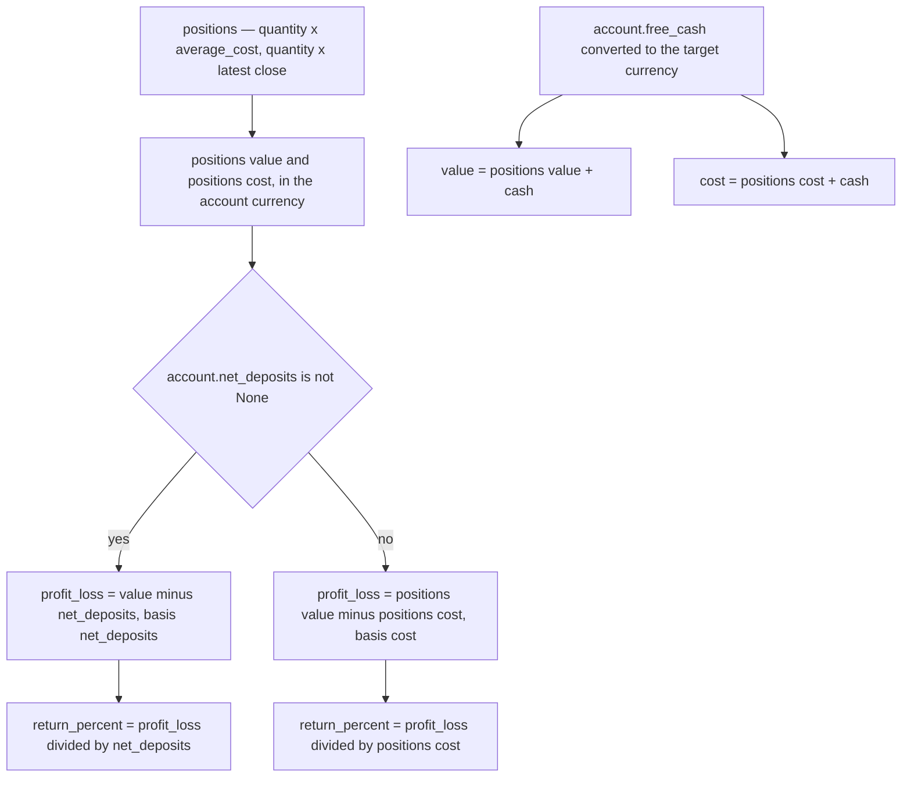

# Money & Currency Handling

Money is the one model that every account, holding, total, P&L, CSV row, and
frontend currency label depends on. There is no single `Money` module to change:
the contract is spread across backend Pydantic API types, `PositionService`,
the database column types, the market data plane's currency resolution
(`src/market/currency.py`) and FX provider (`src/market/fx.py`), and the frontend
helpers in `frontend/src/lib/types/money.ts` and `frontend/src/lib/utils/finance/`.
This page records that contract and the failure modes a careless edit introduces.
Where the resulting numbers are displayed is documented on
[Accounts & Holdings views](../workflows/accounts-and-holdings-views.md); the
provider-side price/currency plumbing lives on
[Market data providers](../architecture/market-data-providers.md) and
[Market data and indicators](../workflows/market-data-and-indicators.md).

## Two layers of representation

The backend deliberately keeps two representations with different jobs.

- **Raw numbers are `Decimal`.** Prices (`Price.close`, `open`, `high`, `low`,
  `adjusted_close`, `volume`), position `quantity`, and position `average_cost`
  are `Decimal` in the API types
  (`src/market/api_types.py`, `src/account/api_types.py`). This is what preserves
  precision through parsing and intermediate math.
- **Currency-tagged amounts are `stockholm.Money`.** Whenever an amount carries a
  currency it is a `Money`: every amount on `AccountTotals` (`cost`, `value`,
  `cash`, `net_deposits`, `profit_loss` — with `return_percent`, `basis`,
  `unpriced_positions` and `pricing_incomplete` as plain scalars), and
  `MarketPricesApi.get_latest_close`, which returns `Money | None` built as
  `Money(latest_price.close, security.currency)` in `src/market/api.py`.

`Account.currency` and `Security.currency` are `stockholm.currency.Currency`
rather than plain strings, because currency validity is checked at the boundary
(broker payloads, CSV import, search results) instead of in every calculation.
`Position.currency` is a plain `str | None` and is the override that wins over the
security's currency in the holdings math (see below). The read models do not keep
the `Currency` type: `AccountSchema.currency` is `Currency` but carries an
explicit `@field_serializer("currency")` that emits a code string, and the read
schemas declare currency fields as `str` (`HoldingRead.currency`,
`HoldingRead.security_currency`, `HoldingRead.display_currency`,
`AccountHoldingsRead.currency`, `AccountHoldingRead.currency`,
`AccountHoldingRead.display_currency`). Numeric account fields also drop to
`float`: `AccountSchema.net_deposits` is `float | None`, `free_cash` is `float`,
and `broker_value` is `float | None`. So "currency" is a `Currency` object only
inside the service layer and the write path, and cash/P&L figures are already
approximate by the time they leave the schema.

`Money` instances are constructed in exactly two places: the market domain tags a
stored close in `MarketPricesApi.get_latest_close`, and `PositionService` wraps
`quantity × average_cost`, `average_cost`, `free_cash`, and `net_deposits` itself
before converting or aggregating them. Two supporting literals live in
`src/account/api_types.py`: `ProfitLossBasis = Literal["net_deposits", "cost"]`
and `SUPPORTED_DISPLAY_CURRENCIES = ("CAD", "USD", "EUR", "GBP")`.

## One conversion contract: Decimal → Money → string → number

The same amount is represented four different ways on its way from a database
column to a rendered figure. This table is the contract both sides must keep
agreeing on.

| Stage | Representation | Example | Produced / read by |
| --- | --- | --- | --- |
| Database column | `DECIMAL(16, 8)` for prices and quantities, `Float` for `average_cost`, `free_cash`, `net_deposits` | `500.00000000` | `src/account/model.py`, `src/market/model.py` |
| Python API type | `stockholm.Money` tagged with a currency code | `Money(500, "USD")` | `AccountTotals`, `MarketPricesApi.get_latest_close`, `PositionService` temporaries |
| JSON on the wire | a single currency-tagged **string** field, never `units`/`nanos` | `{"cost": {"value": "500.00 USD"}}` | Pydantic serialization of `Money` |
| Frontend type | `Money { value?, units?, nanos?, currencyCode? }` | `{ value: "500.00 USD" }` | `frontend/src/lib/types/money.ts`, `AccountTotals`/`Holding` in `frontend/src/lib/types/account.ts` |
| Number for display | `units + nanos / 1e9` when `units` is a number, otherwise `parseFloat(value) \|\| 0`; null/empty/absent → `0` | `500` | `moneyToNumber` |
| Formatted string | `Intl.NumberFormat('en-CA', { style: 'currency', currency })` (or `'en-US'` in the sidebar surfaces) | `$500.00` | `total-profit-loss-buttons.svelte`, the holdings tables |


*From database scale to display: the wire shape is a currency-tagged string, so
the `units`/`nanos` branch is normally bypassed.*

**JSON shape.** A `Money` does *not* serialize to `units`/`nanos`. It serializes
to that single string field:

```json
{ "cost": { "value": "500.00 USD" }, "value": { "value": "650.00 USD" } }
```

`tests/tasks/test_account.py` asserts those exact strings on the WebSocket
payload; `tests/routers/test_accounts.py` asserts the ` CAD` suffix on `cost`,
`value`, `cash` and `profit_loss`, that `net_deposits` is present (and nullable),
and that `?currency=USD` switches every suffix to ` USD`. Anyone who assumes a
structured `{ units, nanos, currencyCode }` payload is working from the frontend
type, not from what the API emits.

**`moneyToNumber` ignores `currencyCode`.** It reads only `units`/`nanos` or
`value`, so the currency is never carried by the parsed number — every call site
must pass the currency separately to the formatter. That is why
`total-profit-loss-buttons.svelte` takes an explicit `currency` prop and why the
holdings tables format each column with the field's own currency.

**The `units`/`nanos` branch is effectively dead against the current backend.**
Because the API emits `{"value": "500.00 CAD"}` with no `units`, every real
response goes through the string fallback, where `parseFloat("500.00 CAD")`
returns `500` only because `parseFloat` stops at the first non-numeric character.
This works by accident, not by design. The frontend fixtures *do* supply
`units`/`nanos` alongside `value` (`accounts-list-item.test.ts`,
`money.test.ts`), which is why the units path still looks alive in tests. Two
failure modes follow:

- If the backend ever emitted a `value` string with a leading currency symbol or a
  non-`en`-style grouping separator, `parseFloat` would silently return a wrong
  number or `0`.
- If a `units`-based serializer is introduced but `nanos` are omitted for
  fractional cents, amounts shift by up to `999_999_999`/`1e9` relative to the
  string — a change that only shows up in tests that exercise both branches.

## Listing currency, pence (GBX), and FX rates

Currency codes enter the system from two very different directions: the *listing*
currency of a security (market data plane) and the *conversion* rate between two
currencies (FX provider). They are separate mechanisms with separate failure
behaviour.

### Listing currency resolution

`src/market/currency.py` owns the security-side code:

- `normalize_currency(code)` returns `None` for `None`/blank input, folds
  provider pence notation (`"GBp"`, `"gbx"`, `"GBX"`) to `"GBX"`, and upper-cases
  anything else. So `"usd" → "USD"`, `"cad" → "CAD"`, `"GBp" → "GBX"`.
- `EXCHANGE_DEFAULT_CURRENCY` is the deterministic fallback:
  `NYSE`/`NASDAQ`/`NYSEARCA`/`AMEX` → `USD`, `TSX` → `CAD`, `LSE` → `GBX`, and
  `None` (no exchange supplied) → `USD`.
- `resolve_listing_currency(gateway, cache, symbol, exchange)` reads the company
  profile through the market gateway, normalizes `profile.currency`, and falls
  back to the exchange default when the profile has no currency or the symbol is
  unknown. `MarketDataNotFoundError` returns the fallback *and caches it*;
  provider/configuration errors return the fallback and log at warning level
  without caching, so a transient outage does not pin a wrong currency. The
  resolved code is cached through `EndpointResponseCache` under
  `data_class="metrics"`, `endpoint="listing_currency"`.

The data-plane routes call it once per price-bearing response
(`src/market/data_router.py` builds `prices_task`/`currency_task` pairs for
history, quote, indicators and fundamentals), so the `currency` field on those
responses is this resolved code.

**GBX is pence, not pounds, and nothing bridges the two.** `LSE` listings resolve
to `GBX`, and provider pence values normalize to `GBX` — but the FX side is ECB
based, and the ECB history quotes `GBP` (the test fixture's header row is
`Date,USD,GBP`). No code in the repository maps `GBX` to `GBP`, and `GBX` does
not appear anywhere in `frontend/src`. Consequences to respect:

- A `GBX` amount handed to `_currency_convert` is passed to the converter under
  the code `"GBX"`, which ECB data does not quote; the short-circuit only fires
  on an exact code match, so `GBX → CAD` is not a same-currency pass-through.
- Prices and `quantity × price` for an LSE listing are in pence while
  `security_currency` reports `GBX`, so any mix of a GBX row with a GBP row is
  wrong by a factor of 100 before FX is even considered.
- Both holdings tables format with `Intl.NumberFormat('en-CA', { currency })` and
  have **no** try/catch (`frontend/src/lib/components/accounts/holdings-table.svelte`,
  `frontend/src/lib/components/holdings/holdings-table.svelte`), unlike
  `total-profit-loss-buttons.svelte` and `account-inline-holdings.svelte`, which
  fall back to a `$x.xx` string. An unknown display code therefore behaves
  differently depending on which surface renders it.

### The FX rate provider

`src/market/fx.py` supplies the `CurrencyConverter` that `PositionService` uses:

- `refresh_fx_rates(redis, http_client)` downloads `currency_converter.ECB_URL`,
  rejects a payload that is not a readable zip, and writes the zip
  (base64-encoded, because the shared Redis client is text-only) together with
  today's fetch date in a single `MSET` under `fx:ecb:zip` / `fx:ecb:fetched_at`.
  It is driven by the `daily_fx_refresh` Huey periodic task in
  `src/market/task.py`.
- `FxRateProvider.converter()` reads the fetch-date key, builds a
  `CurrencyConverter` from the cached zip at most once per fetch date, and caches
  the parsed converter at **module level** keyed by that date (providers are
  request-scoped in `svcs`, so an instance cache would re-parse the ECB CSV on
  every request). The cache is bounded to four converters. A corrupt zip is
  negatively cached for its fetch date.
- Every Redis failure, an empty key, or an unreadable zip falls back to the
  bundled `currencyconverter` snapshot, parsed once per process. `as_of()`
  returns the most recent ECB rate date in the active converter, and a rate date
  more than `STALE_AFTER_BUSINESS_DAYS` (3) business days old logs a warning.
- `position_service_factory` resolves `FxRateProvider` from the container and
  passes `await fx_provider.converter()` into `PositionService` as `fx_rates`.
  The converter is still a plain `CurrencyConverter` at the service boundary,
  which is why tests can and should inject a stub through the `fx_rates`
  constructor argument.

### Where conversion happens

Exactly one place converts currency inside the account domain:
`PositionService._currency_convert(value, to_currency)`. It returns `value`
untouched when `value.currency_code == to_currency` (an exact string match, so
`"gbx"` and `"GBX"` are different codes), otherwise it calls
`self._fx_rates.convert(amount=..., currency=..., new_currency=...)`, rounds the
result to 2 decimal places, and re-wraps it as `Money(converted, to_currency)`.

Conversion is applied at the *aggregation* boundary, never to stored values:
`_calculate_holdings` converts each position's value and cost into the account
currency as it walks the positions and accumulates `total_value` / `total_cost`
there. Stored positions therefore never have `average_cost` or `currency`
rewritten by FX — those two columns are whatever the broker/CSV supplied, and
`PositionModel.currency` (nullable `String(3)`) takes precedence over
`security.currency` everywhere in the cost and holding math:
`position_currency = position.currency or str(security.currency)` is used for the
native cost, for the `security_currency` label, and as the source currency of the
native conversion. That precedence is exactly what makes a CAD-denominated
position in a USD security computable instead of raising a currency mismatch
(`test_get_account_holdings_currency_mismatch_position_cad_security_usd`).

A second hop exists for display. `HoldingRead` carries
`display_total_value` + `display_currency` next to the account-currency
`total_value` + `currency`: `_calculate_holding` converts the account-currency
value into `display_currency` (defaulting to the account currency), and
`get_user_holdings` passes the user's `display_currency` preference (default
`CAD`, from `UserApi.get_display_currency`). The chain
security → position/account → display therefore rounds twice at 2 decimal
places.

Because the account's own `currency` is the conversion target for every stored
aggregate, changing an account's currency re-bases every converted total, value
and P&L for that account without touching a single stored position. CSV import is
one path that does this: it updates an existing account's currency when a
different `chosen_currency` is supplied and creates new accounts with
`currency=Currency(chosen_currency)`. `chosen_currency` is the per-account value
from the import request (trimmed and upper-cased), else the currency the parser
found in the CSV, else `CAD`; the parser itself falls back to `CAD` when a row
carries no `currency`, `book_value_currency_market`, or `market_price_currency`
value, and a position's own currency comes from `currency` →
`book_value_currency_market` → `book_value_currency_cad` → the account currency.

## Free cash, totals, and the P/L basis

Three different numbers get called "total" and "profit/loss", and two account
fields decide which one is reported. Since `_account_performance` was introduced,
both totals paths share one implementation.



*How free_cash and net_deposits compose the account totals and pick the P/L
denominator.*

`AccountTotals` now reports the whole computation, not just a `cost`/`value`
pair: `cost`, `value`, `cash`, `net_deposits`, `profit_loss`, `return_percent`,
`basis` (`"net_deposits"` or `"cost"`), `unpriced_positions`, and
`pricing_incomplete`.

- **Cash sits on both sides.** `_account_performance` wraps
  `Money(account.free_cash, account.currency)`, converts it into the target
  currency, and adds it to `value` and to `cost`; the converted amount is also
  reported separately as `cash`. `cost` therefore stops being a pure cost basis
  as soon as cash is non-zero, while `value - cost` still cancels the cash out.
  `test_get_total_for_account_includes_free_cash` pins the arithmetic: a
  10-share position at an average cost of 10 plus 250 cash yields `cost == 350`
  and `value == 1250`; `test_get_total_for_account_cost_basis_excludes_cash_from_denominator`
  pins that with `net_deposits` unset the P/L is `positions value - positions
  cost` (cash excluded from both numerator and denominator) while `cost` still
  includes it.
- **Net deposits choose the basis.** When `account.net_deposits` is not `None`,
  `basis = "net_deposits"` and `profit_loss = value - net_deposits` — total value
  *including* cash minus deposits, a cash-flow figure. `return_percent` is
  `profit_loss / net_deposits * 100` and is `None` when `net_deposits == 0` (the
  basis is still reported). When `net_deposits` is `None`, `basis = "cost"` and
  `return_percent` is `None` when the positions cost is zero.
  `test_zero_net_deposits_uses_net_deposits_basis_with_null_return` covers the
  zero-denominator case for both paths.
- **The two endpoints agree by construction.** `get_account_holdings` and
  `get_total_for_account` both call `_calculate_holdings` and then
  `_account_performance`, so `AccountHoldingsRead.total_value`,
  `total_profit_loss`, `total_profit_loss_percent` and `profit_loss_basis` mirror
  `AccountTotals.value`, `profit_loss`, `return_percent` and `basis`
  (`test_total_and_holdings_agree_on_performance`,
  `test_total_and_holdings_agree_on_unpriced_account`).
  `AccountHoldingsRead` additionally carries `net_deposits`, `free_cash`,
  `broker_value`, `broker_value_at`, `currency`, `unpriced_positions` and
  `pricing_incomplete`.
- **`get_total_for_account(account_id, currency)`** re-converts the
  account-currency positions totals into the requested currency before calling
  `_account_performance`, which converts cash and net deposits into the same
  target. It is served by `GET /accounts/{account_id}/totals`, where the optional
  `currency` query parameter is normalized and restricted to
  `SUPPORTED_DISPLAY_CURRENCIES` (anything else is a 422) and defaults to the
  account's own currency.
- **The WebSocket broadcast is not consumed.** `recalculate_all_account_totals_task`
  calls `get_total_for_account(account.id, account.currency)` for every active
  account and pushes `AccountTotalsUpdatedMessage`
  (`src/ws/api_types.py`) per user, catching and logging per-account failures so
  one broken account cannot stop the rest. The frontend never handles
  `account_totals_updated` — the string does not appear in `frontend/src`; the
  account list and `/holdings` still fetch totals over HTTP.
- **Per-position, per-security totals.** `get_holdings_by_security` computes a
  different shape: `total_value = quantity × latest close` (rounded to 2) in the
  *security's* currency, `display_total_value` converted into the request's
  display currency (default: the account's), `account_total_value` from
  `get_total_for_account(...).value.amount` — which includes `free_cash` — and
  `account_percentage = converted_total_value / account_total_value * 100`, only
  when the denominator is positive. The numerator is converted into the account
  currency before the division, so the ratio is single-currency.

## Frontend money helpers and formatting surfaces

`frontend/src/lib/types/money.ts` defines the shape the UI actually sees:

```ts
export interface Money {
  value?: string;
  units?: number;
  nanos?: number;
  currencyCode?: string;
}
```

`moneyToNumber` prefers `units + nanos / 1e9` when `units` is a number and falls
back to `parseFloat(value) || 0` otherwise; null/undefined/empty input yields `0`.
Behaviour is pinned in `money.test.ts`, including that `units` wins when both are
present, that negative values work, and that unparseable strings yield `0`. The
helper has four production importers —
`accounts-list-item.svelte` (the account row's P/L figure),
`total-profit-loss-buttons.svelte`, `holding-group.svelte`, and
`frontend/src/lib/utils/finance/account-totals.ts` (the per-currency header
aggregator). The `Money` type additionally backs `AccountTotals` and `Holding` in
`frontend/src/lib/types/account.ts`.

Formatting is split, and only some of it is a live display path:

- `money(m)` renders `$${amount.toLocaleString()}` — a bare `$`, no currency code,
  no fixed decimals. It is safe only where the currency is shown separately, and
  **it currently has no production caller**: after the account list moved its
  totals into `TotalProfitLossButtons`, the only import of `money` is
  `money.test.ts`. Do not treat it as the shared formatter.
- `total-profit-loss-buttons.svelte` is what the account list, the account detail
  page and the `/holdings` header actually render. It accepts `number | Money`
  for `totalValue` and `costBasis`, converts with `moneyToNumber`, takes
  `profitLoss`, `returnPercent` and `basisLabel` as props, and derives whatever is
  missing: `effectiveProfitLoss = profitLoss ?? val - cost`,
  `effectiveReturnPercent = (effectiveProfitLoss / cost) * 100` when
  `returnPercent` is omitted, and `cost = explicitCost ?? val - profitLoss` when
  no basis is supplied. It formats with
  `Intl.NumberFormat('en-CA', { style: 'currency', currency })` and falls back to
  a signed `$x.xx` string when the formatter rejects the code. Its
  `effectiveCurrency` derivation contains a `Money.currencyCode` fallback, but the
  `currency` prop defaults to `'CAD'`, so the display currency is in practice
  whichever currency the caller passes. The account detail page passes
  `totalValue`/`profitLoss`/`total_profit_loss_percent` straight from
  `AccountHoldingsRead`, plus
  `basisLabel={profit_loss_basis === 'cost' ? 'Cost basis' : 'Net deposits'}`.
- `accounts-list-item.svelte` drives that component from the totals endpoint:
  `profitLoss = moneyToNumber(totals.profit_loss)`, `returnPercent =
  totals.return_percent`, and the basis prop is `totals.net_deposits` when
  `totals.basis === 'net_deposits'`, otherwise `totals.cost` — with
  `basisLabel` switching between `Net deposits` and `Cost basis`. It passes
  `account.currency` as the display currency and shows a warning tooltip when
  `totals.pricing_incomplete`. Totals are fetched once per account through
  `AccountsListItemState.fetchAccountTotals`, which caches by account id and is
  invalidated when a sync completes.
- The `/holdings` header never sums across currencies. `currencyTotals` is built
  by `aggregateAccountTotals` from each visible account's *server* totals tagged
  with `account.currency` (`HoldingsService.loadAccountTotals` caches them per
  account id); the result is one bucket per currency, `basis` is
  `'net_deposits'` only when every account in the bucket reports that basis, and
  a mixed bucket falls back to `sum(profit_loss) / sum(value - profit_loss)` and
  is labelled "mixed basis" with no basis amount. `portfolio-list-item.svelte`
  reuses the same aggregator.
- `frontend/src/lib/components/holdings/holdings-table.svelte` (the cross-account
  table) computes `percent_of_total` and the per-account badges from
  `display_total_value`, so accounts held in different currencies are never added
  in their native units. The value column shows the account-currency `total_value`
  with the security-currency `unconverted_total_value` as the secondary line, and
  per-row P&L percent uses the converted average cost (see below).
- `frontend/src/lib/components/accounts/holdings-table.svelte` (the
  account-scoped table) emphasizes the opposite side: the primary value is
  `unconverted_total_value` in `security_currency`, the secondary line the
  account-currency `total_value`, rendered only when
  `security_currency !== currency`, and the per-account share comes from
  `total_value / totalAccountValue`. The account detail page reuses it with
  `totalAccountValue={data.holdings.total_value}`.
- `account-inline-holdings.svelte` formats in the account currency with its own
  try/catch fallback. The sidebar surfaces use a different locale:
  `holding-group.svelte` and `holdings-modal.svelte` format with
  `Intl.NumberFormat('en-US', ...)`, and the blended average they print falls
  back to the first holding's currency, the security's currency, then `USD`.
- The watchlist surfaces deliberately show **no currency symbol at all**:
  `frontend/src/lib/components/watchlist/watchlist-utils.ts` exposes
  `formatPrice` (2 decimals, `-` for absent/unparseable) and
  `formatPriceChangePercent` (signed 2 decimals), and `watchlists/+page.svelte`
  renders `SecuritySchema.current_price` and `daily_price_change_percent` through
  them. That module also carries its own object-shaped `formatValuationRange`
  accepting `number | string` bounds, separate from the
  `$lib/utils/finance/valuation` variant used by the holdings table; the
  range-formatting contract itself lives on
  [Security Valuations](./security-valuation.md).

## Average cost and holdings ratio math

`blendedAverageCost(holdings)` in `frontend/src/lib/utils/finance/average-cost.ts`
is the quantity-weighted mean of `average_cost` across holdings, returning `0`
for an empty list or zero total quantity. Because it treats a missing
`average_cost` as `0`, a holding with unknown cost drags the blended figure
toward zero rather than being excluded — `average-cost.test.ts` pins the empty and
zero-quantity cases. It has three production consumers, all of which run on the
*native* per-holding values and therefore mix currencies when the holdings do:
`holding-group.svelte` (the "Average" row, formatted `en-US`),
the `holdings-modal.svelte` footer (`portfolioAvgPrice`), and the security detail
page's `averageBuyingPrice`, which feeds the chart's average-price overlay line
through `security-chart.svelte`'s `averagePrice` prop.

`frontend/src/lib/utils/finance/holdings-metrics.ts` supplies the ratio and period
math the P&L display leans on. `getBenchmarkPrice` returns `averageCost` for
`period === 'ALL'` (cost basis as the baseline) and otherwise the close of the
most recent candle at or before the period cutoff, falling back to the earliest
candle. `calculateHoldingGain` returns `{ gainAmount, gainPercent }` where
`gainAmount = (currentPrice - benchmarkPrice) * quantity` and
`gainPercent = priceDiff / benchmarkPrice * 100` (guarded to `0` when the
benchmark is `0`, and to zeroes for non-finite inputs).
`calculatePercentOfTotal` and `calculatePercentOfAccount` return `0` for
non-finite inputs or a non-positive denominator, and `formatHoldingPercent`
renders one decimal place or `-`. All of this runs on JS `number`, not the backend
`Decimal` values, so any comparison of frontend-computed P&L against backend
`profit_loss` must expect the usual float-rounding drift.

Per-row P&L percentages are derived the same way on the holdings surfaces:
`profit_loss / (quantity * (converted_average_cost ?? average_cost)) * 100`,
skipped when the cost basis is missing or not positive. Because the numerator is
the converted `profit_loss` and the denominator prefers the converted average
cost, the ratio is in account currency on both sides — provided
`converted_average_cost` was populated.

## Precision and storage

Where the two representations meet, precision is lost on purpose at defined
boundaries:

- **Position storage.** `PositionModel.quantity` is `DECIMAL(16, 8)` in
  `src/account/model.py` (8 fractional digits, enough for fractional shares),
  but `PositionModel.average_cost` is `Float` and `PositionModel.currency` is a
  nullable `String(3)`. Anything with more digits than an IEEE-754 double can
  hold — for example a CSV-derived cost average with many decimals — is already
  approximate once it round-trips through the database.
- **Account storage.** `AccountModel.currency` is a plain `String` while the API
  type is `Currency`; `AccountModel.net_deposits` and `AccountModel.free_cash` are
  `Float`, so cash-flow P&L and the cash contribution to both totals inherit
  float error; `broker_value` is `Numeric(18, 2)`, a second, differently scaled
  money column on the same row.
- **Market prices.** Every `market_prices` column (`open`, `high`, `low`, `close`,
  `adjusted_close`) is `DECIMAL(16, 8)`, so prices are exact to 8 decimal places
  in the database and only become approximate when the service casts them to
  `float` for a read schema.
- **User-entered prices share that convention.** `PriceAlertModel.target_price`
  and `SecurityValuationModel.lower_bound` / `upper_bound` are all
  `DECIMAL(16, 8)` (as is the valuation-history table), while the alert write
  schema takes a bare `Decimal` and the frontend `ValuationClient` types both
  valuation bounds as plain `number`. So the *column scale* is the effective
  precision for user-entered prices: a value written with more than 8 fractional
  digits is rounded by the database, and the number the user typed may not be the
  number that comes back. The field's full contract lives on
  [Security Valuations](./security-valuation.md).
- **Aggregation rounding.** Every product is rounded to 2 decimal places *before*
  accumulation: `_calculate_holding` rounds `current_price_money × quantity` and
  `quantity × average_cost` into `unconverted_total_value` /
  `unconverted_cost`, `_currency_convert` rounds each converted amount,
  `_calculate_holdings` derives `total_cost` as `value_money - pl_money` from
  already-rounded values, and `get_holdings_by_security` rounds
  `quantity × latest close` before converting. Totals are therefore sums of
  rounded per-position values rather than the rounded sum of exact values, and a
  security → account → display conversion rounds twice (up to ~0.005 of drift per
  position per hop). Changing that rounding changes reported totals for
  multi-position accounts even when nothing else moves.
- **CSV parsing.** `src/account/csv/parser.py` parses quantities and book values
  as `Decimal` after stripping `,` and `$`, and `calculate_average_cost` computes
  `(book_value / quantity).quantize(Decimal("0.0001"), rounding=ROUND_HALF_UP)`,
  returning `None` for non-positive quantity or missing book value. Changing that
  quantize step changes every CSV-imported `average_cost` and therefore every
  cost-basis P&L downstream. Cash rows are accumulated separately as `float`
  (`_parse_cash_amount`) and rounded to 2 places into `free_cash`.

## Missing prices and missing rates

A missing price and a missing FX rate are handled completely differently, and
neither is an error the money layer recovers from gracefully.

- **A missing price no longer means a zero valuation, but it does mean a partial
  total.** `_calculate_holdings` catches `SecurityNotFoundError` per position,
  logs it, counts the position in `unpriced_positions`, and skips it entirely. A
  position whose stored price is absent still gets a row through
  `_unpriced_holding` — `total_value = 0.0`, `profit_loss = None`,
  `latest_price = None`, `price_date = None`, `converted_latest_price = None`,
  with `converted_average_cost` still computed — but it contributes nothing to
  `value`, `cost` or P/L. Both totals paths report `unpriced_positions > 0` as
  `pricing_incomplete`, and the account list and account detail header render a
  warning tooltip in that case.
  `test_unpriced_position_is_excluded_from_totals_and_counted` and
  `test_missing_security_is_skipped_logged_and_counted` pin both branches.
  `get_holdings_by_security` still returns an empty list with `total == 0` when
  the security lookup raises `SecurityNotFoundError`.
- **A missing FX rate is not caught.** `_currency_convert` has no fallback, no
  `None` handling and no default rate — it calls into the `currencyconverter`
  package and lets the library's exception propagate. The blast radius depends on
  the caller: `GET /accounts/{account_id}/totals` fails the request, while
  `_recalculate_all_account_totals` wraps each account in `try/except Exception`,
  logs, and continues to the next account (so one unconvertible account cannot
  stop the WebSocket broadcast for the rest). `_unpriced_holding` also calls
  `_currency_convert` for `converted_average_cost`, so an FX failure can fail a
  request even for a position with no price. The `FxRateProvider` fallbacks
  described above only guarantee that *a* converter exists; they do not make a
  missing currency pair convertible.

Because currency lookups are outbound I/O, tests must inject a stub `fx_rates`
instead of relying on live rates: backend test commands run inside Docker
(`./scripts/agent-test tests/...`, or
`docker compose exec backend uv run pytest`), and a test that performs a real
network call is broken by definition. `tests/services/test_position_service.py`
is the one suite that constructs a real `CurrencyConverter()`, and its
CAD-position/USD-security cases and its display-currency cases do reach
`convert` because the codes differ — so those tests depend on the package's rate
data rather than a stub. `tests/account/test_models_and_sync.py` passes a bare
`MagicMock()` precisely because the path under test never converts. New tests
should pass a mock through the `fx_rates` constructor argument, which is exactly
why the service takes it as a parameter rather than building the converter itself.

## Failure modes a change can introduce

- **Mixed currencies in an aggregate.** Any new code that sums `Money` (or
  `Holding.total_value`) across positions or accounts without going through
  `_currency_convert`/`display_total_value` produces a total whose currency is
  whichever operand came first (or raises in `stockholm`). The file that must
  change for backend aggregation is `src/account/service/position.py` — every
  accumulation site (`_calculate_holdings`, `_account_performance`,
  `get_holdings_by_security`) converts before adding, including the `free_cash`
  contribution, because the target currency may not be the account's. On the
  frontend the sanctioned channel is the backend-converted
  `display_total_value`; `frontend/src/lib/components/holdings/holdings-table.svelte`
  (`percent_of_total`, account badges) and `holding-group.svelte`
  (`display_total_value` over totals fetched in the display currency) both use
  it, and `aggregateAccountTotals` buckets server totals by `account.currency`.
  The remaining live hazard is the sidebar modal footer in
  `holdings-modal.svelte`, which still sums each holding's account-currency
  `total_value` and labels the sum with the *first* holding's currency.
- **Assuming the "native" fields are the security's currency.** `security_currency`
  is `position.currency or str(security.currency)`, and while
  `unconverted_total_value`/`unconverted_profit_loss` are converted into that
  position currency, `latest_price` and `average_cost` are copied verbatim
  (`latest_price` straight from the stored price). The accounts holdings table
  prints `latest_price` with the `security_currency` label, so for a
  position-level currency that differs from the security's, the label is wrong
  for that column. Treat `security_currency` as "the currency the cost and value
  math used", not as the security's listing currency.
- **Float contamination.** Converting `Decimal` prices or costs to JS-visible
  `float` inside the service (which `_calculate_holding` and `_unpriced_holding`
  already do at the `HoldingRead` boundary) is fine for display but spreads into
  anything computed from a `HoldingRead` — `total_profit_loss_percent`,
  `account_percentage`, `percent_of_total`, and the frontend metrics. Adding
  float math *before* conversion in `src/account/service/position.py` would widen
  the error.
- **`nanos`/`units` mismatch.** As above: whichever side switches to a structured
  integer money shape must update both the backend serializer and
  `frontend/src/lib/types/money.ts` together, or `parseFloat` silently keeps
  working on a `value` field that no longer exists (returning `0`).
- **GBX treated as GBP.** Pence-denominated LSE listings carry `GBX`, but the ECB
  snapshot quotes `GBP`; any new GBX↔GBP scaling, or any formatter that assumes
  the code is a valid ISO currency for `Intl`, must be added deliberately rather
  than assumed to exist.
- **Cost-versus-value confusion.** `AccountTotals.cost` is *cost basis*
  (positions cost **plus free cash**) and `.value` is *market value* (positions
  value **plus free cash**); `profit_loss` is either `positions value - positions
  cost` (basis `cost`) or `value - net_deposits` (basis `net_deposits`), and the
  frontend labels whichever one the backend chose via
  `AccountHoldingsRead.profit_loss_basis`. Swapping cost and value, mixing the
  cash-flow P&L with the per-holding P&L, or forgetting that cash sits in both
  totals is not a cosmetic bug — it changes the number users would act on.
- **Double conversion drift.** Because a row's display value is produced by
  converting the account-currency value again, comparing
  `display_total_value` against a sum of `unconverted_total_value` will not
  reconcile exactly; the intermediate rounded account-currency value sits between
  them.

## Testing the money contract

Backend commands run in Docker only; never let a test dial a live FX or price
API. `./scripts/agent-test <path>` is the fast entrypoint, with
`docker compose exec backend uv run pytest` and
`docker compose exec frontend npm run test:run` as the raw fallbacks.

The focused tests that pin this behavior are:

- `frontend/src/lib/types/money.test.ts` — `moneyToNumber` null/empty handling,
  `units` + `nanos`, negative values, string fallback, `units`-over-`value`
  precedence, and `money()` formatting.
- `frontend/src/lib/utils/finance/account-totals.test.ts` — per-currency
  bucketing, the all-`net_deposits` denominator, the "mixed basis" fallback
  (`sum(profit_loss) / sum(value - profit_loss)`), a missing `net_deposits`
  treated as zero, and a null return percent when the denominator is zero.
- `frontend/src/lib/components/accounts/accounts-list-item.test.ts` — the account
  row renders the totals derived from `Money` fixtures (which carry
  `units`/`nanos` alongside `value`), the return percentage comes from the totals
  pair, and the totals fetch is cached per account.
- `frontend/src/lib/components/total-profit-loss-buttons.test.ts` — number and
  `Money` inputs for `totalValue`/`costBasis`, a derived profit/loss and percent,
  an explicit `null` `returnPercent` suppressing the pill, and the basis-label
  tooltip for a mixed bucket.
- `frontend/src/lib/components/holdings/holdings-table.test.ts` — `% of Total` and
  per-account badge percentages, including grouped rows.
- `frontend/src/routes/holdings/page.svelte.test.ts` — the `currency-<CODE>`
  header buttons, one bucket per account currency.
- `frontend/src/lib/components/actions-sidebar/holding-group/holding-group.test.ts`
  — the `/holdings/{security_id}` rows summed through `display_total_value` for
  the portfolio percentage.
- `tests/services/test_position_service.py` —
  `test_get_total_for_account_includes_free_cash` (cash in both `cost` and
  `value`), `test_get_account_holdings_includes_free_cash` (`total_value == 1500`,
  `total_profit_loss == 500`, `total_profit_loss_percent == 50.0` for
  `1500 - 1000`), the net-deposits versus cost basis cases, the two
  "total and holdings agree" cases, the unpriced-position and missing-security
  cases, `test_get_user_holdings_converts_to_display_currency`, and
  `test_get_holdings_by_security_converts_to_display_currency`.
- `tests/market/test_currency.py` — `normalize_currency` (including
  `GBp`/`gbx` → `GBX`), the `EXCHANGE_DEFAULT_CURRENCY` table, and the
  profile/fallback/caching behaviour of `resolve_listing_currency`.
- `tests/market/test_fx.py` — the atomic Redis refresh, process-level converter
  caching, the bundled-snapshot fallbacks, negative caching of a corrupt zip, the
  stale-rate warning, and
  `test_position_service_factory_uses_provider_converter` (the service receives
  the provider's converter).
- `tests/account/csv/test_parser.py::test_average_cost_calculation` — the
  `book_value / quantity` quantize to `0.0001` and its `None`/zero edge cases.
- `tests/routers/test_accounts.py` — `test_account_totals_success` (the `value`
  strings end with ` CAD`, `cash` and `profit_loss` are present,
  `basis == "cost"`), `test_account_totals_converts_to_requested_currency`
  (`?currency=USD` switches the suffix), the 422 for an unsupported currency, and
  the 404 cases.
- `tests/tasks/test_account.py` — the WebSocket payload contains
  `totals.cost.value == "500.00 USD"` and `totals.value.value == "650.00 USD"`,
  and one failing account does not stop the others.

When changing the money model, update these tests together with the code — they
are the fastest signal that the backend string shape and the frontend parser
still agree.

## Related pages

- [Accounts & Holdings views](../workflows/accounts-and-holdings-views.md) — where
  these totals, holdings rows and P/L figures are displayed.
- [Frontend](../architecture/frontend.md) — the `Money` type and its helpers in
  the client layer.
- [Market data providers](../architecture/market-data-providers.md) — listing
  currency resolution, pence normalization and the provider capability matrix.
- [Market data and indicators](../workflows/market-data-and-indicators.md) —
  where prices and their currencies come from.
- [Security Valuations](./security-valuation.md) — the user-entered price range
  that shares the `DECIMAL(16, 8)` price precision plus its formatting helpers.
- [User preferences](./user-preferences.md) — the stored `display_currency` that
  drives user-wide `display_total_value`.
- [CSV import](../workflows/csv-import.md) — CSV parsing, currency selection, and
  average-cost derivation.
- [Broker sync](../workflows/broker-sync.md) — how broker positions and their
  currencies enter `PositionService`.
