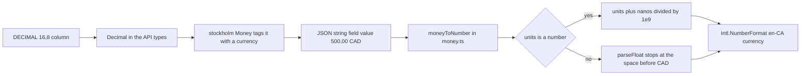
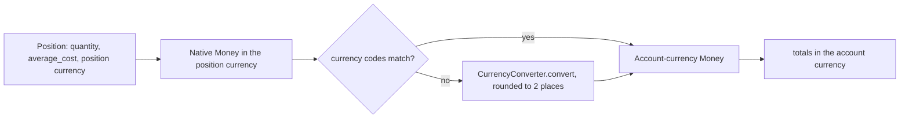
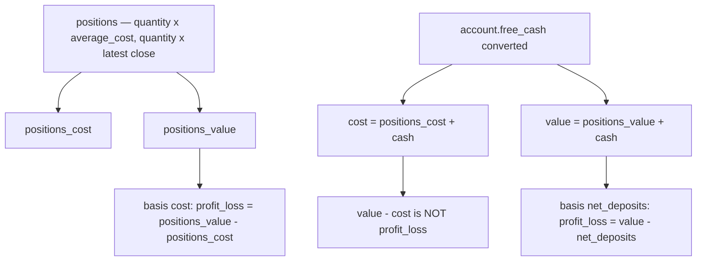

# Money & Currency Handling

Money is the one model every account, holding, total, P&L, CSV row, and frontend
currency label depends on. There is no single `Money` module to change: the
contract is spread across backend Pydantic API types, the `PositionService`
arithmetic, the database column types, the FX provider, and the frontend helpers
in `frontend/src/lib/types/money.ts` and `frontend/src/lib/utils/finance/`.
This page records that contract and the failure modes a careless edit introduces.
Domain endpoints belong to [Domains](../architecture/domains.md) and the
[Broker sync](../workflows/broker-sync.md) / [CSV import](../workflows/csv-import.md)
workflows; this page covers the shared money semantics only.

## Two currency stories

Two unrelated notions of "currency" live in this codebase, and conflating them is
the most common source of confusion. They meet in exactly one place: a position
with no currency of its own inherits the security's currency.

- **Account / portfolio currency** — the unit a portfolio reports in.
  `AccountSchema.currency` (a `stockholm.currency.Currency` in the service layer,
  a plain `String` column in the database) is the target of every conversion in
  `PositionService`; `PositionSchema.currency` is a nullable `String(3)` override
  that wins over `Security.currency` when present. `HoldingRead.currency` is the
  account currency, and every cross-account aggregate on the frontend is bucketed
  by an account currency.
- **Listing currency** — the unit a *quote* is quoted in. `resolve_listing_currency`
  in `src/market/currency.py` resolves it for the market data plane: the company
  profile's currency first, normalized by `normalize_currency` (blank → `None`,
  `GBp` and `GBX` → `GBX`, everything else upper-cased), then a deterministic
  exchange fallback from `EXCHANGE_DEFAULT_CURRENCY` (`TSX` → `CAD`, `LSE` → `GBX`,
  `NYSE`/`NASDAQ`/`NYSEARCA`/`AMEX`/`None` → `USD`) with `or "USD"` as the final
  catch-all. The result is cached under data class `metrics`, endpoint
  `listing_currency`, keyed by `(symbol, exchange)`, and only labels price-bearing
  data-plane responses. It never touches `Account.currency`, positions, or the
  account totals.

That resolution order, its cache, and its failure semantics are documented on
[Market Data Plane](../architecture/market-data-plane.md) and covered by
`tests/market/test_currency.py`. This page only needs the boundary: **the data
plane's currency answers "what unit is this bar in"; the account's currency
answers "what unit is this portfolio in".** `SecuritySchema.currency` (a
`Currency`) is the bridge — it is the fallback for a position without its own
currency, so a USD security held in a CAD account is computable rather than a
currency mismatch.

## Two layers of representation

The backend deliberately keeps two representations with different jobs.

- **Raw numbers are `Decimal`.** Prices (`Price.close`, `open`, `high`, `low`,
  `adjusted_close`), position `quantity`, and position `average_cost` are all
  `Decimal` in the API types. This is what preserves precision through parsing
  and intermediate math.
- **Currency-tagged amounts are `stockholm.Money`.** Whenever an amount carries a
  currency, it is a `Money` value: every field of `AccountTotals` in
  `src/account/api_types.py`, `MarketPricesApi.get_latest_close`'s return type in
  `src/market/api.py`, and `Account.currency` / `Security.currency`, which are
  `stockholm.currency.Currency` rather than plain strings.

`Account.currency` and `Security.currency` are `Currency` because currency
validity is checked at the boundary (broker payloads, CSV import, EODHD search
results) rather than being re-validated in every calculation. The read models do
not keep that type: `AccountSchema.currency` is `Currency` but carries an explicit
`@field_serializer("currency")` that emits a plain code string, and the holdings
read models (`HoldingRead.currency`, `AccountHoldingsRead.currency`,
`AccountHoldingRead.currency`) are declared `str` outright. `AccountSchema.net_deposits`
is `float | None` and `AccountSchema.free_cash` is `float`. So "currency" is a
`Currency` object only inside the service layer and the write path — anything
crossing into a read schema has already become a string or a `float`.

`Money` instances are constructed in two contexts: the market domain tags a
stored close as `Money(latest_price.close, security.currency)` in
`MarketPricesApi.get_latest_close`, and `PositionService` wraps
`quantity × average_cost`, `quantity × latest price`, `free_cash`, and
`net_deposits` itself before converting or aggregating them.

**JSON shape.** A `Money` does *not* serialize to `units`/`nanos` on the wire. It
serializes to a single string field:

```json
{ "cost": { "value": "500.00 USD" }, "value": { "value": "650.00 USD" } }
```

This shape is asserted in `tests/tasks/test_account.py`
(`payload["totals"]["cost"]["value"] == "500.00 USD"`) and
`tests/routers/test_accounts.py` (the ` CAD` suffix). Anyone who assumes a
structured `{ units, nanos, currencyCode }` payload from the backend is working
from the frontend type, not from what the API emits.

The full path from a stored column to a rendered number is worth keeping in mind,
because each hop changes the representation:



*From database scale to display: the wire shape is a currency-tagged string, so
the `units`/`nanos` branch is normally bypassed.*

## Where conversion happens

Exactly one place converts currency inside the position math:
`PositionService._currency_convert(value, to_currency)` in
`src/account/service/position.py`. It short-circuits when
`value.currency_code == to_currency`, otherwise it calls
`self._fx_rates.convert(amount=..., currency=..., new_currency=...)`, rounds the
result to 2 decimal places, and re-wraps it as `Money(converted, to_currency)`.

The converter is no longer a bare `CurrencyConverter()`. `position_service_factory`
resolves `FxRateProvider` from the container and passes
`fx_rates=await fx_provider.converter()`; `tests/market/test_fx.py::test_position_service_factory_uses_provider_converter`
pins that wiring. `FxRateProvider` (`src/market/fx.py`) builds the converter from
the ECB history zip that the daily Huey periodic task `daily_fx_refresh`
(`src/market/task.py`, 17:30 UTC, after the ECB publishes) downloads through
`refresh_fx_rates` and stores in Redis as a base64 payload plus a fetch-date key
written atomically with `MSET`. The provider:

- caches the parsed converter **at module level keyed by the fetch date**
  (bounded to 4 entries), not per provider instance, because svcs providers are
  request-scoped and re-parsing the whole ECB CSV per request would be wasteful;
- serializes builds with a per-event-loop lock and negatively caches a fetch date
  whose zip fails to parse;
- falls back to the bundled `currencyconverter` snapshot whenever Redis is
  unreachable, holds no cached rates, or holds an unreadable zip, logging a
  warning — so a converter is *always* available;
- warns (via `_log_if_stale`) when the freshest ECB rate is more than 3 business
  days old.

Because the fallback is the package's bundled snapshot, "missing FX data" at this
layer does not surface as an exception; it surfaces as a stale rate. A missing
*rate pair* still does — see [Missing prices and missing rates](#missing-prices-and-missing-rates).

There is one other FX consumer, and it is not part of the position math: broker
sync converts reported cash balances into the account currency in
`_sum_cash_in_account_currency` (`src/integration/task.py`), which accumulates in
`float` (the converters are not built with `decimal=True`) and rounds to 2 places
before writing `free_cash`. Gateways that cannot report cash inherit the base
no-op and leave `free_cash` untouched.

Conversion is applied at the *aggregation* boundary, not to stored values:



*Where currency conversion happens: per position, before any accumulation.*

Two consequences matter. First, stored positions never have their `average_cost`
rewritten by FX; `PositionModel.average_cost` and `PositionModel.currency` are
whatever the broker/CSV supplied. Second, the *same* logical amount can be
reported twice in different currencies — `HoldingRead` carries both the native
pair (`unconverted_total_value`, `average_cost`, `latest_price`,
`unconverted_profit_loss`) and the converted pair (`total_value`, `profit_loss`,
`converted_average_cost`, `converted_latest_price` in the account `currency`),
plus a third `display_total_value`/`display_currency` pair in the user's display
currency.

A naming caveat: `HoldingRead.security_currency` is *not* always the security's
currency. `_calculate_holding` and `_unpriced_holding` both resolve
`position_currency = position.currency or str(security.currency)` and report that
as `security_currency`, and `unconverted_total_value` is the native value
converted *into that position currency* (i.e. "not converted to the account
currency"). `latest_price`, by contrast, is the raw stored close in the
*security's* currency. `PositionModel.currency` is a nullable `String(3)`, so a
CSV/broker-supplied position currency wins over the security's own currency
everywhere in the cost and holding math — that precedence is exactly what makes a
CAD-denominated position in a USD security computable, and it is pinned by
`tests/services/test_position_service.py::test_get_account_holdings_currency_mismatch_position_cad_security_usd`.

Because the conversion target is the account's own `currency` at every call site,
changing an account's currency re-bases every converted figure for that account
without touching a single stored position. CSV import is one path that can do
this: `src/account/service/csv_account.py` updates an existing account's currency
when a different `chosen_currency` is supplied, and creates new accounts with
`currency=Currency(chosen_currency)`. `chosen_currency` is the trimmed,
upper-cased per-account value from the import request, else the currency the
parser derived, else `CAD`; the parser's own fallback chain is
`currency` → `book_value_currency_market` → `market_price_currency` → `CAD`, and
each position's currency comes from `currency` / `book_value_currency_market` /
`book_value_currency_cad` / the account currency.

## Account totals: cost, value, cash, and the P/L basis

`get_total_for_account(account_id, currency)` loads the account's positions, runs
`_calculate_holdings`, converts the accumulated `positions_value` /
`positions_cost` into `currency` when it differs from the account currency, and
hands both to `_account_performance`. `_account_performance` is the single place
that decides what "profit/loss" means:

1. `cash = _currency_convert(Money(account.free_cash, account.currency), currency)`.
2. `value = positions_value + cash` and `cost = positions_cost + cash` — cash sits
   on **both** sides.
3. `net_deposits = _currency_convert(Money(account.net_deposits, account.currency), currency)`
   when `account.net_deposits is not None`.
4. **If net deposits are known**: `basis = "net_deposits"`,
   `profit_loss = value - net_deposits`, and
   `return_percent = profit_loss / net_deposits * 100` when `net_deposits != 0`,
   else `None`.
5. **Otherwise**: `basis = "cost"`, `profit_loss = positions_value - positions_cost`
   (cash excluded from *both* the numerator and the denominator), and
   `return_percent = profit_loss / positions_cost * 100` when
   `positions_cost != 0`, else `None`.

The returned `AccountTotals` therefore carries `cost`, `value`, `cash`,
`net_deposits`, `profit_loss`, `return_percent`, `basis`,
`unpriced_positions`, and `pricing_incomplete = unpriced_positions > 0`.



*How free_cash and net_deposits compose the totals and the two P/L bases.*

Three different numbers get called "total" or "profit/loss", and they must not be
interchanged:

| Quantity | Definition | Includes cash |
|---|---|---|
| `AccountTotals.cost` | positions cost basis **plus** cash | yes |
| `AccountTotals.value` | positions market value **plus** cash | yes |
| `AccountTotals.profit_loss` | `value - net_deposits` (basis `net_deposits`), else `positions_value - positions_cost` (basis `cost`) | value side only |
| `HoldingRead.profit_loss` | one position's converted value minus its converted cost basis | no |

`value - cost` is *never* the reported P&L. The frontend used to compute it in the
browser and no longer does — `accounts-list-item.test.ts` asserts that
`value - cost` (`$100.00`) is absent while the server's `+$150.00` / `+15.00%`
are rendered.

**Worked example.** Every row below is asserted by a test in
`tests/services/test_position_service.py`; all are one 10-share USD position in a
USD account (except where noted), so `positions_cost = 10 × average_cost` and
`positions_value = 10 × latest close`.

| Test | avg cost | latest close | positions_cost | positions_value | free_cash | net_deposits | `cost` | `value` | `profit_loss` | `return_percent` | `basis` |
|---|---|---|---|---|---|---|---|---|---|---|---|
| `test_get_total_for_account_includes_free_cash` | 10 | 100 | 100 | 1000 | 250 | — | **350** | **1250** | not asserted | not asserted | — |
| `test_get_total_for_account_uses_net_deposits_basis` | 10 | 110 | 100 | 1100 | 50 | 1000 | **150** | **1150** | **150** | **15.0** | `net_deposits` |
| `test_get_total_for_account_cost_basis_excludes_cash_from_denominator` | 100 | 110 | 1000 | 1100 | 500 | `None` | **1500** | **1600** | **100** | **10.0** | `cost` |
| `test_zero_net_deposits_uses_net_deposits_basis_with_null_return` | 10 | 110 | 100 | 1100 | 50 | 0 | 150 | 1150 | **1150** | `None` | `net_deposits` |
| `test_unpriced_position_is_excluded_from_totals_and_counted` (2 positions, one unpriced) | 100 | 110 | 1000 | 1100 | 0 | — | **1000** | **1100** | **100** | **10.0** | `cost` |
| `test_get_account_holdings_includes_free_cash` | 10 | 100 | 100 | 1000 | 500 | 1000 | — | **1500** | **500** | **50.0** | `net_deposits` |

Read the third row against the second: with net deposits unknown, cash enters
`cost`/`value` but is deliberately excluded from the P/L ratio, so the percentage
stays a cost-basis return (100/1000) rather than being diluted by idle cash. Read
the fifth row against the others: an unpriced position is excluded from
`positions_cost` *and* `positions_value` rather than valued at zero.

`AccountTotals` is served by `GET /accounts/{account_id}/totals`
(`src/account/router.py`) and pushed over WebSocket as `AccountTotalsUpdatedMessage`
by the `recalculate_all_account_totals_task` Huey task, which calls
`get_total_for_account(account.id, account.currency)` once per active account and
catches per account so one failure cannot stop the broadcast. The frontend does
**not** subscribe to that message: `accounts-list.svelte.ts` handles only
`sync_started` / `sync_finished` / `sync_failed`, and
`frontend/src/lib/types/websocket.ts` does not even declare the totals event. The
account list instead fetches totals over HTTP through
`AccountClient.getAccountTotals` and caches them per account in
`accounts-list-item.svelte.ts`, invalidating the cache when a sync completes.

The totals endpoint accepts an optional `currency` query parameter: it is
trimmed, upper-cased, and validated against
`SUPPORTED_DISPLAY_CURRENCIES = ("CAD", "USD", "EUR", "GBP")`, returning 422 for
anything else, and defaults to the account's own currency. The same supported set
gates the persisted `display_currency` user preference
(`UserPreferences._validate_display_currency`), so a converted totals view and the
holdings display values always agree on which currencies are legal.

## Holdings rows: native, account, and display currency

`_calculate_holdings(account, positions, display_currency=None)` is the shared
loop behind both totals paths. It returns
`(holdings, total_value, total_cost, unpriced_positions)` in the account currency:

- For each position it resolves the security; `SecurityNotFoundError` is caught
  per position, logged, counted into `unpriced_positions`, and the position is
  skipped entirely.
- It then asks `MarketPricesApi.get_latest_price` for a stored `PriceSchema`. A
  `None` price counts the position and appends an `_unpriced_holding` row (see
  below) instead of a computed one.
- Otherwise it tags `Money(latest_price.close, security.currency)` and calls
  `_calculate_holding`, accumulating `total_value += value_money` and
  `total_cost += value_money - pl_money` (i.e. the converted cost).

`_calculate_holding` returns the row plus its account-currency value and P&L, and
fills three currency views:

| View | Fields | Currency |
|---|---|---|
| native | `unconverted_total_value`, `average_cost`, `latest_price`, `unconverted_profit_loss` | the position currency (`security_currency`); `latest_price` is the raw security-currency close |
| account | `total_value`, `profit_loss`, `converted_average_cost`, `converted_latest_price`, `currency` | the account currency |
| display | `display_total_value`, `display_currency` | `display_currency` argument, defaulting to the account currency |

`_unpriced_holding` builds the row for a position with no stored price: it is
surfaced to the user with `total_value = 0.0`, `profit_loss = None`,
`unconverted_total_value = 0.0`, `latest_price = None`, `price_date = None`, but a
real `converted_average_cost` — so the position is visible with its cost basis
while the account totals exclude it.

`get_account_holdings` computes totals over **all** positions via
`_calculate_holdings`, then re-reads the paginated page for the rows, so the
header totals cover every position while `items` covers one page — and because
both come from the same loop, `test_total_and_holdings_agree_on_performance` and
`test_total_and_holdings_agree_on_unpriced_account` can assert that the two
endpoints agree. The response adds `profit_loss_basis`, `net_deposits`,
`free_cash`, `broker_value`/`broker_value_at`, `unpriced_positions`, and
`pricing_incomplete` to the `PaginatedResponse`.

`get_holdings_by_security` is the odd one out: it does not reuse
`_calculate_holdings`. It reads `MarketPricesApi.get_latest_close` (a `Money`)
once, falls back to `latest_price = 0.0` when it is `None`, returns `([], 0)` when
the security lookup raises `SecurityNotFoundError`, and per repository row:

1. `holding_total_value = float(quantity) * latest_price` — native, in the
   **security's** currency;
2. `account_total_value = float(totals.value.amount)` from
   `get_total_for_account(account_id, account.currency)`, so the denominator
   already includes `free_cash`;
3. `Money(round(holding_total_value, 2), security.currency)` is converted twice —
   once to the account currency for `account_percentage`, once to
   `display_currency or account currency` for the row;
4. `account_percentage = converted / account_total_value * 100`, reported only
   when `account_total_value > 0`, else `None`
   (`test_security_holdings_zero_value_safely_defaults_none`).

The emitted `AccountHoldingRead` keeps `total_value` and `currency` in the
security's currency and adds `display_total_value` / `display_currency` /
`account_total_value` / `account_percentage`. `get_user_holdings` groups positions
by account, runs `_calculate_holdings` per account with the display currency, and
stamps each row with `account_id` / `account_name` to produce `UserHoldingRead`.

**Display currency plumbing.** Both `/accounts/holdings` and
`/accounts/holdings/{security_id}` pass
`await user_api.get_display_currency(user.id)` into the service;
`UserApi.get_display_currency` reads the `display_currency` preference and
defaults to `"CAD"`. `AccountClient.getAccountTotals(id, token, currency)` exposes
the same idea for totals, which the holdings sidebar uses to fetch every account's
totals in the user's display currency.

## Frontend money helpers

`frontend/src/lib/types/money.ts` defines the shape the UI actually sees:

```ts
export interface Money {
	value?: string;
	units?: number;
	nanos?: number;
	currencyCode?: string;
}
```

`moneyToNumber` prefers `units + nanos / 1e9` when `units` is a number, and falls
back to `parseFloat(value) || 0` otherwise; null/undefined/empty input yields `0`.
Behavior is pinned in `money.test.ts`, including that `units` wins when both are
present and that unparseable strings yield `0`. `moneyToNumber` has four
production importers: `accounts-list-item.svelte`,
`total-profit-loss-buttons.svelte`, `holding-group.svelte`, and
`frontend/src/lib/utils/finance/account-totals.ts`. The `Money` type additionally
backs `AccountTotals` in `frontend/src/lib/types/account.ts`.

**The `units`/`nanos` branch is effectively dead against the current backend.**
Because the API emits `{"value": "500.00 CAD"}` with no `units`, every real
response goes through the string fallback, where `parseFloat("500.00 CAD")`
returns `500` only because `parseFloat` stops at the first non-numeric character.
This works by accident, not by design, and the test fixtures disagree with each
other about it: `accounts-list-item.test.ts` and `total-profit-loss-buttons.test.ts`
supply `units`/`nanos` alongside `value`, while `account-totals.test.ts` builds
`{ value: '0', currencyCode: 'CAD' }` with no `units` at all. Two failure modes
follow:

- If the backend ever emitted a `value` string with a leading currency symbol or a
  non-`en`-style grouping separator, `parseFloat` would silently return a wrong
  number or `0`.
- If a `units`-based serializer is introduced but `nanos` are omitted for
  fractional cents, amounts shift by up to `999_999_999`/`1e9` relative to the
  string — a change that only shows up in tests that exercise both branches.

Formatting is split between several mechanisms, and only some are live display
paths:

- `money(m)` renders `$${amount.toLocaleString()}` — a bare `$`, no currency code,
  no fixed decimals. It is safe only where the currency is shown separately, and
  **it currently has no production caller**: after the account list moved its
  totals into `TotalProfitLossButtons`, the only importers are
  `money.test.ts` and the fixture helper in `accounts-list-item.test.ts`. Do not
  treat it as the shared formatter.
- `total-profit-loss-buttons.svelte` is what the account list, the account detail
  page and the `/holdings` header actually render for totals. It converts its
  `Money | number` props with `moneyToNumber`, takes an explicit `costBasis` (the
  real basis amount) separately from the derived `cost` (`value - profitLoss`),
  derives `effectiveProfitLoss` and `effectiveReturnPercent = (profitLoss / cost) * 100`
  only when they are not supplied, and formats with
  `Intl.NumberFormat('en-CA', { style: 'currency', currency })`. `basisLabel`
  drives the P/L tooltip (`Net deposits: $1,000.00` / `Cost basis: $1,050.00`),
  while the total-value tooltip labels the caller-supplied basis amount
  "Total cost" regardless of basis. `returnPercent: null` is respected as "no
  percent" rather than re-derived. Its `effectiveCurrency` derivation contains a
  `Money.currencyCode` fallback, but the `currency` prop defaults to `'CAD'`, so
  the display currency is in practice whichever currency the caller passes
  (the account list passes `account.currency`). When `Intl` rejects the code the
  formatter falls back to a signed `$x.xx` string.
- `holdings/holdings-table.svelte`, `accounts/holdings-table.svelte` (also used
  by the account detail page) and `account-inline-holdings.svelte` each define
  their own `Intl.NumberFormat('en-CA', { style: 'currency', currency })` helper,
  because a holdings table shows securities in several currencies at once.
- The holdings sidebar surfaces use a different locale: `holding-group.svelte`
  and `holdings-modal.svelte` format with `Intl.NumberFormat('en-US', ...)`, and
  the blended average they print falls back to the first holding's currency, the
  security's currency, then `USD`.
- The watchlist surfaces deliberately show **no currency symbol at all**:
  `frontend/src/lib/components/watchlist/watchlist-utils.ts` exposes
  `formatPrice` (2 decimals, `-` for absent/unparseable) and
  `formatPriceChangePercent` (signed 2 decimals, `0.00%` for zero and negative
  zero), and `watchlists/+page.svelte` renders `SecuritySchema.current_price` and
  `daily_price_change_percent` through them. The same module carries a second
  `formatValuationRange` variant that accepts `number | string` bounds; the range
  formatting contract itself is documented on
  [Security Valuations](./security-valuation.md).

## Frontend aggregates: never sum across currencies

Every cross-account number in the UI is either per-currency or explicitly
normalized into the display currency first. This is the single most important
frontend money rule.

- **The account list renders server numbers verbatim.** `accounts-list-item.svelte`
  passes `totalValue={totals.value}` and
  `costBasis={totals.basis === 'net_deposits' ? totals.net_deposits : totals.cost}`
  into `TotalProfitLossButtons` with the server's `profit_loss` and
  `return_percent`, and shows the amber "Incomplete pricing" tooltip when
  `totals.pricing_incomplete`. No browser-side subtraction of cost from value
  remains.
- **The `/holdings` header buckets server totals per currency.**
  `frontend/src/routes/holdings/+page.svelte` collects each visible account's
  cached `AccountTotals` (fetched in that account's own currency) and calls
  `aggregateAccountTotals` from `frontend/src/lib/utils/finance/account-totals.ts`,
  which groups inputs by `currency` and never adds two currencies together. Inside
  a bucket it sums `value` and `profit_loss`; the return denominator is
  `sum(net_deposits)` only when *every* account reports basis `net_deposits`,
  otherwise `sum(value) - sum(profit_loss)` with the label "mixed basis" and
  `basisAmount: null`; a zero denominator yields `returnPercent: null`. Each
  bucket renders one `TotalProfitLossButtons` with
  `testIdPrefix={`currency-${currency}`}`. `account-totals.test.ts` and
  `page.svelte.test.ts` pin the bucketing, the mixed-basis label, the missing
  `net_deposits` treated as zero, and the zero-denominator case.
- **The cross-account holdings table computes shares from display values.**
  `frontend/src/lib/components/holdings/holdings-table.svelte` derives
  `totalPortfolioValue` by summing `display_total_value` over the visible rows,
  computes per-account sums the same way, and feeds both to
  `calculatePercentOfTotal` / `calculatePercentOfAccount`. `display_total_value`
  is already converted into the user's display currency by the backend, so
  `% of Total` and the per-account badges are currency-consistent — the test
  "computes % of Total from display values so currencies are never summed
  natively" shows 42.2% / 57.8% instead of a naive 50/50.
- **The security sidebar normalizes before dividing.**
  `holding-group.svelte` fetches every account's totals with
  `accountClient.getAccountTotals(acc.id, undefined, displayCurrency)` (the user's
  preference, default `CAD`) and divides the sum of the security's
  `display_total_value` rows by that total — so numerator and denominator are both
  in the display currency, and the denominator still includes each account's
  `free_cash`.
- **Per-row P&L percentages are derived on the client** and are *not* uniform
  across surfaces. `accounts/holdings-table.svelte` uses
  `profit_loss / (quantity * (converted_average_cost ?? 0)) * 100`, guarded by
  `average_cost > 0`; `account-inline-holdings.svelte` and
  `holdings/holdings-table.svelte` use
  `profit_loss / (quantity * (converted_average_cost ?? average_cost ?? 0)) * 100`
  and skip non-positive cost bases. All of them are in account currency because
  the numerator is the converted `profit_loss`. The variants are not equivalent:
  the account-scoped table falls back to `0` rather than to `average_cost`, so a
  holding whose `converted_average_cost` is missing while `average_cost` is
  present divides by zero and renders `Infinity` or `NaN`.

## Client-side holdings math

`blendedAverageCost(holdings)` in `frontend/src/lib/utils/finance/average-cost.ts`
is the quantity-weighted mean of `average_cost` across holdings, returning `0`
for an empty list or zero total quantity and treating a missing `average_cost` as
`0` — so a holding with unknown cost drags the blended figure toward zero rather
than being excluded. It has three consumers: the `holding-group.svelte` "Average"
row, the `holdings-modal.svelte` footer (`portfolioAvgPrice`), and the security
detail page's `averageBuyingPrice`, which feeds the chart's average-price overlay
line. All three run on the *holding* currency values, so a blended figure across
holdings in different currencies is as mixed as its inputs.

`frontend/src/lib/utils/finance/holdings-metrics.ts` supplies the ratio and
period math that P&L display leans on. `getBenchmarkPrice` returns the average
cost for `period === 'ALL'` (`null` when it is missing or `NaN`) and otherwise the
close of the most recent candle at or before the period cutoff, falling back to
the earliest candle and finally to `candles[0].close`. `calculateHoldingGain`
returns `{ gainAmount, gainPercent }` where
`gainAmount = (currentPrice - benchmarkPrice) * quantity` and
`gainPercent = priceDiff / benchmarkPrice * 100`, both `0` for non-finite inputs
and the percent guarded to `0` when the benchmark is `0`.
`calculatePercentOfTotal` and `calculatePercentOfAccount` return `0` for
non-finite inputs or a non-positive denominator, and `formatHoldingPercent`
renders one decimal place or `-`. All of this runs on JS `number`, not the backend
`Decimal` values, so any comparison of frontend-computed P&L against backend
`profit_loss` must expect the usual float-rounding drift.

## Precision and storage

Where the two representations meet, precision is lost on purpose at defined
boundaries:

- **Position storage.** `PositionModel.quantity` is `DECIMAL(16, 8)` in
  `src/account/model.py` (8 fractional digits, enough for fractional shares),
  but `PositionModel.average_cost` is `Float` and `PositionModel.currency` is a
  nullable `String(3)`. Anything with more digits than an IEEE-754 double can
  hold — for example a CSV-derived cost average with many decimals — is already
  approximate once it round-trips through the database.
- **Account storage.** `AccountModel.currency` is a plain `String` while the API
  type is `Currency`; `AccountModel.net_deposits` and `AccountModel.free_cash` are
  `Float`, so cash-flow P&L and the cash contribution to both totals inherit
  float error. `broker_value` is the exception — it is `Numeric(18, 2)`.
- **Market prices.** Every `market_prices` column (`open`, `high`, `low`, `close`,
  `adjusted_close`) is `DECIMAL(16, 8)`, so prices are exact to 8 decimal places
  in the database and only become approximate when the service casts them to
  `float` for `HoldingRead`.
- **User-entered prices share that convention.** `PriceAlertModel.target_price`
  and `SecurityValuationModel.lower_bound` / `upper_bound` are all
  `DECIMAL(16, 8)` (as is the valuation-history table), while the alert write
  schema (`PriceAlertWrite.target_price`) takes a bare `Decimal` and the frontend
  `ValuationClient` types both valuation bounds as plain `number`. So the
  *column scale* is the effective precision for user-entered prices: a value
  written with more than 8 fractional digits is rounded by the database, and the
  number the user typed may not be the number that comes back. The valuation
  field's full contract lives on
  [Security Valuations](./security-valuation.md) — this page only records the
  precision convention it shares with market prices.
- **Aggregation rounding.** `_calculate_holding` rounds both the native product
  (`round(current_price_money * quantity, 2)`) and the native cost
  (`Money(round(quantity * avg_cost, 2), position_currency)`), and
  `_currency_convert` rounds *each* converted amount to 2 decimal places before
  accumulation; `get_holdings_by_security` likewise rounds
  `quantity × latest close` before converting. Totals are therefore sums of
  rounded per-position values rather than the rounded sum of exact values.
  Changing that rounding (or removing it) changes reported totals for
  multi-position accounts even when nothing else moves.
- **CSV parsing.** `src/account/csv/parser.py` parses quantities and book values
  as `Decimal` after stripping `,` and `$`, and `calculate_average_cost` computes
  `(book_value / quantity).quantize(Decimal("0.0001"), rounding=ROUND_HALF_UP)`,
  returning `None` for non-positive quantity or missing book value. Changing that
  quantize step changes every CSV-imported `average_cost` and therefore every
  cost-basis P&L downstream. Cash rows are accumulated separately as `float`
  (`_parse_cash_amount`) and rounded to 2 places into `free_cash`.

## Missing prices and missing rates

A missing price is now an explicit, counted gap rather than a silent zero, and it
fails very differently from a missing FX rate.

- **Missing price → excluded from totals, surfaced as a row.** `_calculate_holdings`
  increments `unpriced_positions` and appends an `_unpriced_holding` row
  (`profit_loss = None`, `total_value = 0.0`) instead of valuing the position at
  zero; the totals exclude both its cost and its value, and
  `pricing_incomplete = True` tells the UI to show the amber warning in the
  account list and on the account detail header.
  `test_unpriced_position_is_excluded_from_totals_and_counted` pins the numbers,
  and `test_missing_security_is_skipped_logged_and_counted` pins that a
  `SecurityNotFoundError` is caught per position (logged as
  `Security not found for position 1`) rather than failing the request.
  `get_holdings_by_security` is the exception: it falls back to
  `latest_price = 0.0`, which makes the row's `account_percentage` `0` when the
  account total is positive and `None` when it is not, and returns an empty list
  with `total == 0` when the security lookup raises.
- **Missing rate pair → exception.** `_currency_convert` has no fallback, no
  `None` handling, and no default rate: if the converter cannot produce a pair it
  lets the `currencyconverter` error propagate. The blast radius depends on the
  caller — `GET /accounts/{account_id}/totals` fails the request, while
  `_recalculate_all_account_totals` wraps each account in `try/except Exception`,
  logs, and continues to the next account. Note the provider layer *does* absorb
  the "no data at all" case by falling back to the bundled ECB snapshot, so this
  path is reached with an unsupported/invalid currency code rather than with an
  empty cache.

Because currency lookups are outbound I/O, tests inject a stub or accept the
bundled snapshot instead of relying on live rates: backend test commands run
inside Docker (`./scripts/agent-test tests/...`, or
`docker compose exec backend uv run pytest`), and a test that performs a real
network call is broken by definition. `tests/market/test_fx.py` covers the
provider with an in-memory Redis fake (no network). Most
`tests/services/test_position_service.py` cases construct
`fx_rates=CurrencyConverter()` and never reach conversion because the account and
security currencies match; the CAD-position/USD-security case *does* convert and
therefore depends on the bundled snapshot. `tests/account/test_models_and_sync.py`
passes `fx_rates=MagicMock()` precisely because its code path never converts. New
tests should pass a mock through the `fx_rates` constructor argument, which is
exactly why the service takes it as a parameter rather than instantiating the
converter itself.

## Failure modes a change can introduce

- **Mixed currencies in an aggregate.** Any new code that sums `Money` across
  positions without routing each operand through `_currency_convert` produces a
  total whose `currency_code` is whichever operand came first (or raises in
  `stockholm`). The file that must change is
  `src/account/service/position.py` — every existing accumulation site
  (`_calculate_holdings`, `_calculate_holding`, `_account_performance`,
  `get_holdings_by_security`) converts before adding, and a new aggregation must
  do the same. The `free_cash` contribution is converted too, even though the
  cash is already in the account currency, because the totals endpoint may be
  asked for a different currency.
- **Float contamination.** Converting `Decimal` prices or costs to JS-visible
  `float` inside the service (as `_calculate_holding` does at the `HoldingRead`
  boundary) is fine for display but spreads into anything computed from
  `HoldingRead` — `account_percentage`, the frontend P&L percentages, and the
  holdings metrics. Adding float math *before* conversion in
  `src/account/service/position.py` would widen the error.
- **`nanos`/`units` mismatch.** As above: whichever side switches to a structured
  integer money shape must update both the backend serializer and
  `frontend/src/lib/types/money.ts` together, or `parseFloat` silently keeps
  working on a `value` field that no longer exists (returning `0`).
- **Cross-account ratios that are not normalized.** Any new percentage that spans
  accounts must bucket by currency or convert into one target currency first.
  `aggregateAccountTotals` (per-currency buckets),
  `holdings/holdings-table.svelte` (`display_total_value`), and
  `holding-group.svelte` (display-currency totals) are the three patterns to
  copy; `total-profit-loss-buttons.svelte` never converts anything itself, so
  passing it a `Money` in the wrong currency simply renders the wrong symbol.
- **Basis confusion.** `AccountTotals.cost` is cost basis **plus cash** and
  `.value` is market value **plus cash**; `profit_loss` follows
  `AccountTotals.basis` and is `value - net_deposits` when deposits are known;
  `HoldingRead.profit_loss` is a per-position value-minus-cost. The frontend
  labels all of them near each other, so swapping cost and value, mixing the
  cash-flow P&L with the per-holding P&L, or forgetting that cash sits in both
  totals is not a cosmetic bug — it changes the number users would act on.
  Changing the basis rule means changing `_account_performance` in one place and
  the `profit_loss_basis` / `basisLabel` plumbing in the UI.

## Testing the money contract

Backend commands run in Docker only; never let a test dial a live FX or price
API. `./scripts/agent-test <path>` is the fast entrypoint, with
`docker compose exec backend uv run pytest` and
`docker compose exec frontend npm run test:run` as the raw fallbacks.

The focused tests that pin this behavior are:

- `tests/services/test_position_service.py` — the authoritative set:
  cash in both `cost` and `value`, the net-deposits basis (including zero
  deposits and a `None` percent), the cost basis excluding cash from the
  denominator, totals/holdings agreement on both priced and unpriced accounts,
  unpriced and missing-security counting, the position-CAD/security-USD mismatch
  case, and display-currency conversion for both user-wide and per-security
  holdings.
- `tests/routers/test_accounts.py` — `test_account_totals_success` (the ` CAD`
  suffix plus `cash`, `net_deposits`, `profit_loss`, `return_percent`, and
  `basis == "cost"`), `test_account_totals_converts_to_requested_currency`
  (`?currency=USD`), `test_account_totals_unsupported_currency_returns_422`, the
  404 ownership cases, and the `account_percentage` /
  `display_total_value` holdings cases.
- `tests/tasks/test_account.py` and
  `tests/ws/test_router.py::test_account_totals_updated_message_serialization` —
  the WebSocket payload shape, including
  `totals.cost.value == "500.00 USD"` and the per-field currency suffixes.
- `tests/market/test_fx.py` — `FxRateProvider` caching, Redis fallback, corrupt-zip
  negative caching, staleness warning, and that `position_service_factory` uses
  the provider's converter.
- `tests/market/test_currency.py` — listing-currency normalization and the
  exchange fallback (see [Market Data Plane](../architecture/market-data-plane.md)).
- `frontend/src/lib/types/money.test.ts` — `moneyToNumber` null/empty handling,
  `units` + `nanos`, negatives, the string fallback, `units`-over-`value`
  precedence, and `money()` formatting.
- `frontend/src/lib/utils/finance/account-totals.test.ts` — per-currency bucketing,
  mixed-basis labeling, missing `net_deposits`, and zero-denominator handling.
- `frontend/src/lib/components/accounts/accounts-list-item.test.ts` — server
  `profit_loss`/`return_percent` rendered instead of `value - cost`, the basis
  tooltips, the incomplete-pricing warning, and the per-account totals cache.
- `frontend/src/lib/components/total-profit-loss-buttons.test.ts` — `number` and
  `Money` inputs for `totalValue`/`costBasis`, derived P/L and percent, and the
  explicit-`null` percent case.
- `frontend/src/lib/components/holdings/holdings-table.test.ts` — `% of Total` and
  per-account badge percentages computed from `display_total_value`.
- `frontend/src/routes/holdings/page.svelte.test.ts` — one header bucket per
  currency, never summed, with the mixed-basis and zero-denominator degradations.
- `frontend/src/lib/utils/finance/average-cost.test.ts`,
  `frontend/src/lib/utils/finance/valuation.test.ts`, and
  `frontend/src/lib/components/watchlist/watchlist-utils.test.ts` — the blended
  average and the two-decimal / watchlist formatters.

When changing the money model, update these tests together with the code — they
are the fastest signal that the backend string shape, the basis rule, and the
frontend parser still agree.

## Related pages

- [Domains](../architecture/domains.md) — account and market domain surfaces,
  models, and the holdings/totals business rules.
- [Market Data Plane](../architecture/market-data-plane.md) — the other currency
  story: listing-currency resolution, `GBp`→`GBX` normalization, and the
  `listing_currency` cache.
- [Frontend](../architecture/frontend.md) — the `Money` type and its helpers in
  the client layer.
- [Accounts & Holdings views](../workflows/accounts-and-holdings-views.md) — how
  these totals and holdings reach the account list, detail page, and `/holdings`.
- [Portfolios](../workflows/portfolios.md) — the account groupings whose
  per-currency totals are aggregated here.
- [Security Valuations](./security-valuation.md) — the user-entered price range
  that shares the `DECIMAL(16, 8)` price precision, and the valuation-range
  formatting helpers.
- [Broker sync](../workflows/broker-sync.md) — how broker positions, cash
  balances, and their currencies enter `PositionService` and `free_cash`.
- [CSV import](../workflows/csv-import.md) — CSV parsing, currency selection, and
  average-cost derivation.
- [Market data and indicators](../workflows/market-data-and-indicators.md) —
  where prices and their currencies come from.
