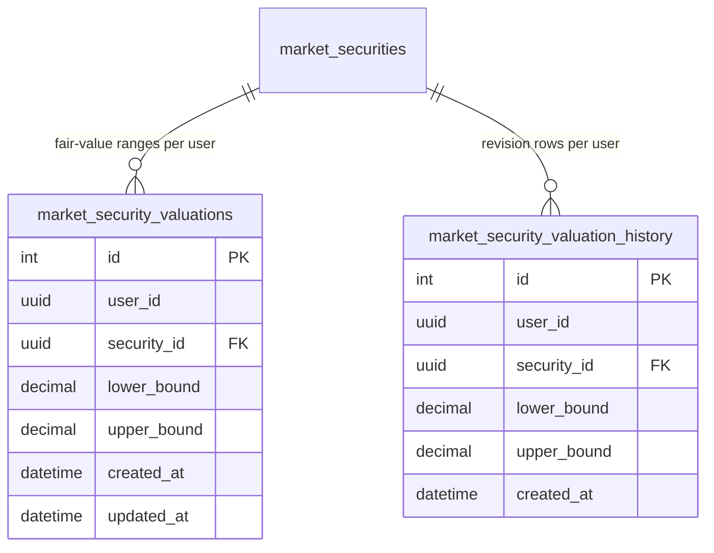
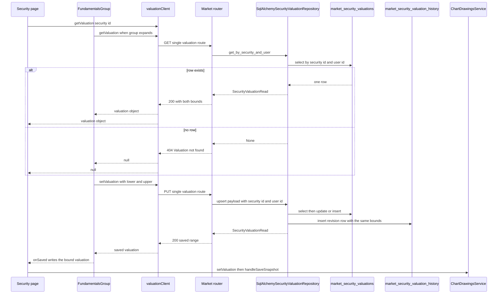
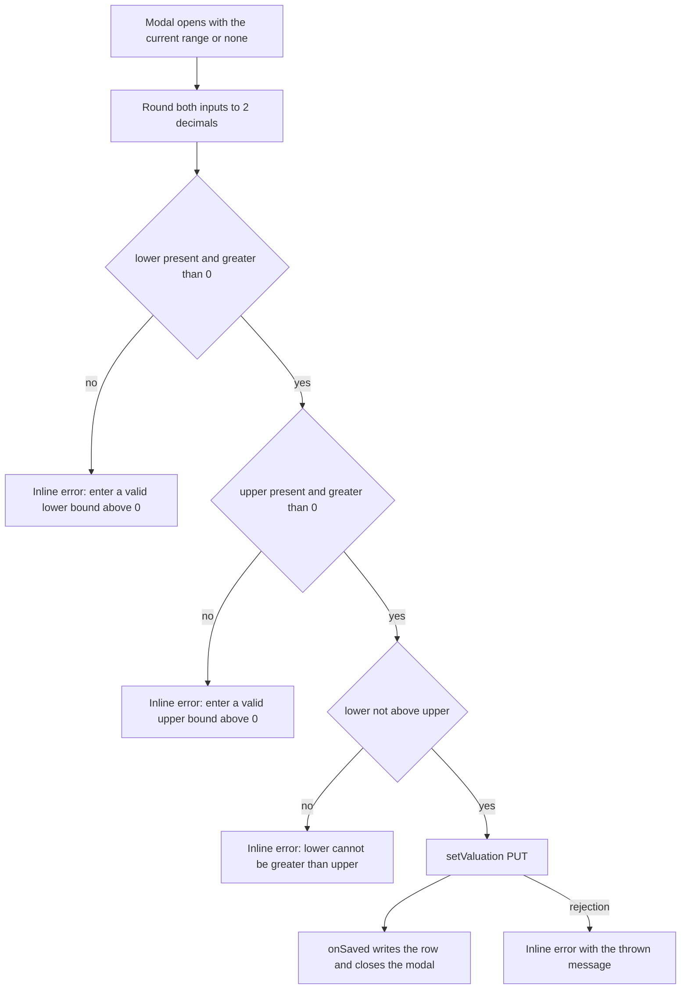
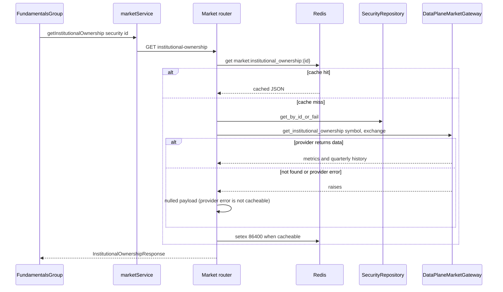

# Security Valuations (Fair-Value Ranges)

A *security valuation* is a user's own opinion of what a security is worth, expressed
as a pair of positive decimal bounds — `lower_bound` and `upper_bound` — attached to
one security for one user. It is not market data and it is not shared: two users hold
two independent ranges for the same security, and every read and write on the backend
is filtered by the requesting `user_id`.

The concept lives entirely inside the market domain. Its storage is two tables — a
current-value table plus an append-only revision log — its API is four routes that call
a router-only repository (there is no valuation service), and its frontend surface is a
sidebar group with a modal on the security detail page, a shaded band on that page's
chart, and bulk read columns on the holdings and watchlist tables. That same sidebar
group also carries the unrelated **institutional-ownership** summary, a shared market
read documented below as a sibling of the valuation routes. The chart band's
*rendering* mechanics are documented on [Charting](../architecture/charting.md); the
preference key that gates it is inventoried on [User Preferences](./user-preferences.md);
the tables' place in the market model catalog is on
[Backend Domains](../architecture/domains.md).



The two tables: one current row per `(user, security)`, and one append-only revision
row per write.

## Primary shape: one range per user and security

`SecurityValuationModel` (`src/market/model.py`) maps to `market_security_valuations`:

| Column | Type | Notes |
| --- | --- | --- |
| `id` | `Integer` PK, autoincrement | |
| `user_id` | `Uuid` | no foreign key to `auth_users`; scoping is by query, not by constraint |
| `security_id` | `Uuid` FK → `market_securities.id`, `ondelete="CASCADE"` | deleting a security removes its ranges and their history |
| `lower_bound`, `upper_bound` | `DECIMAL(16, 8)` | both `NOT NULL`; the same fixed-point convention as `PriceModel` (see [Money & Currency](./money-and-currency.md)) |
| `created_at`, `updated_at` | `DateTime(timezone=True)` | declared with `default=func.now()`, and `updated_at` additionally with `onupdate=func.now()` |

`__table_args__` declares `UniqueConstraint("user_id", "security_id",
name="valuation_user_security_unique")` and the covering index
`ix_market_security_valuations_user_security` over the same two columns.

That unique constraint is the concept's central invariant: **there is at most one row
per `(user, security)`, and the write path is therefore an upsert rather than a
create/update pair.** The model ships with its Alembic revision in the same change —
`migrations/versions/3436586a755f_create_security_valuations.py`
(`down_revision = "4c2ed77e7738"`) creates the table, the cascading foreign key, the
unique constraint and the index, and its `downgrade()` drops index and table. Model
changes in this repository must ship their revision together and follow the
`<hash>_<description>.py` naming convention.

## The append-only revision log

`SecurityValuationHistoryModel` maps to `market_security_valuation_history` and is the
same shape as the current-value table minus the update semantics: `id`, `user_id`, a
cascading `security_id` FK, the two `DECIMAL(16, 8)` bounds, and a single `created_at`.
It has **no unique constraint** — every write adds a row — and one index,
`ix_market_security_valuation_history_user_security_created`, over
`(user_id, security_id, created_at)`, which is exactly the filter-plus-order the history
read uses.

The log arrived in a second, later revision:
`migrations/versions/b291707f24ca_add_market_security_valuation_history.py`
(`down_revision = "7e9699e1590e"`) creates the table, the cascading foreign key and the
index, and its `downgrade()` drops both again. `SecurityValuationHistoryRead`
(`src/market/schema.py`) mirrors the model with `from_attributes=True`.

**History has no HTTP surface.** `get_history` is implemented on the repository and
covered by tests, but the router exposes only read-current plus upsert, and the frontend
has no history client at all. The revision log is therefore reachable only from code
that resolves `SecurityValuationRepository` itself, and it exists to make the current
value auditable rather than to be displayed today.

## Repository: the contract and the upsert

`SecurityValuationRepository` is an ABC in `src/market/repository.py` with exactly four
methods, and `SqlAlchemySecurityValuationRepository`
(`src/market/repository_sqlalchemy.py`) implements all four:

| Method | Behaviour |
| --- | --- |
| `get_by_security_and_user(security_id, user_id)` | one `SELECT` filtered by **both** columns; `scalar_one_or_none()` → `SecurityValuationRead \| None` |
| `upsert(valuation, security_id, user_id)` | selects the `(security_id, user_id)` row; if found, overwrites `lower_bound`/`upper_bound` and sets `updated_at = datetime.now(UTC)`; otherwise inserts with `created_at` and `updated_at` both set to now. **In both branches** it also adds a `SecurityValuationHistoryModel` row carrying the same bounds and the same `now`, then commits once and refreshes before returning |
| `get_history(security_id, user_id)` | all history rows for the pair, ordered by `created_at` then `id` ascending, as `SecurityValuationHistoryRead` |
| `get_batch_by_user_and_securities(security_ids, user_id)` | short-circuits to `[]` for an empty id list; otherwise one `SELECT ... WHERE user_id = :user_id AND security_id IN (...)` |

Three properties follow and all are load-bearing:

- **The upsert is idempotent.** Repeated `PUT`s update the same row rather than
  stacking rows, which is exactly what the unique constraint guarantees. The
  repository test pins that the second upsert returns the *same* `id` with new bounds.
- **Every upsert also appends history, atomically.** The current row and its revision
  row are added to the same session and committed by one `commit()`, so a revision can
  never be lost or orphaned relative to the value it describes; the two revisions of a
  twice-written range come back in write order with
  `history[1].created_at >= history[0].created_at`.
- **User scoping is in every statement.** All four methods take `user_id` and add it as
  a `WHERE` clause, so no caller — including the batch endpoints and `get_history` — can
  read or overwrite another user's range.

The `updated_at` value is written explicitly by the repository rather than relying on
the model's `onupdate`, so the returned read always carries the timestamp of the write
that just happened. The factory `sqlalchemy_security_valuation_repository_factory` is
registered in `register_market_services` (`src/market/__init__.py`) under the ABC key,
which is what lets the router resolve it with `services.aget(SecurityValuationRepository)`.

## Routes

`market_router` (prefix `/market`, mounted under `/api/v1` in `src/main.py`) exposes
four valuation routes in `src/market/router.py`. All four depend on `current_user` and
pass `user.id` down; none of them inspects another user's data or checks that the
security exists.

| Method | Path | Behaviour |
| --- | --- | --- |
| `GET` | `/market/securities/{security_id}/valuation` | returns the caller's range; `404` with `detail: "Valuation not found"` when the repository returns `None` |
| `PUT` | `/market/securities/{security_id}/valuation` | `SecurityValuationWrite` in, upsert out (`200`) |
| `GET` | `/market/securities/valuation/batch` | repeated `security_ids` query parameters, `None` treated as `[]`; returns the subset of the caller's ranges that exist |
| `POST` | `/market/securities/valuation/batch` | body `SecurityValuationBatchRequest` (`{ security_ids: [...] }`), same repository call and same subset semantics |

The two batch routes are declared above the single-security valuation routes at the end
of the file, following this router's convention (the same ordering rule applies to
`/securities/search` and `/securities/{security_id}`) so a literal path segment is
never shadowed by a `{security_id}` matcher. They are the only valuation paths that
serve more than one security per request; the single-security routes take a `SecurityId`
path parameter and, for the `PUT`, never verify that the security exists.

The payload schemas are deliberately minimal (`src/market/schema.py`):
`SecurityValuationWrite` carries only `lower_bound` and `upper_bound`;
`SecurityValuationRead` echoes `id`, `user_id`, `security_id`, both bounds and both
timestamps with `model_config = ConfigDict(from_attributes=True)`;
`SecurityValuationHistoryRead` echoes the same minus `updated_at`; and
`SecurityValuationBatchRequest` is just `security_ids: list[SecurityId]`. There is no
"notes" field, no `model_validator`, and no validation that `lower_bound <= upper_bound`
server-side — the ordering rule exists only in the frontend modal.

The single-`GET` `404` is a genuine contract, not an accident: it is what tells the
frontend "this user has not set a range for this security yet". Note that the same
`404` is returned for a security id that does not exist at all, and that the `PUT`
route has no existence check — an unknown `security_id` can only fail at the database
through the foreign key.

## Read/write round trip



The read collapses "no range yet" into `null`; the write is an unconditional upsert that
always appends a revision row and, on the security page, triggers a chart snapshot save.

## Frontend clients: two surfaces, two bound types

Two independent clients read the same payload, and their TypeScript types disagree on
purpose:

| Client | Bound types | Consumers |
| --- | --- | --- |
| `ValuationClient` (`frontend/src/lib/api/valuationClient.ts`) | `SecurityValuation` with `lower_bound: number` / `upper_bound: number`; `export type SecurityValuationRead = SecurityValuation` | the security detail page and `FundamentalsGroup` |
| `MarketService` (`frontend/src/lib/api/marketService.ts`) | `SecurityValuationRead` with `lower_bound: number \| string` / `upper_bound: number \| string`, plus a separate numeric `SecurityValuation` interface for table rows | the holdings service and the `/watchlists` page |

The `number | string` union on the `MarketService` side is the honest typing of a
`Decimal` that JSON may deliver either way, and it pushes coercion into the consumers —
which is exactly where it happens, differently in each:

- `HoldingsService.load` normalizes each batch entry with `Number(val.lower_bound)` /
  `Number(val.upper_bound)` and stores the numeric `SecurityValuation` in
  `{ [security_id]: SecurityValuation }`.
- The `/watchlists` page stores the raw `SecurityValuationRead` objects untouched, and
  its `formatValuationRange(valuation)` helper does the numeric coercion later inside
  `formatPrice`.

`ValuationClient` is the one client in the codebase that deliberately breaks the
`ApiClient` rule that every non-`ok` response throws (`ApiClient.handleResponse` raises
`ApiError` with the extracted `detail` message):

- `getValuation(securityId, tokenOverride?)` returns `Promise<SecurityValuation | null>`.
  It catches the error and returns `null` when either `err.status === 404` (the
  `ApiError` shape) **or** `err instanceof Error && err.message.includes('404')`. The
  second branch exists because messages are derived from the response body and a custom
  fetch may surface a bare message; every other error is rethrown.
  `valuationClient.test.ts` pins the success path, the status-based 404 path, and the
  PUT body.
- `saveValuation(securityId, lowerBound, upperBound, tokenOverride?)` issues the `PUT`
  with exactly `{ lower_bound, upper_bound }`; `setValuation(securityId, data, ...)` is a
  thin wrapper that forwards `data.lower_bound` / `data.upper_bound`. The
  `SecurityValuationWrite` interface declares an optional `notes?: string` that the
  client silently drops — it is not sent and the backend schema does not accept it, so
  do not treat that field as a feature.
- `getBatchValuations(securityIds, ...)` returns `[]` for an empty/absent id list
  without calling the API, otherwise POSTs `{ security_ids }` to the batch route.
  `MarketService.getValuationsBatch(securityIds, token?)` is the same POST with the same
  empty-list short-circuit; only its return type differs.

## Sidebar surface: fundamentals group, valuation modal, institutional ownership

`FundamentalsGroup`
(`frontend/src/lib/components/actions-sidebar/fundamentals/fundamentals-group.svelte`)
is the editing surface, and it hosts **two independent blocks** that share nothing but
the group shell: the user-authored fair-value range (through `valuationClient`) and a
read-only institutional-ownership summary (through `marketService`). The security page
mounts it as

```svelte
<FundamentalsGroup
	securityId={security.id}
	currency={security.currency}
	bind:valuation
	bind:showOverlay={showValuationOverlay}
	onSaved={handleValuationSaved}
/>
```

so its props are `securityId`, `currency` (default `'USD'`), `symbol`, the two-way
`valuation` / `showOverlay` bindings, `expanded` (bindable, default `true`) and the
`onSaved` callback. The route does not pass `expanded`, so the group starts expanded and
its fetch effect fires on mount.

The component's own state is `isLoading`, `error`, `institutionalOwnership`,
`isOwnershipLoading`, the derived
`hasOwnershipData = institutionalOwnership != null && institutionalOwnership.current_ownership_percent != null`,
and **two** `ModalState` instances (`$lib/utils/modal-state.svelte`):

- `valuationModalState = new ModalState<{ securityId: string; valuation?: SecurityValuationRead | null }>()`,
  opened by `handleOpenModal` — which returns early without a `securityId` — carrying the
  current range.
- `institutionalOwnershipModalState = new ModalState<InstitutionalOwnershipModalData>()`,
  opened by `handleOpenOwnershipModal`, which refuses to open unless `securityId` **and**
  `hasOwnershipData` hold, and passes
  `{ securityId, symbol: symbol || institutionalOwnership?.symbol, data: institutionalOwnership }`.

Both modals are rendered at the top level of the component, outside the collapsible
`Sidebar.Group`, so their open state is independent of the group's collapse state.

**One untracked `$effect`, gated on `expanded && securityId`, runs both fetches** —
`fetchValuation()` and `fetchOwnership()` are called back to back inside a single
`untrack(...)`, so expanding the group loads the range and the ownership metric
together:

- `fetchValuation` assigns `valuation = await valuationClient.getValuation(securityId)`;
  a genuine failure logs and sets `error = 'Failed to load valuation'`, while a `404`
  (mapped to `null` by the client) is not an error.
- `fetchOwnership` assigns
  `institutionalOwnership = await marketService.getInstitutionalOwnership(securityId)`;
  any rejection logs and sets `institutionalOwnership = null`. **The ownership block has
  no error surface** — a transport failure renders the same disabled `N/A` card as a
  payload with no filings.

The valuation block renders, in order, a skeleton while `isLoading`, a `SidebarError`
with its retry bound to `fetchValuation` when `error` is set, "Fair value range not
set." plus a **Set Valuation Range** button when `valuation` is `null`, and otherwise the
range card: the two bounds formatted with
`Intl.NumberFormat('en-US', { style: 'currency', currency })` joined by an en dash, an
**Edit** affordance, the "Show on chart" checkbox, and — when `updated_at` or
`created_at` is present — a short `formatDate` line in the
`data-testid="valuation-updated-at"` slot. The group title's action icon is `Pencil`
when a range exists and `Plus` otherwise (titled "Edit valuation" / "Add valuation"),
and both open `valuationModalState`. The modal's `onSaved` assigns the returned row
straight into the bound `valuation` and forwards it to the group's own `onSaved` prop,
so the page state (and therefore the chart) updates without a refetch.

The **institutional-ownership card** (`data-testid="institutional-ownership-card"`) is
rendered unconditionally inside `Sidebar.GroupContent`, after the valuation block and in
*every* valuation state — including while the range is still loading or failed:

- Its header shows a `View` link (`data-testid="open-ownership-modal"`) only when
  `hasOwnershipData`; the metric row below shows a skeleton while `isOwnershipLoading`, a
  clickable `data-testid="ownership-metric-trigger"` button rendering
  `institutionalOwnership?.current_ownership_percent?.toFixed(2)` with a `%` when
  `hasOwnershipData`, and a **disabled** `N/A` button otherwise. Both the `View` link and
  the metric button call `handleOpenOwnershipModal`, which is why the modal cannot be
  opened for a security with no reported ownership.

`InstitutionalOwnershipModal` (`institutional-ownership-modal.svelte`) is a pure
read-only view over `modalState.data`: it derives `ownership`, `ticker`
(`data.symbol || ownership?.symbol || 'Security'`) and `history` (`ownership?.history ?? []`),
titles the dialog `{ticker} Institutional Ownership` (`data-testid="modal-title"`) and
renders three metric cards (Ownership / Investors / Total Invested) plus a scrollable
quarterly-history table with Filing Date, Ownership %, Investors and Total Invested
columns; an empty history renders "No historical ownership filings available." instead.
Its three formatters are exported from the component's `<script module>` so they are
unit-testable: `formatOwnershipPercent` (`N/A` for `null`/`NaN`, else two decimals plus
`%`), `formatInvestorCount` (`en-US` grouping) and `formatTotalInvested` (compact
`$X.XXT` / `$X.XXB` / `$X.XXM` above `1e12` / `1e9` / `1e6`, else whole-dollar
currency, `N/A` for `null`/`NaN`).

`ValuationModal` (`valuation-modal.svelte`) owns the only validation in the feature, and
it rounds before it validates:



The modal's guard chain: rounding, two positivity checks, then the ordering rule.

Concretely, the modal:

- Prefills from `modalState.data.valuation` through
  `Math.round(Number(raw) * 100) / 100`, so a stored `100.456` is displayed as `100.46`;
  both inputs are `type="number"` with `step="0.01"` and `min="0"`.
- Re-rounds both values on submit with the same expression and rejects a `null` or
  `<= 0` lower bound, a `null` or `<= 0` upper bound, and a `lowerBound > upperBound`
  pair, rendering the message in an inline destructive banner and returning without
  calling the client.
- On success calls `valuationClient.setValuation(securityId, { lower_bound, upper_bound })`,
  then `onSaved?.(res)` and `modalState.close()`; a thrown error becomes the banner text
  (`err.message` or "Failed to save valuation") and the modal stays open.

Because rounding happens before validation, a sub-cent entry such as `0.004` rounds to
`0` and is rejected as non-positive. Server-side validation of the ordering does not
exist, so this modal is the only guard — a direct API call can store an inverted range.

### The sibling read: institutional ownership

The ownership card is fed by one shared market read, declared in `src/market/router.py`
immediately above the watchlist routes. The full market read surface (prices, search,
indicators, alerts) is mapped on
[Market Data & Indicators](../workflows/market-data-and-indicators.md); this endpoint's
behaviour is worth stating here because the sidebar block depends on its degradation
semantics.

`GET /market/securities/{security_id}/institutional-ownership`
(`market_get_institutional_ownership`) depends on `current_user` like its neighbours,
but the payload is **not** user-scoped — it is the same market data for every caller.
Its control flow:



1. **Cache first.** The key is `market:institutional_ownership:{security_id}` and a hit
   returns `InstitutionalOwnershipResponse.model_validate_json(cached)` without touching
   the provider. Any Redis exception on read logs a warning and falls through, so the
   cache is never a hard dependency.
2. **Resolve the security**, then call
   `DataPlaneMarketGateway.get_institutional_ownership(symbol, exchange=security.exchange)`
   through `asyncio.to_thread`. An unknown `security_id` is a `404` from
   `get_by_id_or_fail` before any provider call.
3. **Both provider failure families degrade to a nulled payload** —
   `InstitutionalOwnershipResponse(symbol=..., current_ownership_percent=None,
   investors_count=None, total_invested=None, history=[])` — rather than an error status.
   `MarketDataNotFoundError` is treated as a legitimate "no filings" answer and **is
   cached**; `MarketDataProviderError` (for example a restricted upstream endpoint) sets
   `should_cache = False`, so a provider outage is not frozen for the full TTL.
4. **Write-back** uses `setex` with `_INSTITUTIONAL_OWNERSHIP_CACHE_TTL = 86_400`
   seconds (24 hours) over `data.model_dump_json()`; a cache-write failure logs and is
   ignored. The route therefore never fails because of Redis.

The schemas live in `src/market/api_types.py`: `InstitutionalOwnershipResponse`
(`symbol`, nullable `current_ownership_percent` / `investors_count` / `total_invested`,
`history: list[InstitutionalOwnershipPoint]`) and `InstitutionalOwnershipPoint`
(`date`, nullable `ownership_percent` / `investors_count` / `total_invested`), with
`Decimal` for the money and percentage fields. The frontend mirror is
`MarketService.getInstitutionalOwnership(securityId, token?)` — a plain `GET` whose
declared return type is `InstitutionalOwnershipResponse | null` and which is an ordinary
throwing call, so a transport failure rejects and the group's `catch` collapses it into
the same disabled `N/A` state as an empty payload.

## The presentation gate: `show_valuation_band`

Whether the range is *drawn* is a separate, per-user preference, and it is deliberately
independent of whether a range is *stored*:

- The security page holds `let showValuationOverlay = $state(true)` and seeds it from
  `prefs.show_valuation_band` in two places — `onPreferencesLoaded(prefs)` (called by
  the indicators group) and the init-chain `userPreferencesService.getPreferences()`
  fallback — each guarded by an explicit `!== undefined && !== null` check so an absent
  key keeps the default.
- `FundamentalsGroup`'s checkbox calls
  `userPreferencesService.patchPreferences({ show_valuation_band: val })`, updating the
  bound `showOverlay` first and only logging a rejection. The write is one key, which
  keeps it race-safe against the other components patching preferences.
- The page passes the same flag twice into the chart: `showValuation={showValuationOverlay}`
  and `showValuationBand={showValuationOverlay}`. Inside the chart,
  `isValuationBandVisible = showValuationBand !== undefined ? showValuationBand : showValuation`,
  so the narrower prop wins when supplied.

The authoritative key inventory (readers, writers, failure handling) lives on
[User Preferences](./user-preferences.md); this page only owns the valuation-specific
verbs. Preferences are read on the security page rather than in the route load, because
the root layout load deliberately does not touch them — see
[Frontend Architecture](../architecture/frontend.md).

## Chart band: `ValuationBandPrimitive` and the rewind snapshot

The rendering primitive is `frontend/src/lib/components/charts/plugins/valuation-band/valuation-band.ts`,
a `lightweight-charts` series primitive with three classes:

- `ValuationBandPrimitive` — implements `ISeriesPrimitive`; keeps `_paneView` and the
  `requestUpdate` callback from `attached()`, exposes one pane view, and `setRange(lower, upper, visible)`
  forwards to the view then requests a redraw.
- `ValuationBandPaneView` — holds the range and returns `zOrder() === 'bottom'`, so the
  band paints behind candles and other primitives.
- `ValuationBandRenderer` — bails out entirely when `!visible`, either bound is `null`,
  or no series is attached. Otherwise it converts both prices with
  `series.priceToCoordinate()`, fills the rectangle between them with the translucent
  blue default and strokes dashed lines at each bound inside
  `useBitmapCoordinateSpace`, so the band stays crisp across pixel ratios.

`security-chart.svelte` creates the primitive during chart mount, seeded from
`valuation && isValuationBandVisible ? valuation.lower_bound : null` (and the same for
the upper bound), attaches it to the candlestick series, and keeps it in sync with a
dedicated `$effect` that calls `setRange(...)` with `visibility` as the third argument.
`getValuationBandPrimitive()` exposes it for tests. Because the effect passes `null`
bounds when the gate is off, hiding the band never requires detaching the primitive.

What the chart receives as `valuation` is not the page's live state directly but
`drawingsService.effectiveValuation`, which makes the band rewind-aware:

- Not rewound → the live `valuation` the page loaded or saved.
- Rewound → `activeSnapshot.drawings.valuation` for the snapshot at or before the
  timeline position, or `null` when that snapshot carries no range.

`ChartDrawingsService.handleValuationSave` is the write-side half of the same idea: it
sets the live valuation and then awaits `handleSaveSnapshot()`. The page's
`handleValuationSaved` does the same pair explicitly, which is why saving a range on the
security page creates a rewind snapshot carrying `{ lower_bound, upper_bound }`. That
save path:

- returns immediately when rewound, when no security is set, or when the candle list is
  empty;
- builds `drawings.valuation` from `Number(...)`-coerced bounds and treats a valuation
  alone as content (`hasValuation`), so a save with no drawings at all still persists;
- skips the write when the new snapshot equals the most recent one, toasting "Chart
  snapshot already up to date" instead.

The security-page test suite pins both directions: rewinding swaps the chart prop to the
snapshot's range and returning to now restores the live one, and saving through the modal
calls `snapshotsService.createSnapshot` with the valuation in `drawings`.

## Other readers: batch columns

Two non-chart surfaces read ranges in bulk, both through
`MarketService.getValuationsBatch` (the POST batch route) rather than `ValuationClient`:

- `HoldingsService.load` collects the distinct `security_id`s from the loaded rows,
  fetches them in one call, coerces bounds with `Number(...)` and builds a
  `{ [security_id]: SecurityValuation }` map inside a nested `try`/`catch` that
  degrades to `{}` so a valuation failure never fails the holdings load. The holdings
  table re-normalizes with `toNumberOrNull`, derives lower/upper upside percentages
  against the latest price, renders the range through `formatValuationRange` from
  `$lib/utils/finance/valuation.ts` (two decimals via an `en-CA` formatter, en-dash
  separator, `—` when either bound is missing or non-finite) with the update date below
  it, and sorts the `valuation_range` column by the midpoint of the two bounds — with
  null cells sorted last in both directions.
- The `/watchlists` page fetches the same batch for the union of its securities in a
  cancellable `$effect` (a `cancelled` flag guards the state write) and renders a
  Valuation column through a *separate* `formatValuationRange` helper in
  `watchlist-utils.ts` that accepts the valuation object itself and returns `—` for an
  absent object or blank bound. Failures there are swallowed deliberately: rows fall
  back to `—`.

## Invariants when extending

- **The unique constraint defines the write path.** Any new write must upsert on
  `(user_id, security_id)` or the insert will trip `valuation_user_security_unique`.
- **Every write to the current value must append a history row in the same transaction.**
  `upsert` adds both models before its single `commit()`; a new mutation that skips the
  history insert silently breaks the audit trail, and the history table has no unique
  constraint to catch it.
- **Scope by `user_id` in the repository, not in the router.** The router only supplies
  `user.id`; every statement in `SqlAlchemySecurityValuationRepository` already filters
  on it, so a new read method must do the same or it will leak across users. The
  institutional-ownership read is the counter-example by design: it carries no
  `user_id` because it is shared market data, so do not copy its shape into a
  user-authored table.
- **A missing range is `404` on the single route and `null` on the client.** Do not
  make the route return an empty object; `getValuation`'s two 404 branches and the
  fundamentals group's "not set" state both depend on the distinction between
  "no range" and "error".
- **Batch reads return only the rows that exist.** A security with no range is simply
  absent from the response array, so every consumer must treat a missing key as "not
  set" and fall back to `—` rather than to a fabricated range.
- **`lower_bound <= upper_bound` is a frontend-only rule.** A new server-side caller
  cannot assume stored ranges are ordered; add a validator to `SecurityValuationWrite`
  if that ever needs to change.
- **The ownership read degrades, it does not fail.** A provider outage and a security
  with no filings both surface as a nulled payload with `history: []`, and the sidebar
  turns either into a disabled `N/A` card. Preserve the `should_cache = False` on the
  provider-error branch: caching that payload for 24 hours would turn a transient
  outage into a day-long empty state.
- **A model change ships its Alembic revision in the same change** and the file is
  named `<hash>_<description>.py` under `migrations/versions/`.

## Focused tests

| Test | Covers |
| --- | --- |
| `tests/market/test_security_valuation_repository.py` | `get_by_security_and_user` returning `None`; upsert create returning id + timestamps; upsert-update preserving the row id; batch read across two securities with a second user's row excluded; empty id list returning `[]`; `test_upsert_appends_to_history_and_get_history` (empty history before any write, two revisions for the twice-written pair with non-decreasing `created_at`, other users' and other securities' revisions excluded) |
| `tests/routers/test_market.py` | `test_get_valuation_not_found` (404 before any write), `test_put_and_get_valuation` (PUT then GET returns the same `id` and bounds), `test_batch_valuations_endpoint` (both GET-with-query-params and POST-with-body forms), `test_chart_snapshot_with_valuation_in_drawings` (a snapshot round-trips `drawings.valuation`); for the sibling read, `test_get_institutional_ownership_success`, `..._cached_repeat` (identical JSON on the second call), `..._empty_data` (null percent and empty history still cached) and `..._provider_error_not_cached` (nulled payload returned, cache left empty) |
| `frontend/src/lib/api/valuationClient.test.ts` | success read, 404 → `null`, PUT method/body/path, batch POST |
| `frontend/src/lib/api/marketService.test.ts` | `getValuationsBatch` returning `[]` without a fetch for an empty list, and otherwise POSTing `security_ids` with the bearer token and returning the parsed (string-bounded) valuations |
| `frontend/src/lib/components/actions-sidebar/fundamentals/fundamentals-group.test.ts` | valuation side: "Fair value range not set." empty state, currency-formatted range with the checkbox positioned beside it, `patchPreferences({ show_valuation_band: false })` on toggle, short date of last update. Ownership side (with `valuationClient`, `marketService` and `userPreferencesService` all mocked): the `60.12%` metric from a mocked `getInstitutionalOwnership`, opening the modal from the metric trigger, and the disabled `N/A` trigger for a `null` payload |
| `frontend/src/lib/components/actions-sidebar/fundamentals/institutional-ownership-modal.test.ts` | dialog title from the symbol, the three metric cards, quarterly-history rows, the empty-history message, the close button flipping `modalState.isOpen`, and the exported formatters (`N/A` for null/`NaN`, `$1.98T` / `$2.50B` / `$15.00M` compaction) |
| `frontend/src/lib/components/actions-sidebar/fundamentals/valuation-modal.test.ts` | prefilled bounds, `lower > upper` rejected without calling the client, successful save calling `setValuation` and `onSaved` and closing, `step="0.01"` with prefill rounded to two decimals, user input rounded on save |
| `frontend/src/lib/components/charts/plugins/valuation-band/valuation-band.test.ts` | attach/`requestUpdate`, `zOrder === 'bottom'`, fill + dashed stroke draw calls, no draw when hidden or bounds are `null`, clean detach |
| `frontend/src/lib/components/charts/security-chart.test.ts` | the primitive is attached with the passed range and survives a rerender with new bounds |
| `frontend/src/lib/utils/finance/valuation.test.ts`, `frontend/src/lib/components/watchlist/watchlist-utils.test.ts` | formatting, thousands separators, `—` for null/`NaN`/infinite or blank bounds, object-form helper |
| `frontend/src/lib/services/ChartDrawingsService.test.ts` | `handleValuationSave` updating the valuation and saving a snapshot, a valuation-only snapshot being persisted, `effectiveValuation` swapping to the active snapshot while rewound |
| `frontend/src/routes/security/[security_id]/page.svelte.test.ts` | chart prop following the active snapshot valuation while rewound and the live one after "now", and saving through the modal persisting a snapshot carrying the range |
| `frontend/src/lib/components/holdings/holdingsService.test.ts`, `holdings-table.test.ts`, `frontend/src/routes/watchlists/page.svelte.test.ts` | batch fetch and numeric coercion for distinct security ids, graceful empty-map fallback, rendered ranges and `—` fallback |

## Working on this feature

Backend commands run inside Docker (`docker compose exec backend uv run ruff check`,
`uv run ty check`, `uv run pytest`; autogenerate a revision with
`docker compose exec backend uv run alembic revision --autogenerate -m "message"`), or
through the harness `./scripts/agent-test tests/...`. Backend tests must not touch real
services — the repository test uses the ephemeral Postgres session fixture, not EODHD
or Redis. Frontend checks run in the frontend service (`npm run lint`, `npm run check`,
`npm run test:run`) or `./scripts/agent-test frontend/src/...`, and every frontend test
must mock the API clients it exercises: the fundamentals group mocks
`valuationClient`, `marketService` and `userPreferencesService`, the security page suite
mocks `valuationClient` (keeping `getValuationClient` alongside the singleton) plus its
other clients, and `security-chart.test.ts` mocks `lightweight-charts`.
