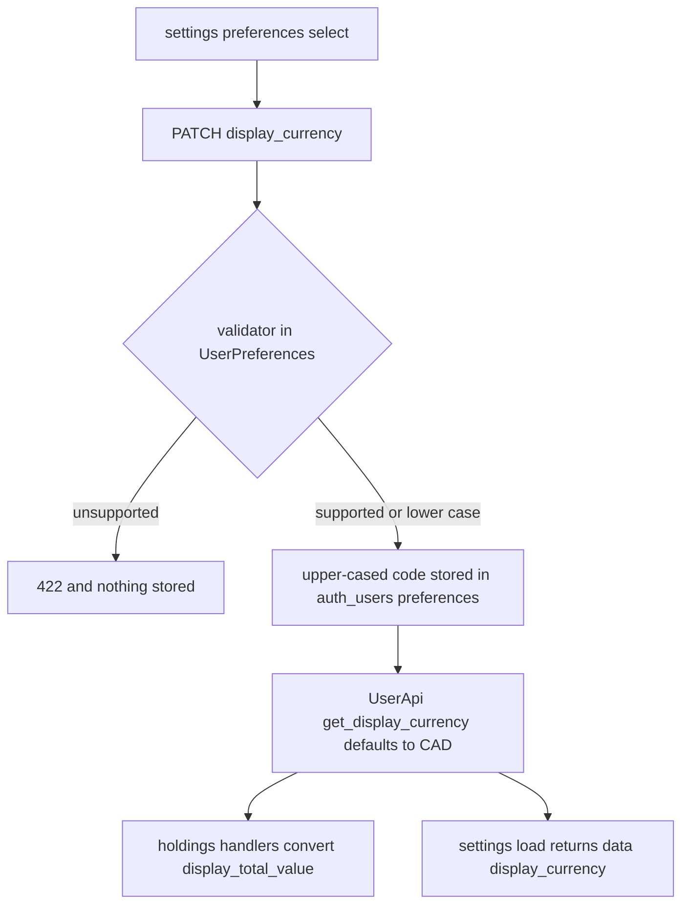
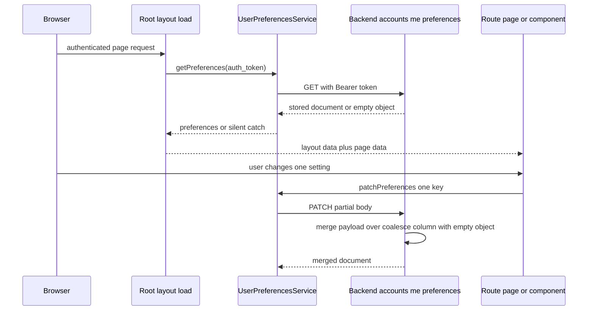

# User Preferences

Every UI setting that must survive a sign-out and follow a user across devices lives in a
single permissive JSON document attached to the user row and served by
`/accounts/me/preferences`. This page owns that contract: the storage shape, the three
endpoints and their write semantics, the read/write matrix for every key, and the failure
rules that differ per surface.

It is a **broadcast document read by several independent consumers**, not a single
settings screen. The readers now span browser components and the backend itself:

| Reader | When | Keys it uses |
| --- | --- | --- |
| Root layout load (`frontend/src/routes/+layout.server.ts`) | every authenticated SSR request | `sidebar_open`, `collapsed_watchlist_ids`, `watchlist_order`, `expanded_account_ids` |
| `/settings/preferences` load (`frontend/src/routes/settings/preferences/+page.server.ts`) | on that route's own SSR load | `display_currency` |
| `/holdings` route load (`frontend/src/routes/holdings/+page.server.ts`) | on `/holdings` navigation | `holdings_table`, `holdings_group`, `elliott_waves` |
| Security page (`frontend/src/routes/security/[security_id]/+page.svelte`) and `IndicatorsGroup` | browser-side, after navigation, once per security | `timeframe`, `chart_style`, `indicators`, `chart_hide_labels`, `chart_auto_scale`, `chart_log_scale`, `show_valuation_band`, `wave_settings`, `indicator_pane_heights`, and (through `ChartDrawingsService`) `elliott_waves`, `fibonacci_tools`, `drawings` |
| On-open component fetches (`holdings-modal.svelte`, `holding-group.svelte`) | each modal/panel open | `elliott_waves`, `holdings_period`, `indicators` |
| Backend holdings handlers (`GET /accounts/holdings`, `GET /accounts/holdings/{security_id}`) | every holdings request, server-side | `display_currency` |

The chart-side details of *how* the values are applied are owned elsewhere — see
[Charting](./../architecture/charting.md) for timeframe, chart style, indicators and pane
heights, and
[Chart Drawings, Plugins & Rewind](./../architecture/chart-drawings-and-rewind.md) for
`elliott_waves`, `fibonacci_tools` and `drawings`. The holdings surfaces that read
`holdings_table` and `holdings_group` are covered by
[Accounts & Holdings Views](./../workflows/accounts-and-holdings-views.md); the security
page's read path is covered by
[Security Detail Page](./../workflows/security-detail-page.md); the conversion and
formatting that `display_currency` drives are covered by
[Money & Currency Handling](./money-and-currency.md); and the layout-level subset of the
matrix plus the `$page.data` preference seam are covered by
[Frontend Architecture](./../architecture/frontend.md).

## Storage

Preferences are one nullable column on the user row:

- `UserModel.preferences: Mapped[dict | None] = mapped_column(JSON, nullable=True)` on
  `auth_users` (`src/auth/model.py`), added by
  `migrations/versions/1548d7b88af5_add_preferences_json_column_to_auth_.py`.
- `UserSchema.preferences: dict | None` mirrors it (`src/auth/schema.py`), so the value
  travels with the user record through the repository.
- The column is declared `sa.JSON()` in the migration but read and written through
  `sqlalchemy.dialects.postgresql.JSONB` casts in
  `SqlAlchemyUserRepository.patch_preferences`, because PATCH depends on the Postgres
  JSONB concatenation operator and `RETURNING` (see below). Postgres is therefore an
  implicit requirement of the PATCH path.

There is exactly one document per user; nothing is keyed by security, route, or device.

## HTTP contract

The three endpoints live on `account_router` (prefix `/accounts`, included in the
`/api/v1` router in `src/main.py`) and are implemented in `src/account/router.py`:

| Method | Path | Behaviour | Response |
| --- | --- | --- | --- |
| `GET` | `/accounts/me/preferences` | `UserApi.get_preferences(user.id)` | the stored document, or `{}` when nothing is saved |
| `PUT` | `/accounts/me/preferences` | replaces the whole document with `payload.model_dump(exclude_none=True)`, then re-reads | the document re-read after the write (or `{}`) |
| `PATCH` | `/accounts/me/preferences` | merges the payload at the **top level** via JSONB `\|\|` and returns the merged document | the merged document |

All three depend on `current_user`; without a valid token each returns 401, pinned by
`tests/routers/test_account_unauth.py`. User isolation is implicit — the repository always
scopes the statement by `UserModel.id == user_id`, and `tests/routers/test_accounts.py`
asserts both directions (user B sees `{}` while user A still sees their document).

### Permissive payload

`UserPreferences` in `src/account/api_types.py` sets `model_config = ConfigDict(extra="allow")`
and declares only a subset of the keys the frontend actually uses. Consequences:

- **Unknown keys pass through.** The server is a store, not a schema authority: a key the
  frontend adds without touching the backend round-trips unchanged. Declared fields are
  still typed, so a malformed *declared* field (for example a non-list `watchlist_order`)
  is rejected with a 422 before it reaches the column.
- **The declared list is advisory and drift-prone.** Both declarations must be read
  together to inventory the keys: the `UserPreferences` interface in
  `frontend/src/lib/api/userPreferencesService.ts`, `src/account/api_types.py` for the keys
  only the backend knows about, and the components that write each key. Treat any other
  inventory (including planning drafts such as `.opencode/features/user-chart-preferences.md`)
  as stale.

The two declarations disagree in both directions, which is the practical consequence of
`extra = "allow"`:

| Declared only on the backend `UserPreferences` model | Declared only in the frontend interface |
| --- | --- |
| `watchlist_sort` | `sidebar_watchlists`, `collapsed_watchlist_ids`, `expanded_account_ids`, `drawings`, `holdings_table`, `holdings_group`, `indicator_pane_heights` |

Neither dataset is enforced against the other: backend-only keys are validated as typed
fields when present, frontend-only keys arrive through `extra = "allow"` unvalidated.
`display_currency` is the one key declared on **both** sides — and the only one with
behaviour beyond storage.

### `display_currency` is validated, not passed through

`display_currency` is the single preference with a real server-side rule attached:

- **A `field_validator(mode="before")` normalizes and rejects.** Any string is stripped and
  upper-cased; a value outside `SUPPORTED_DISPLAY_CURRENCIES` (`("CAD", "USD", "EUR",
  "GBP")`, `src/account/api_types.py`) raises, so both `PUT` and `PATCH` return 422 and
  store nothing — pinned by `test_preferences_display_currency_put_normalizes`,
  `..._patch_normalizes`, `..._put_invalid_rejected` and `..._patch_invalid_rejected`.
  Lower-cased input (`"usd"`) is stored as `"USD"`; a non-string value falls through to
  pydantic's own type validation and also 422s.
- **The supported set is declared twice.** The Python tuple above and
  `SUPPORTED_DISPLAY_CURRENCIES` in `frontend/src/lib/api/userPreferencesService.ts` are
  independent literals; the frontend constant is what renders the
  `/settings/preferences` `<select>` options, while the backend constant is what the
  validator and `GET /accounts/{account_id}/totals?currency=` reject against. Adding a
  currency is therefore a two-file (plus, if it should convert, FX-provider) change, and
  the frontend interface types the key as plain `string | null` rather than a union of the
  four codes, so nothing type-checks the two lists against each other.
- **The stored value is consumed server-side, not by the browser.** `UserApi.get_display_currency`
  re-reads the document, returns the stored string when it is a non-empty string, and
  otherwise defaults to `"CAD"`. `GET /accounts/holdings` and
  `GET /accounts/holdings/{security_id}` call it and pass the result into
  `PositionService.get_user_holdings` / `get_holdings_by_security` as the conversion target
  for each row's `display_total_value` / `display_currency` fields. A preferences outage, a
  missing key or a hand-written junk value therefore degrades to `CAD` rather than failing
  the request. The conversion and rounding rules are owned by
  [Money & Currency Handling](./money-and-currency.md).



*Write-to-read path for the one validated preference key.*

### `exclude_none` and delete semantics

Both write verbs dump with `exclude_none=True`, which makes null meaningless as a stored
value:

- **An explicit null is never persisted.** `PATCH { "indicator_pane_heights": null }` drops
  the key from the payload, so the previously stored map survives. The security page
  deliberately *sends* a null to reset pane heights (its test asserts the client-side call
  body, not a cleared server value), so clearing a key requires a `PUT` that omits it
  rather than a null patch.
- **PUT can delete keys; PATCH cannot.** PUT assigns the dumped payload wholesale, so any
  key not present in the request is gone. PATCH can only add or overwrite non-null keys.
- A PUT of a partial document is therefore a *replace*, not a merge — the round-trip test
  asserts `GET` returns exactly the partial payload with no fabricated defaults.

### Shallow merge, whole-key writes

`SqlAlchemyUserRepository.patch_preferences` builds

```python
preferences=func.coalesce(
    cast(UserModel.preferences, JSONB),
    cast({}, JSONB),
).op("||")(cast(preferences, JSONB))
```

with `.returning(UserModel.preferences)`. Two properties follow, and both are load-bearing
for every writer:

1. **The merge is top-level only.** `indicators`, `wave_settings`, `elliott_waves`,
   `fibonacci_tools`, `drawings` and `holdings_table` are *values*, not sub-documents: any
   patch that mentions the key replaces it entirely. `tests/routers/test_accounts.py`
   documents this explicitly for `wave_settings` ("the top-level wave_settings key is
   replaced entirely by the JSONB `||` merge"), and the writers say the same in comments
   ("PATCH replaces the whole `indicator_pane_heights` key — always send the full object").
2. **One key per write is the race-safe shape.** Because unrelated keys are untouched by a
   single-key patch, independently mounted components (layout, sidebar, chart page, holdings
   page, settings page) can patch concurrently without clobbering each other. The
   `holdings-table-prefs.ts` and `holdings-group-prefs.ts` helpers both note that they
   persist "under a single `holdings_table` / `holdings_group` key so the backend's
   top-level JSONB merge can't race with other preference writes", and
   `test_preferences_patch_cross_component_isolation` walks five such interleaved writes.

`coalesce(..., {})` is what makes the first-ever PATCH work: a `NULL` column merges against
an empty object rather than producing `NULL`.

The counter-example is worth knowing: `ChartDrawingsService.applyRestoredDrawingState`
(undo/redo) sends `elliott_waves`, `fibonacci_tools` **and** `drawings` in one patch. That
is safe only because a single writer owns all three keys — it is a wide write, not a
multi-owner write.

`PUT` is the legacy replace verb: `savePreferences` exists on the service and is covered by
`userPreferencesService.test.ts`, but no component in the repository calls it — every
production write is a partial PATCH, and the replace semantics survive mainly as the
contrast case the round-trip and partial-update tests pin down.

## Read-then-patch round trip



One read at load time seeds the UI; every later change is a single-key PATCH from the
component that owns the interaction. Route loads that need their own keys
(`/holdings`, `/settings/preferences`) read the document separately instead of borrowing
the root layout's copy.

## Read/write ownership matrix

The client half of the contract is `UserPreferencesService`
(`frontend/src/lib/api/userPreferencesService.ts`), which extends `ApiClient` and exposes
`getPreferences` / `savePreferences` (PUT) / `patchPreferences` (PATCH). It is exported
twice: `getUserPreferencesService(customFetch)` for SSR loads that must inject the
server-side `fetch` and pass the `auth_token` cookie explicitly, and a module singleton
`userPreferencesService` used from browser components (where `credentials: 'include'`
carries the cookie). No other module talks to the endpoint directly — the two holdings
helpers instead accept a minimal structural `{ getPreferences, patchPreferences }` service
so tests can inject a double.

Keys every loaded document declares, grouped by owner:

| Key | Read by | Written by | Write-failure handling |
| --- | --- | --- | --- |
| `sidebar_open` | root `+layout.server.ts` → `sidebarOpen` seed | root `+layout.svelte` `handleSidebarOpenChange` | fire-and-forget (`.catch(console.error)`) |
| `collapsed_watchlist_ids` | root `+layout.server.ts` → `$page.data` → `AppSidebarWatchlist` | `AppSidebarWatchlist.toggleCollapsed` (whole array) | fire-and-forget (`.catch(console.error)`) |
| `expanded_account_ids` | root `+layout.server.ts` → `$page.data` → `AccountsList` / `AccountsListItem` | `AccountsListItem.toggleExpanded` (whole array) | fire-and-forget (`.catch(console.error)`) |
| `watchlist_order` | root `+layout.server.ts` → `AppSidebarWatchlist` (`sortWatchlistsByOrder`) and `/watchlists` via `$page.data` | `/watchlists` `moveWatchlist` (drag-and-drop and keyboard share it) | surfaced with rollback: the optimistic order is restored and `watchlistService.error` is set, rendered in the page's alert |
| `display_currency` | `/settings/preferences` `+page.server.ts` → `data.display_currency` (default `CAD`); also `UserApi.get_display_currency` for the two user-level holdings endpoints | `/settings/preferences` currency select → `patchPreferences({ display_currency })` | surfaced with rollback: the select snaps back to the stored value and the message renders in a destructive alert |
| `holdings_table` | `/holdings` `+page.server.ts` → `holdings_table_config` → page `tableConfig` | `/holdings` `handleToggleColumn` / `handleConfigChange` → `saveHoldingsTableConfig` | surfaced: page-level `persistError` (see the `errorMessage` derived) |
| `holdings_group` | `/holdings` `+page.server.ts` → `group_mode` → `HoldingsService.setGroupBy` | `/holdings` `handleGroupToggle` → `saveHoldingsGroupMode` | surfaced: same `persistError` |
| `elliott_waves` | `/holdings` load (EW columns), `holdings-modal.svelte` `loadPreferences` on each open, `ChartDrawingsService` via `setPreferences` | `ChartDrawingsService` (`handleWaveChange`, undo/redo restore, drag-end flush) | logged only |
| `fibonacci_tools` | `ChartDrawingsService` via `setPreferences`, surfaced through `ChartSettingsModal` / `FibWidthModal` | `ChartDrawingsService` (`handleFibChange`, `handleFibLevelsChange`, `handleFibWidthSave`, undo/redo) | logged only |
| `drawings` | `ChartDrawingsService.getEffectiveSecurityDrawings` and the security page's exported accessor | `ChartDrawingsService` (`handleDrawingChange`, `handleRemoveDrawing`, undo/redo) | logged only |
| `timeframe` | security page `onPreferencesLoaded` → `changeTimeframe(prefs.timeframe, { persist: false })` | security page `changeTimeframe` persist branch → `updateChartPreferences` | logged only |
| `chart_style` | security page `onPreferencesLoaded` (defaults to `heikin_ashi`) | security page style buttons → `updateChartPreferences` | logged only |
| `indicators` | security page `onPreferencesLoaded` (enabled, color, period/stdDev/fast/slow/signal); `IndicatorsGroup.loadPreferences`; `holding-group.svelte` `handleToggleAveragePrice` reads it before patching | `IndicatorsGroup.toggleIndicator` / `saveSettings` / `resetSettings` (each sends the whole map); `holding-group.svelte` `handleToggleAveragePrice` (read-merge-write of the whole map) | logged only |
| `chart_hide_labels` | security page → chart `hideLabels` prop and `ChartSettingsModal` | security page `handleGeneralSettingsChange` | logged only |
| `chart_auto_scale` | security page → `autoScale` / `chartAutoScale` props (defaults `true`) | security page `handleGeneralSettingsChange`, `handleAutoScaleChange` | logged only |
| `chart_log_scale` | security page → `logScale` / `chartLogScale` props | security page `handleGeneralSettingsChange` | logged only |
| `show_valuation_band` | security page read path (`showValuationOverlay`, both on `onPreferencesLoaded` and on the post-navigation fetch) | `fundamentals-group.svelte` `handleToggleOverlay` | logged only (`console.error`) |
| `wave_settings` | security page: wave-alert reconcile (defaulting to `DEFAULT_WAVE_SETTINGS`) and `ChartSettingsModal` | security page `handleWaveSettingsChange` (whole object) | logged only |
| `indicator_pane_heights` | security page `applySavedPaneHeights` → `chartRef.setPaneHeights` | security page `handlePaneHeightsChange` (whole map, or `null` to ask for a reset) | logged only |
| `holdings_period` | `holdings-modal.svelte` `loadPreferences` on each open, validated against `PERIODS` and defaulting to `ALL` | `holdings-modal.svelte` `handlePeriodSelect` | logged only |

Two keys are declared but have no consumer anywhere in the repository, which is why they
must not be assumed live:

- `sidebar_watchlists` — present in the frontend `UserPreferences` interface only; no
  component reads or writes it.
- `watchlist_sort` — declared on the backend `UserPreferences` model and exercised by
  `test_preferences_watchlist_order_and_sort`, but no frontend code reads or writes it
  (per-watchlist security sort lives on `WatchlistRead.sort`, persisted through
  `PATCH /market/watchlists/{id}`).

Two more notes about the shape of the table. First, `show_valuation_band` is the one key
written by an actions-sidebar component rather than the security page that reads it — the
toggle lives in the fundamentals group, the consumer in the chart page, and the two never
share state. Second, the security page is the only load that caches the whole document
(`userPreferences` state, plus `ChartDrawingsService.setPreferences`); everything else
extracts specific keys.

### Read-merge-write helper

`mergeChartPreferences(prefs, partial)` in `frontend/src/lib/chart-preferences.ts` is a pure
helper that spreads the existing document and defaults `indicators` to `{}` before applying
the partial, so a partial chart write cannot clobber indicator settings. It is unit-tested
in `userPreferencesService.test.ts` and `page.svelte.test.ts`, but **no production code
calls it**: the security page's `updateChartPreferences` issues a bare partial PATCH and
relies on the server's top-level merge instead. Do not cite it as the live mechanism.

## Which load reads what

Preferences are read in several places, and the split matters because the SSR loads and the
SSR-fetched page components must pass the token explicitly (`cookies.get('auth_token')`),
while browser-side readers use the singleton:

- **Root layout load** (`frontend/src/routes/+layout.server.ts`) — reads `sidebar_open`,
  `collapsed_watchlist_ids`, `watchlist_order` and `expanded_account_ids` for every
  authenticated request, guarded per key by a type check
  (`typeof prefs.sidebar_open === 'boolean'`, `Array.isArray(prefs.collapsed_watchlist_ids)`,
  `Array.isArray(prefs.watchlist_order)`, `Array.isArray(prefs.expanded_account_ids)`)
  with defaults `true`, `[]`, `null` and `[]`. The read sits in a `try/catch` that silently
  falls back, and the request is skipped entirely when `locals.user` is unset.
- **`/settings/preferences` load** (`frontend/src/routes/settings/preferences/+page.server.ts`) —
  the only route load that reads a single key for its own screen. It redirects to
  `/auth/login?clear_session=true` when the `auth_token` cookie is missing, resolves
  `display_currency` with a `?? 'CAD'` default, and on failure deletes the auth cookie and
  throws a 303 for a 401 (any other `ApiError` becomes `error(status, message)`, other
  throwables a 500). The route is reached from the sidebar's profile menu, and
  `display_currency` is deliberately kept off the root load — only this screen needs the
  value, so every other page's `data` stays free of it.
- **`/holdings` load** (`frontend/src/routes/holdings/+page.server.ts`) — reads
  `holdings_table`, `holdings_group` and `elliott_waves` as one of three parallel
  `Promise.allSettled` requests (with portfolios and accounts). It deliberately awaits only
  these cheap keys and lets holdings rows load after navigation. A rejected preferences
  request is non-fatal: the load still returns, with `normalizeHoldingsTableConfig(null)`,
  `normalizeHoldingsGroupMode(null)` (`'none'`) and `null` waves. A **401** from any of the
  three services is not tolerated: the load deletes the auth cookie and throws a 303
  redirect to `/auth/login?clear_session=true`.
- **`/watchlists` load** (`frontend/src/routes/watchlists/+page.server.ts`) — reads nothing
  from preferences and returns `{ watchlists: [] }`; the page seeds `watchlistOrder` from
  `data.watchlist_order`, falling back to `$page.data.watchlist_order`, i.e. from the root
  layout load.
- **Security route load** (`frontend/src/routes/security/[security_id]/+page.server.ts`) —
  returns only `security_id`; the page fetches preferences client-side after navigation
  (either through `IndicatorsGroup.loadPreferences` → `onPreferencesLoaded`, or through its
  own `getPreferences` in the post-navigation init), so the chart shell paints first.

**The `/holdings` filter is URL state, not a preference.** The holdings load reads
`portfolio_id` and `account_id` from `url.searchParams` and returns them as route data; the
page maps them onto `HoldingsService.filterByPortfolio` / `filterByAccount`, and
`handleSelectFilter` writes the selection back with `goto(resolve('/holdings?portfolio_id=…'))`
using `replaceState`. No preference key records the selected portfolio or account, so a
reload or a shared link reproduces the filter while a fresh navigation to `/holdings`
resets it. Only `holdings_table`, `holdings_group` and `elliott_waves` are persisted from
this screen; the grid-side behaviour is covered by
[Accounts & Holdings Views](./../workflows/accounts-and-holdings-views.md).

Components resolve a layout-read key from the most local source available.
`AppSidebarWatchlist` prefers a `setContext` value injected by test harnesses, then
`$page.data.watchlist_order` / `$page.data.collapsed_watchlist_ids`, then falls back.
`AccountsList` reads `initialExpandedAccountIds` from context, then
`$page.data.expanded_account_ids`, then falls back to empty — and republishes the set as
the `expandedAccountIds` context that `AccountsListItem` prefers; the item's own precedence
is `initialExpanded` prop, then context set, then context initial list, then
`$page.data.expanded_account_ids`.

## Failure semantics

The split between silent and surfaced persistence failures is intentional and follows the
surfaces:

- **Fire-and-forget**: layout, sidebar, and account card writes. `+layout.svelte` patches
  `sidebar_open` with `.catch(console.error)`, `AppSidebarWatchlist.toggleCollapsed` patches
  `collapsed_watchlist_ids` that way, and `AccountsListItem.toggleExpanded` patches
  `expanded_account_ids` that way. A failed write never blocks the interaction that
  triggered it; the local UI state stays changed and the preference simply is not saved.
- **Surfaced in-page**: the `/holdings` page's `persist(promise, fallbackMessage)` helper
  clears `persistError`, captures the rejection message (or the fallback string) and renders
  it in a destructive alert above the table — `errorMessage` is
  `persistError ?? service.errorMessage`, so preference-save failures and holdings-load
  failures share one alert slot. The optimistic group/column change is *not* reverted.
- **Surfaced with rollback**: two writes restore their previous state before reporting. The
  `/watchlists` reorder restores both the order snapshot and `watchlistService.watchlists`
  and then sets `watchlistService.error`; the `/settings/preferences` select restores
  `displayCurrency` (and rewrites the `<select>` value) and renders the message in a
  destructive `Alert`.
- **Logged only**: every security-page, `IndicatorsGroup`, `holding-group`,
  `holdings-modal` and `ChartDrawingsService` write (`timeframe`, `chart_style`,
  `indicators`, `chart_hide_labels`, `chart_auto_scale`, `chart_log_scale`,
  `show_valuation_band`, `wave_settings`, `indicator_pane_heights`, `holdings_period`,
  `elliott_waves`, `fibonacci_tools`, `drawings`). Chart mutations are optimistic and
  self-healing, so a lost write shows up as a setting that does not come back on the next
  load rather than as an error banner.

A read failure is never fatal. The root load and the `/holdings` load fall back to
defaults; `IndicatorsGroup.loadPreferences` falls back to `{ indicators: {} }`; the
holdings helpers return their normalized defaults; `holdings-modal.loadPreferences` falls
back to `ALL`; `UserApi.get_display_currency` falls back to `CAD`; and the
`/settings/preferences` load is the exception that makes a preferences failure a visible
error (or a login redirect) rather than a silent default. The security page leaves
`userPreferences` as the `null` sentinel on a fetch failure, and the initial wave-alert
reconcile is gated on `userPreferences !== null` precisely so a preferences outage cannot
mass-delete wave alerts (the reconcile compares `desired` against stored alerts and deletes
the difference).

## Invariants when extending

- **Add the key to the frontend interface and to the backend `UserPreferences` model.**
  `extra="allow"` means a new key persists without touching `src/account/api_types.py`, but
  the backend declaration is the only validation the stored value ever gets — skipping it
  (as the frontend-only keys above show) leaves the value unchecked on the way in. Any
  value that a backend handler will read (the way `get_display_currency` does) must be
  declared, or it will be read unvalidated.
- **Keep the two supported-value lists in sync.** `display_currency` is enforced by
  `SUPPORTED_DISPLAY_CURRENCIES` in `src/account/api_types.py` and offered by the separate
  TS constant in `userPreferencesService.ts`; there is no generated shared list, so a new
  currency added to only one side either becomes unselectable or 422s.
- **Patch one key at a time.** Multi-key patches widen the window in which a concurrent
  component write can be lost, and nested writes must send the complete value because the
  merge is shallow.
- **Do not rely on null to clear a value.** `exclude_none=True` drops it on both verbs.
- **Normalize unvalidated stored values on read.** Because frontend extras bypass
  validation, the consumers own robustness: `normalizeHoldingsTableConfig` drops unknown
  column ids and clamps widths, `normalizeHoldingsGroupMode` maps anything that is not
  `stock`/`company` to `'none'`, and `holdings-modal.svelte` rejects a stored
  `holdings_period` outside `PERIODS` in favour of `ALL`.
- **Keep the layout read cheap.** The root load runs on every authenticated request; the
  pattern for heavier or screen-specific keys is the `/holdings` and `/settings/preferences`
  route load, which read their own keys and let the page fetch rows after navigation.

## Focused tests

| Test | Covers |
| --- | --- |
| `tests/routers/test_accounts.py` | `test_preferences_empty` (`{}` when nothing saved), `test_preferences_roundtrip`, `test_preferences_partial_update` (no fabricated defaults), `test_preferences_isolated`, `test_preferences_patch_from_empty`, `test_preferences_patch_partial_merge`, `test_preferences_patch_cross_component_isolation`, `test_preferences_patch_isolated_across_users`, the four `display_currency` tests (lower-case normalizes through PUT and PATCH, unsupported codes 422 and store nothing), the security-holdings `display_total_value`/`display_currency` assertion, plus per-key round-trips for `sidebar_open`, `holdings_period`, `elliott_waves`, `fibonacci_tools`, `wave_settings` and `watchlist_order`/`watchlist_sort` |
| `tests/routers/test_account_unauth.py` | 401 for `GET`, `PUT` and `PATCH` without a token |
| `tests/services/test_position_service.py` | `test_get_user_holdings_converts_to_display_currency` and `test_get_holdings_by_security_converts_to_display_currency`: native value stays in the account/security currency, `display_total_value` follows the passed display currency, and the default is the account currency |
| `frontend/src/lib/api/userPreferencesService.test.ts` | GET/PUT/PATCH verbs, paths and bodies, `tokenOverride` headers, an empty `{}` response resolving without throwing, `wave_settings` nested bodies, `chart_auto_scale`/`chart_log_scale` serialization, `mergeChartPreferences` |
| `frontend/src/routes/settings/preferences/page.svelte.test.ts` | the select defaulting to `CAD`, rendering the stored value, patching exactly `{ display_currency }`, and reverting to the stored value while showing the error when the patch fails |
| `frontend/src/routes/layout.test.ts` | root load reads `collapsed_watchlist_ids`, `watchlist_order` and `expanded_account_ids`, defaults to `[]` / `null` / `[]` when absent, and rejects a non-array `expanded_account_ids` |
| `frontend/src/lib/components/accounts/accounts-list-item.test.ts` | expansion state restored on load, and a toggle patching the whole `expanded_account_ids` array (removing the id again on collapse) |
| `frontend/src/lib/components/layout/app-sidebar.test.ts` | `collapsed_watchlist_ids` patched with exactly the collapsed id set, then emptied on re-expand |
| `frontend/src/routes/holdings/page.server.test.ts` | the load returns exactly `holdings_table_config`, `group_mode`, `elliott_waves` (plus portfolios/accounts/filters), passes `portfolio_id`/`account_id` through from the query string, tolerates a rejected preferences request with defaults, never fetches holdings server-side, and redirects to login on a 401 from any of the three services |
| `frontend/src/routes/holdings/page.svelte.test.ts` | a rejected preference write showing the alert while the optimistic toggle stays applied, and a `portfolio_id` in route data narrowing the rendered rows |
| `frontend/src/lib/components/holdings/holdings-table-prefs.test.ts`, `holdings-group-prefs.test.ts` | normalization and single-key PATCH payloads, tolerated rejections, no write on load |
| `frontend/src/routes/security/[security_id]/page.svelte.test.ts` | pane heights restored on load, persisted as a whole map, and a reset sent as `indicator_pane_heights: null` without clobbering other keys; general chart settings batched into one patch; `show_valuation_band` applied on load |
| `frontend/src/lib/components/actions-sidebar/fundamentals/fundamentals-group.test.ts` | the overlay toggle patching `show_valuation_band` |
| `frontend/src/lib/components/actions-sidebar/holding-group/holdings-modal.test.ts` | `holdings_period` restored on open, invalid values falling back to `ALL`, selection persisted |

Backend preference rows are exercised through the HTTP API only, with all outbound I/O
mocked; frontend preference tests always mock the preferences client, including the module
singleton.
