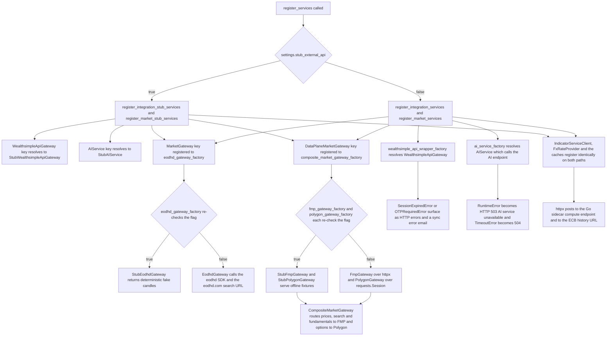

# External Services & Adapters

This page is the boundary catalogue: every dependency that leaves the process (or writes
outside the database), the adapter class that owns it, which credential or switch selects it,
how it fails, and what an agent must not break when touching it. Per-request control flow
belongs to [Architecture](../architecture/overview.md); the `Settings` model and the `svcs`
registry are detailed in
[Configuration, Dependency Injection & Cross-Cutting Runtime](../architecture/configuration.md);
capability routing, the `market:ep` endpoint cache and the data-plane route contract live in
[Market Data Providers & the Service-to-Service Data Plane](../architecture/market-data-providers.md).

Everything outbound is reached through an abstract interface resolved from the `svcs`
registry — `MarketGateway`, `DataPlaneMarketGateway`, `WealthsimpleApiGateway`, `AIService`,
`PriceRepository`, `EmailService`, `IndicatorServiceClient`, `FxRateProvider` — never through a
direct vendor SDK call at a call site. That indirection is what makes the stub switch (below) a
one-line change. The single deliberate exception is `EodhdPriceRepository`, which is both a
repository (Postgres) and a `MarketGateway` consumer, showing the "`repository_*.py` =
alternative backend" convention described in `src/AGENTS.md`.

## What is a boundary and what is not

| Boundary | Third-party? | Owner | Selected by |
|----------|--------------|-------|-------------|
| eodhd.com (`EodhdGateway`) | yes | `src/market/eodhd.py` | `STUB_EXTERNAL_API` (twice) |
| financialmodelingprep.com (`FmpGateway`) | yes | `src/market/fmp.py` | `STUB_EXTERNAL_API` (twice) |
| api.polygon.io (`PolygonGateway`) | yes | `src/market/polygon.py` | `STUB_EXTERNAL_API` (twice) |
| Wealthsimple via `ws-api` (`WealthsimpleApiGateway`) | yes | `src/integration/brokers/wealthsimple.py` | `STUB_EXTERNAL_API` |
| OpenAI-compatible chat completions (`AIService`) | yes | `src/market/ai_service.py` | `STUB_EXTERNAL_API` |
| SMTP (`EmailService`) | yes | `src/core/email.py` | not stubbed — patched in tests |
| ecb.europa.eu FX history (`FxRateProvider`) | yes | `src/market/fx.py` | not stubbed — falls back to bundled rates |
| OS keyring (Wealthsimple sessions) | process-external | `src/integration/brokers/__init__.py` | not stubbed |
| Redis | no — local infrastructure | `src/core/redis.py` | never; faked in tests |
| Go indicator sidecar | no — local infrastructure | `src/market/service.py` | never; mocked in tests |
| Local disk uploads | no — filesystem | `src/market/router.py` | never |
| MCP gateway and the data plane | no — internal services | `services/mcp-gateway`, `src/market/data_router.py` | n/a |

The last four rows are the reason this page is not just a vendor list. Redis, the sidecar and
the documents directory are *not* third-party APIs and are therefore **not** affected by the
stub switch; and the Go MCP gateway plus the `/api/v1/market/data/*` routes it consumes are
**internal** seams — same repository, same trust domain, guarded by a shared secret rather than
a vendor credential — so they never belong in a credentials inventory. See
[MCP Gateway](mcp-gateway.md) for the Go consumer and
[Go Services](../architecture/go-services.md) for the sidecar conventions.

## The stub/live switch

`STUB_EXTERNAL_API` is the **only** mechanism that selects stub versus live third-party
adapters, and it is read through the `settings.stub_external_api` boolean
(`src/config/settings.py`, L21; default `False`) — `src/config/services.py::register_services`
(L14–L33) branches on it exactly once, at registry-construction time:

```python
if settings.stub_external_api:
    register_integration_stub_services(registry)
    register_market_stub_services(registry)
else:
    register_integration_services(registry)
    register_market_services(registry)
```

Both branches register the **same abstract keys** with different factories, so no caller
changes. `register_integration_stub_services` (L36–L62) swaps in the broker stub;
`register_market_stub_services` (L65–L176) re-registers the whole market domain. The live
counterparts are `register_integration_services` (`src/integration/registry.py`, L23) and
`register_market_services` (`src/market/__init__.py`, L68).

| Abstract key | Live factory | Stub-mode factory |
|--------------|--------------|-------------------|
| `MarketGateway` | `eodhd_gateway_factory` (→ `EodhdGateway`) | same factory — it re-checks the flag |
| `DataPlaneMarketGateway` | `composite_market_gateway_factory` (→ `CompositeMarketGateway` over FMP + Polygon) | same factory — both provider factories re-check the flag |
| `PriceRepository` | `eodhd_price_repository_factory` | same — it wraps `eodhd_gateway_factory` |
| `AIService` | `ai_service_factory` (→ `AIService`) | `StubAIService` (`src/stubs/ai.py`) |
| `WealthsimpleApiGateway` | `wealthsimple_api_wrapper_factory` | `StubWealthsimpleApiGateway` (`src/stubs/wealthsimple.py`) |
| `IndicatorServiceClient`, `FxRateProvider`, `IndicatorCache`, `SecuritySearchCache`, `LogoCache`, `EndpointResponseCache` | their production factories | identical registration on both paths |

Three details matter when changing anything here:

- **The registries differ only in the AI line.** `register_market_services`
  (`src/market/__init__.py`, L69–L109) and `register_market_stub_services`
  (`src/config/services.py`, L136–L176) register the identical key set with the identical
  factories; the last factory differs (`ai_service_factory` vs `StubAIService`). A factory
  added to one list but not the other is the failure mode to watch for.
- **The stub registrations import their dependencies lazily inside the function bodies**
  (`register_integration_stub_services` / `register_market_stub_services`, every import
  carrying `# noqa: PLC0415`). This is deliberate: importing stub modules eagerly would pull
  vendor SDKs (`ws_api`, `eodhd`) onto the wrong path. Note the asymmetry — the one
  module-level import of a stub class in `src/config/services.py` is
  `from src.stubs.wealthsimple import StubWealthsimpleApiGateway` (L11), needed because the
  integration stub registration references the class directly; `StubAIService` is imported at
  L134 inside `register_market_stub_services`. Keep the local imports local.
- **Every gateway factory re-checks the flag as well.** `eodhd_gateway_factory`
  (`src/market/eodhd.py`, L218–L223), `fmp_gateway_factory` (`src/market/fmp.py`,
  L1214–L1218) and `polygon_gateway_factory` (`src/market/polygon.py`, L499–L509) each return
  their stub when `settings.stub_external_api` is set, even when the *live* registration path
  ran; `fetch_logo_image` (`src/market/fmp.py`, L133) does the same for the logo proxy. That
  is why stub mode is safe on either path — and why flipping the flag in one place without the
  others silently changes which adapter callers receive.

`tests/conftest.py` sets `os.environ["STUB_EXTERNAL_API"] = "true"` (plus `ENVIRONMENT=test`,
a baseline `MARKET_DATA_SERVICE_TOKEN`, and baseline `FMP_API_KEY`/`POLYGON_API_KEY` so
prod-path settings tests still construct) **before** importing the app, so the whole suite
resolves stubs and needs no EODHD, FMP, Polygon, Wealthsimple, or AI credentials. Note
`STUB_EXTERNAL_API` is *not* present in `.env.example`: the dev Compose stack therefore runs
against the **live** adapters, with `EODHD_API_KEY="demo"`, `FMP_API_KEY="demo"`,
`POLYGON_API_KEY="demo"` and empty `AI_API_KEY`/`AI_API_MODEL` as the only provided values.



Caption: adapter selection under stub versus live mode, and where each boundary's failures
surface — broker session errors inside the sync task, AI failures at the router, EODHD failures
at the repository or search route, and data-plane provider failures at the cached data routes.

## EODHD market data (legacy `MarketGateway` binding)

`MarketGateway` (`src/market/gateway.py`) is the abstract contract. Its required capabilities
are `search`, `get_price_on_date`, `get_prices` and `get_intraday_prices`; every other
capability is non-abstract and defaults to
`MarketDataProviderError("capability not supported by this provider")`, so a gateway that only
serves prices stays concrete. The `MarketGateway` svcs key is bound to EODHD on **both**
registry paths and keeps serving search, the alerting/intraday path and
`EodhdPriceRepository`; the FMP/Polygon data plane is a separate key
(`DataPlaneMarketGateway`) rather than a replacement.

**Live — `EodhdGateway` (`src/market/eodhd.py`).** Constructed with
`settings.eodhd_api_key`. `search` is a raw `requests.get` against
`https://eodhd.com/api/search/{query}?api_token=...&fmt=json` with `timeout=10` and **no
retry loop**; the API key travels in the query string. The price methods go through the
`eodhd.apiclient.APIClient` SDK and rebuild `HistoricalPrice` / `IntradayHistoricalPrice`
from pandas frames, converting every numeric to `Decimal(str(...))` and logging an error and
skipping any row whose index is not a `pandas.Timestamp` (for `get_prices`).
`get_intraday_prices` supports **only `interval="1h"`** (L129–L131) and drops all-zero OHLCV
candles (`open == high == low == close` with `volume == 0`, L167–L168), which is how the
vendor represents non-trading hours. `get_price_on_date` swallows an `IndexError` (empty
frame, e.g. a market holiday) and returns `None` rather than raising (L63–L76).

EODHD is also the only market-data adapter that does not translate vendor failures. A bad key,
a quota error or a transport error propagates out of the SDK or the bare `requests.get`
untouched — out of the search route, out of the daily/hourly price Huey task (counted as a
`failure`), or out of `EodhdPriceRepository`. There is no circuit breaker, no retry and no
negative caching on this path. FMP and Polygon below both map onto the provider-agnostic
exception types instead; do not assume symmetry between the three.

**Stub — `StubEodhdGateway` (`src/stubs/eodhd.py`, L659).** Deterministic and offline:
`StubEodhdAPIClient` seeds `random` from `hash(symbol)` and ships a hard-coded base-price table
(`US:AAPL`, `US:MSFT`, `US:NFLX`, `TO:RY`, `TO:XYR`, `TO:RYT`, `US:GOOGL`, `US:TSLA`,
`US:AMZN`, `TO:TD`) with a `100.0` fallback for unknown symbols. `search` recognizes a
`.`- or `:`-delimited query, knows AAPL/MSFT/RY/TD, and otherwise fabricates a
`SecuritySearchResult` with a synthetic ISIN. Intraday generation caps at
`MAX_INTRADAY_STEPS = 10000` and emits a zero-volume flat candle at
`MARKET_CLOSE_HOUR = 16`. Beyond prices and search it serves static fundamentals and options
fixtures for the symbols in `src/stubs/market_fixtures.py::KNOWN_SYMBOLS` (`AAPL`, `MSFT`);
symbols outside that universe raise `MarketDataNotFoundError`, and the constructor's
`fail_on_symbols` set raises `MarketDataProviderError` — the two knobs the gateway tests use to
exercise failure paths without a socket.

**Where EODHD is consumed.** `EodhdPriceRepository` (`src/market/repository_eodhd.py`)
decorates the SQLAlchemy `PriceRepository` with read-through behaviour: `get_price_on_date`
reads the database first and only calls the gateway on a miss, then persists the single price;
`get_prices` reads the stored window, **always** fetches the window from the gateway, and merges
the fresh rows over the stored ones by date before `save_prices`; `get_latest_price` computes
the last NYSE trading day with the `holidays.NYSE()` calendar (skipping weekends and holidays)
and only refetches when the stored price is older. The decorator's own `save_price` and
`save_prices` deliberately `raise NotImplementedError` — it is a fill-through read path, never a
write target. `SecurityApi.get_or_create_from_broker` (`src/market/api.py`) calls
`gateway.search` and fronts it with `SecuritySearchCache`; `market_search` in
`src/market/router.py` does the same for the HTTP search route. `SecuritySearchCache`
(`src/market/cache.py`) keys on a normalized query
(`market:search:<lowercased, whitespace-collapsed query>`) with a 30-day default TTL, and
**never raises on Redis failure** — `get` returns `None` and `set` logs a warning, so a Redis
outage degrades to hitting EODHD every time rather than failing the request.

Broker-to-EODHD symbol translation happens in `SecurityApi` (`_map_eodhd_symbol` /
`_map_eodhd_exchange`): the broker's `primaryExchange` maps `CSE → CA`, `TSX → TO`,
`NYSE → US`, `NASDAQ → US`, and `.` is rewritten to `-`. `SecurityApi` passes an unknown
exchange through unchanged, whereas the `WealthsimpleApiGateway` twin of this method indexes
the dict directly and raises `KeyError` for an unmapped exchange — the two are not
interchangeable.

## FMP market data (data plane)

**Live — `FmpGateway` (`src/market/fmp.py`, L374)** is built on `FmpHttpClient`
(L329–L371), a thin synchronous `httpx.Client` wrapper that appends the API key as the
`apikey` **query parameter** and applies a 10-second timeout against
`https://financialmodelingprep.com` (`DEFAULT_BASE_URL`, L54). It is a plain `httpx.Client`,
not `AsyncOpenAI`-style async, because the data plane is synchronous and the routes bridge it
with `asyncio.to_thread`. An injected `httpx.Client`/`MockTransport` is supported for tests,
and `FmpHttpClient.close()` closes only a client it created itself (`_owns_client`).

Capabilities: prices (`get_price_on_date`, `get_prices`), `search`, `lookup_symbol`,
`get_quote`, company profile, income statement, balance sheet, cash-flow statement, key
metrics, financial ratios and institutional ownership. `get_intraday_prices` is implemented
concretely **only to satisfy the ABC** and raises the provider-agnostic capability error
(L1198–L1211) — intraday reads still come from EODHD through the alerting path. Non-US
listings are addressed through `map_to_fmp_ticker` (L94–L110): `TSX`/`TO` → `.TO`,
`TSXV`/`TSX-V`/`V` → `.V`, `LSE` → `.L`, US venues (`NYSE`, `NASDAQ`, `NYSEARCA`, `AMEX`) and
unknown exchanges pass the bare ticker through.

Failure mapping is the part to keep stable, and it is the opposite of EODHD's:

| Upstream outcome | Raised |
|------------------|--------|
| HTTP 404, empty payload, unknown ticker | `MarketDataNotFoundError` |
| HTTP 200 body containing `Error Message` with a credential/quota token (`invalid api key`, `limit rate`, `limit reach`, `requests count exceeds`, `legacy endpoint`) | `MarketDataConfigurationError` |
| HTTP 402 Payment Required on institutional ownership | a stub fixture fallback (see below) |
| transport/timeout or any other non-2xx | `MarketDataProviderError` |

Raw upstream text, provider names and URLs are **logged only and never echoed to callers**
(`_PROVIDER_ERROR_MESSAGE` / `_CONFIGURATION_ERROR_MESSAGE`). The route layer maps
`MarketDataNotFoundError` → 404, `MarketDataConfigurationError` → 503 and
`MarketDataProviderError` → 502, all with provider-neutral text.

Two quirks are worth knowing before editing this adapter:

- FMP returns *some* errors as HTTP 200 with an `Error Message` body; `_raise_for_error_payload`
  (L433–L455) is the single place that classifies those into configuration vs not-found.
- Institutional ownership is a paid endpoint. `get_institutional_ownership` (L1166–L1196)
  detects the HTTP 402 (`_is_payment_required_error`, L282–L298) and, for the symbols present
  in `src/stubs.fmp._FUNDAMENTAL_INSTITUTIONAL_OWNERSHIP`, logs a warning and returns that stub
  fixture so the UI stays testable. This is the one place where a live adapter imports stub
  data; it is a deliberate degradation, not a hidden credential.

**Stub — `StubFmpGateway` (`src/stubs/fmp.py`, L972).** Offline and deterministic: prices are
generated from static sample bars, search/lookup return a fixed instrument set, and the
fundamentals methods return static fixtures. It mirrors the live failure knobs
(`unknown_symbols`, `fail_on_symbols`) so tests can assert both `MarketDataNotFoundError` and
`MarketDataProviderError` without I/O, and its `close()` is a no-op because it owns no client.
`fmp_gateway_factory` (L1214–L1218) imports it lazily inside the stub branch.

**Credential requirement.** `FMP_API_KEY` is validated at import by
`Settings.validate_market_provider_keys` (`src/config/settings.py`, L125–L153): outside
`dev`/`test` **and** with `STUB_EXTERNAL_API` unset, a blank `FMP_API_KEY` raises a
`ValueError` naming the variable. That closes the gap the router-level 503 leaves open, but it
only proves the key is *present* — `FmpGateway` accepts any string, so a wrong-but-present key
surfaces at request time as `MarketDataConfigurationError` → 503.

**Logo proxy.** `GET /logo` and `GET /securities/{security_id}/logo`
(`src/market/router.py`, L340–L400) render the FMP company image, not a JSON payload:
`fetch_logo_image` (`src/market/fmp.py`, L113–L175) requests
`{base}/image-stock/{ticker}.png` and returns `None` on HTTP 404, on an error payload, on an
empty body or on any transport failure — callers translate `None` into 404. Responses are
cached by `LogoCache` (`src/market/cache.py`, L378–L462) under `market:logo:<TICKER>` with a
30-day TTL and a 1-day negative sentinel (`__not_found__`) so a missing logo does not hammer
the provider. When `STUB_EXTERNAL_API` is true, `fetch_logo_image` short-circuits before any
HTTP call and returns a fixed 1×1 PNG — except for the sentinel symbols `NOTFOUND`, `MISSING`,
`ZZZZ` and `UNKNOWN`, which return `None` so the 404 path is exercisable offline.

## Polygon market data (data plane)

**Live — `PolygonGateway` (`src/market/polygon.py`, L156)** owns one persistent
`requests.Session` for its lifetime so the pages of a paginated options fetch reuse the same
pooled connection; the API key travels as the `apiKey` query parameter against
`https://api.polygon.io`. It serves **only** the options capability:
`get_options_chain` (L178–L240) reads `/v3/snapshot/options/{underlying}` and
`get_option_expirations` (L242–L294) reads `/v3/reference/options/contracts`; `search`,
`get_price_on_date`, `get_prices` and `get_intraday_prices` raise the provider-agnostic
capability error. `expiration` and `contract_type` are pushed upstream as query parameters,
while the strike range is filtered locally (Polygon's snapshot strike parameters are
unstable). Pagination follows `next_url` to the end, capped at `_MAX_PAGES = 10`; hitting the
cap stops paging, logs a warning and returns the chain with `truncated=True` rather than
looping or discarding the pages already fetched.

Failure mapping (`_request_json`, L332–L357): HTTP 404 → `MarketDataNotFoundError` (also
raised when a chain resolves to zero contracts), 401/403 → `MarketDataConfigurationError`,
every other non-200, transport failure and JSON decode failure → `MarketDataProviderError`.
Malformed payload shapes raise the same provider-agnostic error; raw URLs and response bodies
are logged only.

**Stub — `StubPolygonGateway` (`src/stubs/polygon.py`, L36).** Serves the shared options
fixtures from `src/stubs/market_fixtures.py` (also used by `StubEodhdGateway`, so stub-mode
options reads are provider-independent), honours the same expiry/type/strike filters, and
mirrors the live failure knobs. `polygon_gateway_factory` (L499–L509) imports it lazily.

**Credential requirement.** `POLYGON_API_KEY` is validated by the same
`validate_market_provider_keys` validator as FMP, under the same dev/test and stub-mode
exemptions.

## The composite gateway and the internal data plane

`CompositeMarketGateway` (`src/market/composite.py`, L59) is the provider-agnostic fan-out that
the `DataPlaneMarketGateway` key resolves to: it takes one FMP and one Polygon gateway and
forwards each capability verbatim — prices, search, symbol lookup, quotes and all fundamentals
to FMP; options chains and expirations to Polygon; `get_intraday_prices` delegated to FMP where
it stays unsupported. It adds **no caching of its own**; the single data-plane cache is
`EndpointResponseCache` (`market:ep:*`) one layer above. Capability routing, TTLs and the
`market:ep` key contract are documented in
[Market Data Providers & the Service-to-Service Data Plane](../architecture/market-data-providers.md).

`composite_market_gateway_factory` (L240–L277) is a **sync closeable generator** because the
data-plane routes resolve the key with `services.get(...)` — svcs refuses to enter an async
factory through the sync accessor. It calls the two provider factories directly, cleans up a
partially constructed FMP client if Polygon construction raises, and closes both providers on
teardown, which is what releases the FMP `httpx.Client` and the Polygon `requests.Session`.
`src/main.py` also resolves the key eagerly in a throwaway container at startup, converting an
unregistered or broken registration into a boot failure instead of a first-request 500. That
probe does **not** validate credentials.

The data plane itself is an **internal** boundary: the routes in `src/market/data_router.py`
(docstring, L1–L40) authenticate with the shared-secret `require_service_token` dependency
(`src/auth/api.py`, L308–L326), which constant-time compares the `X-Service-Token` header
against `settings.market_data_service_token` and has no cookie or JWT fallback. The only
external component on that path is the Go MCP gateway (`services/mcp-gateway`) — first-party
code reading the same repository — so `MARKET_DATA_SERVICE_TOKEN` is an internal shared secret,
not a vendor credential. Note `validate_service_token` (`src/config/settings.py`, L110–L123)
refuses to start outside `dev`/`test` with an empty token, because every data route would
otherwise 401.

One user-facing route also reaches the composite directly:
`GET /securities/{security_id}/institutional-ownership` (`src/market/router.py`, L403–L472)
resolves `DataPlaneMarketGateway` synchronously and calls it through `asyncio.to_thread`. Its
failure policy is deliberately softer than the data routes: both `MarketDataNotFoundError` and
`MarketDataProviderError` are logged and degraded to an empty response instead of an HTTP
error, the not-found result is cached under `market:institutional_ownership:<security_id>`
(86400s) while a provider error is **not** cached, and Redis failures never fail the request.

## Wealthsimple brokerage

`BrokerApiGateway` (`src/integration/brokers/__init__.py`) is the abstract broker contract —
`login`, `get_accounts`, `get_positions_by_account` — and it also holds the institution's
keyring prefix and `InstitutionEnum`. Only one institution is implemented;
`src/integration/api.py::get_broker_gateway_class` maps
`InstitutionEnum.WEALTHSIMPLE → WealthsimpleApiGateway` and raises `KeyError` for any other id,
so adding an institution means extending that dict *and* registering the class.

`get_cash_balances` is the one **non-abstract** method on the contract (L47–L59): its default
body returns `{}`, and callers must read that as "cash not reported" rather than a zero
balance, so a gateway that cannot report cash never clears a `free_cash` that came from another
source (CSV import). `WealthsimpleApiGateway` overrides it (L256–L294) by re-reading
`get_account_balances` and folding every `sec-c-<currency>` id into a currency→`Decimal` map,
summing duplicates with a warning.

**Live — `WealthsimpleApiGateway` (`src/integration/brokers/wealthsimple.py`)** wraps the
external `ws-api` package (`WealthsimpleAPI`, `WSAPISession`). Sessions are persisted per user
in the OS keyring under `<keyring_prefix>.<username>` / key `"session"`, with
`_keyring_prefix = "retail_portfolio_wealthsimple"`. `login` is a two-stage credential dance:
first it tries the cached session and probes it with `get_accounts()`; if no session exists it
calls `ws.login_internal(username, password, otp, persist_session_fct=self._save_session)`.
It wraps `ws.send_get` to capture the last raw response before re-raising, so an
`UnexpectedException` is logged with the actual HTTP payload — useful when the vendor changes
shape. `login` performs **synchronous** I/O but is declared on the same interface as the async
`get_accounts` / `get_positions_by_account` / `get_cash_balances`.

Parsing is defensive and lossy by design: closed accounts (`status != "open"`) and unmapped
`unifiedAccountType` values (which raise `AccountTypeUnkownError` internally and are caught)
are skipped rather than faulting; cash pseudo-securities are recognized by the
`sec-c-<currency>` prefix — `_is_cash_security_id` / `_cash_currency` trim the vendor's `[]`
wrapping before matching (L44–L56) — and are skipped as positions; a position whose
`primaryExchange` is `None` is skipped; and the vendor bug that wraps security ids in `[]` is
worked around by `security_id[1:-1]`. Currency is **inferred from the exchange**
(`NYSE`/`NASDAQ` → `USD`, everything else → `CAD`). Malformed *shapes* (market data or
identity positions that are not a `dict`/`list`) raise `UnknownError` instead of being skipped.
`_map_eodhd_exchange` indexes its mapping dict directly and raises `KeyError` on an unmapped
exchange.

Error translation lives in `src/integration/brokers/exception.py`, where all broker errors
descend from `ExternalAPIError`: `ws_api`'s `LoginFailedException` → `LoginFailedError`,
`OTPRequiredException` → `OTPRequiredError`, `ManualLoginRequired` → `SessionExpiredError`,
anything else → `UnknownError`, and a missing keyring entry → `SessionDoesNotExistError`.
`src/integration/task.py` maps each of these to a user-facing sentence in
`_SYNC_ERROR_MESSAGE_MAPPING` and emails it through
`EmailService.send_external_account_error_email`, so a broker auth failure becomes both
a `sync_failed` WebSocket event and a "reconnect your account" email.

`wealthsimple_api_wrapper_factory` additionally accepts `debug_api_responses` and
`debug_dump_path`, which log or dump the raw vendor JSON. `debug_dump_path` writes to an
arbitrary path with no redaction — **treat it as a local debugging aid only; the dumped
payload contains account balances and holdings.**

**Stub — `StubWealthsimpleApiGateway` / `StubWealthsimpleAPI` (`src/stubs/wealthsimple.py`).**
`login` always succeeds, `get_accounts` returns three fixed accounts (one deliberately
`closed` so parsing paths are exercised), and `get_account_balances` returns a
`sec-c-cad` cash entry alongside real positions. It uses a distinct keyring prefix
(`retail_portfolio_wealthsimple_stub`) and, unlike the live gateway, **skips** malformed
payloads instead of raising.

### Security caveat: plaintext keyring

`BrokerApiGateway.__init__` calls `keyring.set_keyring(PlaintextKeyring())` from
`keyrings.alt.file`, i.e. every Wealthsimple session token is stored **unencrypted on
disk**, guarded only by a `# TODO secure this before staging deployment` comment. Any
change that adds a new broker, a new credential, or a new session field inherits this
storage. Do not describe this as secure, and do not copy the pattern into new code
without changing it.

Related: the session payload is what `ws_api` uses to authenticate subsequent calls, so a
user whose keyring entry is missing or stale must re-run `login` with credentials; there
is no silent refresh path in this adapter.

## AI analysis endpoint

`AIService` (`src/market/ai_service.py`) talks to any **OpenAI-compatible** chat
completions endpoint through `AsyncOpenAI`, built as
`AsyncOpenAI(api_key=settings.ai_api_key, base_url=settings.ai_api_endpoint.replace("/chat/completions", ""))`.
That `.replace` is what lets `AI_API_ENDPOINT` be either a bare base URL
(`https://ai.havek.es/api`) or a full completions path — keep it in mind before changing
how the setting is spelled.

The service gathers its own context (`_gather_context`): the security record, the latest
price, up to 50 of the user's notes for that security, and prices from the 1st of the
previous month minus 90 days to today (only the last 30 are sent). Three public methods
share one private call path — `analyze_fundamentals`, `summarize_notes`,
`analyze_portfolio_fit` — and `summarize_notes` short-circuits to a literal
`"No notes found for this security."` without calling the API at all.

Behavior worth knowing before editing `_call_ai_api`:

- `temperature=0.7`, `max_tokens=2000`, `timeout=60` for analyses; the title generator
  uses a **hard-coded `model="gpt-4-turbo"`**, `temperature=0.3`, `max_tokens=20`,
  `timeout=10` and ignores `ai_api_model`.
- Any exception from the SDK is re-raised as
  `RuntimeError(f"AI service unavailable: {e!s}")`, and the router maps that to
  **HTTP 503** (`TimeoutError` maps to **504 "AI analysis timed out"**). Empty content
  raises `RuntimeError`; non-string content raises `TypeError`.
- DeepSeek-style ` thinking...` blocks are stripped from the content before return.
- `generate_note_title` is the **only** AI call with a fallback: on any failure it logs
  and returns the note content truncated to `MAX_TITLE_LENGTH = 50`, so note creation
  never fails because of the AI provider. It is invoked from the Huey task
  `generate_note_title_task`, not inline in the request.
- AI routes are rate-limited at `5/minute` each.

**Stub — `StubAIService` (`src/stubs/ai.py`)** accepts `*args, **kwargs` and returns three
fixed markdown strings, one per method. It deliberately exposes all three methods so it is
a drop-in for `AIService` in the container; `register_market_stub_services` binds it with
`registry.register_factory(AIService, StubAIService)` (`src/config/services.py`, L175).
`AI_API_KEY` and `AI_API_ENDPOINT` are **not** validated at startup, so a bad key or endpoint
surfaces only on the first analysis call — or never, in stub mode.

## SMTP email

`EmailService` (`src/core/email.py`) renders Jinja2 templates from
`src/templates/email/` (HTML + text pairs: `verify_email`, `price_alert`,
`external_account_error`, all extending `base`) and sends via `aiosmtplib.SMTP` using
`settings.smtp_host`, `smtp_port`, `smtp_use_tls`, `smtp_user`, `smtp_password` and
`smtp_sender_email`. The flow is `connect()` → optional `starttls()` → optional `login()`
(only when both user and password are set) → `send_message()` → `quit()`. There is **no
connection pooling** — a source `TODO` flags it as a decision to revisit if hourly alert
volume justifies it — so every email opens and closes its own connection.

Every send method is a coroutine, and `send_email` wraps *any* failure into
`EmailSendError("Failed to send email")`. Callers decide how much that matters:
`_send_sync_error_email` in `src/integration/task.py` catches it and only logs, because
the sync failure itself must still surface.

`settings.frontend_url` is interpolated into the verification link, the price-alert
deeplink (`{frontend_url}/security/{security_id}`) and the external-account error deeplink
(`{frontend_url}/accounts`), so a wrong `FRONTEND_URL` produces working emails with broken
links.

SMTP is the one vendor boundary with no stub counterpart: `STUB_EXTERNAL_API` does not touch
it, and the test suite patches `src.core.email.aiosmtplib.SMTP` instead. In the dev Compose
stack `SMTP_HOST="mailcrab"` / `SMTP_PORT=1025` point at the `marlonb/mailcrab` service — an
email sink, published on `MAILCRAB_PORT` (default `8003`) at container port `1080`. Nothing is
delivered externally; anything that *looks* delivered in dev is in Mailcrab. The prod Compose
file declares no mail service at all, so `SMTP_*` must point at a real relay there.

## ECB FX rates

`FxRateProvider` (`src/market/fx.py`) is a third-party data boundary that the stub switch does
**not** cover. The `currencyconverter` package ships an ECB snapshot that goes stale as soon as
the package is installed, so the worker refreshes it: the Huey periodic task `daily_fx_refresh`
(`src/market/task.py`, L92–L105, `crontab(hour="17", minute="30")` in UTC, after the ECB
publishes) downloads the ECB history zip over `httpx`, validates it with `zipfile`, and stores
it base64-encoded in Redis under `fx:ecb:zip` together with `fx:ecb:fetched_at` in a single
`MSET` (`refresh_fx_rates`, L127–L151). Base64 is required because the shared `redis_manager`
client decodes responses as text and cannot round-trip binary.

`FxRateProvider.converter()` then builds a `currencyconverter.CurrencyConverter` from the
cached zip, parsed once per fetch date into a module-level, bounded process cache (providers
are request-scoped in svcs, so an instance cache would re-parse the CSV on every request).
Degradation is total and silent except for warnings: when Redis is unreachable, holds no
fetch date, or holds an unreadable zip (cached as a failure for that fetch date), the provider
falls back to the bundled `currencyconverter` snapshot. `_log_if_stale` warns once the freshest
rate is more than `STALE_AFTER_BUSINESS_DAYS = 3` business days old — the signal that the daily
task is not running. This boundary matters to portfolio valuation
(`PositionService`, the broker-sync reconciliation), not to the price data plane, which only
*labels* currency and never converts.

## Redis

Redis is the shared coordination layer, reached through the module-level
`redis_manager = RedisManager(settings.redis_url)` singleton
(`src/core/redis.py`) for the indicator cache, security-search cache, logo cache, endpoint
cache, account sync status, WebSocket pub/sub and the Huey broker. `RedisManager` keeps **one
client per running event loop** in a lock-guarded dict, pruning and closing clients whose loop
has closed and lazily creating a `decode_responses=True` client for the current loop — that
loop-keyed design is what lets the same singleton serve the request loop, the pub/sub listener
and `asyncio.run()` task loops. Every loop-scoped client is created with bounded socket
timeouts (`DEFAULT_SOCKET_TIMEOUT` / `DEFAULT_SOCKET_CONNECT_TIMEOUT`, 5s each) so a stalled
server fails fast and callers degrade instead of blocking. Two consumers deliberately diverge:
`indicator_cache_factory` builds its own client from `settings.redis_url` with
`decode_responses=False` (binary-safe indicator payloads), and
`security_search_cache_factory` / `logo_cache_factory` pass the shared manager instead.

Boundaries and keys an agent should not break:

- **Indicator cache** — key `indicators:<security_id>:<interval>:<chart_style>:<sha256 digest>`
  (plus the price count when supplied), TTL 3600s, invalidated by `SCAN` over
  `indicators:*<security_id>*` or flushed wholesale. Cache misses/errors return `None` and log;
  they never raise.
- **Search cache** — `market:search:<normalized query>`, 30-day TTL; payloads are validated
  back into `SecuritySearchResult` and an unexpected shape is treated as a miss. Never raises.
- **Logo cache** — `market:logo:<TICKER>`, 30-day TTL, `__not_found__` sentinel for 1 day.
  Never raises.
- **Endpoint response cache** — `market:ep:<data_class>:<endpoint>:<sha256 digest>`, per-class
  TTLs from `settings.endpoint_ttl_*` read at call time, negative entries under
  `endpoint_ttl_negative_seconds`. Read/write failures degrade to a live provider fetch.
- **Account sync status** — `account_syncs:active:<user_id>`, a Redis set of account ids
  with `settings.sync_ttl_seconds` (default 300) expiry. The TTL is the safety net for a
  worker that dies mid-sync.
- **FX snapshot** — `fx:ecb:zip` / `fx:ecb:fetched_at`, written by the worker, read by both
  processes.
- **WebSocket pub/sub** — channel `ws_messages`, payload `{"user_id": ..., "message": ...}`.
  `ConnectionManager.send_personal_message` publishes so *any* process can deliver, and
  falls back to local-only delivery if Redis is unreachable; the listener task restarts
  itself after a 5s delay on unexpected error.
- **Huey broker** — `RedisHueyWithRegistry("retail-portfolio", url=settings.redis_url)`,
  swapped for `MemoryHueyWithRegistry` when `environment == "test"`.

Redis is *not* part of the `STUB_EXTERNAL_API` switch: the registry passes the same
`redis_manager`-backed factories on both paths, and the test suite replaces the client
itself (see below).

## Indicator sidecar (Go, HTTP)

The FastAPI backend is the only client of the Go indicator service
(`services/indicator-service`, built on `github.com/cinar/indicator/v2`). The service is a
stateless calculator: `POST /compute` takes `{interval, candles, indicators}` and returns
`{"indicators": {<resultKey>: [points]}}`, where the result key is the spec's `id` when set
and its `type` otherwise. Errors are bounded and explicit: too few candles yields an **empty
series and HTTP 200**, an unsupported indicator type is a `400`, and the request body is
capped at 10MB. Requests are also validated against fixed limits before computation — at most
32 indicators, at most 50,000 candles, resolved `period`/`fast`/`slow`/`signal` within
`[1, 1000]` and `stdDev` within `(0, 10]` — each violation answering `400` naming the offending
parameter and result key. `GET /health` is the liveness probe both Compose files poll with
`wget` every 30s.

On the backend, `IndicatorServiceClient` (`src/market/service.py`) is created by
`indicator_service_client_factory` from `settings.indicator_service_url`, owns one
long-lived `httpx.AsyncClient` (default timeout 10.0s) reused across calls, and closes it
only if it created it — an injected client stays open (`_owns_client`). Its error mapping
is the contract the tests pin down:

| Service outcome | Backend response |
|-----------------|------------------|
| `httpx.TimeoutException` | `504` "Indicator service timed out" |
| `httpx.ConnectError` / `httpx.NetworkError` | `503` "Indicator service unavailable" |
| `400` | `400` with the service's `error` text as `detail` |
| `5xx` | `503` "Indicator service unavailable" |
| any other non-`200` | that status, response text as `detail` |

**Security caveat: the sidecar is unauthenticated.** It exposes no auth and no rate
limiting, and its README states plainly that it is intended for the internal Docker
network only and must never be exposed publicly. Dev Compose publishes it on
`127.0.0.1:${INDICATOR_SERVICE_PORT:-8004}` → container `8080`, and prod Compose publishes no
host port at all — so the dev port is already loopback-bound, and any change that widens that
binding hands out an unauthenticated compute endpoint.

Configuration is `INDICATOR_SERVICE_URL` (Compose sets
`http://indicator-service:8080`; `Settings` defaults to `http://localhost:8080`).
Note the client is registered identically on **both** registry paths — the stub switch
does not touch it, because the sidecar is local infrastructure, not a third-party API.

## Uploaded documents on local disk

Security documents have no object storage and no third-party file service: the upload
route writes bytes straight to the container's filesystem. `POST /securities/{security_id}/documents`
(`src/market/router.py`, `market_create_document`, L817–L850) reads `settings.upload_path`
(`UPLOAD_PATH`, default `"data/uploads"`), calls `mkdir(parents=True, exist_ok=True)`,
and writes the uploaded content to `<upload_path>/<uuid4><original extension>`. Only
metadata — original filename, `file_path`, byte size and `file_type` — goes to the
database (`SecurityDocumentModel`); the `file_path` column stores the str of the path the
process wrote.

Deployment constraints that follow directly from this:

- **The directory is local to the process's filesystem.** No Compose file declares a
  named volume for it. In dev it happens to land inside the bind-mounted repo root
  (`./:/app` for both `backend` and `worker`), so both services see the files; in prod
  (image-based, no bind mount) the files live in the container's writable layer and are
  lost on recreate or upgrade.
- **It is not backed up with the database.** Restoring Postgres alone leaves
  `SecurityDocumentModel` rows pointing at files that no longer exist, and documents
  written by one replica are invisible to any other.
- There is **no content-type or size validation** in the route, and no path traversal risk
  from the original filename because only the sanitized `uuid4` name is used for the
  stored path — but the caller-supplied `file.content_type`/`filename` are stored verbatim
  in metadata and served back to the owner.
- `settings.upload_path` is relative by default, so it resolves against the process's
  working directory — `/app`, set by `WORKDIR` in the root `Dockerfile` and by
  `working_dir` in the dev Compose services. Changing it requires a restart and a matching
  directory on whatever host you deploy to.

Treat this as a deployment constraint to fix, not a design to copy: moving documents to
object storage means adding an adapter here, a stub in `src/stubs/`, and a factory that
branches on `settings.stub_external_api` like every other third-party boundary on this page.

## Configuration reference

| Variable | Setting | Consumed by |
|----------|---------|-------------|
| `EODHD_API_KEY` | `eodhd_api_key` | `EodhdGateway` construction, EODHD SDK and search URL |
| `FMP_API_KEY` | `fmp_api_key` | `FmpGateway` — prices, search, quotes, fundamentals, logos |
| `POLYGON_API_KEY` | `polygon_api_key` | `PolygonGateway` options chains and expirations |
| `AI_API_ENDPOINT` | `ai_api_endpoint` | `ai_service_factory` base URL |
| `AI_API_KEY` | `ai_api_key` | `AsyncOpenAI` credentials |
| `AI_API_MODEL` | `ai_api_model` | analysis calls only (title generation hard-codes a model) |
| `MARKET_DATA_SERVICE_TOKEN` | `market_data_service_token` | `require_service_token` on every `/market/data` route |
| `INDICATOR_SERVICE_URL` | `indicator_service_url` | `indicator_service_client_factory` |
| `UPLOAD_PATH` | `upload_path` | `market_create_document` document writes |
| `SMTP_HOST` / `SMTP_PORT` / `SMTP_USE_TLS` / `SMTP_USER` / `SMTP_PASSWORD` / `SMTP_SENDER_EMAIL` | same names | `EmailService.send_email` |
| `FRONTEND_URL` | `frontend_url` | deeplinks and verification links inside emails |
| `REDIS_URL` | `redis_url` | `redis_manager`, all caches, Huey broker, pub/sub |
| `SYNC_TTL_SECONDS` | `sync_ttl_seconds` | account-sync status TTL |
| `ENDPOINT_TTL_PRICES_SECONDS`, `..._STATEMENTS_...`, `..._METRICS_...`, `..._OPTIONS_...`, `..._SEARCH_...`, `..._QUOTES_...`, `..._NEGATIVE_...` | same names | `EndpointResponseCache` per-class TTLs, read at call time |
| `STUB_EXTERNAL_API` | `stub_external_api` | registry branch and all four gateway/logo factories (tests only; absent from `.env.example`) |

Secrets come from the root `.env` (copied from the tracked `.env.example`, gitignored
once copied) and from the process environment, which wins over the file — `Settings`
pins `env_file=(".env",)` with `extra="ignore"`. **Startup validation is partial and
asymmetric**, and that asymmetry is the thing to remember:

- Validated at import, outside `dev`/`test`: `SECRET_KEY` (non-empty and at least
  `MIN_SECRET_KEY_LENGTH = 32` characters), `MARKET_DATA_SERVICE_TOKEN` (non-empty), and —
  unless `STUB_EXTERNAL_API` is true — `FMP_API_KEY` and `POLYGON_API_KEY`. Each failure
  raises a `ValueError` naming the variable and telling you how to generate a value.
- **Not** validated: `EODHD_API_KEY`, `AI_API_KEY`, `AI_API_ENDPOINT`, `AI_API_MODEL`,
  `SMTP_*` and `INDICATOR_SERVICE_URL`. A bad one surfaces later, either as a vendor error
  on first use, or — with `STUB_EXTERNAL_API=true` — as a stubbed response that hides the
  misconfiguration entirely. The data plane's boot-time probe (`src/main.py`) constructs the
  gateways but does not check credentials.

**Changing these values requires a container restart**, because the backend and worker load
`.env` at process start; the endpoint-cache TTLs are the exception, read at call time.

## Testing rule for outbound clients

Repository-wide and mandatory (`src/AGENTS.md`): **backend tests must not depend on
external services** — no Redis, no HTTP APIs (EODHD, FMP, Polygon, broker APIs), no SMTP, no
DNS resolution, and no ECB download. Mock every outbound client and stub *every* method the
code under test calls. A test that performs a real network, Redis or SMTP call is broken by
definition; do not "fix" it by expecting the service to be up. The one allowed infrastructure
dependency is the ephemeral PostgreSQL container from `testcontainers`. See
[Testing](../operations/testing.md).

The mechanisms already in place, in preference order:

- **Global env switch** — `STUB_EXTERNAL_API=true` in `tests/conftest.py` before the app
  import, alongside baseline `MARKET_DATA_SERVICE_TOKEN` / `FMP_API_KEY` / `POLYGON_API_KEY`
  values so prod-path `Settings` tests still construct.
- **In-memory Redis** — the autouse `fake_redis_manager` fixture
  (`tests/fixtures/redis.py`) replaces `src.core.redis.redis_manager.client` (and the
  `src.auth` module-level references) with `FakeRedis`; `mock_redis_storage` exposes the
  backing store for assertions. Reuse it rather than adding a Redis dependency.
- **Vendor stubs** — `StubEodhdGateway` / `StubEodhdAPIClient`, `StubFmpGateway`,
  `StubPolygonGateway`, `StubWealthsimpleAPI` / `StubWSAPISession`, `StubAIService`
  (`src/stubs/`), with `src/stubs/market_fixtures.py` shared between the EODHD and Polygon
  stubs.
- **Monkeypatched factories** — `tests/fixtures/auth.py::auth_client` replaces
  `src.market.eodhd.eodhd_gateway_factory` with `MockEodhdGateway` (patched on the source
  module, because `src/market/__init__.py` imports the name for DI) and neuters
  `EmailService.send_verification_email`; `tests/market/test_gateway_registration.py`
  monkeypatches `src.market.composite.fmp_gateway_factory` / `polygon_gateway_factory` to
  observe delegation and teardown.
- **`httpx.MockTransport`** — `tests/market/test_fmp.py` drives `FmpHttpClient` through a
  mock transport, and `tests/market/test_indicator_client.py` does the same for
  `IndicatorServiceClient` to assert the 504/503/400 mapping.
- **`unittest.mock.patch`** — `tests/market/test_polygon.py` patches
  `src.market.polygon.requests.Session`; `tests/email/test_email_service.py` patches
  `src.core.email.aiosmtplib.SMTP` for every send path; `tests/routers/test_notes.py` uses
  `AsyncMock(spec=AIService)` so the AI client is never constructed.

The stub/live switch has its own regression tests. `tests/market/test_gateway_registration.py`
pins that `register_market_services` **and** `register_market_stub_services` both resolve
`DataPlaneMarketGateway` to a bare `CompositeMarketGateway` over `StubFmpGateway` /
`StubPolygonGateway` (stub mode is on suite-wide), that the legacy `MarketGateway` key stays on
EODHD and is never the composite, that the key is resolvable through the sync `Container.get`
the data router uses, and that container teardown closes both providers.
`tests/test_settings.py` covers the credential validators, including the stub-mode exemption.

Commands run inside Docker (`docker compose exec backend uv run pytest`, per
`src/AGENTS.md`). Every stub in `src/stubs/` is fake data — never present a stub value,
a `.env.example` placeholder (`EODHD_API_KEY="demo"`, `FMP_API_KEY="demo"`,
`POLYGON_API_KEY="demo"`), or the throwaway dev `SECRET_KEY` as a real credential.

## Extension points

- **New outbound dependency**: define an abstract interface, a live adapter, a stub in
  `src/stubs/`, a factory that branches on `settings.stub_external_api` (or is registered
  from the stub function), and register both paths in the domain's `register_*_services`.
- **New market-data provider**: implement `MarketGateway`, add a stub-aware factory beside
  `fmp_gateway_factory` / `polygon_gateway_factory`, and route the capabilities it owns in
  `CompositeMarketGateway`; do not add a third svcs key unless the routing decision belongs to
  callers.
- **New broker institution**: extend `get_broker_gateway_class`, add a `BrokerApiGateway`
  subclass with its own keyring prefix and `InstitutionEnum`, map its vendor errors onto
  `ExternalAPIError` subclasses, override `get_cash_balances` if the broker reports cash, and
  add a sentence to `_SYNC_ERROR_MESSAGE_MAPPING` if the user needs actionable guidance.
- **New indicator type**: it belongs in the Go sidecar, not in Python — extend the Go
  calculator and its `type` alias table; the backend only forwards specs.
- **Document storage**: replace the direct filesystem write with an adapter behind a
  repository/interface so it can be stubbed, versioned, and shared between backend and
  worker.

## Related pages

- [Configuration, Dependency Injection & Cross-Cutting Runtime](../architecture/configuration.md) —
  the `Settings` model and the full registry.
- [Market Data Providers & the Service-to-Service Data Plane](../architecture/market-data-providers.md) —
  capability routing, the `market:ep` cache and the data-plane route contract.
- [Backend Domains](../architecture/domains.md) — where each adapter is registered.
- [MCP Gateway](mcp-gateway.md) — the internal Go consumer of the data plane.
- [Go Services](../architecture/go-services.md) — conventions the sidecar and gateway follow.
- [Testing](../operations/testing.md) — fixtures and the no-external-services rule.
- [Broker Sync](../workflows/broker-sync.md) — the Wealthsimple session lifecycle.
- [AI Analysis](../workflows/ai-analysis.md) — the AI call path from route to provider.
