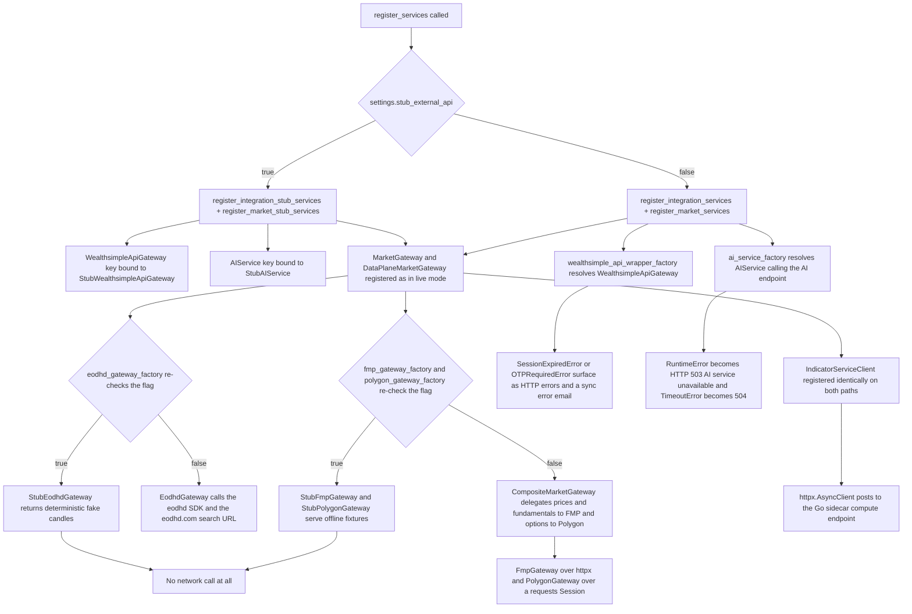

# External Services & Adapters

This page is the boundary catalogue: every dependency that leaves the process (or writes
outside the database), the adapter class that owns it, how the adapter is selected, how it
fails, and what an agent must not break when touching it. The provider-agnostic data-plane
route contract itself belongs to
[Market Data Plane](../architecture/market-data-plane.md); per-request control flow belongs
to [Architecture](../architecture/overview.md); the `Settings` model and the `svcs`
registry are detailed in
[Configuration, Dependency Injection & Cross-Cutting Runtime](../architecture/configuration.md).

Everything outbound is reached through an abstract interface resolved from the `svcs`
registry — `MarketGateway`, `DataPlaneMarketGateway`, `WealthsimpleApiGateway`, `AIService`,
`PriceRepository`, `EmailService`, `IndicatorServiceClient` — never through a direct vendor
SDK call at a call site. That indirection is what makes the stub switch (below) a one-line
change.

| Boundary | svcs key / owner | Live implementation | Stub counterpart |
|---|---|---|---|
| Legacy market data | `MarketGateway` | `EodhdGateway` (`eodhd` SDK + `requests`) | `StubEodhdGateway` |
| Data-plane market data | `DataPlaneMarketGateway` | `CompositeMarketGateway` over `FmpGateway` + `PolygonGateway` | `StubFmpGateway` + `StubPolygonGateway` |
| Brokerage | `WealthsimpleApiGateway` | `WealthsimpleApiGateway` over `ws_api` | `StubWealthsimpleApiGateway` |
| AI analysis | `AIService` | `AIService` over `AsyncOpenAI` | `StubAIService` |
| Email | `EmailService` | `EmailService` over `aiosmtplib` | none — tests patch `aiosmtplib.SMTP` |
| Redis | module singleton `redis_manager` | `RedisManager` over `redis.asyncio` | `FakeRedis` fixture |
| ECB FX rates | `refresh_fx_rates` task + `FxRateProvider` | `httpx` download into Redis | bundled `currencyconverter` snapshot |
| Indicators | `IndicatorServiceClient` | Go sidecar over HTTP | not switched — local infrastructure |
| Uploaded documents | none (direct write) | local filesystem | none |
| MCP gateway | *outbound consumer of our plane* | Go sidecar calling `BACKEND_BASE_URL` | none |

The single deliberate exception to the "one adapter per boundary" shape is
`EodhdPriceRepository`, which is both a repository (Postgres) and an adapter
(`MarketGateway`), showing the "repository_*.py = alternative backend" convention described
in `src/AGENTS.md`. Two further entries are **not** third-party APIs and are therefore not
affected by the stub switch: Redis (an external process, but locally hosted) and the Go
indicator sidecar (local infrastructure). Uploaded security documents are not even a
service — they are the local filesystem — see
[Uploaded documents on local disk](#uploaded-documents-on-local-disk). The MCP gateway is
the one boundary where *we* are the server: it consumes our data plane rather than a
vendor API — see [MCP gateway edge](#mcp-gateway-edge).

## The stub/live switch

`STUB_EXTERNAL_API` is the **only** mechanism that selects stub versus live third-party
adapters, and it is read through the `settings.stub_external_api` boolean
(`src/config/settings.py`, L21; default `False`) — `src/config/services.py::register_services`
branches on it exactly once:

```python
if settings.stub_external_api:
    register_integration_stub_services(registry)
    register_market_stub_services(registry)
else:
    register_integration_services(registry)
    register_market_services(registry)
```

Both branches register the **same abstract keys** with different factories, so no caller
changes. The live counterparts are `register_integration_services`
(`src/integration/registry.py`) and `register_market_services` (`src/market/__init__.py`).
`register_market_stub_services` and `register_market_services` bind the **same keys to the
same factories**; the single registration that differs is `AIService` (`StubAIService` on
the stub path, `ai_service_factory` on the live one). Market-data providers are stubbed
because their factories re-check the flag, not because the two registrations disagree.

| Abstract key | Live-mode factory | Stub-mode factory |
|--------------|-------------------|-------------------|
| `MarketGateway` | `eodhd_gateway_factory` | same factory — it re-checks the flag |
| `DataPlaneMarketGateway` | `composite_market_gateway_factory` | same factory — its providers re-check the flag |
| `PriceRepository` | `eodhd_price_repository_factory` | same — it wraps `eodhd_gateway_factory` |
| `AIService` | `ai_service_factory` (→ `AIService`) | `StubAIService` (`src/stubs/ai.py`) |
| `WealthsimpleApiGateway` | `wealthsimple_api_wrapper_factory` | `StubWealthsimpleApiGateway` (`src/stubs/wealthsimple.py`) |
| `IndicatorServiceClient` | `indicator_service_client_factory` | identical registration on both paths |

**The provider factories are stub-aware.** `eodhd_gateway_factory`
(`src/market/eodhd.py`), `fmp_gateway_factory` (`src/market/fmp.py`) and
`polygon_gateway_factory` (`src/market/polygon.py`) each check
`settings.stub_external_api` themselves and return their stub with the corresponding
provider key (`EODHD_API_KEY`, `FMP_API_KEY`, `POLYGON_API_KEY`). Because
`composite_market_gateway_factory` calls the two provider factories directly, stub mode
yields a **fully offline composite** — no network call at all — even though the
`DataPlaneMarketGateway` registration is identical on both paths. `fetch_logo_image`
(`src/market/fmp.py`) carries the same branch for the logo routes.

Two details matter when changing anything here:

- The stub registrations import their dependencies **lazily inside the function bodies**
  of `register_integration_stub_services` / `register_market_stub_services` (every import
  carries `# noqa: PLC0415`). This is deliberate: importing stub modules eagerly would pull
  vendor SDKs (`ws_api`, `eodhd`) onto the wrong path. Note the asymmetry — the one
  module-level import of a stub class in `src/config/services.py` is
  `from src.stubs.wealthsimple import StubWealthsimpleApiGateway`, needed because the
  integration stub registration references the class directly; `StubAIService` is imported
  inside `register_market_stub_services`. Keep the local imports local.
- There are now **three** independent stub checks (EODHD, FMP, Polygon) in addition to the
  registry branch. They must stay consistent: flipping one without the others silently
  mixes a stub provider into a live composite, or the reverse.

`tests/conftest.py` sets `os.environ["STUB_EXTERNAL_API"] = "true"` (plus
`ENVIRONMENT=test`, a baseline `MARKET_DATA_SERVICE_TOKEN`, and placeholder `FMP_API_KEY` /
`POLYGON_API_KEY`) **before** importing the app, so the whole suite resolves stubs and
needs neither EODHD, FMP, Polygon, Wealthsimple, nor AI credentials. Note
`STUB_EXTERNAL_API` is *not* present in `.env.example`: the dev Compose stack therefore runs
against the **live** adapters, with `EODHD_API_KEY="demo"`, `FMP_API_KEY="demo"` and
`POLYGON_API_KEY="demo"` as the only provided values.



Caption: adapter selection under stub versus live mode — the registry branch swaps only
`AIService` and the broker, while every market-data factory re-checks the flag itself, which
is what keeps stub mode fully offline.

## Market data providers

### Two gateway keys over one ABC

`MarketGateway` (`src/market/gateway.py`) declares **four** abstract capabilities —
`search`, `get_price_on_date`, `get_prices`, `get_intraday_prices` — so a prices-and-search
gateway stays concrete and instantiable. Every newer capability (`lookup_symbol`,
`get_company_profile`, the three statement reads, `get_key_metrics`, `get_financial_ratios`,
`get_institutional_ownership`, `get_options_chain`, `get_option_expirations`, `get_quote`)
is a non-abstract method whose default body raises
`MarketDataProviderError("capability not supported by this provider")`. A provider that
does not serve a dataset therefore fails provider-agnostically instead of raising
`NotImplementedError`, and the composite can forward it unchanged.

Two `svcs` keys sit over that ABC, and the split is what keeps the new providers from
repointing the old flows:

| Key | Factory | Implementations | Consumed by |
|---|---|---|---|
| `MarketGateway` | `eodhd_gateway_factory` | `EodhdGateway`, `StubEodhdGateway` | `EodhdPriceRepository`, `MarketService`, `SecurityApi`, `MarketPricesApi`, `/market/search`, listing-currency resolution |
| `DataPlaneMarketGateway` | `composite_market_gateway_factory` | `CompositeMarketGateway` over FMP + Polygon (stub or live per provider) | the `data_router` routes and the user-facing institutional-ownership route |

`DataPlaneMarketGateway` is a behaviour-free subclass that exists **solely as a distinct
registration key**. Route shapes, caching, currency semantics and the frozen OpenAPI
contract are documented in [Market Data Plane](../architecture/market-data-plane.md) —
this page only covers the HTTP clients behind that key.

### EODHD — the legacy price path

**Live — `EodhdGateway` (`src/market/eodhd.py`).** Constructed with
`settings.eodhd_api_key`. `search` is a raw `requests.get` against
`https://eodhd.com/api/search/{query}?api_token=...&fmt=json` with `timeout=10` and **no
retry loop**; the API key travels in the query string. The price methods go through the
`eodhd.apiclient.APIClient` SDK and rebuild `HistoricalPrice` / `IntradayHistoricalPrice`
from pandas frames, converting every numeric to `Decimal(str(...))` and logging an error
and skipping any row whose index is not a `pandas.Timestamp` (for `get_prices`).
`get_intraday_prices` supports **only `interval="1h"`** and raises `ValueError` for
anything else; it also drops all-zero OHLCV candles (`open == high == low == close` with
`volume == 0`), which is how the vendor represents non-trading hours.
`get_price_on_date` swallows an `IndexError` (empty frame, e.g. a market holiday) and
returns `None` rather than raising.

**Stub — `StubEodhdGateway` (`src/stubs/eodhd.py`).** Deterministic and offline:
`StubEodhdAPIClient` seeds `random` from `hash(symbol)` and steps prices by a hash-derived
percentage, so the same symbol always yields the same series. It ships a hard-coded
base-price table (`US:AAPL`, `US:MSFT`, `US:NFLX`, `TO:RY`, `TO:XYR`, `TO:RYT`,
`US:GOOGL`, `US:TSLA`, `US:AMZN`, `TO:TD`) and falls back to `100.0` for unknown symbols,
so any symbol you invent still produces plausible data. `search` recognizes a `.`- or
`:`-delimited query, knows AAPL/MSFT/RY/TD, and otherwise fabricates a
`SecuritySearchResult` with a synthetic ISIN. Intraday generation caps at
`MAX_INTRADAY_STEPS = 10000` and emits a zero-volume flat candle at
`MARKET_CLOSE_HOUR = 16`. The gateway itself resolves against `KNOWN_SYMBOLS`
(`("AAPL", "MSFT")` in `src/stubs/market_fixtures.py`): unknown symbols raise
`MarketDataNotFoundError`, and `fail_on_symbols` / `unknown_symbols` let a test drive the
failure paths.

**Where EODHD is consumed.** `EodhdPriceRepository` (`src/market/repository_eodhd.py`)
decorates the SQLAlchemy `PriceRepository`: `get_price_on_date` reads the database first and
calls the gateway only on a miss, while `get_prices` **always** reads the gateway for the
requested window, merges the fetched bars with the stored ones keyed by date (fresh bars
win) and persists the merged set via the inner `save_prices`. Its own `save_price` /
`save_prices` deliberately `raise NotImplementedError` — the wrapper is read-through, never
a write target. `get_latest_price` computes the last NYSE trading day using the
`holidays.NYSE()` calendar (skipping weekends), and only refreshes when the stored price is
older than that. `SecurityApi.get_or_create_from_broker` (`src/market/api.py`) calls
`gateway.search` and fronts it with `SecuritySearchCache`; `market_search` in
`src/market/router.py` does the same for the HTTP search route, resolving the legacy
`MarketGateway` key with the sync `services.get(...)`.
`SecuritySearchCache` (`src/market/cache.py`) keys on a normalized query
(`market:search:<lowercased, whitespace-collapsed query>`) with a 30-day default TTL, and
**never raises on Redis failure** — `get` returns `None` and `set` logs a warning, so a
Redis outage degrades to hitting the provider every time rather than failing the request.

Broker-to-EODHD symbol translation happens in `SecurityApi` (`_map_eodhd_symbol` /
`_map_eodhd_exchange`): the broker's `primaryExchange` maps `CSE → CA`, `TSX → TO`,
`NYSE → US`, `NASDAQ → US`, and `.` is rewritten to `-`. `SecurityApi` passes an unknown
exchange through unchanged, whereas the `WealthsimpleApiGateway` twin of this method
indexes the dict directly and raises `KeyError` for an unmapped exchange — the two are not
interchangeable.

**Failure mode.** Neither `search` nor the gateway calls translate vendor errors: a network
or HTTP error propagates out of the route (or out of the daily/hourly price Huey task,
which counts it as a `failure`). There is no circuit breaker and no caching of negative
results at this layer.

### FMP — prices, search, fundamentals and quotes

`FmpGateway` (`src/market/fmp.py`) is the data plane's price/search/fundamentals provider.
It is built on `FmpHttpClient`, a thin **sync `httpx.Client` wrapper** whose `get_json`
appends the API key as the `apikey` query parameter, calls
`https://financialmodelingprep.com` (override with `base_url`) with a 10-second timeout, and
raises `httpx.HTTPStatusError` on non-2xx. The injectable client is what makes every
outbound call mockable with `httpx.MockTransport` — no test dials the network. Only a client
the wrapper created itself is closed by it (`_owns_client`), mirroring
`IndicatorServiceClient`.

Capabilities and endpoints:

| Capability | FMP endpoint |
|---|---|
| `get_prices` / `get_price_on_date` | `stable/historical-price-eod/full` |
| `search`, `lookup_symbol` | `stable/search-symbol`, falling back to `stable/search-name` |
| `get_quote` | `stable/quote` |
| `get_company_profile` | `stable/profile` |
| `get_income_statement` / `get_balance_sheet` / `get_cash_flow_statement` | `stable/income-statement`, `stable/balance-sheet-statement`, `stable/cash-flow-statement` |
| `get_key_metrics` / `get_financial_ratios` | `stable/key-metrics`, `stable/ratios` |
| `get_institutional_ownership` | `stable/institutional-ownership/symbol-positions-summary` |
| `get_intraday_prices` | *not supported* — raises the provider-agnostic capability error (the price-alert path still uses EODHD) |

`map_to_fmp_ticker` keeps provider ticker shape behind the gateway: `NYSE`, `NASDAQ`,
`NYSEARCA` and `AMEX` (plus any unknown code) return the bare symbol, while known non-US
venues append FMP's market suffix (`TSX`/`TO` → `.TO`, `TSXV`/`V` → `.V`, `LSE` → `.L`) and
never double-suffix. That is why every data-plane route accepting `exchange` forwards it.

**Error translation is provider-agnostic and never echoes upstream text.** Transport and
timeout failures and non-2xx statuses become `MarketDataProviderError`; a payload that is
an HTTP-200 `Error Message` body becomes `MarketDataConfigurationError` when it matches one
of the `_CONFIGURATION_ERROR_TOKENS` (`invalid api key`, `limit rate`, `limit reach`,
`requests count exceeds`, `legacy endpoint`) and `MarketDataNotFoundError` otherwise. Raw
upstream messages are logged only. One documented exception: when the institutional-ownership
endpoint answers **HTTP 402 Payment Required**, the gateway falls back to the static
`_FUNDAMENTAL_INSTITUTIONAL_OWNERSHIP` fixture from `src/stubs/fmp.py` for the symbols it
covers, logging a warning — a deliberate UI-testing affordance on a restricted endpoint, not
a general behaviour.

`fetch_logo_image` (`src/market/fmp.py`) is a **provider-direct helper that does not go
through the gateway**: the logo routes in `src/market/router.py` call it with the mapped
ticker, treat any 404/error payload/transport failure as "no logo", cache positive bytes
under `market:logo:<ticker>` (30-day TTL) and the miss as a negative sentinel (1-day TTL) in
`LogoCache`, and answer `404 Logo not found` either way. In stub mode it returns a fixed
1×1 PNG for known symbols and `None` for the sentinel names.

**Stub — `StubFmpGateway` (`src/stubs/fmp.py`).** Fully offline: static sample bars and a
`_BASE_PRICES` table drive deterministic price generation, a small `_KNOWN_SYMBOLS` universe
(AAPL, MSFT, RY, VOD, SHOP, OSCR, ZETA) drives search/lookup and fundamentals, and static
fixtures serve profiles, statements, metrics, ratios, quotes and institutional ownership.
Unknown symbols raise `MarketDataNotFoundError`; `fail_on_symbols` raises
`MarketDataProviderError`; `close()` is a no-op.

### Polygon — options chains

`PolygonGateway` (`src/market/polygon.py`) owns **only** the options capabilities
(`get_options_chain`, `get_option_expirations`); every other method raises the
provider-agnostic capability error, so a mis-routed call fails loudly rather than silently
returning empty data.

- It keeps one persistent `requests.Session` for the gateway's lifetime, so each page of a
  paginated fetch reuses pooled connections; the key travels as the `apiKey` query
  parameter against `https://api.polygon.io` with a 10-second timeout.
- `get_options_chain` reads `/v3/snapshot/options/{symbol}` (250 per page) and
  `get_option_expirations` reads `/v3/reference/options/contracts` (1000 per page, sorted by
  expiration). Both follow `next_url` cursors with `_with_api_key` appending the key when the
  vendor's cursor omits it, and both stop at `_MAX_PAGES = 10`, setting `truncated=True`
  instead of hanging on a sticky cursor.
- `expiration` and `contract_type` are pushed to the endpoint; the strike range is filtered
  **locally** because Polygon's snapshot strike parameters are unstable. An empty result set
  raises `MarketDataNotFoundError`.
- Failure mapping: 404 → `MarketDataNotFoundError`, 401/403 → `MarketDataConfigurationError`,
  any other non-200, transport failure or non-JSON body → `MarketDataProviderError`. URLs and
  bodies are logged only, never returned.

**Stub — `StubPolygonGateway` (`src/stubs/polygon.py`).** Serves the shared options fixtures
from `src/stubs/market_fixtures.py` (`OPTIONS_CHAINS`, `KNOWN_SYMBOLS`, a fixed
`STUB_AS_OF_DATE`), honours the provider-agnostic filters, returns an empty chain for a known
symbol without options, raises `MarketDataNotFoundError` for unknown symbols and
`MarketDataProviderError` for `fail_on_symbols`. It shares its fixtures with
`StubEodhdGateway`, so stub-mode options reads are reproducible and provider-independent.

### The composite

`CompositeMarketGateway` (`src/market/composite.py`) implements the ABC by delegating **per
capability**, not per call site: prices, search, symbol lookup, quotes and every
fundamentals capability go to FMP; options chains go to Polygon. It adds no caching, no
currency resolution, no error translation and no retries of its own — data-plane caching
lives one layer up in `EndpointResponseCache` (`market:ep`), so each response is stored
exactly once. The capability-to-provider table and the route contract are in
[Market Data Plane](../architecture/market-data-plane.md).

`composite_market_gateway_factory` is a **sync closeable generator factory**: it builds the
FMP and Polygon gateways directly, yields the bare composite, and its `finally` calls
`gateway.close()`, which invokes each provider's `close()` defensively (a provider without
the hook is skipped, because lifecycle hooks are structural rather than part of the
`MarketGateway` contract). If the Polygon factory raises, the already-built FMP client is
closed before the original error propagates, with any cleanup failure suppressed. It must
stay sync: `data_router` resolves the key with the sync `services.get(...)`, and svcs
refuses to enter an async factory through a sync `get`. The app lifespan resolves the key
once inside a throwaway container at boot, so a missing provider credential fails at
startup rather than on the first agent request.

### The provider-name rule

Vendor identity is an invariant, not a style preference. `MarketDataNotFoundError`,
`MarketDataProviderError` and `MarketDataConfigurationError` (`src/market/exception.py`) are
documented as provider-agnostic — neither their type nor their default message names an
upstream source — and `data_router._map_market_error` ignores the exception message entirely,
answering `404`, `503` (configuration) or `502` (any other provider failure) with a single
generic detail string. The rule is enforced at four independent layers:

- **Response bodies** — `tests/market/test_data_router.py` asserts, for 404s, 502s and 503s,
  that `detail` contains neither a provider name nor raw upstream text.
- **The contract** — `test_data_plane_contract_has_no_provider_names`
  (`tests/market/test_data_plane_contract.py`) scans both the live FastAPI schema and the
  committed OpenAPI snapshot for `fmp`, `financialmodelingprep`, `polygon` and `eodhd`.
- **Public types and messages** — `tests/market/test_gateway_contract.py` pins the public
  type names, exception names, gateway method names and default messages as
  provider-agnostic.
- **The Go gateway** — `services/mcp-gateway` repeats the check for tool names, titles,
  descriptions, result text, error sentinels and log lines.

Backend provider modules *do* name the provider in their own operator-facing log records
("FMP request to … failed", "Options chain request failed"), but they log the request path
or status, never the full URL and never the API key, and never copy upstream text into an
exception message. Tokens (`EODHD_API_KEY`, `FMP_API_KEY`, `POLYGON_API_KEY`,
`MARKET_DATA_SERVICE_TOKEN`) must never be logged or returned; the `.env.example` values are
placeholders (`"demo"`), not credentials.

## Wealthsimple brokerage

`BrokerApiGateway` (`src/integration/brokers/__init__.py`) is the abstract broker
contract — `login`, `get_accounts`, `get_positions_by_account` — and it also holds the
institution's keyring prefix and `InstitutionEnum`. Only one institution is implemented;
`src/integration/api.py::get_broker_gateway_class` maps
`InstitutionEnum.WEALTHSIMPLE → WealthsimpleApiGateway` and raises `KeyError` for any
other id, so adding an institution means extending that dict *and* registering the class.

**Live — `WealthsimpleApiGateway` (`src/integration/brokers/wealthsimple.py`)** wraps the
external `ws-api` package (`WealthsimpleAPI`, `WSAPISession`). Sessions are persisted per
user in the OS keyring under `<keyring_prefix>.<username>` / key `"session"`, with
`_keyring_prefix = "retail_portfolio_wealthsimple"`. `login` is a two-stage credential
dance: first it tries the cached session and probes it with `get_accounts()`; if no session
exists it calls `ws.login_internal(username, password, otp, persist_session_fct=self._save_session)`.
It wraps `ws.send_get` to capture the last raw response before re-raising, so an
`UnexpectedException` is logged with the actual HTTP payload — useful when the vendor
changes shape. `login` performs **synchronous** I/O but is declared on the same
interface as the async `get_accounts` / `get_positions_by_account`.

Parsing is defensive and lossy by design. Benign cases are **skipped**, not faulted:
closed accounts (`status != "open"`), unmapped `unifiedAccountType` values (an
`AccountTypeUnkownError` inside `_get_account_type` is caught and logged), cash balances
whose security id carries the `sec-c-` prefix (`_is_cash_security_id`, e.g. `sec-c-cad`),
positions whose `primaryExchange` is `None`, and the vendor bug that wraps security ids in
`[]` (worked around by `security_id[1:-1]`). Cash is an account attribute, not a position:
`get_cash_balances` re-reads `get_account_balances`, extracts every `sec-c-<currency>` entry
and returns a `{currency: amount}` map, summing duplicates with a warning. Currency is
**inferred from the exchange** (`NYSE`/`NASDAQ` → `USD`, everything else → `CAD`). Malformed
*shapes* (market data that is not a `dict`, or an identity-position payload that is not a
`list`) raise `UnknownError` instead of being skipped.

Error translation lives in `src/integration/brokers/exception.py`, where all broker
errors descend from `ExternalAPIError`: `ws_api`'s `LoginFailedException` →
`LoginFailedError`, `OTPRequiredException` → `OTPRequiredError`, `ManualLoginRequired` →
`SessionExpiredError`, anything else → `UnknownError`, and a missing keyring entry →
`SessionDoesNotExistError`. `src/integration/task.py` maps each of these to a
user-facing sentence in `_SYNC_ERROR_MESSAGE_MAPPING` and emails it through
`EmailService.send_external_account_error_email`, so a broker auth failure becomes both
a `sync_failed` WebSocket event and a "reconnect your account" email.

`wealthsimple_api_wrapper_factory` additionally accepts `debug_api_responses` and
`debug_dump_path`, which log or dump the raw vendor JSON. `debug_dump_path` writes to an
arbitrary path with no redaction — **treat it as a local debugging aid only; the dumped
payload contains account balances and holdings.**

**Stub — `StubWealthsimpleApiGateway` / `StubWealthsimpleAPI` (`src/stubs/wealthsimple.py`).**
`login` always succeeds, `get_accounts` returns three fixed accounts (one deliberately
`closed` so parsing paths are exercised), and `get_account_balances` returns a
`sec-c-cad` cash entry alongside real positions. It uses a distinct keyring prefix
(`retail_portfolio_wealthsimple_stub`) and, unlike the live gateway, **skips** malformed
payloads instead of raising.

### Security caveat: plaintext keyring

`BrokerApiGateway.__init__` calls `keyring.set_keyring(PlaintextKeyring())` from
`keyrings.alt.file`, i.e. every Wealthsimple session token is stored **unencrypted on
disk**, guarded only by a `# TODO secure this before staging deployment` comment. Any
change that adds a new broker, a new credential, or a new session field inherits this
storage. Do not describe this as secure, and do not copy the pattern into new code
without changing it.

Related: the session payload is what `ws_api` uses to authenticate subsequent calls, so a
user whose keyring entry is missing or stale must re-run `login` with credentials; there
is no silent refresh path in this adapter.

## AI analysis endpoint

`AIService` (`src/market/ai_service.py`) talks to any **OpenAI-compatible** chat
completions endpoint through `AsyncOpenAI`, built as
`AsyncOpenAI(api_key=api_key, base_url=api_endpoint.replace("/chat/completions", ""))`.
That `.replace` is what lets `AI_API_ENDPOINT` be either a bare base URL
(`https://ai.havek.es/api`) or a full completions path — keep it in mind before changing
how the setting is spelled.

The service gathers its own context (`_gather_context`): the security record, the latest
price, up to 50 of the user's notes for that security, and prices from the 1st of the
previous month minus 90 days to today (only the last 30 are sent). Three public methods
share one private call path — `analyze_fundamentals`, `summarize_notes`,
`analyze_portfolio_fit` — and `summarize_notes` short-circuits to a literal
`"No notes found for this security."` without calling the API at all.

Behavior worth knowing before editing `_call_ai_api`:

- `temperature=0.7`, `max_tokens=2000`, `timeout=60` for analyses; the title generator
  uses a **hard-coded `model="gpt-4-turbo"`**, `temperature=0.3`, `max_tokens=20`,
  `timeout=10` and ignores `ai_api_model`.
- Any exception from the SDK is re-raised as
  `RuntimeError(f"AI service unavailable: {e!s}")`, and the router maps that to
  **HTTP 503** (`TimeoutError` maps to **504 "AI analysis timed out"**). Empty content
  raises `RuntimeError`; non-string content raises `TypeError`.
- DeepSeek-style ` thinking...` blocks are stripped from the content before return.
- `generate_note_title` is the **only** AI call with a fallback: on any failure it logs
  and returns the note content truncated to `MAX_TITLE_LENGTH = 50`, so note creation
  never fails because of the AI provider. It is invoked from the Huey task
  `generate_note_title_task`, not inline in the request.
- AI routes are rate-limited at `5/minute` each.

**Stub — `StubAIService` (`src/stubs/ai.py`)** accepts `*args, **kwargs` and returns three
fixed markdown strings, one per method. It deliberately exposes all three methods so it is
a drop-in for `AIService` in the container; `register_market_stub_services` binds it with
`registry.register_factory(AIService, StubAIService)`.

## SMTP email

`EmailService` (`src/core/email.py`) renders Jinja2 templates from
`src/templates/email/` (HTML + text pairs: `verify_email`, `price_alert`,
`external_account_error`, all extending `base`) and sends via `aiosmtplib.SMTP` using
`settings.smtp_host`, `smtp_port`, `smtp_use_tls`, `smtp_user`, `smtp_password` and
`smtp_sender_email`. The flow is `connect()` → optional `starttls()` → optional `login()`
(only when both user and password are set) → `send_message()` → `quit()`. There is **no
connection pooling** — a source `TODO` flags it as a decision to revisit if hourly alert
volume justifies it — so every email opens and closes its own connection.

Every send method is a coroutine, and `send_email` wraps *any* failure into
`EmailSendError("Failed to send email")`. Callers decide how much that matters:
`_send_sync_error_email` in `src/integration/task.py` catches it and only logs, because
the sync failure itself must still surface.

`settings.frontend_url` is interpolated into the verification link, the price-alert
deeplink (`{frontend_url}/security/{security_id}`) and the external-account error deeplink
(`{frontend_url}/accounts`), so a wrong `FRONTEND_URL` produces working emails with broken
links.

In the dev Compose stack `SMTP_HOST="mailcrab"` / `SMTP_PORT=1025` point at the
`marlonb/mailcrab` service — an email sink, published on `MAILCRAB_PORT` (default `8003`)
at `/`. Nothing is delivered externally; anything that *looks* delivered in dev is in
Mailcrab.

## Redis

Redis is the shared coordination layer, reached through the module-level
`redis_manager = RedisManager(settings.redis_url)` singleton
(`src/core/redis.py`) for the indicator cache, security-search cache, logo cache, endpoint
response cache, account sync status, WebSocket pub/sub, the Huey broker and the ECB FX
snapshot. `RedisManager` keeps **one client per running event loop** in a lock-guarded dict,
pruning and closing clients whose loop has closed and lazily creating a
`decode_responses=True` client for the current loop — that loop-keyed design is what lets
the same singleton serve the request loop, the pub/sub listener and `asyncio.run()` task
loops. Every client gets bounded socket timeouts (`DEFAULT_SOCKET_TIMEOUT` and
`DEFAULT_SOCKET_CONNECT_TIMEOUT`, 5s each) so a stalled server fails fast instead of
blocking a request. Two consumers deliberately diverge: `indicator_cache_factory` builds its
own client from `settings.redis_url` with `decode_responses=False` (binary-safe indicator
payloads), and `security_search_cache_factory` passes the shared manager instead.

Boundaries and keys an agent should not break:

- **Indicator cache** — key `indicators:<security_id>:<interval>:<chart_style>:<sha256 digest>:<price_count?>`,
  TTL 3600s, invalidated by `SCAN` over `indicators:*<security_id>*` or flushed wholesale.
- **Search cache** — `market:search:<normalized query>`, 30-day TTL; payloads are validated
  back into `SecuritySearchResult` and an unexpected shape is treated as a miss.
- **Logo cache** — `market:logo:<ticker>`, 30-day TTL for image bytes and a 1-day negative
  sentinel for a miss (`LogoCache.NEGATIVE_SENTINEL`), so a provider 404 is not re-fetched
  on every page render.
- **Endpoint response cache** — `market:ep:<data_class>:<endpoint>:<hash>`, per-data-class
  TTLs read from `Settings` at call time, plus a negative entry under
  `endpoint_ttl_negative_seconds`.
- **Account sync status** — `account_syncs:active:<user_id>`, a Redis set of account ids
  with `settings.sync_ttl_seconds` (default 300) expiry. The TTL is the safety net for a
  worker that dies mid-sync.
- **WebSocket pub/sub** — channel `ws_messages`, payload `{"user_id": ..., "message": ...}`.
  `ConnectionManager.send_personal_message` publishes so *any* process can deliver, and
  falls back to local-only delivery if Redis is unreachable; the listener task restarts
  itself after a 5s delay on unexpected error.
- **Huey broker** — `RedisHueyWithRegistry("retail-portfolio", url=settings.redis_url)`,
  swapped for `MemoryHueyWithRegistry` when `environment == "test"`.
- **ECB FX snapshot** — `fx:ecb:zip` (base64) and `fx:ecb:fetched_at`, written together with
  `MSET`; see [ECB FX rates](#ecb-fx-rates).

**Redis failures degrade, they never propagate.** Every cache catches broadly, logs a
warning and returns `None` (a miss) or drops the write; `EndpointResponseCache` "degrades to
a live fetch and never propagates"; `FxRateProvider` falls back to the bundled snapshot;
`ConnectionManager` falls back to local delivery. The consequence to keep in mind is
operational rather than correctness-related: with Redis down the app keeps serving, but
every read becomes a provider call, latency rises, and negative caching stops protecting
upstream quotas.

Redis is *not* part of the `STUB_EXTERNAL_API` switch: the registry passes the same
`redis_manager`-backed factories on both paths, and the test suite replaces the client
itself (see below).

## ECB FX rates

`src/market/fx.py` adds a second outbound HTTP dependency that is not a market-data vendor:
the `currencyconverter` package ships an ECB snapshot that goes stale the moment the package
is installed, so the backend refreshes it itself.

- `daily_fx_refresh` (`src/market/task.py`) is a Huey periodic task at `17:30` UTC — after
  the ECB publishes — that runs `refresh_fx_rates`, which downloads `ECB_URL` with an
  `httpx.AsyncClient`, validates that the payload is a readable zip, and stores it
  base64-encoded under `fx:ecb:zip` together with `fx:ecb:fetched_at`, in one `MSET` so the
  zip and its fetch date can never drift apart.
- `FxRateProvider` builds a `CurrencyConverter` from that zip, caches the parsed converter
  at **module level keyed by fetch date** (providers are request-scoped in svcs, so an
  instance cache would re-parse the whole CSV per request), and warns when the freshest rate
  is more than `STALE_AFTER_BUSINESS_DAYS = 3` business days old.
- Degradation is explicit: Redis unavailable/empty, a missing zip, or an unreadable zip all
  fall back to the bundled snapshot (a failed fetch date is remembered so a corrupt payload
  is parsed once, not per request).

There is no stub counterpart because there is no credential and no vendor quota: the
fallback *is* the offline path, and `tests/market/test_fx.py` drives both the refresh and
the fallbacks against a fake Redis and a mock transport.

## Indicator sidecar (Go, HTTP)

The FastAPI backend is the only client of the Go indicator service
(`services/indicator-service`, built on `github.com/cinar/indicator/v2`). The service is a
stateless calculator: `POST /compute` takes `{interval, candles, indicators}` and returns
`{"indicators": {<resultKey>: [points]}}`, where the result key is the spec's `id` when set
and its `type` otherwise. Too few candles yields an **empty series and HTTP 200**, not an
error. The service also validates fixed bounds before computing — at most 32 indicators,
at most 50,000 candles, resolved periods within `[1, 1000]`, `stdDev` within `(0, 10]` —
and a violation, an unsupported indicator type, or a body over the **10MB** cap
(`http.MaxBytesReader`) is a `400`. `GET /health` is the liveness probe both Compose files
poll with `wget` every 30s.

On the backend, `IndicatorServiceClient` (`src/market/service.py`) is created by
`indicator_service_client_factory` from `settings.indicator_service_url`, owns one
long-lived `httpx.AsyncClient` (default timeout 10.0s) reused across calls, and closes it
only if it created it — an injected client stays open (`_owns_client`). Its error mapping
is the contract the tests pin down:

| Service outcome | Backend response |
|-----------------|------------------|
| `httpx.TimeoutException` | `504` "Indicator service timed out" |
| `httpx.ConnectError` / `httpx.NetworkError` | `503` "Indicator service unavailable" |
| `400` | `400` with the service's `error` text as `detail` |
| `5xx` | `503` "Indicator service unavailable" |
| any other non-`200` | that status, response text as `detail` |

**Security caveat: the sidecar is unauthenticated.** It exposes no auth and no rate
limiting, and its README states plainly that it is intended for the internal Docker
network only and must never be exposed publicly. Dev Compose publishes it on
`127.0.0.1:${INDICATOR_SERVICE_PORT:-8004}` → container `8080`, bound to the loopback
interface; prod Compose publishes **no host port** at all. Changing either binding to
`0.0.0.0` hands out an unauthenticated compute endpoint.

Configuration is `INDICATOR_SERVICE_URL` (Compose sets
`http://indicator-service:8080`; `Settings` defaults to `http://localhost:8080`).
Note the client is registered identically on **both** registry paths — the stub switch
does not touch it, because the sidecar is local infrastructure, not a third-party API.

## MCP gateway edge

`services/mcp-gateway` is a Go sidecar that exposes *our* data plane as an MCP server over
streamable HTTP. It is the one entry on this page that is **not** a third-party API
boundary: the gateway holds no provider credentials, calls no provider directly, and talks
exclusively to the backend's service-to-service data plane. Treat the edge this way:

- **Outbound configuration** — `BACKEND_BASE_URL` (the backend origin, e.g.
  `http://backend:8000`), `MARKET_DATA_SERVICE_TOKEN` (sent as the `X-Service-Token`
  header), and `DATA_PLANE_PATH` (default `/api/v1/market/data`, also accepting
  `MARKET_DATA_PATH`). Every request goes to
  `BACKEND_BASE_URL + DATA_PLANE_PATH + /...`; a missing or unusable required value is a
  startup error.
- **The shared secret is a coordinated two-sided value.** The backend validates it in
  `require_service_token` (`src/auth/api.py`) with a constant-time byte comparison against
  `settings.market_data_service_token`, independent of user JWT auth; the gateway sends it
  and never logs it. Dev Compose defaults it to `dev-market-data-token`; prod Compose
  requires it (`${MARKET_DATA_SERVICE_TOKEN:?…}`).
- **The `/mcp` listener itself is unauthenticated** — the trust boundary is the backend data
  plane, not the MCP listener — so it must stay on the internal network. Dev Compose binds
  it to `127.0.0.1:${MCP_GATEWAY_PORT:-8005}`; prod publishes no host port.
- **Provider-name rule and token redaction** — tool names, titles, descriptions, result text
  and error sentinels are provider-agnostic, and diagnostic status/body detail is kept for
  Go-side logs only. Sensitive headers (`Authorization`, `X-Service-Token`, `Cookie`,
  `Set-Cookie`) are redacted in the request-logging middleware.

The gateway's own internals — transport, concurrency bounding, route groups, the error
taxonomy and the tool surface — live on [MCP Gateway](mcp-gateway.md); the route contract it
consumes lives on [Market Data Plane](../architecture/market-data-plane.md).

## Uploaded documents on local disk

Security documents have no object storage and no third-party file service: the upload
route writes bytes straight to the container's filesystem. `POST /securities/{security_id}/documents`
(`src/market/router.py`, `market_create_document`) reads `settings.upload_path`
(`UPLOAD_PATH`, default `"data/uploads"`), calls `mkdir(parents=True, exist_ok=True)`,
and writes the uploaded content to `<upload_path>/<uuid4><original extension>`. Only
metadata — original filename, `file_path`, byte size and `file_type` — goes to the
database (`SecurityDocumentModel`); the `file_path` column stores the str of the path the
process wrote.

Deployment constraints that follow directly from this:

- **The directory is local to the process's filesystem.** No Compose file declares a
  named volume for it (the only declared volume is `postgres_data`). In dev it happens to
  land inside the bind-mounted repo root (`./:/app` for both `backend` and `worker`), so
  both services see the files; in prod (image-based, no bind mount) the files live in the
  container's writable layer and are lost on recreate or upgrade.
- **It is not backed up with the database.** Restoring Postgres alone leaves
  `SecurityDocumentModel` rows pointing at files that no longer exist, and documents
  written by one replica are invisible to any other.
- There is **no content-type or size validation** in the route, and no path traversal risk
  from the original filename because only the sanitized `uuid4` name is used for the
  stored path — but the caller-supplied `file.content_type`/`filename` are stored verbatim
  in metadata and served back to the owner.
- `settings.upload_path` is relative by default, so it resolves against the process's
  working directory — `/app`, set by `WORKDIR` in the root `Dockerfile` and by
  `working_dir` in the dev Compose services. Changing it requires a restart and a matching
  directory on whatever host you deploy to.

Treat this as a deployment constraint to fix, not a design to copy: moving documents to
object storage means adding an adapter here, a stub in `src/stubs/`, and a factory that
branches on `settings.stub_external_api` like every other third-party boundary on this page.

## Configuration reference

| Variable | Setting | Consumed by |
|----------|---------|-------------|
| `EODHD_API_KEY` | `eodhd_api_key` | `EodhdGateway` construction, EODHD SDK and search URL |
| `FMP_API_KEY` | `fmp_api_key` | `FmpGateway` / `FmpHttpClient` (`apikey` query parameter) and `fetch_logo_image`; startup-validated |
| `POLYGON_API_KEY` | `polygon_api_key` | `PolygonGateway` (`apiKey` query parameter); startup-validated |
| `AI_API_ENDPOINT` | `ai_api_endpoint` | `ai_service_factory` base URL |
| `AI_API_KEY` | `ai_api_key` | `AsyncOpenAI` credentials |
| `AI_API_MODEL` | `ai_api_model` | analysis calls only (title generation hard-codes a model) |
| `INDICATOR_SERVICE_URL` | `indicator_service_url` | `indicator_service_client_factory` |
| `BACKEND_BASE_URL` | — (Go only) | MCP gateway backend origin |
| `DATA_PLANE_PATH` | — (Go only) | MCP gateway data-plane path prefix (default `/api/v1/market/data`) |
| `MARKET_DATA_SERVICE_TOKEN` | `market_data_service_token` | `require_service_token` on the data-plane routes; sent by the MCP gateway as `X-Service-Token`; startup-validated |
| `UPLOAD_PATH` | `upload_path` | `market_create_document` document writes |
| `SMTP_HOST` / `SMTP_PORT` / `SMTP_USE_TLS` / `SMTP_USER` / `SMTP_PASSWORD` / `SMTP_SENDER_EMAIL` | same names | `EmailService.send_email` |
| `FRONTEND_URL` | `frontend_url` | deeplinks and verification links inside emails |
| `REDIS_URL` | `redis_url` | `redis_manager`, indicator/search/logo/endpoint caches, Huey broker, pub/sub, ECB FX snapshot |
| `SYNC_TTL_SECONDS` | `sync_ttl_seconds` | account-sync status TTL |
| `ENDPOINT_TTL_*_SECONDS` | `endpoint_ttl_*_seconds` | per-data-class `EndpointResponseCache` TTLs and the negative-cache TTL |
| `STUB_EXTERNAL_API` | `stub_external_api` | registry branch and the EODHD/FMP/Polygon gateway factories (tests only; absent from `.env.example`) |

Secrets come from the root `.env` (copied from the tracked `.env.example`, gitignored
once copied) and from the process environment, which wins over the file — `Settings`
pins `env_file=(".env",)` with `extra="ignore"`. Three validators run at import time:

- `validate_secret_key` — outside `dev`/`test`, `SECRET_KEY` must be at least
  `MIN_SECRET_KEY_LENGTH = 32` characters or `Settings()` raises a `ValueError` with
  generation instructions.
- `validate_service_token` — outside `dev`/`test`, `MARKET_DATA_SERVICE_TOKEN` must be
  non-empty or `Settings()` raises.
- `validate_market_provider_keys` — outside `dev`/`test` **and** with
  `STUB_EXTERNAL_API` false, both `FMP_API_KEY` and `POLYGON_API_KEY` must be set, or
  `Settings()` raises naming the missing ones. Stub mode is explicitly exempt because the
  stub gateways are offline and need no credentials.

So the startup contract is: the data-plane provider keys and the service token fail fast,
while `EODHD_API_KEY` and `AI_API_KEY` are *not* validated — a bad value surfaces on first
use, either as a vendor error or as a stubbed response that hides the misconfiguration
entirely when `STUB_EXTERNAL_API=true`. **Changing any of these values requires a container
restart**, because the backend and worker load `.env` at process start.

## Testing rule for outbound clients

Repository-wide and mandatory (`src/AGENTS.md`): **backend tests must not depend on
external services** — no Redis, no HTTP APIs (market data providers, broker APIs), no SMTP,
no DNS resolution. Mock every outbound client and stub *every* method the code under test
calls. A test that performs a real network, Redis or SMTP call is broken by definition; do
not "fix" it by expecting the service to be up. The one allowed infrastructure dependency is
the ephemeral PostgreSQL container from `testcontainers`. See
[Testing](../operations/testing.md).

The mechanisms already in place, in preference order:

- **Global env switch** — `STUB_EXTERNAL_API=true` in `tests/conftest.py` before the app
  import, together with baseline `MARKET_DATA_SERVICE_TOKEN`, `FMP_API_KEY` and
  `POLYGON_API_KEY` values so the prod-path `Settings` validators still pass.
- **In-memory Redis** — the autouse `fake_redis_manager` fixture
  (`tests/fixtures/redis.py`) replaces `src.core.redis.redis_manager.client` (and the
  `src.auth` module-level references) with `FakeRedis`; `mock_redis_storage` exposes the
  backing store for assertions. Reuse it rather than adding a Redis dependency.
- **Vendor stubs** — `StubEodhdGateway` / `StubEodhdAPIClient`, `StubFmpGateway`,
  `StubPolygonGateway`, `StubWealthsimpleAPI` / `StubWSAPISession`, `StubAIService`
  (`src/stubs/`).
- **`httpx.MockTransport`** — `tests/market/test_fmp.py` drives `FmpGateway` through a mock
  transport so no test can dial the network, and `tests/market/test_indicator_client.py`
  asserts the sidecar 504/503/400 mapping the same way.
- **Patched sessions** — `tests/market/test_polygon.py` patches `src.market.polygon.requests.Session`,
  the only outbound surface of the Polygon gateway.
- **Monkeypatched factories** — `tests/fixtures/auth.py::auth_client` replaces
  `src.market.eodhd.eodhd_gateway_factory` with `MockEodhdGateway` (patched on the source
  module, because `src/market/__init__.py` imports the name for DI) and neuters
  `EmailService.send_verification_email`.
- **`unittest.mock.patch`** — `tests/email/test_email_service.py` patches
  `src.core.email.aiosmtplib.SMTP` for every send path; `tests/routers/test_notes.py` uses
  `AsyncMock(spec=AIService)` so the AI client is never constructed.

Commands run inside Docker (`docker compose exec backend uv run pytest`, per
`src/AGENTS.md`). Every stub in `src/stubs/` is fake data — never present a stub value,
a `.env.example` placeholder (`EODHD_API_KEY="demo"`, `FMP_API_KEY="demo"`,
`POLYGON_API_KEY="demo"`), or the throwaway dev `SECRET_KEY` as a real credential.

## Extension points

- **New outbound dependency**: define an abstract interface, a live adapter, a stub in
  `src/stubs/`, a factory that branches on `settings.stub_external_api` (or is registered
  from the stub function), and register both paths in the domain's `register_*_services`.
- **New market data capability or provider**: implement the optional `MarketGateway` method
  on the provider and route it in `CompositeMarketGateway`; add a stub so
  `STUB_EXTERNAL_API=true` keeps the whole suite offline. Which registration key the
  provider belongs to (`MarketGateway` vs `DataPlaneMarketGateway`) is the decision that
  keeps the legacy EODHD flows and the data plane from entangling — see
  [Market Data Plane](../architecture/market-data-plane.md).
- **New broker institution**: extend `get_broker_gateway_class`, add a `BrokerApiGateway`
  subclass with its own keyring prefix and `InstitutionEnum`, map its vendor errors onto
  `ExternalAPIError` subclasses, and add a sentence to `_SYNC_ERROR_MESSAGE_MAPPING` if the
  user needs actionable guidance.
- **New indicator type**: it belongs in the Go sidecar, not in Python — extend the Go
  calculator and its `type` alias table; the backend only forwards specs.
- **Document storage**: replace the direct filesystem write with an adapter behind a
  repository/interface so it can be stubbed, versioned, and shared between backend and
  worker.

## Related pages

- [Market Data Plane](../architecture/market-data-plane.md) — the route contract, capability
  routing table, caching layering and provider-agnostic error mapping over these clients.
- [MCP Gateway](mcp-gateway.md) — the Go consumer of the data plane: transport, tools and
  error taxonomy.
- [Configuration, Dependency Injection & Cross-Cutting Runtime](../architecture/configuration.md) —
  the `Settings` model and the full registry.
- [Authentication](../architecture/authentication.md) — where `SECRET_KEY` and the
  service-token boundary come from.
- [Testing](../operations/testing.md) — fixtures and the no-external-services rule.
- [Market Data & Indicators](../workflows/market-data-and-indicators.md) — how the provider
  and sidecar boundaries are driven end to end.
- [Broker Sync](../workflows/broker-sync.md) — the Wealthsimple session lifecycle.
- [AI Analysis](../workflows/ai-analysis.md) — the AI call path from route to provider.
