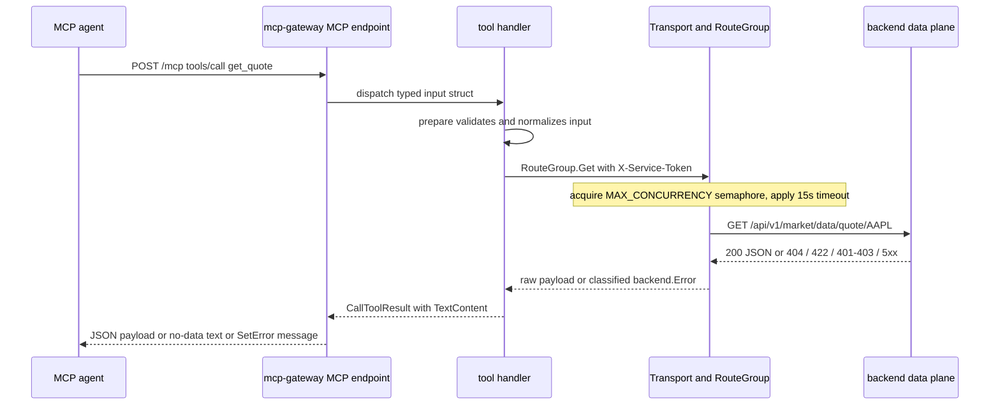

# MCP Gateway (Agent-Facing Market Data Server)

`services/mcp-gateway` is a Go sidecar that exposes the backend's provider-agnostic market data as an
[MCP](https://modelcontextprotocol.io) server over the **streamable HTTP** transport. An agent connects to
`/mcp` and calls generic market-data tools; it never learns which upstream provider serves the data. The
service is a thin transport and client layer: it holds no provider credentials, calls no provider directly,
and talks exclusively to the backend's service-to-service data plane using `X-Service-Token`.

Two different boundaries shape everything below, and conflating them is the classic mistake:

- The **agent-facing boundary** is the MCP listener. It is deliberately unauthenticated — there is no user
  JWT, no API key and no per-caller identity at `/mcp`.
- The **service boundary** is the backend data plane, and that is where the shared secret actually lives.
  The gateway's only credential is `MARKET_DATA_SERVICE_TOKEN`, sent as `X-Service-Token`.

The route contract the gateway consumes, provider routing and cache TTLs belong to
[Market Data Plane](../architecture/market-data-plane.md); the token's backend half is covered by
[Authentication](../architecture/authentication.md) and
[Configuration](../architecture/configuration.md); the outbound-boundary catalogue entry is in
[External Services](external-services.md).

## Listener surface and trust boundary

`server.NewRouter` (`internal/server/router.go`) mounts exactly two endpoints:

| Endpoint | Methods | Behaviour |
| --- | --- | --- |
| `/health` | `GET` | Fixed `200` with `{"status":"ok"}`, `Content-Type: application/json`. It does **not** depend on backend reachability, so a gateway that can serve liveness but cannot reach the data plane still answers `200`. Any other method returns `405` with `Allow: GET`. |
| `/mcp` | MCP streamable HTTP (`POST` for JSON-RPC calls, `GET` for the streaming/SSE side) | The MCP endpoint. **Unauthenticated** — the shared-secret trust boundary is the backend data plane, not this listener — so it must stay on the internal network. |

Three protections and lifecycle rules apply to `/mcp`:

- **Cross-origin rejection.** The handler is wrapped in Go's standard-library
  `http.NewCrossOriginProtection()`. Browser requests carrying `Sec-Fetch-Site: cross-site` or a mismatched
  `Origin` header receive `403 Forbidden`; non-browser MCP agents that send neither header connect normally.
- **Idle session reaping.** The streamable handler is constructed with
  `&mcp.StreamableHTTPOptions{SessionTimeout: cfg.SessionIdleTimeout}`, so an idle MCP session is closed
  after `SESSION_IDLE_TIMEOUT` (default `30m`). `SESSION_IDLE_TIMEOUT` is therefore a real session-lifetime
  knob, not a per-request timeout.
- **Transport timeouts are asymmetric on purpose.** In `cmd/mcp-gateway/main.go` the `http.Server` sets
  `ReadTimeout: 15s`, `IdleTimeout: 60s` and `WriteTimeout: 0`. The unlimited write deadline exists because
  the MCP streamable transport keeps SSE responses open for the life of the session, and any finite deadline
  would truncate them mid-stream; `IdleTimeout` still reaps dead connections.

Shutdown is signal-driven: `SIGHUP`, `SIGINT`, `SIGTERM` and `SIGQUIT` trigger `httpServer.Shutdown` with a
10-second grace period, a timeout is logged as a forced exit, and the process logs `mcp-gateway stopped`
before exiting cleanly.

The server identity reported during `initialize` is `market-data-gateway` version `0.0.1`
(`internal/server/server.go`) — provider-agnostic on purpose.

## One tool call end to end



Caption: the request path of a single MCP tool call, from the agent's `tools/call` to the service-token data
plane and back through the result contract.

## The generalized transport layer

All outbound backend communication flows through one `Transport` plus per-domain `RouteGroup`s
(`internal/backend/transport.go`). This is the extension seam of the service: the market client is just the
first domain wired on top of it.

**`Transport`** owns:

- a single `*http.Client` whose timeout defaults to **15s** (`defaultHTTPTimeout`), so a stalled data plane
  cannot pin a tool call open forever;
- a **semaphore channel sized by `MAX_CONCURRENCY`** that bounds concurrent outbound requests across *all*
  route groups, not per domain;
- `ValidateBaseURL`, which rejects values that parse but cannot address an HTTP origin (a non-`http(s)`
  scheme or a missing host) so a misconfigured environment fails at startup rather than on the first tool
  call;
- a **response cap of 8 MiB** (`maxResponseBytes`) applied through `io.LimitReader`, and error-detail
  truncation at 512 characters.

**`RouteGroup`** (`transport.NewRouteGroup(prefix, token)`) isolates a domain's path prefix and its service
token on top of the shared transport. `Do` composes `baseURL + prefix + path`, URL-encodes the query,
serializes a non-nil body as JSON with `Content-Type: application/json`, always sets
`Accept: application/json`, and sets `X-Service-Token` when the group's token is non-empty. `Get` and `Post`
are thin wrappers over `Do`, so the layer is method-agnostic and a second domain (portfolios, watchlists,
orders) needs no new transport code.

Concurrency behaviour is explicit rather than implicit: `Do` first tries a non-blocking semaphore acquire. If
the semaphore is saturated it emits a `WARN` record (`"backend concurrency limit reached, queuing call"` with
`max_concurrency` and `url`) and then blocks on the acquire, racing it against `ctx.Done()`. A queued call
whose context expires — including one waiting behind a slow sibling — returns `ErrProvider` with the context
error as diagnostic detail, so saturation degrades into a classified provider failure instead of a hung tool
call. `internal/backend/transport_test.go` pins the cap (`TestTransport_ConcurrencyCap`) and the saturated
timeout path (`TestTransport_SaturatedSemaphoreTimeout`); `internal/backend/market_test.go` repeats both for
the market client, including saturation logging and cancellation while queued.

### The market client and its contract coupling

`backend.NewMarketClient` builds a `Transport` and wraps a `RouteGroup` whose prefix defaults to
`DefaultDataPlanePath` (`/api/v1/market/data`). Every method normalizes the symbol to upper case, trims it
and `url.PathEscape`s it before it goes on the wire (`normalizeSymbol`), and float filters are rendered
without exponents or trailing zeros (`formatFloat`) to match the decimal query syntax the backend accepts.

Routes and query-parameter names are a **frozen contract**, defined in `src/market/data_router.py` and
published as the committed OpenAPI snapshot `tests/market/contracts/data_plane_openapi.json`. Parity is
verified from both sides: backend contract tests plus
`services/mcp-gateway/internal/backend/contract_test.go`, which asserts the artifact is a valid OpenAPI 3.x
document, that the Go client exercises 100% of its eight routes without undeclared or missing query
parameters, that drift is rejected, and that the exchange vocabulary matches. Do not rename a route or a
query parameter without regenerating the snapshot — see
[Market Data Plane](../architecture/market-data-plane.md) for the contract's owning side.

## Error taxonomy and result contract

Every backend failure is normalized into exactly one of four classes, matched with `errors.Is`
(`internal/backend/errors.go`):

| Sentinel | Trigger | What it means | How the tool reports it |
| --- | --- | --- | --- |
| `ErrNoData` | HTTP **404** | There is no data for this request *right now*. A 404 may be a cached empty result inside the cache TTL, so it is **never** "invalid symbol". | A **successful** `CallToolResult` whose text is `No market data is available for this request.` |
| `ErrValidation` | HTTP **422** | The parameters failed backend validation. Unlike `ErrNoData`, retrying with corrected parameters is the right response. | `result.SetError(...)` carrying the parsed, agent-safe validation message (falling back to the generic sentinel text when the body is unparsable). |
| `ErrConfiguration` | HTTP **401/403** | The service token was rejected — an operator problem, not a user one. | `result.SetError(err)` carrying the generic sentinel text only. |
| `ErrProvider` | HTTP **5xx**, unexpected statuses, non-JSON bodies, timeouts, connection failures | The data plane is unreachable or misbehaving. | `result.SetError(err)` carrying the generic sentinel text only. |

The four sentinel messages are deliberately generic (`"no market data found"`,
`"market data request was invalid"`, `"market data authentication failed — check service token
configuration"`, `"market data is temporarily unavailable"`): none contains a status, a token or a provider
name, so forwarding `err.Error()` to an agent cannot leak internals.

The `backend.Error` type is what makes that guarantee structural rather than a convention:

- `Error()` returns only the class text; `Unwrap()` exposes the sentinel so `errors.Is` keeps working.
- `Status()` and `Detail()` (status code plus a truncated body, capped at 512 runes) exist **for Go-side
  logging only** and are deliberately excluded from `Error()`. The diagnostic detail never reaches a tool
  result.
- `ValidationMessage()` is populated only for `ErrValidation`. It parses FastAPI's `{"detail": ...}` body —
  either a plain string or an array of `{loc, msg}` objects — drops leading request-location kinds
  (`body`, `query`, `path`, `header`, `cookie`) from each `loc` path, joins the messages with `; `, and
  truncates. Anything it cannot parse falls back to the generic `ErrValidation` text.

The tool layer (`internal/tools/registry.go`) implements the result contract in one shared pipeline,
`runTool`, so all eight tools behave identically:

1. **Input validation failure is caught locally.** A `prepare` error is reported through
   `result.SetError` with the locally synthesized message (for example `symbol is required` or
   `option_type must be 'call' or 'put'`) and is logged at `ERROR` as `ErrValidation` with status `400`. The
   backend is never called.
2. **`ErrNoData` is a success**, returned as a single `mcp.TextContent` with the no-data sentence. Two tools
   synthesize this class themselves: `resolve_symbol` when the search returns no candidates, and
   `get_fundamentals` when every requested section is null or absent.
3. **`ErrValidation` becomes `result.SetError`** with `ValidationMessage()`, falling back to the generic
   sentinel text.
4. **`ErrConfiguration` / `ErrProvider` become `result.SetError(err)`** with the generic sentinel text.
5. **Anything else becomes `result.SetError(errors.New("tool call failed"))`.** This is the catch-all for
   malformed-but-`200` payloads (for example a statement item missing its `date`/`symbol` header): a shape
   change is reported as a generic tool failure and is **never** reported as "no data".

## Configuration and fail-fast startup

`config.Load(getenv)` takes an injected `getenv` function so the parsing rules are unit-testable without
mutating the process environment. Every value comes from the environment, so the same binary runs unchanged
in local Compose and in CI.

| Variable | Required | Default | Rules |
| --- | --- | --- | --- |
| `BACKEND_BASE_URL` | yes | — | Must parse as an absolute `http`/`https` origin with a host (`backend.ValidateBaseURL`); otherwise startup fails. |
| `MARKET_DATA_SERVICE_TOKEN` | yes | — | Sent as `X-Service-Token`. The value is **never logged and never appears in an error message**. |
| `DATA_PLANE_PATH` (alias `MARKET_DATA_PATH`) | no | `/api/v1/market/data` | `DATA_PLANE_PATH` wins when both are set. Trailing slashes are trimmed and a leading slash is added. |
| `PORT` | no | `8080` | HTTP listen port. |
| `ENVIRONMENT` | no | `dev` | `prod` selects the JSON slog handler at `INFO`; `dev`/unset selects the text handler at `DEBUG`. |
| `LOG_LEVEL` | no | — | `DEBUG`, `INFO`, `WARN`/`WARNING` or `ERROR`. An invalid value is a startup error naming `LOG_LEVEL`. |
| `MAX_CONCURRENCY` | no | `10` | Must be a positive integer; sizes the outbound semaphore. |
| `SESSION_IDLE_TIMEOUT` | no | `30m` | Must be a positive Go duration string; becomes the MCP `SessionTimeout`. |

Startup order in `cmd/mcp-gateway/main.go` is strictly fail-fast: `config.Load(os.Getenv)` →
`logging.Init(cfg)` → `backend.NewMarketClient(...)` → `server.NewRouter(server.New(client), cfg)` →
`logging.Middleware(router, cfg.Environment)`. A missing or unusable required value, an invalid base URL, a
bad log level, a non-positive `MAX_CONCURRENCY` or an unparsable `SESSION_IDLE_TIMEOUT` logs an error and
exits non-zero instead of serving.

The token discipline is worth stating separately, because it is asserted rather than assumed:

- `Load` returns errors that **name** the offending variable but never echo the token value.
- The startup log record carries `service`, `port`, `backend_url`, `data_plane_path`, `environment` and
  `max_concurrency` — deliberately **not** the token and not the `MARKET_DATA_SERVICE_TOKEN` variable name.
- `internal/config/config_test.go` and `internal/logging/logger_test.go` both fail the build if a
  configuration error or a startup/shutdown log line contains the secret.

## Tools

`tools.Register(*mcp.Server, *backend.MarketClient)` (`internal/tools/registry.go`) fans out to four
per-family registration functions — `registerPriceTools`, `registerFundamentalsTools`, `registerOptionsTools`,
`registerSymbolTools` — each in its own file. Every tool is registered through `addTool`, which sets
`Annotations` with `ReadOnlyHint: true`, `IdempotentHint: true` and `Title`, and infers the input schema from
a typed input struct carrying `jsonschema` tags. Fields without `omitempty` are rejected by the SDK before
the handler runs, which is why omitting `symbol`, `statement` or `expiry` never reaches the backend.

| Tool | Inputs | Backend route (via the data-plane prefix) | Validation / clamping before the call |
| --- | --- | --- | --- |
| `resolve_symbol` | `query`, `exchange?` | `GET /symbols/search?q=` | Query trimmed to 1–100 characters; exchange must be one of the six supported codes. Intended to be used first. |
| `get_quote` | `symbol`, `exchange?` | `GET /quote/{symbol}?exchange=` | Symbol rule below; exchange enum. |
| `get_price_history` | `symbol`, `from?`, `to?`, `interval?`, `exchange?` | `GET /prices/{symbol}?from=&to=&interval=&exchange=` | Dates parsed as `YYYY-MM-DD`; `from <= to`; interval one of `day`/`week`/`month`. The 2,000-bar cap is backend-side and is stated in the description. |
| `get_fundamentals` | `symbol`, `sections?`, `exchange?` | `GET /fundamentals/{symbol}?exchange=` | Sections are a de-duplicated subset of `profile`, `key_metrics`, `ratios`, defaulting to all three. |
| `get_financial_statements` | `symbol`, `statement`, `period?`, `limit?`, `exchange?` | `GET /fundamentals/{symbol}/statements?statement=&period=&limit=&exchange=` | `statement` one of `income`/`balance`/`cashflow`; `period` `annual` (default) or `quarter`; `limit` clamped to 1–20 with a default of 5. |
| `get_option_expirations` | `symbol` | `GET /options/{symbol}/expirations` | Symbol rule only. |
| `get_options_chain` | `symbol`, `expiry`, `option_type?`, `strike_min?`, `strike_max?` | `GET /options/{symbol}?expiry=&option_type=&strike_min=&strike_max=` | `expiry` required, `YYYY-MM-DD`; `option_type` `call`/`put`; `strike_min <= strike_max`. |
| `get_technical_indicator` | `symbol`, `indicator`, `period?`, `fast?`, `slow?`, `signal?`, `std_dev?`, `from?`, `to?`, `exchange?` | `GET /indicators/{symbol}?indicator=&period=&fast=&slow=&signal=&std_dev=&from=&to=&exchange=` | `indicator` one of `sma`/`ema`/`rsi`/`macd`/`bollinger`; each period parameter 2–400; `std_dev > 0`; `from <= to`. |

Shared input rules (`internal/tools/validate.go`):

- **Symbol**: required, at most 32 characters, and matching
  `^\^?[A-Za-z0-9][A-Za-z0-9.\-=]{0,30}$` — an alphanumeric ticker with an optional leading `^` and internal
  `.`, `-`, `=`. The pattern is what blocks path traversal (`AAPL/EXPIRATIONS`), percent-encoded segments
  (`A%2FB`), whitespace and control characters before they reach a URL.
- **Exchange**: optional; when present it must be one of `NYSE`, `NASDAQ`, `NYSEARCA`, `AMEX`, `TSX`, `LSE`
  (trimmed and upper-cased, so `tsx` is accepted and normalized).

Because these bounds mirror the backend data plane's own constraints, most bad arguments are rejected in the
handler; a backend `422` that still slips through is classified as `ErrValidation` and reported as an
actionable error rather than as "no data".

### Result shaping

Tools do not blindly forward every backend payload; three of them reshape it, and the rest pass raw JSON
through:

- **`resolve_symbol`** ranks candidates in four tiers — case-insensitive exact symbol match on the preferred
  exchange, then exact symbol match anywhere, then the first result on the preferred exchange, then the first
  result — and returns `best_match` plus up to 10 alternatives in backend order. An empty search result
  becomes `ErrNoData`.
- **`get_fundamentals`** filters the aggregate to the requested sections and passes each section through
  verbatim, preserving unknown fields and exact numeric representations; if every requested section is null
  or absent the whole call becomes `ErrNoData`.
- **`get_financial_statements`** decodes the bare statement list, requires each item to be a JSON object with
  non-empty `date` and `symbol` string headers, passes line items and unknown fields through untouched, and
  wraps the result in an envelope echoing `statement`, `symbol`, `period`, `limit`, `exchange` and `items`.
- Every other tool returns the backend's JSON as the `TextContent` payload.

Tool descriptions follow a four-section convention — `Use when:`, `Examples:` (at least two
plain-language-query → parameter-JSON pairs), `Returns:` (top-level keys and decimal-string/`truncated`
semantics) and `See also:` (only registered tool names). `internal/tools/registry_test.go`
(`TestToolSurfaceContract`) asserts the registered set, the annotations, the four sections, the example
count, the `See also:` targets, and specific guidance such as `resolve_symbol` saying to use it first, the
2,000-bar cap on `get_price_history`, and `get_options_chain` explaining `truncated`.

## Provider-agnostic vocabulary rule

This is a hard constraint on the whole module, not a style preference: **tool names, titles, descriptions,
result strings, log lines, error strings and the README must never name an upstream provider data vendor.**
The vocabulary is "market data" and nothing more, because an agent that learns the vendor name learns
something the data plane exists to hide.

The rule is enforced by tests, and those test files obey it themselves by assembling the forbidden names
from string fragments, so the rule's own enforcement cannot become the leak:

- `internal/tools/registry_test.go` and `internal/server/server_test.go` scan tool names, titles,
  descriptions, input schemas, result text and execution logs.
- `internal/backend/market_test.go` scans error strings and all four sentinels, and asserts errors never
  leak the service token either.
- `internal/logging/middleware_test.go` scans middleware log output.

Practically: an agent can learn that data is missing, that a request was invalid, or that the provider is
unavailable — never which vendor is behind the plane.

## Adding a new tool domain

The transport layer is provider- and domain-agnostic, so adding a second data plane (portfolios, watchlists,
orders) is a three-step workflow that modifies no existing client method:

1. **Configure the route group and token.** Add the domain's service token and any prefix configuration to
   `internal/config/config.go`, then create a `RouteGroup` from the shared `Transport`:
   `transport.NewRouteGroup("/api/v1/portfolio", cfg.PortfolioServiceToken)`.
2. **Create the domain client.** Add `internal/backend/<domain>.go` with a client struct wrapping
   `*RouteGroup` and typed methods calling `group.Get` / `group.Post`, so the domain inherits the
   concurrency semaphore, timeout, response cap and error classification for free.
3. **Register the tools.** Add `internal/tools/<domain>.go` with a `register<Family>Tools` function that
   defines typed inputs, a `prepare` method and a `runTool` handler closing over the domain client, and call
   it from `tools.Register` in `internal/tools/registry.go`.

Two invariants carry over to any new domain: the tool metadata must stay provider-agnostic, and every tool
result must go through `runTool` so the four-class error contract and the "404 is a successful no-data
result" rule are never re-implemented by hand.

## Logging, redaction and observability

Structured logging uses the standard library `log/slog` (`internal/logging`). `ENVIRONMENT=prod` selects
`slog.NewJSONHandler` with a default level of `INFO`; `dev` (or unset) selects `slog.NewTextHandler` with a
default of `DEBUG`; an explicit `LOG_LEVEL` overrides the level for the active handler.

- **Inbound access logging** (`logging.Middleware`) wraps the router. Every request completion is logged at
  `INFO` with `method`, `path`, `remote_addr`, `status` and `duration`. In `dev`, incoming request details
  are additionally logged at `DEBUG` with `method`, `path`, `headers`, `query` and a body dump bounded to
  64 KB.
- **Redaction** replaces the values of `Authorization`, `X-Service-Token`, `Cookie` and `Set-Cookie` with
  `[REDACTED]` in every log record the middleware emits.
- **Streaming pass-through.** The response writer implements `http.Flusher` by delegating to the underlying
  writer when supported, so real-time MCP SSE responses are flushed immediately instead of being buffered by
  the logging wrapper.
- **Tool execution logging** (`internal/tools/registry.go`). Invocations log `tool` and `arguments` at
  `DEBUG`; completions log `tool`, `duration` and the response payload at `DEBUG`; failures log `tool`,
  `arguments`, `error_class`, `status` and diagnostic `detail` at `ERROR`. Because the debug lines are gated
  by the logger level alone, they appear under `LOG_LEVEL=DEBUG` even in `prod` and are suppressed under the
  `prod` default of `INFO`.
- **`ErrNoData` is not an error.** A 404 is logged as a normal `DEBUG` completion, not an `ERROR`.
- **Outbound backend logging** (`internal/backend/transport.go`). Requests (`method`, `url`, `query`) and
  responses (`method`, `url`, `status`, `duration`) are logged at `DEBUG`; non-2xx responses and
  transport/network errors are logged at `ERROR` with `status`, `detail` and the endpoint `url`. A
  saturated semaphore logs the `WARN` queueing record described above.

Neither `MARKET_DATA_SERVICE_TOKEN` nor any domain `X-Service-Token` header value is ever logged.

## Docker Compose and the image

Both Compose files build the service from `./services/mcp-gateway` and depend on the backend being healthy:

- **Dev (`docker-compose.yml`)** publishes the gateway on `127.0.0.1:${MCP_GATEWAY_PORT:-8005}` mapped to
  container port `8080`, and passes `ENVIRONMENT`, `BACKEND_BASE_URL` (default `http://backend:8000`),
  `MARKET_DATA_SERVICE_TOKEN` (dev default `dev-market-data-token`) and `DATA_PLANE_PATH`.
- **Prod (`docker-compose.prod.yml`)** is internal-network only — **no host port is published** — with
  `container_name: retail-portfolio-mcp-gateway`, `restart: always`, `ENVIRONMENT` defaulting to `prod`, and
  the token asserted with `${MARKET_DATA_SERVICE_TOKEN:?MARKET_DATA_SERVICE_TOKEN must be set}` so a missing
  secret fails the Compose invocation instead of the container.
- Both declare the same healthcheck: `wget -qO- http://localhost:8080/health` every 30s, timeout 5s, 3
  retries, 5s start period.

The image is a two-stage build (`services/mcp-gateway/Dockerfile`): `golang:1.27-alpine` compiles a static
binary (`CGO_ENABLED=0 GOOS=linux go build -ldflags="-s -w" -o mcp-gateway ./cmd/mcp-gateway`) and
`alpine:3.21` runs it as the non-root `appuser` with `ca-certificates`, `tzdata` and `wget` installed for the
healthcheck. The module is independent (`retail-portfolio/services/mcp-gateway`, Go 1.27, pinned on
`github.com/modelcontextprotocol/go-sdk`), following the conventions in `services/README.md`.

## Testing and CI

The Go checks run on the **host toolchain**, not through the Docker test harness — `scripts/agent-test`
knows only the `backend` and `frontend` ecosystems and never executes Go.

```sh
just test-mcp-gateway   # cd services/mcp-gateway && go test ./...
just lint-go            # gofmt -l + staticcheck + govulncheck for both Go services
```

`just lint-go` fails on any unformatted file under `services/`, then runs `staticcheck` and `govulncheck` in
both Go modules. The dedicated `mcp-gateway` CI job in `.github/workflows/ci.yml` runs on Go 1.27.1 with a
module cache keyed on `services/mcp-gateway/go.sum` and executes, in order: `go mod download`,
`go vet ./...`, a `gofmt -l` check, `staticcheck`, `govulncheck` (with an allowance for
standard-library-only findings under the pinned Go version), `go build ./...` and `go test ./...`. The Go
jobs are independent of the backend and frontend jobs, so a Go failure never masks a Python one. See
[Testing & Verification](../operations/testing.md) and [Development Workflows](../operations/workflows.md)
for the wider harness and CI picture.

The test surface is organized by responsibility:

| Test file | What it pins |
| --- | --- |
| `internal/server/server_test.go` | `GET /health` returns `{"status":"ok"}`; non-`GET` returns `405` with `Allow: GET`; an MCP `initialize` + `tools/list` round-trip reports the `market-data-gateway` identity and exactly the eight tool names; `SESSION_IDLE_TIMEOUT` reaches `mcp.StreamableHTTPOptions.SessionTimeout`; cross-origin `403`s and the allowed non-browser path. |
| `internal/config/config_test.go` | Defaults, `DATA_PLANE_PATH`/`MARKET_DATA_PATH` normalization and precedence, invalid `LOG_LEVEL`/`MAX_CONCURRENCY`/`SESSION_IDLE_TIMEOUT`, missing required values, and that no error ever contains the token. |
| `internal/backend/transport_test.go` | `NewTransport` validation, `Get`/`Post` round-trips, `RouteGroup` isolation of prefix and token, the error taxonomy, logging, the concurrency cap and the saturated-semaphore timeout. |
| `internal/backend/market_test.go` | Per-method endpoint and query wiring, `X-Service-Token` on every request, the taxonomy over real status codes, validation-message parsing, real backend response shapes, transport errors as `ErrProvider`, "errors never leak secrets or providers", outbound logging, and concurrency cap/saturation/cancellation-while-queued. |
| `internal/backend/contract_test.go` | The committed OpenAPI artifact exists and is valid, the client exercises all eight routes with no undeclared or missing query parameters, negative drift is rejected, exchange vocabulary matches, and the options-chain schema is honored. |
| `internal/tools/*_test.go` | Tools call the backend and return data, the error-mapping table (`404` → no-data text, `422` → forwarded message, `401/403`/`5xx` → generic sentinel, non-JSON → generic sentinel), invalid input and unknown sections/statements rejected *before* any backend call, SDK-level rejection of missing required fields, dev/prod logging gating, provider-name compliance, symbol ranking, fundamentals section filtering and null handling, and statement decode failures surfacing as a generic tool error rather than "no data". |
| `internal/logging/*_test.go` | Log-level parsing, handler selection per environment, level override, token redaction in startup/shutdown logs, inbound request logging, dev-mode body dump with `[REDACTED]` headers, and provider-name compliance in log output. |

The tests exercise the real MCP streamable handler through an SDK client session and a stub backend, so a
tool call in a test travels the same `/mcp` → handler → `RouteGroup` → HTTP path as a production call.

## Related pages

- [Market Data Plane](../architecture/market-data-plane.md) — the eight service-to-service routes, the
  frozen OpenAPI contract, provider routing and cache TTLs that this gateway consumes.
- [Authentication](../architecture/authentication.md) — `require_service_token` and the backend half of the
  shared secret, and why the unauthenticated MCP listener is not a hole in user auth.
- [Configuration](../architecture/configuration.md) — the root `.env`, the coordinated two-sided token, and
  service configuration generally.
- [External Services](external-services.md) — the boundary catalogue, including the MCP gateway edge entry.
- [Architecture Overview](../architecture/overview.md) — where the gateway sits in the request topology.
- [Testing & Verification](../operations/testing.md) and [Development Workflows](../operations/workflows.md)
  — the Docker harness, host Go toolchain and CI jobs.
- [Quickstart](../quickstart.md) — bringing the stack up so `/mcp` is reachable for manual inspection.
