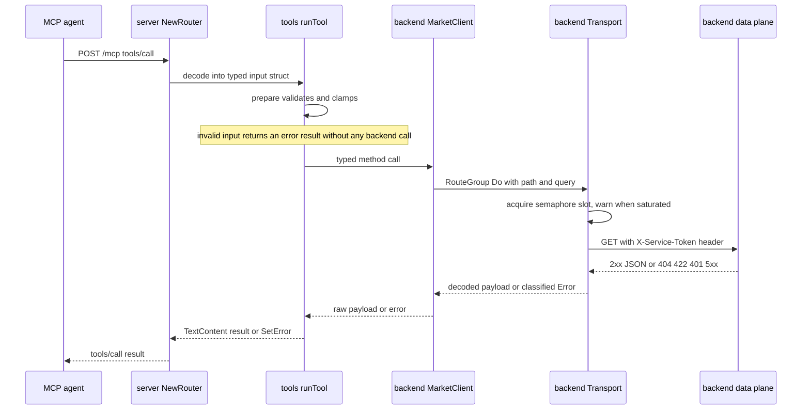

# MCP Gateway: Go Sidecar, Tools and the Data-Plane Client

`services/mcp-gateway` is a Go sidecar that exposes the backend's provider-agnostic
market data as an MCP server over the **streamable HTTP** transport. It is a thin
transport plus client layer: it holds no provider credentials, calls no provider
directly, and talks only to the backend's service-to-service data plane. An agent
connects to `/mcp`, calls a generic market-data tool, and never learns which upstream
vendor served the data.

The module is `retail-portfolio/services/mcp-gateway` (Go 1.27, one direct dependency:
`github.com/modelcontextprotocol/go-sdk`). Cross-service Go conventions — layout,
injected `Load(getenv)`, `slog` setup, graceful shutdown — live in
[Go Microservices](../architecture/go-services.md); the backend side of the wire
contract lives in
[Market Data Providers & the Service-to-Service Data Plane](../architecture/market-data-providers.md).
This page owns the gateway's own behaviour.

## Listener surface and trust posture

`server.NewRouter` wires exactly two routes:

| Route | Method | Behaviour |
| --- | --- | --- |
| `/health` | `GET` | Liveness only: `200` with the fixed body `{"status":"ok"}`, independent of backend reachability. Any other method is `405` with `Allow: GET`. |
| `/mcp` | streamable HTTP | The MCP endpoint: JSON-RPC messages arrive by `POST`, with the streamable HTTP transport also serving its SSE stream over `GET`. Served by `mcp.NewStreamableHTTPHandler`. |

`/mcp` is **unauthenticated by design**: the shared-secret trust boundary is the
backend data plane (`X-Service-Token`), not the MCP listener, so the gateway must run
on the internal network only. The only inbound defence is Go's
`http.NewCrossOriginProtection()` wrapper: a browser request carrying
`Sec-Fetch-Site: cross-site` or a mismatched `Origin` header gets `403 Forbidden`,
while a non-browser MCP agent without those headers connects normally.

The MCP server identifies itself during `initialize` as `market-data-gateway` version
`0.0.1`. The name is deliberately provider-agnostic. Sessions are reaped by
`SESSION_IDLE_TIMEOUT`: the value is passed straight through as
`mcp.StreamableHTTPOptions.SessionTimeout`, so an idle session is closed after that
period.

The HTTP server itself sets `ReadTimeout: 15s`, `IdleTimeout: 60s`, and
`WriteTimeout: 0` — unlimited on purpose, because the streamable-HTTP transport holds
SSE/streaming responses open for the life of a session and any finite write deadline
would truncate them mid-stream. `SIGHUP`/`SIGINT`/`SIGTERM`/`SIGQUIT` trigger a
graceful shutdown with a 10-second grace period.

## Call flow



The diagram shows one tool call end to end: the MCP layer validates locally, the
client composes a data-plane GET, the shared transport bounds outbound concurrency, and
the outcome is mapped back onto an MCP result.

## Configuration

Every value comes from the environment through `config.Load(os.Getenv)`, so the same
binary runs unchanged in Compose and in CI.

| Variable | Required | Default | Effect |
| --- | --- | --- | --- |
| `BACKEND_BASE_URL` | yes | — | Backend origin, e.g. `http://backend:8000`. Validated as http/https with a host. |
| `MARKET_DATA_SERVICE_TOKEN` | yes | — | Shared secret sent as `X-Service-Token` on every data-plane call. |
| `DATA_PLANE_PATH` | no | `/api/v1/market/data` | Route-group prefix. `MARKET_DATA_PATH` is an accepted alias; `DATA_PLANE_PATH` wins. Normalized to a leading slash, trailing slashes trimmed. |
| `PORT` | no | `8080` | HTTP listen port. |
| `ENVIRONMENT` | no | `dev` | Selects the `slog` handler and its default level. |
| `LOG_LEVEL` | no | — | Level override: `DEBUG`, `INFO`, `WARN`/`WARNING`, `ERROR`. |
| `MAX_CONCURRENCY` | no | `10` | Size of the outbound backend semaphore. Must be a positive integer. |
| `SESSION_IDLE_TIMEOUT` | no | `30m` | Idle MCP session timeout. Must be a positive Go duration. |

Fail-fast is the invariant: a missing or unusable required value aborts startup before
the listener binds. Errors name the offending variable (`BACKEND_BASE_URL is
required`, `invalid MAX_CONCURRENCY "0": must be a positive integer`, `invalid
SESSION_IDLE_TIMEOUT "soon": must be a positive duration`,
`invalid LOG_LEVEL "nope": must be DEBUG, INFO, WARN, WARNING, or ERROR`) and **never**
echo the token value — a dedicated test
asserts that a malformed `BACKEND_BASE_URL` next to a secret token produces an error
containing neither. `main` exits non-zero via `slog.Error` + `os.Exit(1)` on a config
or logger error, so a misconfiguration surfaces as a crash loop rather than a runtime
failure on the first agent request.

The startup log line carries `service`, `port`, `backend_url`, `data_plane_path`,
`environment` and `max_concurrency` — the token is not among them.

## The client side of the data-plane contract

`backend.MarketClient` owns the wire contract. Each request is
`BACKEND_BASE_URL + DATA_PLANE_PATH + <route>` with `Accept: application/json`, plus
`Content-Type: application/json` when a body is sent and `X-Service-Token` whenever the
route group's token is non-empty. Symbols are trimmed, upper-cased and path-escaped by
the client (`normalizeSymbol`, `url.PathEscape`); float filters render without exponent
or trailing zeros (`formatFloat`).

| Client method | Backend route (after the prefix) | Query |
| --- | --- | --- |
| `Prices` | `GET /prices/{symbol}` | `from`, `to`, `interval`, `exchange` |
| `Quote` | `GET /quote/{symbol}` | `exchange` |
| `SymbolSearch` | `GET /symbols/search` | `q` |
| `OptionsChain` | `GET /options/{symbol}` | `expiry` (required), `option_type`, `strike_min`, `strike_max` |
| `OptionExpirations` | `GET /options/{symbol}/expirations` | — |
| `Fundamentals` | `GET /fundamentals/{symbol}` | `exchange` |
| `Statements` | `GET /fundamentals/{symbol}/statements` | `statement`, `period`, `limit`, `exchange` |
| `TechnicalIndicator` | `GET /indicators/{symbol}` | `indicator`, `period`, `fast`, `slow`, `signal`, `std_dev`, `from`, `to`, `exchange` |

These paths and query names are a **frozen contract**: the backend's serving routes,
the committed OpenAPI snapshot
([`tests/market/contracts/data_plane_openapi.json`](../../tests/market/contracts/data_plane_openapi.json))
and the byte-for-byte parity test on the Python side are documented in
[Market Data Providers & the Service-to-Service Data Plane](../architecture/market-data-providers.md).
Do not restate or re-derive them here — extend both sides together. The gateway's half
of that parity is `services/mcp-gateway/internal/backend/contract_test.go`, which loads
the same artifact, asserts the eight routes and non-empty `operationId`s, drives every
`MarketClient` method against a stub server that validates each request against the
snapshot (requiring 100 % route coverage, the token header, only contract-defined query
parameters and all required ones), compares the `exchange` enum on every route that
declares it against the Go `supportedExchanges` list, and runs negative drift cases
(missing token header, unknown route, missing required query parameter, unknown query
parameter) through the same validator.

The client also bounds what it will buffer and what it will retain:

| Limit | Value | Where |
| --- | --- | --- |
| Per-call timeout | `15s` (`defaultHTTPTimeout`) | Both `http.Client.Timeout` and a per-request `context.WithTimeout`. |
| Buffered response cap | `8 MiB` (`maxResponseBytes = 8 << 20`) | `io.ReadAll(io.LimitReader(resp.Body, maxResponseBytes))`. |
| Diagnostic detail | `512` runes | `truncateDetail` in `errors.go`. |

## Transport, concurrency and backpressure

Every outbound backend call in the process funnels through one `backend.Transport`,
which owns the HTTP client, the timeout, the headers and a semaphore channel sized by
`MAX_CONCURRENCY`. Domains sit on top as `RouteGroup` values created with
`transport.NewRouteGroup(prefix, token)`; the route group owns the path prefix and the
service token, the transport owns everything shared. That split is the extension point:
a second domain (portfolios, watchlists, orders) adds a prefix/token pair and a typed
client over `group.Get`/`group.Post`, with no change to existing client methods or to
the concurrency budget — `transport_test.go` verifies two route groups issuing
concurrent calls still land on their own paths with their own tokens.

The semaphore is acquired before the request is built, with a non-blocking send first:
if no slot is free the call emits

```text
backend concurrency limit reached, queuing call
```

as a `WARN` record (with `max_concurrency` and `url`) and then blocks on either a slot
or `ctx.Done()`. A call that gives up while queued is classified `ErrProvider` with the
context error as detail, so semaphore saturation degrades into a normal provider
failure rather than an unbounded wait. The slot is released by a deferred receive, so
it is held across response reading and decoding.

`Do` is method-agnostic (`Get` and `Post` wrap it): a non-nil body is JSON-marshalled,
a 2xx body is decoded into `out` when `out` is non-nil, and a 2xx body that fails to
decode is `ErrProvider` with the fixed detail `malformed response from the market data
service` — never "no data".

## Error taxonomy and the tool result contract

Every failure — HTTP status, transport error, timeout, decode failure, bad URL — is
normalized into one of four sentinels, matched with `errors.Is`:

| Class | Trigger | Meaning for the caller |
| --- | --- | --- |
| `ErrNoData` | HTTP `404` | No data for this request *right now*. A 404 may be a cached empty result within the cache TTL, so it is never presented as "invalid symbol". |
| `ErrValidation` | HTTP `422` | The parameters failed backend validation. Retrying with corrected parameters is the right response, so a parsed, agent-safe message is forwarded. |
| `ErrConfiguration` | HTTP `401`/`403` | The service token was rejected — an operator problem. |
| `ErrProvider` | HTTP `5xx`, unexpected 4xx, non-JSON bodies at `200`, timeouts, connection failures | The market data service is unavailable or misbehaving. |

`*backend.Error` keeps `Error()` equal to the generic sentinel text and exposes the
status, the truncated raw body and (for 422) the parsed validation text only through
`Status()`, `Detail()` and `ValidationMessage()`. `Error()` therefore cannot leak a
status, a token, a provider name or a raw upstream body into an agent-facing result;
`Detail()` is explicitly documented as Go-side logging only. For 422 bodies, the client
accepts FastAPI's `{"detail": ...}` shape in either form — a plain string or an array of
`{loc, msg}` objects — drops the leading request-location kind (`body`/`query`/`path`/
`header`/`cookie`), joins surviving messages with `; `, and falls back to the generic
sentinel text when nothing parses. `ValidationMessage()` is the single detail field that
is safe to forward.

`runTool` in `internal/tools/registry.go` is the only place that maps errors onto MCP
results:

- **Success** — a single `mcp.TextContent` holding the JSON-encoded payload; the tool's
  typed `Out` is always `any`, so the SDK never infers an output schema.
- **`ErrNoData` is a successful result** whose text is exactly
  `No market data is available for this request.` The tool layer never emits an error
  for it. Note the layering: the shared `Transport` still logs a `404` at `ERROR` level
  like any other non-2xx, while the tool layer records it as a normal completion.
- **`ErrValidation`** becomes `result.SetError(...)` carrying the backend's parsed
  validation message, falling back to the generic sentinel text.
- **`ErrConfiguration` / `ErrProvider`** become `result.SetError(err)` carrying the
  client's generic sentinel text.
- **Local validation failure** (the `prepare` step) never reaches the backend and
  returns an error result carrying the handler's own message.
- **Anything else** maps to the generic `tool call failed`.

Two tools can synthesize `ErrNoData` client-side, which is deliberate: `get_fundamentals`
returns it when every requested section is absent or `null`, and `resolve_symbol` returns
it when the search list is empty. Both then flow through the same "successful no data"
path.

## Tool surface

`tools.Register(server, client)` attaches eight tools in four per-family registration
functions (`registerPriceTools`, `registerFundamentalsTools`, `registerOptionsTools`,
`registerSymbolTools`), each closing over the `*backend.MarketClient`. Input schemas are
inferred by the SDK from typed `In` structs, so a call missing a required field is
rejected by the SDK before the handler runs.

| Tool | Inputs | Local validation / clamping | Backend route |
| --- | --- | --- | --- |
| `resolve_symbol` | `query` (required), `exchange?` | `query` trimmed to 1–100 chars; `exchange` uppercased and checked against the canonical list | `GET /symbols/search?q=` — the exchange is **not** sent, it only steers local ranking |
| `get_quote` | `symbol` (required), `exchange?` | `symbol` validated; `exchange` normalized | `GET /quote/{symbol}?exchange=` |
| `get_price_history` | `symbol`, `from?`, `to?`, `interval?`, `exchange?` | `from <= to` enforced; `interval` one of `day`/`week`/`month`; the 2,000-bar cap is the backend's and is only documented in the description | `GET /prices/{symbol}?from=&to=&interval=&exchange=` |
| `get_fundamentals` | `symbol`, `sections?`, `exchange?` | `sections` ⊆ `profile`, `key_metrics`, `ratios`, deduplicated, defaults to all three | `GET /fundamentals/{symbol}?exchange=` |
| `get_financial_statements` | `symbol`, `statement` (required), `period?`, `limit?`, `exchange?` | `statement` one of `income`/`balance`/`cashflow`; `period` `annual` (default) or `quarter`; `limit` **clamped** to 1–20 with default 5 | `GET /fundamentals/{symbol}/statements?statement=&period=&limit=&exchange=` |
| `get_option_expirations` | `symbol` | `symbol` validated | `GET /options/{symbol}/expirations` |
| `get_options_chain` | `symbol`, `expiry` (required), `option_type?`, `strike_min?`, `strike_max?` | `expiry` parsed as `YYYY-MM-DD`; `option_type` `call`/`put`; `strike_min <= strike_max` | `GET /options/{symbol}?expiry=&option_type=&strike_min=&strike_max=` |
| `get_technical_indicator` | `symbol`, `indicator` (required), `period?`, `fast?`, `slow?`, `signal?`, `std_dev?`, `from?`, `to?`, `exchange?` | `indicator` one of `sma`/`ema`/`rsi`/`macd`/`bollinger`; each period **rejected** unless in 2–400; `std_dev > 0`; `from <= to` | `GET /indicators/{symbol}?indicator=&period=&fast=&slow=&signal=&std_dev=&from=&to=&exchange=` |

Shared symbol rules: a `symbol` is required, at most 32 characters, and must match
`^\^?[A-Za-z0-9][A-Za-z0-9.\-=]{0,30}$`. `exchange` accepts only `NYSE`, `NASDAQ`,
`NYSEARCA`, `AMEX`, `TSX`, `LSE`. The bounds mirror the backend data plane's query
constraints so that most bad arguments are rejected locally instead of being rewarded
with a `422`; a `422` that still occurs is surfaced as `ErrValidation`, i.e. as an
actionable error, never as "no data".

Result shaping differs by family, and the difference is intentional:

- **Pass-through** (`get_quote`, `get_price_history`, `get_technical_indicator`,
  `get_option_expirations`, `get_options_chain`) — the backend JSON is returned as-is,
  including `currency` decimal strings and the options `truncated` flag.
- **`get_fundamentals`** — the aggregate is filtered to the requested section keys,
  absent or `null` sections are rendered as JSON `null`, and unknown fields and exact
  numeric representations inside a returned section are preserved verbatim.
- **`get_financial_statements`** — the bare statement list is decoded by
  `backend.DecodeStatementList` (every item must be an object with non-empty `date` and
  `symbol` strings) and re-wrapped in a `statementEnvelope` echoing `statement`,
  `symbol`, `period`, `limit` and optional `exchange`. All line items and unknown fields
  pass through untouched; a decode failure is a generic provider failure, so a
  cache-hit shape change is never reported as "no data".
- **`resolve_symbol`** — results are ranked locally in four tiers (case-insensitive exact
  symbol match on the preferred exchange, exact symbol match anywhere, first result on
  the preferred exchange, first result) and returned as `best_match` plus up to 10
  `alternatives` in backend order.

### Annotations and description convention

`addTool` sets `Annotations.ReadOnlyHint: true`, `Annotations.IdempotentHint: true` and
a human `Title` on every tool, so MCP clients can see the whole surface as safe and
idempotent. Descriptions follow a four-section convention that tests enforce:

- **`Use when:`** — when to invoke it, the default behaviour, and the hard constraints.
  `resolve_symbol` opens with "USE THIS FIRST", and the convention is real: agents are
  expected to resolve a symbol before calling the price, fundamentals, options or
  indicator tools.
- **`Examples:`** — at least two plain-language query → parameter-JSON lines, using
  supported exchanges.
- **`Returns:`** — the top-level response keys, noting decimal-string prices, the quote
  `timestamp`, or `truncated` semantics.
- **`See also:`** — related tools, which must all be registered names.

## Logging and redaction

`logging.Init(cfg)` installs the process logger with `slog.SetDefault`: `ENVIRONMENT=prod`
selects `slog.NewJSONHandler` at `INFO`, anything else selects `slog.NewTextHandler` at
`DEBUG`, and `LOG_LEVEL` overrides the default level for the active handler.

`logging.Middleware` wraps the whole router (`/health` and `/mcp` alike). It always emits
one `INFO` record per completed request with `method`, `path`, `remote_addr`, `status` and
`duration`, and in `dev` it additionally emits a `DEBUG` record per inbound request with
`method`, `path`, `headers`, `query` and up to 64 KiB of body — the body is read into
memory and restored, so the handler still sees the original stream. Its wrapper
implements `http.Flusher` (delegating when the underlying writer supports it), which is
what keeps SSE responses from being buffered behind the middleware.

Sensitive header values are replaced with `[REDACTED]` before any header map is logged:

```text
Authorization, X-Service-Token, Cookie, Set-Cookie
```

The same rule is enforced independently inside the transport: `MARKET_DATA_SERVICE_TOKEN`
and any domain `X-Service-Token` value never appear in a log record, and `market_test.go`
and `transport_test.go` assert the token and the header name are absent from both debug
and error output. In `dev`, inbound logging therefore dumps headers, query strings and
request bodies, and with `DEBUG` enabled anywhere the tool arguments and full tool
responses join them — but credentials never do.

Component-level logging:

| Source | Level | Fields |
| --- | --- | --- |
| Transport, outbound request | `DEBUG` | `method`, `url`, `query` |
| Transport, outbound response | `DEBUG` | `method`, `url`, `status`, `duration` |
| Transport, failure | `ERROR` | `url`, `status` (`0` for transport/decode failures), `detail` |
| Transport, saturated semaphore | `WARN` | `max_concurrency`, `url` on the fixed message above |
| Tool invocation / completion | `DEBUG` | `tool`, `arguments`, then `tool`, `duration`, `response` |
| Tool execution failure | `ERROR` | `tool`, `arguments`, `error_class`, `status`, `detail` |

`error_class` is one of `ErrValidation`, `ErrConfiguration`, `ErrProvider`, or
`ErrUnknown`; a local `prepare` failure logs `ErrValidation` with `status` set to the
synthetic `400`, and a backend failure logs the real status (or `0`). The `detail` field
is `backend.Error.Detail()` when available and `err.Error()` otherwise. Both the tool
debug records and the tool `ERROR` records are gated by the logger level alone — not by
`ENVIRONMENT` — so `LOG_LEVEL=DEBUG` in production re-enables them, and the transport's
`DEBUG` records behave the same way. Keep that in mind before turning on debug logging
where tool arguments and full responses are sensitive.

## Provider-agnostic vocabulary rule

Tool names, descriptions, titles, log lines, error strings, the server identity and the
module's test files must never name an upstream data provider. The vocabulary is "market
data" and nothing more; the fallback for needing a brand name is to rephrase, not to
scope it to a component. The rule is enforced mechanically rather than by review:

| Suite | What it asserts |
| --- | --- |
| `internal/server/server_test.go` | `initialize` server name and every tool name/description are provider-free |
| `internal/tools/registry_test.go` | Tool names, titles, descriptions, marshalled input schemas, tool execution logs and tool result text are provider-free, and every error-mapping case also checks the result text for leaked backend detail |
| `internal/backend/market_test.go` | Error text for all five failure shapes and all four sentinel messages are provider- and token-free; transport logs are provider-free |
| `internal/logging/middleware_test.go` | Middleware log output is provider-free |

Each suite builds its forbidden-name list by concatenating fragments rather than writing
the brand literally, so the module source is clean under those same assertions. Two
related guarantees share the mechanism: `Error()` never carries the status or the raw
body (only `Detail()` does, and it is documented as log-only), and the parsed 422
validation message is the one backend string allowed to reach an agent.

## Deploy wiring

Dev Compose (`docker-compose.yml`) declares the `mcp-gateway` service as:

- `build: ./services/mcp-gateway`, `restart: unless-stopped`;
- `ports: 127.0.0.1:${MCP_GATEWAY_PORT:-8005}:8080` — loopback-only on the host, so the
  unauthenticated `/mcp` listener stays off the network; override with
  `MCP_GATEWAY_PORT=9090 docker compose up mcp-gateway`;
- `environment:` forwards `ENVIRONMENT` (default `dev`), `BACKEND_BASE_URL` (default
  `http://backend:8000`), `MARKET_DATA_SERVICE_TOKEN` (default
  `dev-market-data-token`) and `DATA_PLANE_PATH` (default `/api/v1/market/data`);
- `depends_on: backend: condition: service_healthy` — the gateway never starts before
  the backend's own liveness probe passes;
- a `CMD-SHELL` healthcheck running `wget -qO- http://localhost:$$PORT/health`
  (interval 30s, timeout 5s, 3 retries, 5s start period). Note that the service does not
  set `PORT`, so `$$PORT` resolves to an empty value inside the container; the image's
  own `HEALTHCHECK` and the prod override both use `http://localhost:8080/health`, which
  is the port the process actually listens on.

Prod Compose (`docker-compose.prod.yml`) publishes **no host port** (internal network
only by design), fixed container name `retail-portfolio-mcp-gateway`, `restart: always`,
`ENVIRONMENT` default `prod`, `BACKEND_BASE_URL: http://backend:8000`, and
`MARKET_DATA_SERVICE_TOKEN: ${MARKET_DATA_SERVICE_TOKEN:?MARKET_DATA_SERVICE_TOKEN must
be set}` — production refuses to start without a real secret. Its healthcheck probes
`localhost:8080/health`. `MCP_GATEWAY_URL` in `.env.example` is documentation for MCP
clients only; no repository process reads it.

The image is a two-stage build: `golang:1.27-alpine` compiles a statically linked binary
(`CGO_ENABLED=0`, `-ldflags="-s -w"`), and `alpine:3.21` adds `ca-certificates`, `tzdata`
and `wget` for the healthcheck, creates an unprivileged `appuser`, `EXPOSE`s `8080` and
sets the same 30s/5s/3-retry `HEALTHCHECK` against `/health`.

## Verification

| Command / job | What it runs |
| --- | --- |
| `just test-mcp-gateway` | `go test ./...` in `services/mcp-gateway` — the focused suite for everything on this page |
| `just lint-go` | `gofmt -l` over both Go modules, then `staticcheck@v0.8.1` and `govulncheck@v1.8.0` in each |
| CI job `mcp-gateway` | Pinned Go 1.27.1, then `cd services/mcp-gateway` and: `go mod download`, `go vet ./...`, a `gofmt -l` format gate, staticcheck, govulncheck (allowing known standard-library-only CVEs under the pinned toolchain), `go build ./...`, `go test ./...` |

The suites that carry this page's contract:

| Concern | Suite |
| --- | --- |
| Endpoints, MCP handshake/tool list, `SESSION_IDLE_TIMEOUT` propagation, cross-origin `403`s | `internal/server/server_test.go` |
| Config defaults, aliasing and fail-fast error text | `internal/config/config_test.go` |
| Handler selection, level parsing, token redaction | `internal/logging/logger_test.go` |
| Inbound request logging, `[REDACTED]` headers, dev/prod gating, flusher pass-through | `internal/logging/middleware_test.go` |
| Transport encode/decode, route-group isolation, taxonomy, concurrency cap, saturated-semaphore timeout | `internal/backend/transport_test.go` |
| Client methods, token header, taxonomy, validation message parsing, secret/provider leak checks, outbound logging | `internal/backend/market_test.go` |
| OpenAPI snapshot parity and negative drift | `internal/backend/contract_test.go` |
| Tool error mapping, `ErrNoData` as success, local rejection before any backend call, description/annotation contract, tool logging, provider-name compliance | `internal/tools/registry_test.go` |
| Per-family validation, clamping and pass-through | `internal/tools/{prices,fundamentals,symbols}_test.go` |

## Change checklist

- **Adding a tool** to an existing family: define the typed `In` struct and a `prepare`
  method, register it with `addTool`/`toolSpec` from that family's `register*Tools`
  function, and follow the four-section description convention. Run
  `just test-mcp-gateway` — the surface contract test will fail on a missing section, a
  thin `Examples:` block, a `See also:` target that is not registered, or a missing
  annotation.
- **Adding a tool family or domain**: create a typed client in `internal/backend/<domain>.go`
  over `transport.NewRouteGroup(prefix, token)`, a per-family file in
  `internal/tools/<domain>.go` with its own `register<Family>Tools`, and call it from
  `tools.Register`. The shared `Transport` keeps the concurrency budget and the timeout
  for the new domain automatically.
- **Adding or renaming a data-plane route**: the OpenAPI snapshot is a frozen contract —
  regenerate it on the backend side, extend `MarketClient` and its contract test, and see
  [Market Data Providers & the Service-to-Service Data Plane](../architecture/market-data-providers.md)
  for the full sequence.
- **Tightening a backend bound**: update the mirrored constant in
  `internal/tools/registry.go`/`validate.go` and the tool description together; the
  bound exists so an agent learns the constraint from the tool rather than from a `422`.
- **Renaming a log field**: the middleware, transport and tool log records are all
  asserted in tests, and every one of them is also scanned for provider brands.
