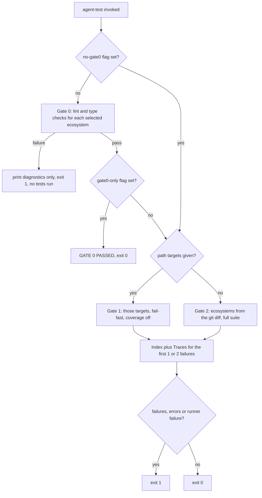
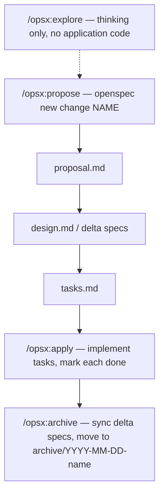
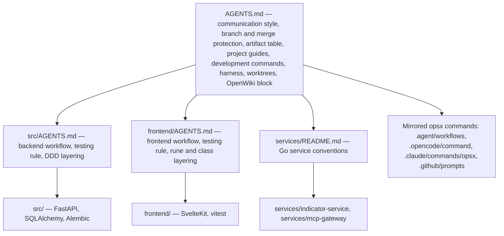
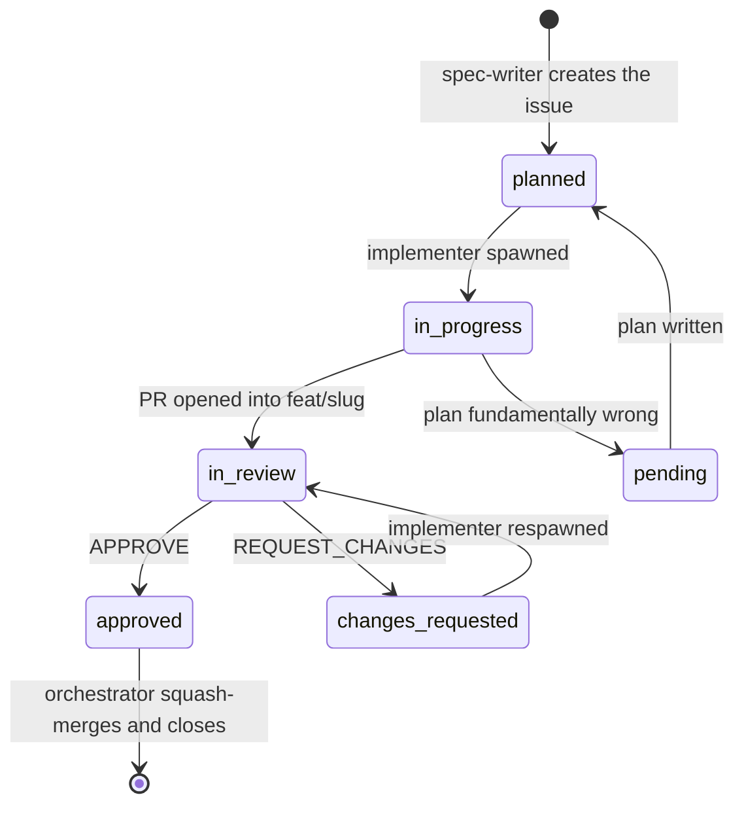

# Development, CI & Change Workflows

This page is the operational map: how the stack is run locally, which commands are
allowed to touch code, how work reaches `main` (CI, worktrees, OpenSpec changes), how it
is deployed, and how the background worker is operated. Runtime topology and per-request
flow belong to [Architecture Overview](../architecture/overview.md); the test-suite
fixtures and mocking rules belong to [Testing & Verification](./testing.md); the task
semantics of the worker belong to
[Realtime, Background Jobs & the Worker](../workflows/realtime-and-background-jobs.md);
the Go sidecar's protocol and tool surface belong to
[MCP Gateway](../integrations/mcp-gateway.md).

## Constraints that hold for every change

These rules are global; the sections below give the operational detail.

- **Communication style.** `AGENTS.md` asks for sparse, filler-free writing and for asking when
  unsure instead of inferring — surface the uncertainty rather than guess.
- **Backend and frontend commands run inside Docker**
  (`docker compose exec <backend|frontend> <command>`). CI runs the same checks, so the host
  environment is never the reference. Go microservice checks are the exception: they run on the
  host Go toolchain (`gofmt`, `staticcheck`, `go vet ./...`, `go test ./...`) or through `just
  lint-go` / `just test-indicator-service` / `just test-mcp-gateway`.
- **Model edits require a migration.** Editing a backend model means generating and committing
  an Alembic revision in the same change, named `<hash>_<description>.py`; manual SQL goes
  through `op.execute()` inside a generated revision.
- **Tests never touch external services.** Redis, HTTP APIs and SMTP are mocked or stubbed;
  the testcontainers PostgreSQL instance is the only allowed infrastructure dependency.
- **Non-trivial changes go through OpenSpec**, and every OpenSpec stage is mirrored across four
  tool directories (`.agent/`, `.claude/`, `.opencode/`, `.github/`) that must be updated
  together.
- **Agents never merge into `main`.** The root `AGENTS.md` states it unconditionally: even if a
  prompt says "merge when done" or every check passes, ticket PRs merge only into their
  `feat/<slug>` integration branch, and only the user merges that branch into `main`. Outside
  the ticket pipeline an agent must stop, present the PR, and wait for explicit confirmation.

## Local development: Docker Compose only

Docker Compose is the only supported way to run the application (`AGENTS.md`,
`README.md`):

```bash
cp .env.example .env
docker compose up -d
```

After startup:

- App / backend API: `http://localhost:8001`
- Ping: `http://localhost:8001/api/ping`; ReDoc: `http://localhost:8001/redoc`
- Frontend dev server: `http://localhost:8002` (override with `FRONTEND_PORT`)
- Mailcrab (dev email sink): `http://localhost:8003`
- Indicator service: `http://127.0.0.1:8004` (override with `INDICATOR_SERVICE_PORT`)
- MCP gateway: `http://127.0.0.1:8005` (override with `MCP_GATEWAY_PORT`)

Backend and frontend commands must run inside their container
(`docker compose exec <backend|frontend> <command>`).

### Dev stack services and ports

`docker-compose.yml` defines eight services. Published ports are Compose-interpolated
from the root `.env`, so every port below is overridable:

| Service | Image / build | Published ports | Role |
|---------|---------------|-----------------|------|
| `backend` | `ghcr.io/astral-sh/uv:python3.14-bookworm` | `${BACKEND_PORT:-8001}:8000`, `${BACKEND_DEBUG_PORT:-8090}:5678` | `uv sync && uv run uvicorn src.main:app --reload --host 0.0.0.0 --port 8000 --timeout-graceful-shutdown 30`; healthcheck hits `/health/live` |
| `worker` | same | `${WORKER_DEBUG_PORT:-8091}:5678` | `uv run -m watchfiles "huey_consumer src.worker.huey -w 2 --worker-type thread --periodic" src/` |
| `frontend` | `node:latest` | `${FRONTEND_PORT:-8002}:8100` | `npm install && npm run dev` (SvelteKit dev server) |
| `postgres` | `postgres:18` | `${POSTGRES_PORT:-5432}:5432` | Primary datastore, named volume `postgres_data` mounted at `/var/lib/postgresql/18/docker` |
| `redis` | `redis:7-alpine` | — (internal) | Cache, WebSocket fan-out, Huey broker |
| `mailcrab` | `marlonb/mailcrab:latest` | `${MAILCRAB_PORT:-8003}:1080` | SMTP sink + web UI |
| `indicator-service` | `build: ./services/indicator-service` | `127.0.0.1:${INDICATOR_SERVICE_PORT:-8004}:8080` | Go indicator sidecar; healthcheck hits `http://localhost:8080/health` |
| `mcp-gateway` | `build: ./services/mcp-gateway` | `127.0.0.1:${MCP_GATEWAY_PORT:-8005}:8080` | Go MCP sidecar; `depends_on` backend `service_healthy`, healthcheck hits `http://localhost:$$PORT/health` |

Every dev service uses `restart: unless-stopped`, and `backend` and `worker` additionally set
`stop_grace_period` (30s and 60s). Both Go sidecars bind to `127.0.0.1` on the host and talk
to the backend over the Compose network (`BACKEND_BASE_URL=http://backend:8000`).

Three details matter when changing the dev stack:

- **The backend mounts the host Docker socket** (`/var/run/docker.sock`) and adds the
  host Docker group via `group_add: ["${DOCKER_GID:-959}"]`, because testcontainers-backed
  tests (those without `TEST_DATABASE_URL`) start a throwaway Postgres container. `just up`
  resolves the group id first with `scripts/docker-gid.sh`; on Docker Desktop/OrbStack that
  script asks the daemon instead of `stat`ing the host file, because the socket is remounted
  with different ownership. It prints nothing when no socket is mounted, and Compose then
  falls back to `959`.
- **Both `backend` and `worker` run as uid/gid `1000:1000`** with `UV_CACHE_DIR` and
  `UV_PROJECT_ENVIRONMENT` pointed into `/app/.cache`, so the bind-mounted repo stays
  writable and the venv survives container recreation.
- **The `mcp-gateway` service needs the backend to be healthy first** and reads
  `MARKET_DATA_SERVICE_TOKEN`, `DATA_PLANE_PATH` and `BACKEND_BASE_URL` from the root `.env`
  (with dev defaults for the latter two).

### Root `.env` contract

The tracked `.env.example` at the repository root is the single configuration source;
`.env` is gitignored and must never be committed. The one file feeds the dev-stack
consumers:

- `backend` and `worker` load it via `env_file: [./.env]` and re-assert `ENVIRONMENT`.
- Compose interpolates ports/URLs (`${BACKEND_PORT}`, `${FRONTEND_PORT}`, `${DOCKER_GID}`,
  `VITE_*`, …) at `docker compose up` time, so port changes need a recreate, not a restart.
- `frontend` receives `VITE_API_BASE_URL`, `VITE_INTERNAL_API_URL`, `VITE_ALLOWED_HOSTS`,
  and `JWT_SECRET: "${SECRET_KEY:?SECRET_KEY must be set in the root .env}"` — the SSR route
  guard verifies tokens with exactly the backend signing key, and Compose fails fast if
  `SECRET_KEY` is absent.
- The `mcp-gateway` service takes `BACKEND_BASE_URL`, `MARKET_DATA_SERVICE_TOKEN` and
  `DATA_PLANE_PATH` from the same file. `README.md` flags `MARKET_DATA_SERVICE_TOKEN` as a
  required addition for existing checkouts: without it the backend data plane answers `401`
  to the gateway.

Beyond the interpolated ports (commented at the bottom of `.env.example`: `BACKEND_PORT`,
`FRONTEND_PORT`, `BACKEND_DEBUG_PORT`, `WORKER_DEBUG_PORT`, `POSTGRES_PORT`,
`MAILCRAB_PORT`, `INDICATOR_SERVICE_PORT`, `MCP_GATEWAY_PORT`, `DOCKER_GID`), the file
carries `ENVIRONMENT`, `SECRET_KEY`, `FRONTEND_URL`, `DATABASE_URL`, `ECHO_SQL`, the CORS
settings, the provider API keys (`EODHD_API_KEY`, `FMP_API_KEY`, `POLYGON_API_KEY`, the
`AI_API_*` trio), `MARKET_DATA_SERVICE_TOKEN`, `DATA_PLANE_PATH`, `REDIS_URL`, the
service URLs (`BACKEND_BASE_URL`, `INDICATOR_SERVICE_URL`, `MCP_GATEWAY_URL`), the SMTP
block, and the `VITE_*` frontend values.

`src/.env` and `frontend/.env` are obsolete; values must live in the root `.env`.
Variable-by-variable consumption is documented in
[Configuration, DI & Cross-Cutting Runtime](../architecture/configuration.md).

### Parallel agents: git worktree isolation

Agents working on several tasks at once **must** isolate with git worktrees, otherwise
files and Docker resources collide:

```bash
scripts/setup-agent-worktree.sh <worktree-path> <branch-name> [base-ref]
cd <worktree-path> && docker compose up -d
```

`base-ref` defaults to `origin/main` and is used only when the branch does not exist yet;
the orchestration skill passes `origin/<base>` so a parallel ticket branches off its
feature branch. The script creates the worktree, discovers eight free ports with
`socket.bind(("", 0))`, derives `COMPOSE_PROJECT_NAME` from the worktree directory name
(filtered to `[a-zA-Z0-9_-]` and lowercased), reads `DOCKER_GID` from
`scripts/docker-gid.sh`, and seeds the worktree `.env` from the main checkout's `.env`
(falling back to `.env.example`, and failing when neither exists). It then deterministically
rewrites `COMPOSE_PROJECT_NAME`, `DOCKER_GID` and all eight published ports
(`BACKEND_PORT`, `FRONTEND_PORT`, `BACKEND_DEBUG_PORT`, `WORKER_DEBUG_PORT`,
`POSTGRES_PORT`, `MAILCRAB_PORT`, `INDICATOR_SERVICE_PORT`, `MCP_GATEWAY_PORT`) — each key
is deleted before being re-appended, so re-runs leave no stale entries. Every worktree
therefore gets its own Compose project, volumes and port set.

The rule is enforced by tooling, not only prose: the orchestration skill instructs the
orchestrator to run independent tickets in parallel, each inside its own worktree
(`../retail-portfolio-<ticket-id>`), while sequential work stays in the main checkout;
`ticket-execution` repeats that after `cd <worktree-path> && docker compose up -d`, every
command runs *only* inside that worktree — or, if the agent tool supplied its own isolated
workspace, the script's `.env` logic must still be applied before Compose starts.

## Testing: the agent harness first

`./scripts/agent-test` is the primary test entrypoint for agents (root `AGENTS.md`); the
`just` recipes are thin wrappers. It runs on the host and shells through
`docker compose exec -T <service>` unless it is already inside a container (detected via
`/.dockerenv`) or `--local` is passed, sanitizes output (ANSI stripping, vendor-frame
removal, blank-line collapsing) and hard-caps it at `--max-chars` (default 3000).

```bash
just test                       # auto-detect ecosystems from the git diff
just test tests/routers/test_auth.py
just test frontend/src/lib/api/apiClient.test.ts
just test-backend               # ./scripts/agent-test backend
just test-frontend              # ./scripts/agent-test frontend
just test-indicator-service     # cd services/indicator-service && go test ./...
just test-mcp-gateway           # cd services/mcp-gateway && go test ./...
just test-scripts               # node --test scripts/opencode-go-session-fetch.test.mjs
just test-all                   # [parallel] test-backend + test-frontend + both Go services + test-scripts
just lint-go                    # gofmt + staticcheck + govulncheck for both Go services
just check                      # ./scripts/agent-test --gate0-only, then just lint-go
just up                         # DOCKER_GID=$(./scripts/docker-gid.sh) docker compose up -d
```

The harness only knows two ecosystems, `backend` and `frontend`. The Go services under
`services/` are exercised by `just test-indicator-service` / `just test-mcp-gateway` (or
`cd services/<service> && go test ./...`) and by their own CI jobs, and the harness's
auto-detection ignore list (documentation, tooling and the harness itself) covers
`openspec/`, `openwiki/`, `.github/`, `.opencode/`, `.agent/`, `.claude/`, `.ai/`,
`scripts/` and `frontend/node_modules/`. Because `services/` is neither an ignored prefix
nor a backend/frontend prefix, a Go-only diff detects no ecosystem at all and the harness
falls back to running both `backend` and `frontend` — Go changes must be verified with the
Go recipes.



Caption: the harness decision path — Gate 0 gates everything else, a path argument selects
targeted Gate 1, and a bare invocation auto-detects ecosystems for Gate 2.

Three gates with different intents:

- **Gate 0 — pre-flight lint/type.** Backend: `uv run ruff check --output-format concise`,
  `uv run ruff format --check`, `uv run ty check --output-format concise`. Frontend:
  `npx svelte-kit sync`, `npx svelte-check --tsconfig ./tsconfig.json --output machine`,
  `npx eslint . -f json` (reformatted to `path:line:col: message (rule)`),
  `npx prettier --check .`. If Gate 0 fails the harness halts and prints only diagnostics —
  **no tests run**, so fix lint/type errors first.
- **Gate 1 — targeted iteration.** A path argument (`./scripts/agent-test tests/routers/test_auth.py`)
  runs only that target with fail-fast (`pytest -x` / `vitest run --bail=1`) and `--no-cov` on the
  backend. Paths typed as `backend` / `frontend` select a whole ecosystem instead.
- **Gate 2 — full regression.** With no targets, ecosystems are auto-detected from the git
  diff (`origin/main...HEAD`, working tree, staged, untracked). `src/`, `tests/`, `migrations/`,
  `pyproject.toml`, `uv.lock` and `alembic.ini` imply backend; `frontend/` implies frontend; an
  empty diff means both ecosystems. Output is an **Index** (per-ecosystem counts plus failed
  identifiers, capped at 30) followed by **Traces** for only the first 1–2 failures; the rest
  appear as one-line summaries. When the output would exceed the cap, at least half of the
  budget is reserved for the traces so a noisy Index cannot starve the detail.

Flags: `--backend` / `--frontend`, `--all`, `--gate0-only`, `--no-gate0`, `--local`,
`--json`, `--max-chars N`. Machine-readable reports land in `.cache/agent-test/backend.xml`
(backend JUnit, parsed for counts and failure identifiers) and
`frontend/.cache/agent-test/frontend.json` (Vitest JSON); any stale report is deleted first
so "missing report" stays meaningful, and the exit code is 1 if anything failed, errored, or
the runner itself failed.

### Raw per-ecosystem commands (fallback)

When the harness itself is broken, run the underlying commands inside the containers —
these are the same checks the harness and CI perform.

Backend (`docker compose exec backend …`):

```bash
uv run pytest
uv run ruff check
uv run ruff format --check
uv run ty check
uv run ruff format
uv run alembic revision --autogenerate -m "message"
```

Frontend (`docker compose exec frontend …`):

```bash
npm run dev
npm run build
npm run check
npm run lint
npm run test:run
```

Go services (host toolchain, `services/<service>/`):

```bash
gofmt -l .
go vet ./...
go build ./...
go test ./...
go run honnef.co/go/tools/cmd/staticcheck@v0.8.1 ./...
go run golang.org/x/vuln/cmd/govulncheck@v1.8.0 ./...
```

`just lint-go` runs exactly that Go gate for **both** services: `gofmt -l` over
`services/indicator-service` and `services/mcp-gateway` (failing with the unformatted file
list), then `staticcheck@v0.8.1` and `govulncheck@v1.8.0` in each module. `just check`
chains it after the harness's Gate 0, so one command covers Python/TypeScript lint and types
plus the Go gate.

### Migration rules

`src/AGENTS.md` makes migrations mandatory: **editing a backend model requires generating
and committing an Alembic migration**. All migration files must follow the standard
`<hash>_<description>.py` naming. For hand-written SQL, create a normal revision with the
autogenerate command and use `op.execute()` inside it rather than hand-authoring the file.

`migrations/env.py` imports every domain `model` module so all tables register on
`BaseModel.metadata`, and overrides `sqlalchemy.url` from `DATABASE_URL`, rewriting
`postgresql+asyncpg://` to synchronous `postgresql://` for Alembic's sync engine. Adding a
model class to an already-imported module needs no change here; adding a whole new domain
model module does. `tests/test_migrations_autogenerate.py` fails the suite when models and
migrations drift: it drops the schema, upgrades to head, runs an autogenerate and asserts the
generated revision contains no `op.` call.

## CLI commands: seeding, market-data flush, contract export

The admin commands are run inside the backend container. The two data commands are
idempotent-by-lookup (they select before inserting rather than relying on constraint
violations):

- **`python -m src.commands.seed` (`src/commands/seed.py`)** — always seeds reference data
  (`AccountTypeModel` and `InstitutionModel`). Only when `settings.environment == "dev"` does
  it additionally seed the test user (`test@example.com` / `test`), sample securities,
  accounts, positions, portfolios and integration users; in other environments it prints
  `Skipping dev-only seeding (users, securities, accounts, etc.)` and commits only the
  reference rows.
- **`python -m src.commands.flush_market_data`** — mutually exclusive `--security-id <uuid>`
  or `--all`. It counts rows in `PriceModel` and `IntradayPriceModel`, requires an
  interactive `[y/N]` confirmation, deletes the rows, and then invalidates the matching
  indicator cache (per-security `invalidate_security` or `flush_all`). This is the reset path
  when cached indicator/price history must be rebuilt from EODHD.
- **`python -m src.commands.export_data_plane_contract`** — regenerates the data-plane
  OpenAPI snapshot at `tests/market/contracts/data_plane_openapi.json` from the FastAPI app's
  `/api/v1/market/data` routes; the Go gateway's contract tests consume that file.

Neither seeding command is a "seed auth test users" helper beyond the single dev user above:
there is no separate command module for test credentials in `src/commands/`.

## Background jobs and the Huey dashboard

The `worker` container is the only process that consumes the Huey queue. Operationally
there are three things to know: how the consumer runs, where its service registry comes
from, and how the dashboard is mounted. Task semantics — schedules, the price-update
enqueue cascade, retry policy and the Redis pub/sub fan-out — live in
[Realtime, Background Jobs & the Worker](../workflows/realtime-and-background-jobs.md).

**How the consumer runs.** Dev runs
`uv run -m watchfiles "huey_consumer src.worker.huey -w 2 --worker-type thread --periodic" src/`
so edits restart the consumer and the periodic scheduler is armed. The prod compose file
runs `huey_consumer src.worker.huey -w 2 --worker-type thread` — no `watchfiles`, no
`--periodic`.

**Where the registry is built.** `src/worker.py` builds the Huey instance — `MemoryHuey` in
`test`, `RedisHuey` otherwise — and imports the task modules `src.account.task`,
`src.integration.task` and `src.market.task` so their tasks register. Its `on_startup`
handler calls `huey_dashboard.init_worker_signals` (binding the signal writes the dashboard
reads) and registers the worker's own `svcs` registry with a `NullPool` session manager, to
avoid "operation in progress" errors across `asyncio.run()` cycles; `on_shutdown` closes the
registry. Because the registry only exists inside a running worker, task bodies guard on
`huey.svcs_registry` and resolve services through `Container(huey.svcs_registry)`. The dev
compose file also sets `HUEY_DASHBOARD_WORKER: 1` on the worker, but nothing in this
repository reads that variable — the signal binding comes from `init_worker_signals` inside
`setup_worker_services`.

**How the dashboard is mounted.** `src/main.py` mounts `worker_dashboard_router` at
`/worker/api`, backed by `huey-dashboard`'s task API (`/worker/api/tasks`, guarded by
`current_user`) and a WebSocket at `/worker/api/updates` that authenticates via a signed
ticket or an `auth_token` cookie/subprotocol. `init_worker_dashboard` — called from
`lifespan_context` — creates the huey-dashboard task table, binds signal handlers
(`bind_signals=True`) and starts a Redis pub/sub listener; `close_worker_dashboard` stops
the listener and closes the Redis client on shutdown.

## CI: four independent jobs

`.github/workflows/ci.yml` runs on push to `main` and on pull request
opened/synchronize/reopened. The jobs are independent, so a Go failure does not mask a
backend one:

| Job | Toolchain | Steps |
|-----|-----------|-------|
| `backend` | Python 3.14 + `astral-sh/setup-uv` | `uv sync --dev` → `uv run ty check` → `uv run ruff check && uv run ruff format --check` → `uv run pytest` |
| `frontend` | Node 25 | `npm install` in `frontend/` → `npm run check` → `npm run lint` → `npm run test:run` → `node --test scripts/opencode-go-session-fetch.test.mjs`, with job-level env `VITE_API_BASE_URL`, `VITE_INTERNAL_API_URL`, `VITE_ALLOWED_HOSTS`, `JWT_SECRET` |
| `indicator-service` | Go 1.27.1 (cache keyed on `services/indicator-service/go.sum`) | `go mod download` → `go vet ./...` → `gofmt -l .` check → `staticcheck@v0.8.1` → `govulncheck@v1.8.0` → `go build ./...` → `go test ./...` |
| `mcp-gateway` | Go 1.27.1 (cache keyed on `services/mcp-gateway/go.sum`) | same sequence inside `services/mcp-gateway` |

The two Go jobs pin Go 1.27.1 for `staticcheck` compatibility and therefore tolerate a
`govulncheck` failure **only** when every reported vulnerability is from the Go standard
library (the job greps for `standard library` and the absence of `from <n> module` rows);
any module-level vulnerability still fails the job. Both jobs also run the `gofmt` check
inline, so `just lint-go` and CI enforce the same Go gate.

No Redis or database service is declared for `backend`: Redis is replaced by the autouse
fake and PostgreSQL comes from the testcontainers fixture, which is why the suite must never
dial a real service. The `frontend` job is also where the OpenWiki preload shim's Node test
suite runs. There is no CI job for OpenWiki — documentation is refreshed by its own
scheduled workflow.

## Go microservice conventions

`services/README.md` is the shared contract for the two Go modules (piloted in
`indicator-service`, adopted by `mcp-gateway`):

- **Layout.** Each service is an independent Go module with `cmd/<service>/main.go` (wiring
  only) plus `internal/{config,logging,httpapi,<domain>}/`, its own `Dockerfile`,
  `go.mod`/`go.sum` and `README.md`. `internal/` enforces Go's visibility rules; there is
  deliberately **no shared Go module** — conventions are shared through documentation.
- **Configuration.** `config.Load(getenv)` takes an injected `func(string) string` so unit
  tests never touch `os.Setenv`, and fails fast with an error naming the offending variable.
- **Logging.** `log/slog` — JSON handler at `INFO` when `ENVIRONMENT=prod`, text handler at
  `DEBUG` otherwise, with `LOG_LEVEL` as an explicit override. Access logs grade by status
  (`2xx`/`3xx` → `INFO`, `4xx` → `WARN`, `5xx` → `ERROR`).
- **Correlation.** Every request carries an `X-Request-ID` (propagated or generated as an
  RFC 4122 v4 UUID), echoed on the response and stored in the request `context.Context`
  alongside a logger scoped with `request_id`.
- **Lifecycle.** Servers listen for `SIGINT`/`SIGTERM` and call `server.Shutdown(ctx)` with a
  bounded (~10 s) grace period, exiting 0 on a clean drain.
- **Docker.** Multi-stage `golang:<version>-alpine` → `alpine:<version>`, building
  `./cmd/<svc>` with `CGO_ENABLED=0 GOOS=linux go build -ldflags="-s -w"`, running as the
  unprivileged `appuser`, exposing `GET /health`.

## Deployment surface

`docker-compose.prod.yml` keeps the same service topology but swaps dev commands for built
images, `restart: always` and explicit `container_name`s:

| Service | Build / image | Published ports |
|---------|---------------|-----------------|
| `backend` | `build: .` (root `Dockerfile`) | `8000:8000` |
| `worker` | `build: .` | — ; runs `huey_consumer src.worker.huey -w 2 --worker-type thread` (no `--periodic`/`watchfiles`; dev-only) |
| `frontend` | `build: ./frontend` | `80:3000` |
| `postgres` | `postgres:18` | — (volume `postgres_data`) |
| `redis` | `redis:7-alpine` | — |
| `indicator-service` | `build: ./services/indicator-service` | — (internal network only by design) |
| `mcp-gateway` | `build: ./services/mcp-gateway` | — (internal network only by design) |

There is no mailcrab service in prod, and the prod file declares no `env_file` — the
backend/worker read their configuration from the process environment. The prod
`mcp-gateway` pins `BACKEND_BASE_URL: "http://backend:8000"`, defaults `DATA_PLANE_PATH` and
requires the secret to be present: `MARKET_DATA_SERVICE_TOKEN: "${MARKET_DATA_SERVICE_TOKEN:?MARKET_DATA_SERVICE_TOKEN must be set}"`, so Compose refuses to start without it. Both Go
services default `ENVIRONMENT` to `prod` here.

### Images

- **Backend (`Dockerfile`)** — a two-stage build on `python:3.14-slim` with `uv` copied in
  from `ghcr.io/astral-sh/uv:latest`. The builder copies `pyproject.toml`/`uv.lock` first and
  runs `uv sync --frozen --no-install-project --no-dev` to leverage layer caching, then copies
  the source and runs `uv sync --frozen --no-dev` to install the project; the final stage
  copies `/app/.venv` and the source, puts the venv on `PATH`, creates a non-root `appuser`,
  installs a `HEALTHCHECK` against `http://localhost:8000/health/live` and declares
  `EXPOSE 8000`. The `CMD` is
  `uvicorn src.main:app --host 0.0.0.0 --port 8000 --workers 4 --timeout-graceful-shutdown 30`.
  `.dockerignore` excludes `.env`, `.venv`, `.cache`, `frontend/` and caches from the build
  context.
- **Frontend (`frontend/Dockerfile`)** — `node:20-alpine` build stage (`npm ci`, `npm run build`
  with `VITE_API_BASE_URL`/`VITE_INTERNAL_API_URL` build args) into a runtime stage that runs
  `node build` on port 3000.
- **Go sidecars (`services/indicator-service/Dockerfile`, `services/mcp-gateway/Dockerfile`)**
  — identical shape: `golang:1.27-alpine` builds a static binary (`CGO_ENABLED=0`,
  `-ldflags="-s -w"`, target `./cmd/<svc>`), copied into `alpine:3.21` alongside
  `ca-certificates`, `tzdata` and `wget` (needed by the healthcheck), run as the non-root
  `appuser` with `EXPOSE 8080` and a `HEALTHCHECK` hitting `http://localhost:8080/health`.
- `src/Dockerfile` is a separate, simpler variant of the backend image (single
  `uv sync --frozen --no-cache`, no healthcheck, `EXPOSE 8000`, plain `uvicorn` with no worker
  count). Root `Dockerfile` is what `docker-compose.prod.yml` builds.

### Startup migrations and health probes

Migrations are not a deployment step: `lifespan_context` in `src/main.py` calls
`run_migrations()` through `asyncio.to_thread` unless `settings.environment == "test"`, and
`run_migrations()` runs `alembic.command.upgrade(Config("alembic.ini"), "head")`. **The
backend container therefore migrates the database as it starts**, so a rolling deploy runs
the upgrade on each new instance and the `postgres` service must be reachable from the
`depends_on` chain before uvicorn begins serving.

Probes (used both by Compose healthchecks and by orchestrators):

- `GET /health/live` returns `{"status": "alive"}` and is the check wired into the compose
  healthchecks and the Dockerfile `HEALTHCHECK` — it deliberately touches no dependency.
- `GET /health/ready` executes `select(1)` through the container-resolved `AsyncSession` and
  pings Redis, returning `200 {"status": "ready", "database": "ok", "redis": "ok"}` or
  `503 {"status": "degraded", …}` with per-dependency `ok`/`error` values.
- `GET /api/ping` is the human/app-level check reported in the README and quickstart.

The Go sidecars each expose `GET /health` (used by their compose healthchecks) and are
unauthenticated on an internal-only network: the indicator service adds `POST /compute`, and
the gateway serves its MCP streamable-HTTP endpoint at `/mcp` (with browser cross-origin
requests rejected). Both shut down gracefully on `SIGINT`/`SIGTERM` within a 10-second grace
period. Their protocol detail lives in
[MCP Gateway](../integrations/mcp-gateway.md) and
[Market Data & Indicators](../workflows/market-data-and-indicators.md).

## Spec-driven change workflow (OpenSpec)

This repository uses OpenSpec in `spec-driven` mode (`openspec/config.yaml` declares
`schema: spec-driven`; the file carries no project `context` or per-artifact `rules`, only the
commented examples). Canonical specs live in `openspec/specs/<capability>/spec.md`
(11 capabilities today, from `account-holdings-view` through `technical-indicators`); active
changes live in `openspec/changes/<name>/` and, once archived, move to
`openspec/changes/archive/YYYY-MM-DD-<name>/`.



Caption: the four-stage lifecycle. Each stage is one slash command and one mirrored skill;
`explore` can feed `propose` but is not a required step.

**What the loop expects of a change.** A change is a directory scaffolded by the CLI, never
written by hand, that becomes apply-ready when every artifact named in the schema's
`apply.requires` has `status: "done"`, and archive-ready when its tasks are checked and its
delta specs have been reconciled against the canonical capabilities. The full sequence:

1. **Propose.** `openspec new change "<name>"` scaffolds `openspec/changes/<name>/` with a
   `.openspec.yaml`. Artifacts are then created in dependency order — for `spec-driven` that
   is `proposal.md` (what and why), then `design.md` and the delta specs, then `tasks.md` —
   driven by `openspec status --change <name> --json` (`applyRequires`, `artifacts`) and
   `openspec instructions <artifact-id> --change <name> --json` (`template`, `instruction`,
   `outputPath`, `dependencies`), re-reading status after each artifact.
2. **Apply.** `openspec instructions apply --change <name> --json` returns `contextFiles`,
   progress and per-task state. `state: "blocked"` means artifacts are missing (go back to
   propose); `state: "all_done"` means archive. Otherwise the tasks are implemented one by one
   with minimal, focused changes and each `- [ ]` flips to `- [x]` as it completes.
3. **Archive.** The change directory is moved to
   `openspec/changes/archive/YYYY-MM-DD-<name>` (`mv`, failing if that target already exists),
   after reconciling delta specs.

### Mirrored definitions

Each stage is defined once per agent tool, so the same four stages exist in four mirrored
directories. `CLAUDE.md` exists and is a one-line `@AGENTS.md` import, so Claude Code reads
the same guidance as every other tool through the `.claude/` directory:

| Stage | Slash command | Skill |
|-------|---------------|-------|
| Propose | `.agent/workflows/opsx-propose.md`, `.opencode/command/opsx-propose.md`, `.github/prompts/opsx-propose.prompt.md`, `.claude/commands/opsx/propose.md` (`/opsx:propose`) | `.agent/skills/openspec-propose/`, `.claude/skills/openspec-propose/`, `.opencode/skills/openspec-propose/`, `.github/skills/openspec-propose/` |
| Explore | `opsx-explore.md` in `.agent/workflows/`, `.opencode/command/`, `.github/prompts/` (`.prompt.md`) and `.claude/commands/opsx/explore.md` | `openspec-explore/` |
| Apply | `opsx-apply.md` / `.prompt.md` / `.claude/commands/opsx/apply.md` | `openspec-apply-change/` |
| Archive | `opsx-archive.md` / `.prompt.md` / `.claude/commands/opsx/archive.md` | `openspec-archive-change/` |

`.agent/skills/`, `.claude/skills/` and `.opencode/skills/` hold a wider catalogue beyond
OpenSpec (`architecture-review`, `commit-message`, `feature-definition`, `orchestration`,
`pr-review`, `quality-check`, `spec-writing`, `ticket-execution`). When adding an OpenSpec
stage, add every mirror — a change to only one silently diverges per tool.

### Rules the workflows enforce

- Create changes with `openspec new change "<name>"`, never by hand; the scaffold places
  `.openspec.yaml` in `openspec/changes/<name>/`.
- Build artifacts in dependency order, driven by `openspec status --change <name> --json`
  and `openspec instructions <artifact-id> --change <name> --json`. Read completed dependency
  artifacts before writing a new one.
- `context` and `rules` from `openspec instructions` are **agent-only constraints** and must
  never be copied into the artifact files.
- In `apply`: read `contextFiles` first, keep changes minimal, and flip `- [ ]` → `- [x]`
  immediately as each task completes; pause and ask when a task is unclear or reveals a design
  issue rather than guessing.
- In `archive`: never auto-select a change — list active changes with `openspec list --json`
  and prompt when ambiguous. Warn (and require confirmation) on incomplete artifacts or
  unchecked tasks, and compare delta specs against `openspec/specs/<capability>/spec.md`
  before offering to sync. The move is
  `mv openspec/changes/<name> openspec/changes/archive/YYYY-MM-DD-<name>` and fails if the
  target already exists.
- `explore` is a stance, not a workflow: investigation and OpenSpec artifacts are allowed,
  application code is not.

## Agent tooling: how agents work in this repository

Beyond the OpenSpec commands, the repository carries a full agent operating manual. It is
layered, and each layer has one owner: the root `AGENTS.md` is the entrypoint and delegates
area rules to the two area guides and the Go service conventions, while each agent tool
directory carries its own mirrored OpenSpec commands.



Caption: the guidance hierarchy — the root file delegates area rules to the two area guides
plus the Go service conventions, and each agent tool directory mirrors the OpenSpec slash
commands.

| Location | Contents |
|----------|----------|
| `AGENTS.md` | Communication style, branch and merge protection, the agent workflow and artifact table, delegation to `src/AGENTS.md` / `frontend/AGENTS.md` / `services/README.md`, the Docker-only command rule for backend/frontend (Go via host toolchain or `just lint-go`), the harness and worktree instructions, then the OpenWiki block delimited by `<!-- OPENWIKI:START -->` / `<!-- OPENWIKI:END -->` |
| `CLAUDE.md` | A single `@AGENTS.md` import — Claude Code inherits the root guidance |
| `src/AGENTS.md` | Backend workflow (ruff, ty, pytest, alembic), the no-external-services testing rule, and the domain-driven layering contract (models → schemas → repositories → services → APIs) |
| `frontend/AGENTS.md` | Frontend workflow (npm scripts), the mock-every-API-call rule, and the four-layer contract: `.svelte` UI, `.svelte.ts` rune/class services, stateless `.ts` API clients, and the chart-primitive plugin layout with its `helpers/` and pure finance-math boundaries |
| `services/README.md` | The Go conventions above, plus per-service `services/<service>/README.md` guides |
| `.ai/skills/` | Canonical skills: the non-OpenSpec catalogue (architecture-review, commit-message, feature-definition, orchestration, pr-review, quality-check, spec-writing, ticket-execution) |
| `.agent/`, `.claude/`, `.opencode/` | Per-tool `agents/`, `skills/` (the catalogue plus the per-tool `openspec-*` copies) and stage definitions; `.opencode/` adds `opencode.json` and the `orchestrator` agent, `.claude/` adds `commands/opsx/` |
| `.github/` | `prompts/opsx-*.prompt.md`, the four `skills/openspec-*/`, and `workflows/` |
| `.ai/` | The durable output directory — `features/` (product specs, `status: draft → ready → done`), `reviews/` (`<date>-architecture[-focus].md`, `open → resolved`), `notes/` (working notes and `<id>-plan.md` files), `scratch/` (gitignored temporary payloads) |

`.claude/skills`, `.agent/skills` and `.opencode/skills` symlink the canonical `.ai/skills/`
entries — only the `openspec-*` skills stay per-tool copies.

### The feature pipeline

`.ai/skills/orchestration/SKILL.md` is the single source of truth for the ticket pipeline, and
`.opencode/opencode.json` wires it to models: `default_agent: "orchestrator"` with per-agent
models `arch-reviewer` → `opencode-go/grok-4.7`, `implementer` →
`opencode-go/deepseek-v4.1-flash`, `orchestrator` → `opencode-go/glm-5.3-flash`,
`pr-reviewer` → `opencode-go/glm-5.3-flash`, `spec-writer` →
`opencode-go/deepseek-v4-pro` (so `pr-reviewer` and `orchestrator` share a model, and
`implementer` is deliberately the cheaper one).

Work is delivered on a **`feat/<slug>` integration branch** cut from `main`. Tickets are
GitHub issues titled `<ID>: <title>`, labeled `ticket` plus exactly one `status:*`, managed
through the `gh` CLI. New tickets are created directly as `status:planned`;
`status:pending` marks a ticket whose plan is missing or invalidated.



Caption: the ticket state machine from the orchestration skill — the orchestrator owns every
transition and workers never touch labels; ticket PRs land on the feature branch without
asking, and only the final `feat/<slug>` → `main` PR stops for the user.

Worker roles map one-to-one onto skills: `spec-writer` (`spec-writing`) turns an idea, a
`.ai/features/<slug>.md` spec, or an `.ai/reviews/<date>-architecture.md` report into planned
tickets; `implementer` (`ticket-execution`) executes one ticket on its branch and opens the
PR; `pr-reviewer` (`pr-review`) reads the ticket and the diff and returns
APPROVE / REQUEST_CHANGES with severity-graded findings; `arch-reviewer`
(`architecture-review`) performs an on-demand health check and writes only the report.
Supporting skills exist outside the pipeline: `feature-definition` shapes a raw idea into
`.ai/features/<slug>.md` before it is ticketed, `quality-check` drives the fix loop over
`./scripts/agent-test`, and `commit-message` enforces the 50/72 commit-message rule.

Two habits keep the loop honest in practice: a backend model edit always ships its
`docker compose exec backend uv run alembic revision --autogenerate -m "<msg>"` migration in
the same change, and temporary artifacts (issue-body payloads, captured output) go to
`.ai/scratch/` with working notes in `.ai/notes/` — never the repository root or `/tmp`.

## Scheduled OpenWiki update

`.github/workflows/openwiki-update.yml` runs daily at 08:00 UTC (`cron: "0 8 * * *"`) and on
`workflow_dispatch`, with `contents: write` and `pull-requests: write` permissions:

1. Check out the repository; set up Node 22.
2. `npm install --global openwiki`.
3. `node --test scripts/opencode-go-session-fetch.test.mjs` — the preload shim has its own
   test suite, and it gates the wiki run.
4. `openwiki code --update --print` with `OPENWIKI_PROVIDER=openai-compatible`,
   `OPENAI_COMPATIBLE_BASE_URL=https://opencode.ai/zen/go/v1`, `OPENWIKI_MODEL_ID=deepseek-v4.1-flash`
   and `OPENAI_COMPATIBLE_API_KEY` fed from the `OPENCODE_API_KEY` secret. The step also sets
   `NODE_OPTIONS: --import ./scripts/opencode-go-session-fetch.mjs`, a preload shim that wraps
   global `fetch` for `opencode.ai` requests: it adds the `x-opencode-session` header the
   provider requires (OpenWiki's openai-compatible provider cannot send custom headers), sets a
   non-generic user agent, and round-trips `reasoning_content` between turns, which thinking-mode
   models such as `deepseek-v4.1-flash` require in multi-turn and tool-use loops.
5. `peter-evans/create-pull-request@v7` opens a PR on the `openwiki/update` branch limited to
   `add-paths: openwiki` (`docs: update OpenWiki`).

Documentation therefore lands through review, never as a direct commit to `main`.

### What the OpenWiki block in `AGENTS.md` instructs

The generated `openwiki/` tree is refreshed by this workflow, and the OpenWiki block at the end
of `AGENTS.md` (delimited by `<!-- OPENWIKI:START -->` / `<!-- OPENWIKI:END -->`) declares a
**retrieval-first** consumption policy for agents. It describes the tree as an optional,
just-in-time evidence index rather than required startup reading:

- **Do not enumerate, preload, or search wikis at task start.** `openwiki/` is just-in-time
  context, not required startup reading. Retrieval applies when the user asks for it, when
  unfamiliar architecture or dependency behavior materially affects the task, or when source
  inspection leaves an important uncertainty — and it stops once the question is grounded.
- When those conditions apply and the retrieval tools are available, `openwiki_search` supplies
  just-in-time context and `openwiki_read` returns the relevant complete sections. A
  `workspace_required` response means asking which listed workspace to use and retrying with its
  ID; `openwiki_list_workspaces` / `openwiki_list_wikis` exist for discovering workspace
  membership itself.
- When the retrieval tools are unavailable, the fallback is to read
  [Quickstart](../quickstart.md) — the `openwiki/quickstart.md` entry point — and follow its
  links to the relevant pages.
- **Source code and tests stay authoritative.** A brief's unknowns and review items are
  verification gaps, not automatic requirements.
- Prefer the narrowest quiet validation that proves the changed behavior, and preserve complete
  failure output.
- Do not hand-edit generated OpenWiki pages unless explicitly asked; update source code and docs
  instead and let the scheduled workflow regenerate them.

That block is the authoritative statement of consumption policy — if it and this page disagree
about how the wiki is meant to be used, the block wins.
