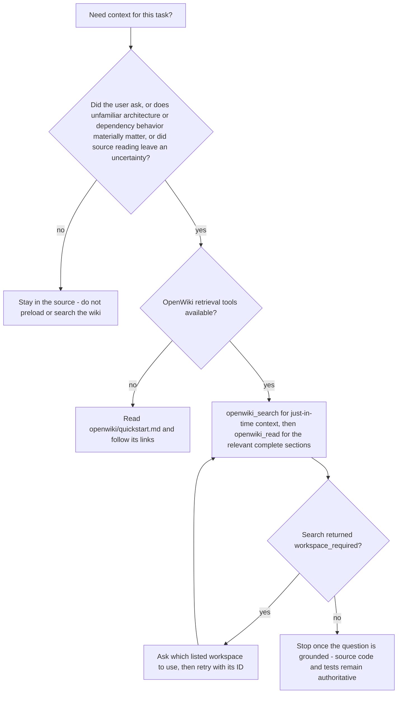

# Quickstart & Task Routing

`retail-portfolio` is a portfolio tracker for retail investors. One Docker Compose stack runs
five runtime pieces:

- a Python 3.14 / FastAPI backend in `src/` (SQLAlchemy 2 async models over PostgreSQL,
  Alembic migrations) that serves the user API under `/api/v1` **and** a service-to-service
  market data plane;
- a Huey worker on Redis (`src/worker.py`);
- a SvelteKit 2 / Svelte 5 SSR frontend in `frontend/`;
- a stateless Go indicator sidecar in `services/indicator-service/`;
- a Go MCP gateway in `services/mcp-gateway/` — the agent-facing MCP server that reads market
  data through the backend's data plane. It is agent-facing **only**: no route in `frontend/`
  consumes it, so do not go looking for MCP wiring in the SvelteKit app.

Local development is Docker Compose only; the backend, worker, Compose interpolation, the
frontend dev server and both Go sidecars all read one root `.env` copied from the tracked
`.env.example`.

`AGENTS.md` is the root guide. It delegates backend work (`src/`, `tests/`, `migrations/`) to
`src/AGENTS.md`, frontend work (`frontend/`) to `frontend/AGENTS.md`, and Go microservice work
(`services/indicator-service/`, `services/mcp-gateway/`) to `services/README.md` plus each
service's own `README.md`. Those guides, plus the agent tooling under `.ai/`, `.agent/`,
`.claude/` and `.opencode/`, are the authoritative statement of how work is done here — this
wiki is only context.

## Run it

```bash
cp .env.example .env
just up        # or: docker compose up -d
```

`just up` starts the stack with the host Docker socket's real group id (discovered by
`scripts/docker-gid.sh`, overridable with `DOCKER_GID`), which is what lets
testcontainers-backed tests inside the containers reach the daemon.

| Service | URL / purpose | Host port (root `.env` override) | Container port |
|---|---|---|---|
| backend | `http://localhost:8001` — `/redoc`, `/api/ping`, `/health/live`, `/health/ready`, Huey dashboard at `/worker/api`, service data plane under `/api/v1/market/data` | `BACKEND_PORT` | `8000` |
| frontend | `http://localhost:8002/` | `FRONTEND_PORT` | `8100` |
| mailcrab (dev SMTP inbox) | `http://localhost:8003` | `MAILCRAB_PORT` | `1080` |
| indicator service | `http://127.0.0.1:8004` — stateless Go indicator calculator | `INDICATOR_SERVICE_PORT` | `8080` |
| mcp-gateway | `http://127.0.0.1:8005` — agent-facing MCP server (`/mcp`, `/health`); no frontend route consumes it | `MCP_GATEWAY_PORT` | `8080` |
| PostgreSQL | `localhost:5432` | `POSTGRES_PORT` | `5432` |
| debugpy | `localhost:8090` (backend) / `localhost:8091` (worker) | `BACKEND_DEBUG_PORT`, `WORKER_DEBUG_PORT` | `5678` |
| Redis | not published — reachable only on the Compose network as `redis:6379` | — | — |

Every one of those ports is Compose-interpolated from the root `.env`, so change ports there
rather than in `docker-compose.yml`. Both Go sidecars are bound to `127.0.0.1` on the host in
dev and publish no host port at all in `docker-compose.prod.yml` (internal network only). The
`mcp-gateway` service additionally waits for `backend` to be healthy before starting.

### The root `.env` contract

The tracked `.env.example` is the single configuration source; `.env` is gitignored. Beyond
the interpolated ports and the pre-existing keys, the service-to-service market data path adds
these values:

- **Provider keys.** `FMP_API_KEY` and `POLYGON_API_KEY` are required outside dev/test unless
  `STUB_EXTERNAL_API=true`: the provider-agnostic data-plane gateway routes prices and
  fundamentals to FMP and options chains to Polygon, and the stub gateways need no
  credentials. `EODHD_API_KEY` remains for the legacy EODHD `MarketGateway`. The backend
  resolves `DataPlaneMarketGateway` eagerly during lifespan, so a missing provider key fails
  at boot rather than on the first request.
- **`MARKET_DATA_SERVICE_TOKEN`.** The shared secret for the MCP gateway → backend data plane,
  sent as the `X-Service-Token` header. Dev default `dev-market-data-token`; required outside
  dev/test. A checkout that predates the gateway must add it: with a missing or mismatched
  token the data plane answers `401` to the MCP gateway.
- **`DATA_PLANE_PATH`** (default `/api/v1/market/data`) — the path prefix the gateway appends
  to `BACKEND_BASE_URL`; **`BACKEND_BASE_URL`** (default `http://backend:8000`) is the backend
  origin over the Compose network.
- **`MCP_GATEWAY_PORT`** (default `8005`) — dev host port for the gateway, mapped to container
  `8080`. `MCP_GATEWAY_URL` (`http://mcp-gateway:8080`) is declared in `.env.example` for the
  in-network gateway URL, but nothing in the backend or the Compose files reads it today.

`src/.env` and `frontend/.env` are obsolete — move any custom values into the root `.env` and
delete them.

Three wiring details bite when ports change:

- The frontend service receives `JWT_SECRET` derived from the root `SECRET_KEY`, so the SSR
  route guard verifies tokens with exactly the backend HS256 signing key and Compose fails
  fast if `SECRET_KEY` is unset.
- `CORS_ALLOW_ORIGINS` in `.env.example` names `http://localhost:8101` while the dev frontend
  is published on `8002`; dev still works because the backend sets
  `allow_origin_regex=r"https?://.*"` for any non-prod environment, but in prod that regex is
  `None` and the origin list must be correct.
- `worker` is a separate container from `backend`, running
  `huey_consumer src.worker.huey -w 2 --worker-type thread --periodic` under `watchfiles`
  reload so task changes are picked up without restarting Compose. Nothing in a request path
  runs those tasks, and the dashboard API is mounted on the backend app, not the worker — see
  [Realtime, Background Jobs & the Worker](./workflows/realtime-and-background-jobs.md).

CI (`.github/workflows/ci.yml`) runs the same checks in four jobs: backend (`uv run ty check`,
`ruff check` + `ruff format --check`, `pytest` on Python 3.14), frontend (`npm run check`,
`npm run lint`, `npm run test:run` on Node 25, plus `node --test
scripts/opencode-go-session-fetch.test.mjs`), and one job per Go module — `indicator-service`
and `mcp-gateway` each run `go vet`, `gofmt -l`, `staticcheck`, `govulncheck`, `go build` and
`go test ./...` on Go 1.27.1.

## Where things live

| Path | What it owns |
|------|--------------|
| `src/` | FastAPI backend, split into domains (`account`, `auth`, `market`, `integration`, `ws`) plus cross-cutting `core`, `config` and `worker_dashboard` |
| `frontend/` | SvelteKit SSR app: routes, services, API clients, components |
| `services/indicator-service/` | Go indicator sidecar (stateless calculator) |
| `services/mcp-gateway/` | Go MCP gateway sidecar: `/mcp` + `/health`, the backend `Transport`/`RouteGroup` client layer, the tool registry |
| `services/README.md` | Repository-wide Go service conventions: `cmd/` + `internal/` layout, `Load(getenv)` config, `slog`, `X-Request-ID`, graceful shutdown, multi-stage Dockerfile, and why there is no shared Go module |
| `migrations/` | Alembic revisions (configured as the Alembic `script_location`) |
| `tests/` | Backend pytest suites, organized by domain and layer |
| `tests/market/contracts/` | Committed `data_plane_openapi.json` snapshot — the source of truth for the gateway ↔ backend data-plane contract |
| `src/stubs/` | Stub external gateways used by tests and `STUB_EXTERNAL_API` mode |
| `src/commands/` | The two CLI entrypoints `seed.py` (seeding users, accounts, portfolios, positions, securities) and `flush_market_data.py` (clearing price/intraday rows plus the indicator cache) |
| `openspec/` | Canonical capability specs (`specs/<capability>/`) and change artifacts (`changes/`) |
| `scripts/` | `agent-test` harness, `setup-agent-worktree.sh`, `docker-gid.sh`, the OpenWiki preload shim (`opencode-go-session-fetch.mjs`) and its node test |
| `.ai/` | Core agent skills (`skills/`), feature briefs (`features/`), architecture reviews (`reviews/`), working notes (`notes/`) |
| `.agent/`, `.claude/`, `.opencode/` | Per-tool agent trees — skills (symlinked to `.ai/skills/`, except the per-tool `openspec-*` copies), agents, commands/workflows, and the OpenCode model map in `opencode.json` |
| `.github/workflows/` | CI (`ci.yml`) and the scheduled OpenWiki refresh (`openwiki-update.yml`) |
| `CLAUDE.md` | One-line `@AGENTS.md` import for tools that look for that filename |

## If you are changing X, read Y

| You are changing… | Read |
|---|---|
| Anything at the system level: processes, startup, request flow, layer rules | [Architecture Overview](./architecture/overview.md) |
| A backend domain: add a route/service/repository, or touch `account`, `auth`, `market`, `integration`, `ws`, `core` | [Backend Domains](./architecture/domains.md) |
| `Settings`, the root `.env` contract, the `svcs` registry, DB/Redis managers, middleware | [Configuration, DI & Cross-Cutting Runtime](./architecture/configuration.md) |
| SvelteKit routes, `load`/form actions, API clients, runes-based services, SSR pitfalls | [Frontend Architecture](./architecture/frontend.md) |
| The chart surface: chart mount/series lifecycle, panes and pane heights, timeframe/chart style, indicator overlays, chart settings, price alerts | [Charting: Chart Surface, Panes & Indicators](./architecture/charting.md) |
| Drawing tools: series-primitive plugins and helpers, finance math, drawing persistence/undo-redo, chart snapshots and the rewind timeline | [Chart Drawings, Plugins & Rewind](./architecture/chart-drawings-and-rewind.md) |
| Anything persisted per user: the `/accounts/me/preferences` contract, key ownership, merge/`exclude_none` semantics | [User Preferences](./concepts/user-preferences.md) |
| Signup/login, the `auth_token` JWT, 2FA/TOTP, passkeys, ownership authorization, the WS ticket, or the `X-Service-Token` service trust boundary | [Authentication & Authorization](./architecture/authentication.md) |
| The service-to-service market data plane: the `/api/v1/market/data` route contract, `DataPlaneMarketGateway`, the FMP/Polygon routing table, endpoint/negative caching, listing-currency resolution, error mapping, the committed OpenAPI snapshot | [Market Data Plane: Providers, Caching & the Service Endpoint Contract](./architecture/market-data-plane.md) |
| The Go MCP gateway: the `/mcp` streamable-HTTP surface and session lifecycle, cross-origin protection, config/startup validation, the `Transport`/`RouteGroup` client layer, the eight registered tools, the four-class error taxonomy, token redaction | [MCP Gateway (Agent-Facing Market Data Server)](./integrations/mcp-gateway.md) |
| The holdings read path: the accounts dashboard, `/accounts/[id]`, cross-account `/holdings`, holdings table columns/grouping/preferences | [Accounts & Holdings Views](./workflows/accounts-and-holdings-views.md) |
| Portfolios: the `portfolios`/`portfolio_accounts` models, `PortfolioService`, the `/portfolios` CRUD routes, the list page, the `?portfolio_id=` holdings filter | [Portfolios & Holdings Filters](./workflows/portfolios.md) |
| Watchlists, the sidebar watchlist groups and ticker shortcuts, the `/watchlists` page, or the global-search dialog | [Watchlists, Sidebar & Global Search](./workflows/watchlists-and-search.md) |
| A fair-value range on a security: the valuations table, the four market routes, `valuationClient`, the fundamentals sidebar group | [Security Valuations (Fair-Value Ranges)](./concepts/security-valuation.md) |
| The `/security/[security_id]` route itself: the shell-first load, the page data wave, the instant titlebar, and the actions-sidebar groups (notes, documents, alerts, indicators, holdings, AI) | [Security Detail Page & Actions Sidebar](./workflows/security-detail-page.md) |
| Broker connect, Wealthsimple login/OTP, position import and the Huey sync task | [Broker Connect, Import & Position Sync](./workflows/broker-sync.md) |
| CSV templates, account discovery, the inspect → import → sync lifecycle | [CSV Account Import & Sync](./workflows/csv-import.md) |
| Price fetches/backfill, daily & intraday tasks, the downstream recalc/alert cascade, indicator computation | [Market Data, Indicators & the Price Update Cascade](./workflows/market-data-and-indicators.md) |
| AI context assembly, fundamentals/notes/debate endpoints, the async title task | [AI Analysis Flows](./workflows/ai-analysis.md) |
| The worker: task registries, periodic/on-demand jobs, retries, the Redis WebSocket fan-out, sync-status keys, the frontend consumer | [Realtime, Background Jobs & the Worker](./workflows/realtime-and-background-jobs.md) |
| An outbound dependency: EODHD, FMP, Polygon, Wealthsimple, the AI endpoint, SMTP/mailcrab, Redis, either Go sidecar | [External Services & Adapters](./integrations/external-services.md) |
| Money, currency conversion, totals, holdings/P&L math, rounding | [Money & Currency Handling](./concepts/money-and-currency.md) |
| How to run, ship and change: Compose stack, in-container commands, agent-test harness, worktrees, migrations, CI, OpenSpec, the OpenWiki refresh | [Development, CI & Change Workflows](./operations/workflows.md) |
| The pytest/Vitest/Go test layout, fixtures, mandatory mocking, harness gates, the backend↔gateway OpenAPI parity tests, the CI matrix | [Testing & Verification](./operations/testing.md) |
| A Go service's shared conventions (`cmd/` + `internal/`, `Load(getenv)`, `slog`, request IDs, graceful shutdown) or adding a new one | `services/README.md`, then [Testing & Verification](./operations/testing.md) for its test surface |
| Agent guidance and this wiki: `AGENTS.md`, `src/AGENTS.md`, `frontend/AGENTS.md`, `services/README.md`, the agent-tooling trees, the OpenWiki block and its retrieval policy | [Development, CI & Change Workflows](./operations/workflows.md) |

Every wiki link above resolves to a page in this wiki; `AGENTS.md` names this page as the
fallback route when the OpenWiki retrieval tools are unavailable.

## Non-negotiables

These rules come from `AGENTS.md`, its per-area guides (`src/AGENTS.md`, `frontend/AGENTS.md`,
`services/README.md`) and the OpenWiki block at the end of `AGENTS.md`, and hold for every
task:

- **Backend and frontend commands run inside Docker.** `docker compose exec
  <backend|frontend> <command>`; the host is never the reference environment. Go microservice
  checks run through the host Go toolchain (`gofmt`, `staticcheck`, `go test ./...`, `go vet
  ./...`) or `just lint-go`. CI runs the same checks.
- **Use the agent harness.** `./scripts/agent-test` (shorthand `just test`) is the primary
  backend/frontend test entrypoint. It runs inside Docker for you, sanitizes and caps output,
  and offers **Gate 0** (lint + type checker; halts before tests on failure), **Gate 1** (a
  path argument — targeted, fail-fast) and **Gate 2** (no path — full suite with a two-tier
  Index/Traces summary). Flags: `--backend` / `--frontend`, `--all`, `--gate0-only`,
  `--no-gate0`, `--local`, `--json`, `--max-chars N`. Raw
  `docker compose exec … pytest`/`vitest` is the fallback if the harness itself breaks.
- **Verification covers the Go modules too.** `just test-all` runs the backend, frontend,
  indicator-service and mcp-gateway suites (plus the node script tests) in parallel, and
  `just lint-go` / `just check` gate both Go modules with `gofmt`, `staticcheck` and
  `govulncheck`.
- **Model edits require a migration.** Editing a backend model means generating the Alembic
  revision in the same change; migration files follow `<hash>_<description>.py` naming, and
  manual SQL goes through `op.execute()` inside a standard revision.
- **Tests never touch external services.** Mock all outbound I/O — Redis, HTTP APIs (EODHD,
  broker APIs), and SMTP in the backend; all API calls in the frontend. The ephemeral
  testcontainers PostgreSQL is the only allowed infrastructure dependency. A test that makes a
  real network/Redis/SMTP call is broken by definition; mock it, don't expect the service to be
  up.
- **Parallel agents isolate with git worktrees.** Use
  `scripts/setup-agent-worktree.sh <worktree-path> <branch-name> [base-ref]`, which discovers
  free ports and generates a worktree `.env`, before starting that worktree's Compose stack —
  otherwise files and Docker resources collide.
- **The service token is the trust boundary, not the MCP listener.** The gateway's `/mcp`
  endpoint is unauthenticated and must stay on the internal network; what guards the data is
  the backend data plane's `X-Service-Token` check against `MARKET_DATA_SERVICE_TOKEN`. Keep
  both sides of that value in the root `.env`, never log or echo the token, and never expose
  the gateway's host port outside a trusted host.
- **Keep the market-data vocabulary provider-agnostic.** Tool names, tool descriptions, log
  lines, error strings and docs must never name an upstream provider brand — say "market
  data". The gateway's data-plane route paths and query parameter names are a frozen contract
  mirrored by the committed `data_plane_openapi.json` snapshot; change them only together with
  that snapshot.
- **Agents never merge into `main`.** Ticket PRs merge into their `feat/<slug>` integration
  branch; only the user merges that branch into `main`, and outside the ticket pipeline a PR
  waits for explicit confirmation.
- **Spec-driven changes.** Non-trivial work goes through OpenSpec in `openspec/`
  (propose → apply → archive); canonical specs live in `openspec/specs/<capability>/spec.md`.
- **Source code and tests are authoritative; the generated wiki is optional context.**
  `openwiki/` is just-in-time context, not required startup reading, and its pages must not be
  hand-edited — see [Consuming the generated wiki](#consuming-the-generated-wiki).

## Consuming the generated wiki

The `openwiki/` tree is generated documentation, refreshed by the scheduled
`.github/workflows/openwiki-update.yml` workflow (daily at 08:00 UTC, plus `workflow_dispatch`),
which installs OpenWiki, runs `openwiki code --update --print` through the OpenCode session
shim, and opens a pull request on the `openwiki/update` branch limited to `add-paths:
openwiki`. Documentation therefore lands through review, never as a direct commit. Do not
hand-edit these pages unless explicitly asked: update source code and docs and let the workflow
regenerate them.

The OpenWiki block at the end of `AGENTS.md` (delimited by `<!-- OPENWIKI:START -->` /
`<!-- OPENWIKI:END -->`) defines how agents are meant to use it. It is the authoritative
statement of consumption policy: if it and this page disagree, the block wins.

- **The wiki is optional just-in-time context, not required startup reading.** Do not
  enumerate, preload, or search wikis at task start. Retrieval applies when the user asks for
  it, when unfamiliar architecture or dependency behavior materially affects the task, or when
  source inspection leaves an important uncertainty — and it stops once the question is
  grounded.
- **Use the retrieval tools when those conditions apply.** `openwiki_search` supplies
  just-in-time context; `openwiki_read` returns the relevant complete sections. If search
  returns `workspace_required`, ask which listed workspace to use and retry with its ID;
  `openwiki_list_workspaces` / `openwiki_list_wikis` are for when workspace membership itself
  needs to be discovered.
- **If the retrieval tools are unavailable**, read `openwiki/quickstart.md` and follow its
  links — this page and the tables above are the entry point.
- **Source code and tests stay authoritative**, and validation should be the narrowest quiet
  check that proves the changed behavior while preserving complete failure output.



How an agent decides whether to consult the generated wiki, and what to do when retrieval needs a workspace.
