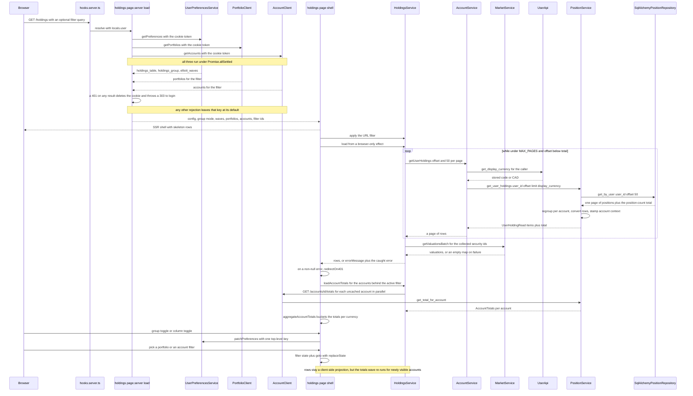
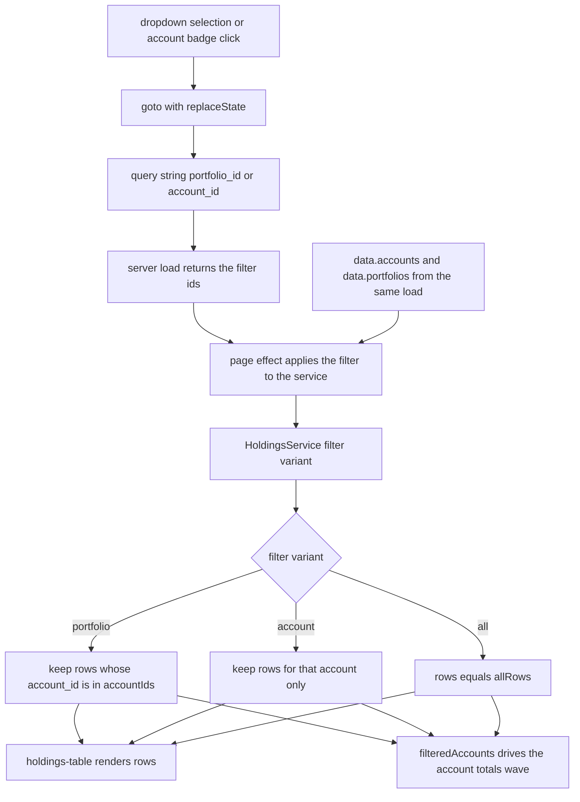
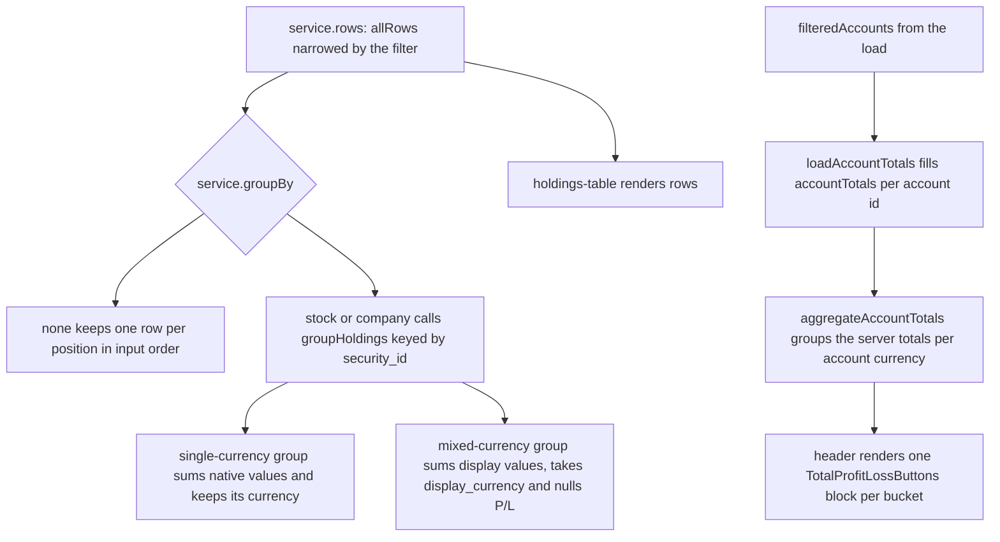

# Accounts & Holdings Views (read path)

This page owns the three read surfaces that show stored positions to a user, plus
the aggregation, pagination and table contract behind them: the accounts dashboard
(`/`), the account-scoped page (`/accounts/[id]`) and the cross-account page
(`/holdings`).

Three neighbouring pages own the surrounding machinery and are not re-derived here:

- [Frontend Architecture](../architecture/frontend.md) owns the SvelteKit shell, the
  shell-first/post-navigation data convention, the `ApiClient` layer and the
  per-surface load shapes.
- [Money & Currency Handling](../concepts/money-and-currency.md) owns the FX chain
  (`security → position/account → display`), the free-cash/P&L-basis composition of
  `AccountTotals`, and the per-security totals semantics.
- [Portfolios](portfolios.md) owns the portfolio model and the `?portfolio_id=`
  hand-off that this page's filter consumes.
- [User Preferences](../concepts/user-preferences.md) owns the preference document,
  the `PATCH` merge semantics and the `display_currency` validator.

| Surface | Route | Backing endpoint | Where the rows come from |
| --- | --- | --- | --- |
| Accounts dashboard | `/` | `GET /accounts/` plus one `GET /accounts/{id}/totals` per rendered account and one `GET /accounts/{id}/holdings` per expanded row | the account list is awaited in the load; each row fetches its own totals client-side and its holdings only when expanded |
| Account-scoped holdings | `/accounts/[id]` | `GET /accounts/{account_id}/holdings` | awaited in the load |
| Cross-account holdings | `/holdings` | `GET /accounts/holdings` (paged) plus `GET /accounts/me/preferences`, `GET /portfolios/`, `GET /accounts/` and one `GET /accounts/{id}/totals` per filtered account | preferences and filter metadata only in the load; rows and account totals fetched after navigation by a page-owned `HoldingsService` |

A fourth, narrower read — `GET /accounts/holdings/{security_id}` — is consumed by
the security detail page and the holdings modal (see
[Security Detail Page](security-detail-page.md)), not by these three routes; it is
described below because it shares the same service and repository contract.

## Backend read contract

The holdings responses are Pydantic shapes in `src/account/schema.py`, serialized to
the wire by `src/account/serializer.py`:

- **`HoldingRead`** — one position turned into a display row. It carries three
  currency layers: native (`security_currency`, `unconverted_total_value`,
  `unconverted_profit_loss`), account currency (`total_value`, `profit_loss`,
  `currency`, `converted_average_cost`, `converted_latest_price`, `average_cost`,
  `latest_price`, `price_date`) and display currency (`display_total_value`,
  `display_currency`).
- **`UserHoldingRead`** — `HoldingRead` plus `account_id` / `account_name`. This is
  the cross-account row.
- **`AccountHoldingsRead`** — a `PaginatedResponse[HoldingRead]` (`items`, `total`,
  `offset`, `limit`) extended with `account_id`, `account_name`, `total_value`,
  `total_profit_loss`, `total_profit_loss_percent`, `profit_loss_basis`,
  `net_deposits`, `free_cash`, `broker_value`, `broker_value_at`, `currency`,
  `unpriced_positions` and `pricing_incomplete`.
- **`AccountHoldingRead`** — the per-security row (`account_id`, `account_name`,
  `quantity`, `average_cost`, `total_value`, `currency`, `display_total_value`,
  `display_currency`, `account_total_value`, `account_percentage`).
- **`AccountTotals`** (`src/account/api_types.py`) — what the dashboard badge and the
  `/holdings` header consume: `cost`, `value`, `cash`, `net_deposits`,
  `profit_loss`, `return_percent`, `basis` (`"net_deposits" | "cost"`),
  `unpriced_positions`, `pricing_incomplete`.

`PositionService` (`src/account/service/position.py`) is the only aggregation layer.
Every number in the holding shapes comes from `_calculate_holdings` /
`_calculate_holding` / `_unpriced_holding`, which resolve each position's security
and latest price and convert through `_currency_convert`; `get_user_holdings`,
`get_account_holdings`, `get_total_for_account` and `get_holdings_by_security` all
share those helpers and none reimplements them. The conversion targets and rounding
rules are owned by [Money & Currency Handling](../concepts/money-and-currency.md).

### `get_user_holdings` — cross-account

```python
positions, total = await self._position_repository.get_by_user(user_id, offset, limit)

positions_by_account: dict[AccountId, list[PositionSchema]] = {}
for position in positions:
    positions_by_account.setdefault(position.account_id, []).append(position)

result_items: list[UserHoldingRead] = []
for account_id, account_positions in positions_by_account.items():
    account = await self._account_service.get_account(account_id)
    holdings, _, _, _ = await self._calculate_holdings(
        account, account_positions, display_currency
    )
    result_items.extend(
        UserHoldingRead(
            **holding.model_dump(),
            account_id=account.id,
            account_name=account.name,
        )
        for holding in holdings
    )

return result_items, total
```

Load-bearing properties:

1. **The endpoint pages positions, not accounts and not holdings rows.** `total` on
   `GET /accounts/holdings` is the *position* count (`PositionRepository.get_by_user`
   counts `PositionModel` rows joined to `AccountModel` for the user), not the number
   of accounts.
2. **A page boundary can split one account's rows.** Pagination happens in the
   repository before the service regroups by account, so an account whose positions
   straddle an offset can appear in two different pages. The service only ever sees
   the subset inside the requested window and emits compacted rows for it.
3. **`_calculate_holdings` runs per account, on the page's subset.** One
   `AccountService.get_account` call per distinct account in the page (not per
   position), then per-position security + latest-price lookups.
4. **Account context is stamped after per-row conversion.**
   `UserHoldingRead(**holding.model_dump(), account_id=account.id, account_name=account.name)`
   converts each `HoldingRead` first, so the account id/name are pure additions and
   every `HoldingRead` field keeps its `_calculate_holding` semantics.
5. **`display_currency` defaults to `"CAD"` on the service and is supplied by the
   router** from the caller's stored preference, so rows from accounts in different
   currencies share one comparable `display_total_value` without losing their native
   and account-currency fields.
6. **Row order is account-first-appearance**, not the repository's
   `order_by(PositionModel.id)`: the service iterates the grouped dict. Both
   surfaces sort client-side anyway.
7. **A position whose security cannot be resolved is skipped and counted.**
   `_calculate_holdings` logs `"Security not found for position ..."`, increments
   `unpriced_positions` and `continue`s, so a page can return fewer rows than it
   counted. `total` still counts the position.

### `get_account_holdings` — account-scoped

`get_account_holdings(account_id, offset=0, limit=50)` resolves the account, then
walks the account's positions **twice**:

1. An *unlimited* `PositionRepository.get_by_account(account_id)` feeds
   `_calculate_holdings` and then `_account_performance`, producing the
   `AccountTotals` that become the response's `total_value`,
   `total_profit_loss`, `total_profit_loss_percent`, `profit_loss_basis`,
   `net_deposits`, `free_cash`, `broker_value`/`broker_value_at`,
   `unpriced_positions` and `pricing_incomplete`.
2. A *paginated* `get_by_account(account_id, offset=offset, limit=limit)` feeds
   `_calculate_holdings` again for `items`; `total` is the account's full position
   count.

So the header totals always cover every position of the account while the table body
covers at most one page. The P/L basis is the shared `_account_performance` rule
(`net_deposits` when the account has them, otherwise positions cost) — see the
free-cash/P&L-basis section of
[Money & Currency Handling](../concepts/money-and-currency.md) for the arithmetic,
which is not re-explained here.

### `get_total_for_account` and the totals route

`get_total_for_account(account_id, currency)` re-runs the same unlimited walk and
converts the positions value/cost into `currency` before calling
`_account_performance`, so both totals paths agree by construction.
`GET /accounts/{account_id}/totals` accepts an optional `currency` query parameter,
normalizes it, restricts it to `SUPPORTED_DISPLAY_CURRENCIES` (`CAD`, `USD`, `EUR`,
`GBP`) with a 422 for anything else, and defaults to the account's own currency.
`AccountClient.getAccountTotals(id, token, currency?)` is the client seam for it; the
dashboard calls it without a currency, so its badge is in the account currency.

### Pricing completeness is part of the contract

`_calculate_holdings` distinguishes two failure modes, and neither may be collapsed
into the other:

- **No security row** — the position is dropped from `holdings`, counted in
  `unpriced_positions` and excluded from value, cost and P/L.
- **No stored price** — `_unpriced_holding` still emits a row (with the converted
  average cost and the security identity) whose `total_value` is `0.0` and whose
  `profit_loss` is `None`, and the position is likewise counted in
  `unpriced_positions` and excluded from the totals.

`unpriced_positions` therefore counts *skipped-plus-visible* unpriceable positions,
and `pricing_incomplete = unpriced_positions > 0` tells the UI that the totals
understate the account. Both `/accounts/[id]` and each expanded dashboard row render
an amber "Incomplete pricing" tooltip off that flag, so a partially priced account is
visibly flagged rather than silently understated.

### `get_holdings_by_security` — per-security reads

`PositionRepository.get_holdings_by_security` selects `account_id`, `account_name`,
`quantity` and `average_cost` joined to the user's accounts and returns
`AccountHoldingRead` stubs with `total_value=0.0`, `currency=""`,
`display_total_value=0.0` and `display_currency=""` as explicit placeholders.
`PositionService.get_holdings_by_security` then fills them per row: it resolves the
account (`AccountService.get_account`), calls `get_total_for_account` for the
account's value, and sets

- `total_value = quantity × latest close` in the **security's** currency,
- `display_total_value` = that value converted into the request's `display_currency`
  (defaulting to the account's currency),
- `account_total_value` from the account totals (which include free cash), and
- `account_percentage` only when the account total is above zero, computed from the
  *account-currency* conversion of the holding value.

If the security is unknown the method returns `([], 0)` — an empty list that is
ambiguous with "no holdings", flagged in a `TODO` in the source.

### Router surface

`src/account/router.py` exposes:

- `GET /accounts/holdings` → `PositionService.get_user_holdings`, returning
  `PaginatedResponse[UserHoldingRead]`. User scoping is implicit in the repository
  join on `AccountModel.user_id`; the handler resolves the caller's display currency
  through `UserApi.get_display_currency` before delegating.
- `GET /accounts/holdings/{security_id}` → `PositionService.get_holdings_by_security`
  with the same implicit user scoping and the same display-currency resolution,
  returning `PaginatedResponse[AccountHoldingRead]`.
- `GET /accounts/{account_id}/holdings` → `AccountRepository.get` +
  `authorization_api.check_entity_owned_by_user` before
  `PositionService.get_account_holdings`, returning `AccountHoldingsRead`.
- `GET /accounts/{account_id}/totals` → the same ownership check, then
  `PositionService.get_total_for_account`.
- `GET`/`PUT`/`PATCH /accounts/me/preferences` → `UserApi.get_preferences` /
  `save_preferences` / `patch_preferences`. `PATCH` calls
  `payload.model_dump(exclude_none=True)` and merges at the **top level** via
  SQLAlchemy `JSONB || JSONB`, so one key per write is the race-safe shape
  ([User Preferences](../concepts/user-preferences.md) owns the full key inventory).

Pagination parameters come from `src/core/pagination.py`: `offset` defaults to `0`
and `limit` defaults to `50` with `ge=1, le=100`. All three holdings routes take
`PaginationParams` as a dependency, so the values in the response echo the request.

## The `/holdings` read path: preference-only SSR, then two post-navigation waves

`/holdings` is the one holdings surface that does **not** fetch rows in its server
load. `frontend/src/routes/holdings/+page.server.ts` reads the `auth_token` cookie,
the `portfolio_id` / `account_id` query parameters, and issues three requests in
parallel with `Promise.allSettled`:

```ts
export const load: PageServerLoad = async ({ fetch, cookies, url }) => {
	const token = cookies.get('auth_token');
	const portfolio_id = url.searchParams.get('portfolio_id');
	const account_id = url.searchParams.get('account_id');

	let holdings_table_config = normalizeHoldingsTableConfig(null);
	let group_mode = normalizeHoldingsGroupMode(null);
	let elliott_waves: Record<string, SecurityElliottWaves> | null = null;
	let portfolios: Portfolio[] = [];
	let accounts: Account[] = [];

	try {
		const [prefsResult, portfoliosResult, accountsResult] = await Promise.allSettled([
			getUserPreferencesService(fetch).getPreferences(token),
			getPortfolioClient(fetch).getPortfolios(token),
			getAccountClient(fetch).getAccounts(token)
		]);

		for (const res of [prefsResult, portfoliosResult, accountsResult]) {
			if (res.status === 'rejected' && res.reason instanceof ApiError && res.reason.status === 401) {
				deleteAuthCookie(cookies);
				throw redirect(303, '/auth/login?clear_session=true');
			}
		}

		// fulfilled results fill holdings_table_config, group_mode, elliott_waves,
		// portfolios and accounts; a rejection simply leaves the defaults in place.
	} catch (err) {
		// Re-throw the 303 redirect; swallow every other failure as non-fatal.
	}

	return { holdings_table_config, group_mode, elliott_waves, portfolios, accounts, portfolio_id, account_id };
};
```

Load-bearing properties of this load:

1. **Preferences, portfolios and the account list are awaited, holdings rows are
   not.** The three reads run concurrently; a rejected portfolio or account read
   degrades to an empty list rather than failing the page, so a preference or
   filter-metadata outage does not hide holdings.
2. **A 401 is the one non-fatal exception.** Each settled result is inspected: a
   rejected result whose reason is an `ApiError` with `status === 401` triggers
   `deleteAuthCookie(cookies)` and a `throw redirect(303, ...)`. The outer `catch`
   re-throws exactly that redirect (matching on `status === 303`) and swallows
   everything else — without the re-throw the redirect would be swallowed too.
3. **The filter is URL-driven, not client-derived from scratch.** The load reads
   `portfolio_id` / `account_id` from the query string and returns them, and the
   page's first `$effect` re-applies the corresponding filter to the service.
4. **The rows still arrive after navigation.** The server load never calls
   `getUserHoldings`; a test pins that. A browser-only `$effect` calls
   `service.load()` once per mount, and a third `$effect` starts the account-totals
   wave described below.



*The three data waves of `/holdings`: a metadata-only SSR load, the paged holdings
fetch, and the per-account totals fetch that feeds the header.*

### The paging loop lives in `HoldingsService.load()`

`frontend/src/lib/components/holdings/holdingsService.svelte.ts` is the only
implementation of the collect-every-page contract:

```ts
const PAGE_SIZE = 50;
// Safety valve against a stale `total` from the server: never page forever.
const MAX_PAGES = 100;

async load(token?: string | null): Promise<unknown | null> {
	this.isLoading = true;
	this.errorMessage = null;

	try {
		const collected: UserHolding[] = [];
		let offset = 0;
		let total = Infinity;

		for (let page = 0; page < MAX_PAGES && offset < total; page++) {
			const response = await this.client.getUserHoldings(offset, PAGE_SIZE, token);
			collected.push(...response.items);
			total = response.total;
			offset += PAGE_SIZE;

			if (response.items.length === 0) break;
		}

		this.rows = collected; // setter assigns allRows

		// One batched valuation read for every distinct security in the collected rows,
		// in its own try/catch: a failure empties `valuations` but keeps the rows.
		const uniqueSecurityIds = Array.from(
			new SvelteSet(collected.map((h) => h.security_id).filter((id): id is string => Boolean(id)))
		);
		// getValuationsBatch(...) → this.valuations; a rejection or an empty id list stores {}

		return null;
	} catch (error) {
		this.errorMessage = error instanceof Error ? error.message : String(error);
		return error;
	} finally {
		this.isLoading = false;
	}
}
```

- `PAGE_SIZE = 50` matches the backend `PaginationParams` default and the
  repository defaults. `MAX_PAGES = 100` caps the loop at 5 000 rows because the
  server's `total` can be stale relative to concurrent position writes.
- The loop stops early on an empty page — the second stale-total guard. Together
  the cap and the empty-page exit are why an inconsistent `total` degrades to a
  truncated list rather than an infinite request waterfall.
- Pages are requested **sequentially**, not in parallel: each iteration awaits the
  previous response, so the offsets are deterministic (`0, 50, 100, …`).
- `load()` never throws. It stores the message in `errorMessage` and *returns* the
  caught value (`null` on success) so the caller can route a 401 through the shared
  async-data seam. `isLoading` toggles around the whole loop, which is what drives
  the skeleton rows.
- On failure the previously loaded `rows` are kept (the assignment happens only
  after the loop completes), and a later success clears `errorMessage`.
- After the last page the loop makes **one batched valuation read** —
  `marketClient.getValuationsBatch(uniqueSecurityIds, token)` — for the distinct
  `security_id`s collected, storing the result in `valuations`. That call has its own
  nested `try/catch`: a failure (or no securities at all) sets `valuations` to `{}`
  and leaves the rows intact, so a valuation outage cannot fail the holdings load.
- `rows` is a getter over the `allRows` array plus the active `filter`, and its
  setter writes `allRows`. The paging loop therefore always stores the *complete*
  cross-account set; filtering never mutates what was fetched.

### Second wave: per-account totals behind the filter

The page derives `filteredAccounts` from `service.filter` plus the loaded
portfolios/accounts (a portfolio filter resolves to that portfolio's accounts, an
account filter to that one account, no filter to `data.accounts`). A third `$effect`
watches that list and calls `service.loadAccountTotals(accountIds)` inside
`untrack`, so the cache writes inside the service do not become dependencies of the
effect that triggered them.

`HoldingsService.loadAccountTotals`:

- dedupes the incoming ids, skips any account already present in its
  `accountTotals` cache and returns `null` immediately when nothing is missing;
- requests the rest in parallel with `Promise.allSettled` against
  `GET /accounts/{id}/totals`;
- stores each fulfilled result under its account id and records only the *first*
  rejection's message into `errorMessage`.

A failed account therefore loses its header bucket (and shows the shared in-page
alert) instead of blanking the header. A filter change re-runs this wave but never
re-fetches holdings rows.

### Failure semantics after navigation

`+page.svelte` owns the error policy, and it is deliberately different from the two
loads that fetch in SSR:

```ts
$effect(() => {
	void (async () => {
		const loadError = await service.load();

		if (loadError !== null) {
			await redirectOn401(loadError);
		}
	})();
});

const errorMessage = $derived(persistError ?? service.errorMessage);
```

- A 401 goes through `redirectOn401` (`$lib/api/async-data.ts`), which `goto`s
  `/auth/login?clear_session=true` and returns `true`. The httpOnly `auth_token`
  cookie is **not** deleted client-side — `hooks.server.ts` clears it when the login
  page is resolved.
- Any other error returns `false` and the message lands in the `holdings-error`
  `Alert`. The shell survives: no SvelteKit error page, and the page still renders
  its header and table.
- The same alert is used for preference-write failures (`persistError`) and for the
  first account-totals rejection, so a failed load, a failed `PATCH` and a failed
  totals read are visually indistinguishable apart from their text.

By contrast, the `/` and `/accounts/[id]` loads keep the standard SSR error
contract: `ApiError` 401 → `deleteAuthCookie(cookies)` then
`redirect(303, '/auth/login?clear_session=true')`; any other `ApiError` →
`error(status, message)`; anything else → `error(500, 'Internal Server Error')`.
SSR requests pass `cookies.get('auth_token')` explicitly as a Bearer override
because `ApiClient.get` only adds `Authorization: Bearer <token>` when a token
override is supplied (it always sends `credentials: 'include'`), and the browser
cookie is not automatically replayed on the internal server-side fetch. The
client-side helpers are token-less for the same reason — same-origin browser
requests carry the cookie themselves.

### Portfolio and account filter seam

`/holdings` carries a client-only filter that narrows the already-loaded rows
without touching the holdings endpoint. `HoldingsService` owns it as a single
discriminated `filter` state plus a `rows` getter:

```ts
export type HoldingsFilter =
	| { type: 'all' }
	| { type: 'portfolio'; portfolioId: string; accountIds: string[] }
	| { type: 'account'; accountId: string };

allRows = $state<UserHolding[]>([]);
filter = $state<HoldingsFilter>({ type: 'all' });

get rows(): UserHolding[] {
	const filter = this.filter;
	if (filter.type === 'portfolio') {
		return this.allRows.filter((r) => filter.accountIds.includes(r.account_id));
	}
	if (filter.type === 'account') {
		return this.allRows.filter((r) => r.account_id === filter.accountId);
	}
	return this.allRows;
}

filterByPortfolio(portfolioId: string, accountIds: string[]) { /* sets the portfolio variant */ }
filterByAccount(accountId: string) { /* sets the account variant */ }
clearFilter() { /* resets to { type: 'all' } */ }
```

- The row filter is a **membership test over `account_id`**, not a query parameter on
  `getUserHoldings`. A portfolio filter keeps rows whose `account_id` is in the
  portfolio's account id list (a portfolio is a grouping of accounts — see
  [Portfolios](portfolios.md)); an account filter keeps rows for that one account;
  with no filter, `rows` is `allRows` unchanged. `groupedHoldings` derives from
  `rows`, so grouping and filtering compose.
- **The URL is the source of truth, and the load reads it.** `+page.server.ts` pulls
  `portfolio_id` / `account_id` from the query string and returns them; the page's
  first `$effect` maps them back onto the service (`filterByPortfolio(id,
  portfolio.accounts.map(a => a.id))`, `filterByAccount(id)`, or `clearFilter()`), so
  a shared or reloaded URL restores the view.
- **A user selection `goto`s with `replaceState: true`** (`noScroll`, `keepFocus`
  too), not a bare history push: `/holdings?portfolio_id=…`, `/holdings?account_id=…`
  or `/holdings` to clear. `keepFocus` matters because the selection comes from a
  dropdown, and `replaceState` keeps the filter out of the history stack.
- **Every rejection except a 401 degrades to an empty option list.** The three
  `allSettled` reads are independent, so a portfolios or accounts failure empties
  only that picker while holdings still render.
- The table's account badges are clickable and route into the same seam:
  `onAccountClick` calls `handleSelectFilter('account', accountId)`, so clicking a
  badge narrows the view and rewrites the URL exactly like the dropdown does.
- The page also derives its subtitle, the breadcrumb chain, the "All accounts" label
  and the empty messages ("No holdings match the selected filter." when the filter
  yields nothing while `allRows` is non-empty, otherwise the import prompt) from
  `service.filter` and the loaded metadata.



*The filter as a pure client-side projection of the paged rows, with the URL both
driving and mirroring the selection, and the header's totals wave keyed off the same
filter.*

## Client-side rendering: grouping, per-currency buckets, the table

`frontend/src/routes/holdings/+page.svelte` constructs its own
`new HoldingsService()` (the "no global instances" rule from `frontend/AGENTS.md`),
calls `service.setGroupBy(data.group_mode)` at initialization, and renders
`$lib/components/holdings/holdings-table.svelte` with `holdings={service.rows}`,
`isLoading`, `tableConfig`, `onConfigChange`, `onAccountClick`, `onValuationChange`,
`elliottWaves`, `valuations` and `emptyMessage`. Toggling grouping only changes
`service.groupBy` and picking a portfolio/account filter only changes `service.filter`
— both are pure client-side derivations over the already-fetched `allRows`, so
neither re-fetches holdings rows (the filter does re-run the totals wave above).



*Two independent derivations: body grouping from the rows, header buckets from the
server-computed account totals.*

### Per-currency header totals

The header no longer approximates totals from the row fields. `+page.svelte` builds
`AccountTotalsInput[]` from `filteredAccounts` and the service's `accountTotals`
cache (tagging each with the account's own currency), then delegates to
`aggregateAccountTotals` in `frontend/src/lib/utils/finance/account-totals.ts`:

- Buckets are keyed by `account.currency`; **currencies are never summed together**.
- `totalValue` and `profitLoss` are the sums of the buckets' `value` and
  `profit_loss` amounts, so cash (already inside `value`) is included.
- `returnPercent` uses `sum(profit_loss) / sum(net_deposits)` when *every* account in
  the bucket reports `basis === 'net_deposits'`; any other mix falls back to
  `sum(profit_loss) / sum(value − profit_loss)` and labels the bucket
  `'mixed basis'`. A zero denominator yields `null` (no percentage pill).
- `basisAmount` is the summed net deposits for an all-net-deposits bucket and `null`
  for a mixed one, which is why the tooltip can show the real basis instead of
  deriving `value − profit_loss`.

Each bucket renders a `TotalProfitLossButtons` block with `totalValue`, `profitLoss`,
`returnPercent`, `costBasis={basisAmount}`, `basisLabel` and a
`testIdPrefix={`currency-${currency}`}`, producing the `currency-CAD-total-value`,
`currency-CAD-profit-loss`, `currency-CAD-return-percent` and
`currency-CAD-profit-loss-value` test ids. Because the totals arrive from the
server's totals endpoint, the `/holdings` header and the `/accounts/[id]` header and
the dashboard badge all report the *same* basis rule rather than three different
ones; the basis arithmetic itself is owned by
[Money & Currency Handling](../concepts/money-and-currency.md).

### `groupHoldings` and weighted average cost

`frontend/src/lib/utils/finance/holdings-group.ts` implements both modes:

- `none` returns one `HoldingsGroup` per row, in input order, with
  `key = id = row.id`, `account_names` from `row.account_name` and
  `account_count: 1`.
- `stock` (and the legacy alias `company`, handled identically) keys strictly on
  `security_id`, so one security held in several accounts collapses to exactly one
  row. Groups are never reordered — they follow first appearance.
- `aggregateGroup` sums `quantity`, `total_value`, `display_total_value`,
  `unconverted_total_value` and the P/L values (a `null` P/L stays `null` until a row
  contributes, then sums numerically) and computes **quantity-weighted** averages:
  `average_cost = Σ(quantity × average_cost) / Σ(quantity)` over rows with a non-null
  cost, and the same shape for `converted_average_cost` using the account-currency
  cost. `account_names` are trimmed, deduplicated and ordered by appearance;
  `account_count` counts distinct `account_id`s.
- **Mixed currencies are handled explicitly.** When every row in a group shares one
  currency the group keeps that currency and sums native `total_value` and the P/L
  values. When the rows span currencies the group's `total_value` becomes the sum of
  `display_total_value` (the already-converted values), `currency` becomes the rows'
  `display_currency` (falling back to `'CAD'`), and `profit_loss` is forced to `null`
  because per-row P/L was never converted. `security_currency`, `latest_price` and
  `price_date` come from the group's first row.

`frontend/src/lib/components/holdings/holdings-table.svelte` is presentational. It
takes `holdings`, `groupBy`, `isLoading`, `emptyMessage`, `tableConfig`,
`onConfigChange`, `onAccountClick`, `onValuationChange`, `elliottWaves` and
`valuations`. It builds one `HoldingRowView` per displayed row from either the
grouped or the flat branch, and derives per-row shares from **display** values so
accounts in different currencies are never added in their native units:
`totalPortfolioValue` is the sum of `display_total_value`, the `account_name`
("Allocation") column sorts and displays `calculatePercentOfTotal(display_total_value,
totalPortfolioValue)`, and each account badge shows
`calculatePercentOfAccount(display_total_value, accountTotal)` from
`$lib/utils/finance/holdings-metrics`. It sorts with `sortColumn` (default
`total_value`) and `sortDirection` (default `desc`), placing null/non-finite cells
last in both directions and sorting the EW columns by upside with the target as
fallback and the valuation column by the midpoint of its bounds.

The Elliott Wave and valuation columns are display-only projections over the same
rows: EW data comes from the `elliott_waves` preference read in the same load
(`getLatestWaveCount` / `getWaveTargetPrice` / `calculateUpsidePercentage`, covered by
[Charting, Drawing Tools & Rewind](../architecture/charting.md)), and the Valuation
Range cells read the service's `valuations` map, open an in-table `ValuationModal`,
and write the saved range back through `onValuationChange` so the column updates
without a page reload.

### Table configuration and the sticky column

`frontend/src/lib/components/holdings/holdings-table-columns.ts` is DOM-free and
owns the canonical column set:
`security_symbol`, `account_name` (labelled "Allocation"), `quantity`,
`latest_price`, `total_value`, `profit_loss`, `ew_primary_target`,
`ew_cycle_target`, `valuation_range` — nine ids, with per-column default/min/max
widths. `normalizeHoldingsTableConfig` turns any stored shape into a usable config:
non-object input yields the defaults; unknown ids are dropped from `widths` and
`visible`; widths are clamped by `clampColumnWidth` (non-finite falls back to the
default); surviving `visible` ids are re-ordered to
`HOLDINGS_TABLE_COLUMN_IDS` order; an empty or fully invalid `visible` list falls
back to all columns; the sticky column is force-included; and the result never
aliases the defaults.

`HOLDINGS_TABLE_STICKY_COLUMN_ID` is `'security_symbol'` and can never be hidden:
`toggleColumnVisibility` returns the same config object unchanged for it, the
display-settings menu item is `disabled`, `normalizeHoldingsTableConfig` re-adds it
to any stored `visible` list, the table's first data cell is rendered with the
sticky position classes whenever that column is visible, and the loading skeleton
cells use the constant to place the sticky tint.

## The accounts dashboard and the account-scoped page

### The accounts dashboard

`/` is the only one of the three surfaces that awaits neither holdings rows nor
totals. `frontend/src/routes/+page.server.ts` loads the account list with
`getAccountClient(fetch).getAccounts(token)` → `GET /accounts/`
(`AccountRepository.get_by_user`, ordered by account name) and
`frontend/src/routes/+page.svelte` renders `AccountsList` from `data.accounts`.
Each row then runs its own browser-only reads through
`AccountsListItemState`:

- `totals` is a `$derived` promise that returns a never-resolving promise during SSR
  (`if (!browser) …`) and otherwise calls `accountClient.getAccountTotals(id)` →
  `GET /accounts/{id}/totals` → `PositionService.get_total_for_account`. The result
  is cached per account inside the component state and rendered by
  `TotalProfitLossButtons` with the basis label derived from `totals.basis`
  ("Net deposits" vs "Cost basis"), plus the amber "Incomplete pricing" tooltip when
  `totals.pricing_incomplete`.
- Expanding a row lazily calls `fetchAccountHoldings(id)` →
  `GET /accounts/{id}/holdings`, cached in the same state object, and renders the
  lightweight `frontend/src/lib/components/accounts/account-inline-holdings.svelte`
  table (Symbol, Account Value, Price, Return) off those rows — so the dashboard does
  render holding rows, but only for an expanded account and only one unpaginated page
  of them.
- `invalidateCache(id)` deletes both caches, bumps the `version` that the `totals`
  derived depends on, and re-fetches holdings when the row is expanded. The row's
  sync `$effect` calls it when an in-flight sync finishes, which is why both the
  badge and the expanded table refresh after a sync without a page reload.
- Toggling a row also writes the `expanded_account_ids` preference (one key per
  write) so the expansion state survives a reload — owned by
  [User Preferences](../concepts/user-preferences.md).

The account name links to `/accounts/{id}`.

### The account-scoped page

`frontend/src/routes/accounts/[id]/+page.server.ts` calls
`getAccountClient(fetch).getAccountHoldings(params.id, token)` (token again from
`cookies.get('auth_token')`) → `GET /accounts/{id}/holdings` → the router's
ownership check → `PositionService.get_account_holdings`, and returns the whole
`AccountHoldingsRead` as `data.holdings`; the same file exposes the `renameAccount`
form action.

The page renders everything from that one payload:

- header: an `EditableTitle` bound to `data.holdings.account_name` (the rename action
  posts back to the same route), a currency badge from `data.holdings.currency`, the
  amber "Incomplete pricing" tooltip when `data.holdings.pricing_incomplete`, and a
  `TotalProfitLossButtons` block fed by `total_value`, `total_profit_loss`,
  `total_profit_loss_percent` and `currency`, with the basis label chosen from
  `profit_loss_basis` and the cost basis passed as `net_deposits` when the basis is
  net deposits.
- body: `frontend/src/lib/components/accounts/holdings-table.svelte` — a separate
  presentational table that takes only `holdings` and `totalAccountValue`, has no
  column configuration or grouping, sorts by any `Holding` field (default
  `total_value`/`desc`), shows native-currency values with the account-currency value
  as a secondary line when `security_currency !== currency`, annotates each row with
  its share of the account (`total_value / totalAccountValue`), and is mounted only
  when `data.holdings.items.length > 0`.

## Preferences persistence contract

Two preference keys drive these surfaces, both persisted through
`UserPreferencesService` (`frontend/src/lib/api/userPreferencesService.ts`) and both
declared on `UserPreferences`:

- `holdings_table` — the whole `HoldingsTableConfig` (`widths` record plus `visible`
  id list, now including `valuation_range`).
- `holdings_group` — the group mode (`'none' | 'stock' | 'company'`).

**One key per write.** `frontend/src/lib/components/holdings/holdings-table-prefs.ts`
and `holdings-group-prefs.ts` expose `saveHoldingsTableConfig(service, config)` and
`saveHoldingsGroupMode(service, mode)`, each issuing exactly one
`service.patchPreferences({ holdings_table: config })` /
`patchPreferences({ holdings_group: mode })`. Because the backend `PATCH` merges the
JSON body at the top level (`preferences || payload` via SQLAlchemy `JSONB || JSONB`
in `src/auth/repository_sqlalchemy.py`), writing a single top-level key cannot drop
another component's key. Nested values are replaced wholesale, so a second writer of
the *same* key is still last-write-wins.

**Injected service, not the module singleton.** Both modules declare only a
structural `{ getPreferences(tokenOverride?), patchPreferences(prefs, tokenOverride?) }`
type, so callers and tests pass any instance instead of importing the module-level
`userPreferencesService`. This is what keeps SSR free of shared mutable state. The
page holds one `getUserPreferencesService()` instance for its write path.

**Normalize on both ends of the pipe.**

- `normalizeHoldingsTableConfig(raw)` is described under table configuration above;
  the important consequences are that a stored config with a since-removed id (for
  example the legacy `profit_loss_percent` or `average_cost`) loads cleanly, and that
  a *new* column id is absent from an existing stored `visible` list and therefore
  starts hidden for users who have ever saved a config.
- `normalizeHoldingsGroupMode(raw)` returns `'stock'` for `'stock'` and the legacy
  `'company'`, and `'none'` for everything else — including `'STOCK'`, numbers,
  objects and `null`. A stored `'company'` therefore still renders grouped, and the
  next save writes `'stock'`.
- `loadHoldingsTableConfig` / `loadHoldingsGroupMode` swallow a rejected
  `getPreferences()` and return the defaults; the page's own SSR path does the same
  inline (it normalizes `prefs?.holdings_table` / `prefs?.holdings_group` after a
  single `getPreferences` call rather than calling the two loaders).

**Ownership split for the table config.** The page owns `tableConfig` state and
persistence; `holdings-table.svelte` derives `config` from the `tableConfig` prop via
`normalizeHoldingsTableConfig`, keeps a local copy for immediate drag feedback, and
emits the finished config once per drag through `onConfigChange` (called on pointer
up with the clamped width). Column visibility toggles in the page's display-settings
dropdown call `saveHoldingsTableConfig` directly. Both paths route failures into
`persistError`, rendered as an `Alert` with `data-testid="holdings-error"`; the
optimistic UI change stays applied. The group toggle behaves the same way and calls
`saveHoldingsGroupMode(prefsService, mode)`.

## Invariants an editor must not break

1. **`GET /accounts/holdings` paginates positions.** Its `total` is a position
   count produced by `PositionRepository.get_by_user` (positions joined to the user's
   accounts), so `items` is a page of *positions*: one account can contribute several
   rows, and the row count in a page can be smaller than `total` even for a
   single-page response. Nothing in the payload is per-account, and no field equals
   the number of accounts the user owns.
2. **The service regroups after the page is fetched.** Because of (1), a single
   account's positions can be split across pages; per-account aggregation inside
   `get_user_holdings` therefore only ever sees the page's subset. Do not move
   grouping before pagination without revisiting the client's collect-all loop.
3. **`UserHoldingRead` conversion happens before account stamping, and the display
   hop is separate.** `_calculate_holdings` runs once per account and produces
   `HoldingRead`s with native, account-currency and display-currency fields; the
   `account_id` / `account_name` fields are layered on with
   `UserHoldingRead(**holding.model_dump(), account_id=…, account_name=…)`.
   Reordering those steps (for example building rows straight from positions)
   changes `currency`, `security_currency`, `display_currency` and every
   `converted_*` field for cross-currency accounts.
4. **The `/holdings` server load returns no holdings rows.** It must not start
   awaiting holdings: the shell-first contract (skeletons first, rows after
   navigation) and the post-navigation 401 path both depend on the load returning
   only `holdings_table_config`, `group_mode`, `elliott_waves`, `accounts` and
   `portfolios` plus the two filter ids. A test asserts that `getUserHoldings` is
   never called from `load`.
5. **The client loops pages with `PAGE_SIZE = 50` and `MAX_PAGES = 100`.**
   `total` may be stale, so the loop must keep both the hard page cap and the empty
   page early exit. Both constants live only in `holdingsService.svelte.ts`; adding a
   second copy elsewhere re-introduces the drift the old SSR loop had.
6. **A preferences, portfolio or account-list failure in the `/holdings` load is
   non-fatal.** The SSR read stays inside one `try/catch` that falls back to
   `normalizeHoldingsTableConfig(null)`, `normalizeHoldingsGroupMode(null)`,
   `elliott_waves = null`, `accounts = []` and `portfolios = []`. Lifting that catch
   turns a preference outage into a failed page even though the rows load fine
   afterwards.
7. **Header totals come from the server's totals endpoint, bucketed per currency.**
   The header is fed by the `loadAccountTotals` wave and `aggregateAccountTotals`, not
   by summing row fields; buckets are keyed by account currency and are never summed
   across currencies, and the return percentage only uses summed net deposits when
   every account in the bucket shares the `net_deposits` basis. A filter change must
   re-run that wave, and a failed totals read must lose a bucket (with the alert)
   rather than blank the header.
8. **Cross-currency grouping must stay explicit.** `groupHoldings` may only sum
   native `total_value`/P/L when every row in the group shares a currency; otherwise
   it must sum `display_total_value`, label the group with `display_currency` and drop
   (null) the group P/L. Likewise the table's percent-of-portfolio and
   percent-of-account math must operate on `display_total_value`. Reintroducing a
   hardcoded currency label or adding native values across currencies silently
   produces wrong numbers.
9. **The account-scoped page renders one page of rows but all-position totals.**
   `AccountClient.getAccountHoldings` sends no pagination parameters, so the backend
   defaults apply (`offset = 0`, `limit = 50`), while `AccountHoldingsRead.total` is
   the account's full position count and `total_value` covers every position. Accounts
   with more than 50 positions show truncated rows next to complete header totals
   until the client passes pagination. Note also that the account header's P/L basis
   is `net_deposits` as soon as `net_deposits` is set, so the basis differs from the
   per-row cost-basis P/L shown in the table body.
10. **Pricing completeness must stay visible.** A position with no stored price is
    still returned as a row (`total_value = 0`, `profit_loss = None`) but excluded
    from value, cost and P/L, counted in `unpriced_positions`, and reported through
    `pricing_incomplete`; a position whose security is missing is skipped and counted.
    Dropping the row, or dropping the flag, turns a partially priced account into a
    silently understated one.
11. **The sticky column stays visible.** Hiding `security_symbol` collapses the
    sticky layout: `toggleColumnVisibility` refuses it, the menu disables it,
    `normalizeHoldingsTableConfig` re-adds it to any stored `visible` list, and the
    skeleton cells key their sticky styling off the constant.
12. **The portfolio/account filter never re-fetches holdings rows.** `rows` is a
    membership test over `account_id` on `allRows` in memory; the only side effects are
    a `goto` with `replaceState: true` that updates the URL and the account-totals
    wave for the newly visible accounts. Sending the filter to `getUserHoldings`
    instead would break the collect-all paging contract, because the endpoint
    paginates positions and has no account or portfolio parameter.

## Extension points and safe-change notes

**Adding a holdings column or column id.** Add the id to
`HOLDINGS_TABLE_COLUMN_IDS`, the `HOLDINGS_TABLE_COLUMNS` entry (label +
`alignRight`), and the `HOLDINGS_TABLE_DEFAULT_WIDTHS` /
`HOLDINGS_TABLE_COLUMN_MIN_WIDTHS` / `HOLDINGS_TABLE_COLUMN_MAX_WIDTHS` maps;
`clampColumnWidth` falls back to the global min/max if a map entry is missing, so an
omitted bound degrades quietly rather than failing. Then extend `HoldingRowView` and
populate it in **both** `baseRows` branches of `holdings-table.svelte` (the grouped
branch reads from `HoldingsGroup`, so `groupHoldings` may need a matching field), add
the render branch, and add the `valueFor` case if sorting should use a derived value.
Stored configs are forward-compatible (unknown ids are dropped), but a *new* id is
absent from an existing stored `visible` list and therefore starts hidden for users
who have ever saved a config.

**Changing the sticky column.** `HOLDINGS_TABLE_STICKY_COLUMN_ID` is used by the
visibility guard, the menu's `disabled` check, the skeleton cells and (indirectly, by
id) the first data cell's sticky classes. Change the constant, not the call sites.

**Changing the header.** Any new header figure should come from the account totals
wave (server-computed, per-account, per-currency) rather than from the rows, and must
stay inside `aggregateAccountTotals`' per-currency bucket rule. Adding a bucket
attribute means extending `CurrencyTotalsBucket` and the `TotalProfitLossButtons`
props together, plus the `/holdings` page test ids.

**Adding a group mode.** Extend `HoldingsGroupMode` in `holdings-group.ts`, add the
branch in `groupHoldings`, extend `normalizeHoldingsGroupMode` (unknown persisted
strings intentionally collapse to `'none'`), then wire the control in `+page.svelte`.
The `holdings_group` preference accepts any string, so old values must keep
normalizing safely. Note the page currently renders a single "Group by stock"
checkbox whose checked state covers both `'stock'` and `'company'`, and passes
`'stock' | null` down to the table.

**Adding a frontend data wave.** Each wave is one page-level `$effect` plus one
service entry point, and the account-totals wave shows the pattern: derive the input
list from route data rather than from the rows, call the service inside `untrack` so
cache writes do not re-trigger the effect, cache per key with a skip, and let a
partial failure degrade (fewer buckets) rather than throw. Waves run in parallel with
each other; only the paging loop is sequential.

**Changing page size or pagination assumptions.** `PAGE_SIZE` / `MAX_PAGES` exist in
exactly one place, `frontend/src/lib/components/holdings/holdingsService.svelte.ts`.
The backend side is `PaginationParams` (`limit` default 50, hard ceiling 100) and the
repository defaults (`get_by_user(..., limit=50)`, `get_by_account(..., limit=None)`).
`AccountClient.getAccountHoldings` is the one client call that does not pass
pagination, so adding `offset`/`limit` there is the change that lets the account-scoped
page render more than the first 50 positions.

**Changing what the endpoint paginates.** `PositionRepository.get_by_user` currently
pages `PositionModel` rows for the user's accounts. Switching to per-account or
per-holding pagination changes the meaning of the response's `total` and would break
invariant 1; it also lets a caller no longer recover a full cross-account view by
looping offsets, which is exactly what `HoldingsService.load` does.

**Moving data back into the load.** Reverting `/holdings` to an SSR fetch means
re-adding the paging loop to `+page.server.ts`, re-adding the `ApiError` → Kit error
mapping there, and dropping the `$effect`/`redirectOn401` path. Do not do half of
it: a load that returns both rows and a page that still reloads them doubles every
holdings request.

**Adding a filter dimension.** The row filter is a discriminated `HoldingsFilter`
union in `holdingsService.svelte.ts`, so a new dimension needs: a new variant plus a
`filterBy*` setter, a clause in the `rows` getter, a query-parameter read in
`+page.server.ts` (returned in `data`) and a matching branch in the page's first
`$effect`, a way to resolve the dimension into account ids for both the filter and
the totals wave, an option list in the load's `allSettled` trio (or a client read if
it is not URL-driven), and a `goto(..., { replaceState: true })` call in
`handleSelectFilter`. Keep every new SSR read inside the same `allSettled` so a
failure degrades to an empty option list and a 401 still redirects.

**Adding a preference key.** Declare it on `UserPreferences`
(`frontend/src/lib/api/userPreferencesService.ts`; the backend `UserPreferences`
model is permissive with `extra="allow"`), read it inside the existing non-fatal
`try/catch` in `+page.server.ts` using
`getUserPreferencesService(fetch).getPreferences(token)`, pass it through the `data`
return, and persist it with a single top-level key through `patchPreferences` —
ideally via a small `load*`/`save*` helper module that takes the injected structural
service type so SSR keeps no shared instances. Add a `normalize*` function for
anything a browser could have stored in an older shape. The portfolio/account filter
deliberately is **not** such a key: it lives in the URL instead.

**Operational characteristics to preserve.** Each holdings page request fans out
into per-position security and latest-price lookups; `get_account_holdings` walks the
account's positions twice (once unlimited for totals, once paginated); `load()` pages
the cross-account endpoint sequentially and adds one batched valuation read; and the
`/holdings` totals wave adds one totals request per uncached account.
`get_holdings_by_security` is the most expensive per row: it calls
`get_total_for_account` (and therefore another unlimited `get_by_account` plus
`_calculate_holdings`) *per returned row*. Raising `limit`, removing the `MAX_PAGES`
cap, or making the totals wave unconditional multiplies those lookups; keep the
safety valves and prefer fixing `total` over looping unbounded.

## Focused tests

Frontend suites are row-scoped: every API client module and framework module that
performs network or browser work is mocked (`$app/paths`, `$app/navigation`,
`$lib/api/accountService`, `$lib/api/accountClient`, `$lib/api/marketService`,
`$lib/api/valuationClient`, `$lib/api/userPreferencesService`), per the
`frontend/AGENTS.md` testing rule — the holdings suites never call the backend.
Backend suites mock every outbound dependency (`PositionRepository`,
`AccountService`, `SecurityApi`, `MarketPricesApi` as `AsyncMock`s) and never touch
the network; the router tests run against the Postgres test container.

| Suite | What it pins |
| --- | --- |
| `frontend/src/routes/holdings/page.server.test.ts` | The SSR load returns `holdings_table_config`, `group_mode`, `elliott_waves`, `portfolios`, `accounts`, `portfolio_id` and `account_id` (asserted as the exact key set); it **never** calls `getUserHoldings`; a rejected preferences request still yields `HOLDINGS_TABLE_DEFAULT_CONFIG`, `'none'`, `null` waves, empty portfolio and account lists; and reading `portfolio_id=p1` out of the URL returns it unchanged. |
| `frontend/src/routes/holdings/page.svelte.test.ts` | Mocks the five API modules plus `$app/paths` and `$app/navigation`; covers the shell-first contract (skeletons render before the async load resolves), rows appearing with no user action, sequential paging (`getUserHoldings` called with offsets 0 and 50), the header buckets built from the mocked `getAccountTotals` responses (one CAD and one USD bucket, `$1,500.00` / `+11.11%` / `+$150.00` and `US$200.00` / `+US$20.00`, never summed), the mixed-basis tooltip and the summed net-deposits tooltip, cash included verbatim from the filtered account's totals, the negative-return pill, the zero-denominator case omitting the pill, the totals wave not blocking the shell, a failed totals request omitting that account while the alert shows, the icon-only display-settings trigger, grouping collapsing rows without calling `getUserHoldings` and un-grouping again, a persisted `group_mode` restoring checked state, the group toggle persisting `{ holdings_group: 'stock' }`, the empty and filter-specific empty messages, a failed load showing the `holdings-error` alert while the shell survives, a 401 calling `goto('/auth/login?clear_session=true')`, a failed persistence write showing the alert while the optimistic toggle stays applied, and the column config persisting/restoring per toggle including `valuation_range`. |
| `frontend/src/lib/components/holdings/holdingsService.test.ts` | Initial state (`rows` empty, `valuations` empty, `isLoading` false, `groupBy 'none'`); `isLoading` toggles around one request; three pages collected with offsets `[0, 50, 100]` and the token forwarded on every call; an empty first page stops paging; a failure stores the message and keeps previous rows; non-`Error` throws are stringified; a later success clears the error; `load()` resolves `null` on success and returns the caught `ApiError(401)` otherwise; batch valuations mapped by `security_id` with numeric bounds and degrading to `{}` on failure or with no securities; `groupedHoldings` reacting to `setGroupBy('stock' \| 'company')` and to filter changes; `loadAccountTotals` caching by id, deduplicating, threading the token, omitting a failed account and storing the first error, and skipping the network when everything is cached; `getHoldingsService(customFetch)` returning an isolated instance. |
| `frontend/src/lib/components/holdings/holdings-table.test.ts` | Presentational behaviour of the big table: sorting via header clicks (including inner-button bubbling, numeric columns, null-last, Return, EW and valuation columns), resize handles not triggering sorts, one row per holding with `/security/{id}` links, account badges and the blank-account dash, dual-currency native/account display, grouping into one row per stock with combined badges, grouped-row sorting, empty state and custom message, skeleton rows, the `Account` vs `Accounts` header swap, sticky/zebra styling, the valuation cell opening the modal, and config handling (custom widths, hidden columns, empty-state colspan, fallback for an invalid stored config). |
| `frontend/src/lib/components/holdings/holdings-table-columns.test.ts` | `clampColumnWidth` bounds, rounding and non-finite fallback (including EW and valuation columns); the nine-column id/label set with no `average_cost`, `percent_of_total` or `profit_loss_percent`; `toggleColumnVisibility` hide/restore, canonical ordering and the identity-stable refusal to hide the sticky column; `normalizeHoldingsTableConfig` defaults for garbage input, width merge plus dropping of unknown/legacy ids, clamping, visible filtering and canonical ordering, sticky force-include, all-visible fallback for an empty list, JSON round-trip, and no aliasing of the defaults. |
| `frontend/src/lib/utils/finance/account-totals.test.ts` | `aggregateAccountTotals` bucket count and per-currency isolation; `basisAmount` summed for an all-net-deposits bucket; `basis`/`basisLabel` `'mixed basis'` and `basisAmount: null` for a mixed bucket; return % as `sum(pl)/sum(net_deposits)` for all-net-deposits and `sum(pl)/sum(value − pl)` otherwise; and `returnPercent: null` when the denominator is zero. |
| `frontend/src/lib/components/holdings/holdings-table-prefs.test.ts` and `holdings-group-prefs.test.ts` | `loadHoldingsTableConfig` / `loadHoldingsGroupMode` read and normalize the stored key, tolerate missing/empty/garbage configs and a rejected request, and never write on load; the savers call `patchPreferences` exactly once with `{ holdings_table: config }` / `{ holdings_group: mode }`; `'stock'`/`'company'` both normalize to `'stock'` and everything else to `'none'`; and a round-trip through the real `UserPreferencesService` against a mocked fetch hits `/accounts/me/preferences` with `GET` then `PATCH` and the exact body. |
| `frontend/src/lib/api/accountService.test.ts` | `getUserHoldings(offset, limit, token)` builds `/accounts/holdings?offset=…&limit=…`, defaults to `0`/`50`, sends `credentials: 'include'` and forwards the token as a Bearer header — the client contract the paging loop depends on. |
| `frontend/src/lib/utils/finance/holdings-group.test.ts` | Strict one-group-per-`security_id` merging with summed aggregates; both quantity-weighted average costs and the deduped account names/`account_count`; `'company'` behaving as `'stock'`; first-appearance ordering; a mixed-currency group merging into one row labelled with the display currency, summing display values and nulling P/L while keeping the native unconverted total; a single-currency group keeping its currency and native sums; null-safety for P/L and average cost; partial P/L summing; empty input; and `'none'` producing one group per row in original order without merging. |
| `tests/routers/test_accounts.py` | `test_account_totals_success` (cost/value/cash/net_deposits/profit_loss/basis all serialized), `test_account_totals_converts_to_requested_currency`, `test_account_totals_unsupported_currency_returns_422`, `test_account_totals_not_found` / `_not_owned` (404); the security-holdings reads including calculated values, the display-currency conversion and the zero-value `account_percentage is None` default; `test_account_holdings_success` (items, account identity, broker value fields present and null for CSV accounts) and `test_account_holdings_returns_broker_value`; `test_user_holdings_success_across_accounts` (two accounts, `total == 2`, every `HoldingRead` field including `display_total_value`/`display_currency` plus account context), `test_user_holdings_isolation` (another user's position is never returned), `test_user_holdings_pagination` (three positions across three accounts, `total == 3` while `limit=2` pages them disjointly) and `test_user_holdings_empty`; plus the preference round-trip, partial-merge and cross-component-isolation tests. |
| `tests/routers/test_account_unauth.py` | `GET /accounts/holdings` returns 401 without auth, alongside the unauthenticated cases for the preferences `GET`/`PUT`/`PATCH` endpoints and account rename. |
| `tests/services/test_position_service.py` | `test_get_user_holdings_groups_by_account_and_stamps_context` (per-account grouping, account context, `(user_id, 0, 50)` forwarded, exactly one `get_account` per account); `test_get_user_holdings_converts_to_display_currency` and `test_get_holdings_by_security_converts_to_display_currency` (native value stays in the account/security currency, `display_total_value` follows the requested currency, default is the account currency); `test_get_total_for_account_includes_free_cash` and `test_get_account_holdings_includes_free_cash`; `test_get_account_holdings_exposes_broker_value` and the CSV null case; `test_get_total_for_account_uses_net_deposits_basis`, `..._cost_basis_excludes_cash_from_denominator`, `test_zero_net_deposits_uses_net_deposits_basis_with_null_return`, `test_total_and_holdings_agree_on_performance`; the position/security currency-mismatch case; and `test_unpriced_position_is_excluded_from_totals_and_counted`, `test_missing_security_is_skipped_logged_and_counted`, `test_total_and_holdings_agree_on_unpriced_account`. |

The neighbouring `average-cost.ts` and the candle/benchmark half of
`holdings-metrics.ts` cover `blendedAverageCost` and the security-detail
calculations; neither is used by these three routes — they back the security detail
page and the holdings modal.
