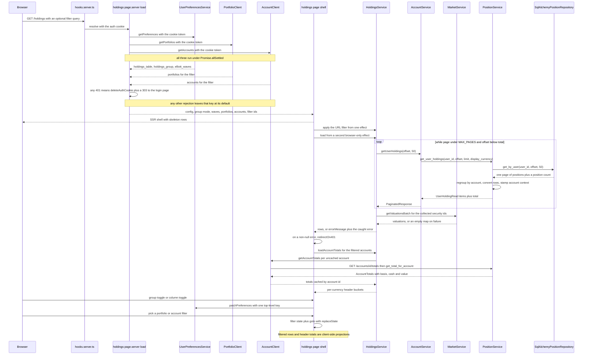
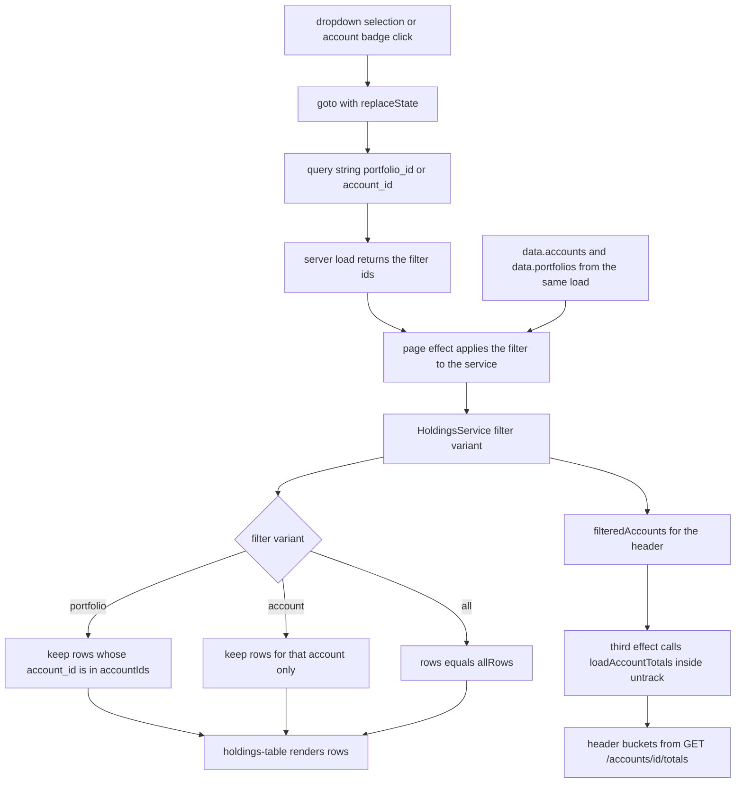
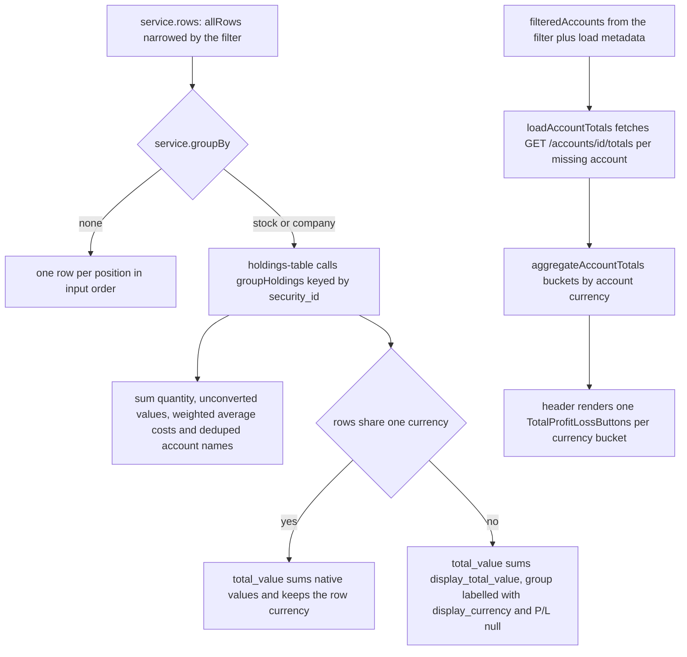

# Accounts & Holdings Views (read path)

This page owns the three read surfaces that show stored positions to a user, plus
the aggregation contract behind them. The SvelteKit shell, SSR conventions, the
post-navigation data wave and the `ApiClient` layer are described in
[Frontend Architecture](../architecture/frontend.md); the backend money/currency
model is owned by [Money & Currency Handling](../concepts/money-and-currency.md).
Neither is re-derived here.

| Surface | Route | Backing endpoints | Where the rows come from |
| --- | --- | --- | --- |
| Accounts dashboard | `/` | `GET /accounts/`, plus one `GET /accounts/{id}/totals` and (on expand) one `GET /accounts/{id}/holdings` per rendered account | the account list is awaited in the load; each row fetches its own totals client-side and its holdings only when expanded |
| Account-scoped holdings | `/accounts/[id]` | `GET /accounts/{account_id}/holdings` | awaited in the load |
| Cross-account holdings | `/holdings` | `GET /accounts/me/preferences`, `GET /portfolios`, `GET /accounts/` in the load; then `GET /accounts/holdings` (paged), `POST`-style batch valuations and one `GET /accounts/{id}/totals` per filtered account after navigation | preferences and filter metadata in the load; rows and per-account totals fetched after navigation by a page-owned `HoldingsService` |

A fourth, narrower read — `GET /accounts/holdings/{security_id}` — is consumed by
the security detail page and the holdings modal, not by these three routes; it is
described below because it shares the same service and repository contract.

## Backend read contract

The holdings responses are Pydantic shapes in `src/account/schema.py`, plus the
`AccountTotals` API type in `src/account/api_types.py`:

- **`HoldingRead`** — one position turned into a display row. It carries three
  currencies' worth of the same value:
  - native/position values: `security_currency` (position currency, falling back
    to security currency), `unconverted_total_value` and
    `unconverted_profit_loss`, both expressed in `security_currency`;
  - account-currency values: `currency`, `total_value`, `profit_loss`,
    `converted_average_cost`, `converted_latest_price`;
  - the user's display currency: `display_currency` and `display_total_value`.
  Plus identity and price metadata: `id`, `security_id`, `security_symbol`,
  `security_name`, `quantity`, `average_cost`, `latest_price`, `price_date`,
  `updated_at`.
- **`UserHoldingRead`** — `HoldingRead` plus `account_id` / `account_name`. This is
  the cross-account row.
- **`AccountHoldingsRead`** — a `PaginatedResponse[HoldingRead]` (`items`, `total`,
  `offset`, `limit`) extended with `account_id`, `account_name`, `total_value`,
  `total_profit_loss`, `total_profit_loss_percent`, `profit_loss_basis`
  (`'net_deposits' | 'cost'`), `net_deposits`, `free_cash`, `broker_value`,
  `broker_value_at`, `currency`, `unpriced_positions` and `pricing_incomplete`.
- **`AccountHoldingRead`** — the per-security row (`account_id`, `account_name`,
  `quantity`, `average_cost`, `total_value`, `currency`,
  `display_total_value`, `display_currency`, `account_total_value`,
  `account_percentage`).
- **`AccountTotals`** — the `/accounts/{id}/totals` and dashboard payload:
  `cost`, `value`, `cash` and `profit_loss` as `Money`, `net_deposits` as
  `Money | None`, `return_percent`, `basis`, `unpriced_positions` and
  `pricing_incomplete`.

`PositionService` (`src/account/service/position.py`) is the only aggregation
layer. Every number in these shapes comes from `_calculate_holdings` /
`_calculate_holding`, which resolve each position's security and latest price and
convert through `_currency_convert` into the account currency (and, for the
user-wide reads, on into the user's display currency). `get_user_holdings`,
`get_account_holdings`, `get_total_for_account` and `get_holdings_by_security` all
call into that pair; none reimplements it.

### Display currency comes from the user's preferences

`GET /accounts/holdings` and `GET /accounts/holdings/{security_id}` resolve
`display_currency` server-side through `UserApi.get_display_currency(user_id)`
(`src/auth/api.py`), which reads the `display_currency` preference and defaults to
`"CAD"`. The value is passed into the service and surfaces as
`display_total_value` / `display_currency` on every row, so a client can aggregate
across accounts without adding different currencies together. `display_currency`
is validated against `SUPPORTED_DISPLAY_CURRENCIES` (`CAD`, `USD`, `EUR`, `GBP`)
when written through the preferences endpoints.

### `get_user_holdings` — cross-account

```python
positions, total = await self._position_repository.get_by_user(user_id, offset, limit)

positions_by_account: dict[AccountId, list[PositionSchema]] = {}
for position in positions:
    positions_by_account.setdefault(position.account_id, []).append(position)

result_items: list[UserHoldingRead] = []
for account_id, account_positions in positions_by_account.items():
    account = await self._account_service.get_account(account_id)
    holdings, _, _, _ = await self._calculate_holdings(account, account_positions, display_currency)
    result_items.extend(
        UserHoldingRead(
            **holding.model_dump(),
            account_id=account.id,
            account_name=account.name,
        )
        for holding in holdings
    )

return result_items, total
```

Load-bearing properties:

1. **The endpoint pages positions, not accounts and not holdings.**
   `PositionRepository.get_by_user` counts `PositionModel` rows joined to the
   user's `AccountModel` rows, so `total` on `GET /accounts/holdings` is the
   *position* count, not the number of accounts.
2. **A page boundary can split one account's rows.** Pagination happens in the
   repository before the service regroups by account, so an account whose positions
   straddle an offset can appear in two different pages. The service only ever sees
   the subset inside the requested window and emits rows for it.
3. **`_calculate_holdings` runs per account, on the page's subset.** One
   `AccountService.get_account` call per distinct account in the page (not per
   position), then per-position security + latest-price lookups.
4. **Account context is stamped after per-row conversion.**
   `UserHoldingRead(**holding.model_dump(), account_id=account.id, account_name=account.name)`
   converts each `HoldingRead` first, so the account id/name are pure additions and
   every `HoldingRead` field keeps its `_calculate_holding` semantics.
5. **Row order is account-first-appearance**, not the repository's
   `order_by(PositionModel.id)`: the service iterates the grouped dict. Both
   surfaces sort client-side anyway.
6. **Rows can be fewer than the position count in two different ways.** A position
   whose security cannot be resolved is dropped (`_calculate_holdings` logs
   `"Security not found for position ..."`, counts it and `continue`s), while a
   position whose security resolves but has no stored price still yields a row via
   `_unpriced_holding` with `total_value=0.0` and `profit_loss=None`. Both cases
   increment the returned `unpriced_positions` count, so the page's row count can be
   smaller than `total` without the gap being invisible.

### `_calculate_holding` — one position's math

`_calculate_holding` returns `(HoldingRead, value_money, pl_money)`:

- `unconverted_total_value = current_price_money * quantity`, then converted into the
  *position* currency (`position.currency or security.currency`) and reported as
  `unconverted_total_value` alongside `security_currency`.
- `unconverted_cost = quantity * average_cost` in the position currency, and
  `unconverted_profit_loss = unconverted_total_value - unconverted_cost`.
- `value_money = _currency_convert(unconverted_total_value, account.currency)` and
  `cost_money = _currency_convert(unconverted_cost, account.currency)`;
  `profit_loss = value_money - cost_money`. **The account-currency P/L is
  cost-basis P/L** — current value minus what the position cost.
- `converted_average_cost` / `converted_latest_price` are the same two inputs in the
  account currency, provided for display.
- `display_total_value = _currency_convert(value_money, display_currency)`, where
  `display_currency` defaults to the account currency (so account-scoped rows report
  `display_total_value == total_value`).
- `latest_price` is the raw close in the security currency and `price_date` its date.

`_currency_convert` short-circuits when the currencies match and otherwise rounds the
converted amount to two decimals.

### `_calculate_holdings` — the per-account loop and its totals

`_calculate_holdings(account, positions, display_currency=None)` returns
`(holdings, total_value, total_cost, unpriced_positions)`:

- `total_value` accumulates each priced position's `value_money` and `total_cost`
  accumulates `value_money - pl_money`, both in the **account** currency.
- A missing security is logged, counted and skipped.
- A position with no stored price is counted and *also* returned as a row
  (`_unpriced_holding`: `total_value=0.0`, `profit_loss=None`,
  `converted_latest_price=None`, but with the converted average cost preserved), so
  the position is visible without corrupting the totals.
- `unpriced_positions` therefore counts both cases and is what
  `pricing_incomplete` is derived from.

### `_account_performance` — the shared basis decision

Both account-scoped totals paths funnel their per-account numbers through
`_account_performance`, which is why `get_total_for_account` and
`get_account_holdings` can never disagree:

```python
cash = self._currency_convert(Money(account.free_cash, account.currency), currency)
value = positions_value + cash
cost = positions_cost + cash

if net_deposits is not None:
    basis = "net_deposits"
    profit_loss = value - net_deposits
    return_percent = pl / net_deposits * 100 if net_deposits != 0 else None
else:
    basis = "cost"
    profit_loss = positions_value - positions_cost
    return_percent = pl / positions_cost * 100 if positions_cost != 0 else None

return AccountTotals(cost=cost, value=value, cash=cash, net_deposits=net_deposits,
                     profit_loss=profit_loss, return_percent=return_percent, basis=basis,
                     unpriced_positions=unpriced_positions,
                     pricing_incomplete=unpriced_positions > 0)
```

- `free_cash` is added to **both** `value` and `cost`; in the cost branch it is
  deliberately excluded from the P/L denominator, which stays `positions_cost`.
- The basis is a *stored-account* property: as soon as `account.net_deposits` is
  set, the reported P/L becomes `value − net_deposits` — deposits and withdrawals
  move it without any position changing — and `profit_loss_basis` tells the UI
  which reading it is looking at. A zero `net_deposits` keeps the basis but yields
  `return_percent = None`.
- `unpriced_positions > 0` sets `pricing_incomplete`, which both UIs render as an
  amber warning ("Some positions are missing prices. They are excluded from these
  totals.").

### `get_account_holdings` — account-scoped

`get_account_holdings(account_id, offset=0, limit=50)` resolves the account, then
calls `PositionRepository.get_by_account(account_id)` **without** a limit to compute
`total_value` / `total_profit_loss` over *all* positions through
`_calculate_holdings` + `_account_performance`, and only then fetches the paginated
page of positions for `items`. `total` is the account's full position count.

Consequence for the UI: on `/accounts/[id]` the header totals cover every position
of the account (plus cash) while the table body covers at most one page, and the
header P/L may be the net-deposits figure rather than a sum of cost-basis gains —
see the pagination invariant below.

### `get_total_for_account` — the dashboard badge and the `/holdings` header

`get_total_for_account(account_id, currency)` walks the account's positions
(unlimited `get_by_account`), converts `positions_value` / `positions_cost` into the
requested `currency` when it differs from the account currency, and then calls
`_account_performance` with that currency. It prices positions through
`_calculate_holdings` (i.e. `get_latest_price`), whereas
`get_holdings_by_security` uses `get_latest_close` — a distinction the service tests
document explicitly. This is the single method behind
`GET /accounts/{id}/totals`, the dashboard badge and the `/holdings` header buckets,
so all three report the same basis.

`src/account/task.py` re-runs the same method for every active account in a Huey
task and broadcasts an `AccountTotalsUpdatedMessage` over the WebSocket; the frontend
surfaces in this page do **not** subscribe to that message — they invalidate on
sync completion instead (see the dashboard section).

### `get_holdings_by_security` — per-security reads

`PositionRepository.get_holdings_by_security` selects `account_id`,
`account_name`, `quantity` and `average_cost` joined to the user's accounts, and
returns `AccountHoldingRead` stubs with `total_value=0.0`, `currency=""`,
`display_total_value=0.0` and `display_currency=""` as explicit placeholders.
`PositionService.get_holdings_by_security` then fills them:
`total_value = quantity * latest_close` (security currency),
`display_total_value` the same value converted into `display_currency` (which
defaults to the account currency), `account_total_value` from
`get_total_for_account` (one call per returned row), and `account_percentage` only
when the account total is above zero. If the security is unknown the method returns
`([], 0)` — an empty list that is ambiguous with "no holdings", flagged in a `TODO`
in the source.

### Router surface

`src/account/router.py` exposes:

- `GET /accounts/holdings` → `PositionService.get_user_holdings`, returning
  `PaginatedResponse[UserHoldingRead]`. User scoping is implicit in the repository
  join on `AccountModel.user_id`.
- `GET /accounts/{account_id}/holdings` → ownership check
  (`authorization_api.check_entity_owned_by_user`) before
  `PositionService.get_account_holdings`, returning `AccountHoldingsRead`. The same
  check is used by `/accounts/{account_id}/totals`; it raises 404 both for a missing
  account and for one owned by somebody else, hiding existence.
- `GET /accounts/holdings/{security_id}` → `PositionService.get_holdings_by_security`
  with the user's display currency.
- `GET /accounts/{account_id}/totals` → `PositionService.get_total_for_account`
  (the dashboard badge and the `/holdings` header). It accepts an optional
  `?currency=` query parameter that is upper-cased, validated against
  `SUPPORTED_DISPLAY_CURRENCIES` (422 otherwise) and defaults to the account's own
  currency; the account update form uses the same response.
- `GET`/`PUT`/`PATCH /accounts/me/preferences` → `UserApi.get_preferences` /
  `save_preferences` / `patch_preferences`. `PATCH` calls
  `payload.model_dump(exclude_none=True)` and merges at the **top level** via
  SQLAlchemy `JSONB || JSONB`, so one key per write is the race-safe shape.

Pagination parameters come from `src/core/pagination.py`: `offset` defaults to `0`
and `limit` defaults to `50` with `ge=1, le=100`.

## The `/holdings` read path: preference-only SSR, post-navigation paging

`/holdings` is the one holdings surface that does **not** fetch rows in its server
load. `frontend/src/routes/holdings/+page.server.ts` reads the `auth_token` cookie,
the `portfolio_id` / `account_id` query parameters, and issues three requests in
parallel with `Promise.allSettled`:

```ts
export const load: PageServerLoad = async ({ fetch, cookies, url }) => {
	const token = cookies.get('auth_token');
	const portfolio_id = url.searchParams.get('portfolio_id');
	const account_id = url.searchParams.get('account_id');

	let holdings_table_config = normalizeHoldingsTableConfig(null);
	let group_mode = normalizeHoldingsGroupMode(null);
	let elliott_waves: Record<string, SecurityElliottWaves> | null = null;
	let portfolios: Portfolio[] = [];
	let accounts: Account[] = [];

	try {
		const [prefsResult, portfoliosResult, accountsResult] = await Promise.allSettled([
			getUserPreferencesService(fetch).getPreferences(token),
			getPortfolioClient(fetch).getPortfolios(token),
			getAccountClient(fetch).getAccounts(token)
		]);

		for (const res of [prefsResult, portfoliosResult, accountsResult]) {
			if (res.status === 'rejected' && res.reason instanceof ApiError && res.reason.status === 401) {
				deleteAuthCookie(cookies);
				throw redirect(303, '/auth/login?clear_session=true');
			}
		}

		// fulfilled results fill holdings_table_config, group_mode, elliott_waves,
		// portfolios and accounts; a rejection simply leaves the defaults in place.
	} catch (err) {
		// Re-throw the 303 redirect; swallow every other failure as non-fatal.
	}

	return { holdings_table_config, group_mode, elliott_waves, portfolios, accounts, portfolio_id, account_id };
};
```

Load-bearing properties of this load:

1. **Preferences, portfolios and the account list are awaited, holdings rows are
   not.** The three reads run concurrently; a rejected portfolio or account read
   degrades to an empty list rather than failing the page, so a preference or
   filter-metadata outage does not hide holdings.
2. **A 401 is the one non-fatal exception.** Each settled result is inspected: a
   rejected result whose reason is an `ApiError` with `status === 401` triggers
   `deleteAuthCookie(cookies)` and a `throw redirect(303, ...)`. The outer `catch`
   re-throws exactly that redirect (matching on `status === 303`) and swallows
   everything else — without the re-throw the redirect would be swallowed too.
3. **The filter is URL-driven, not client-derived from scratch.** The load reads
   `portfolio_id` / `account_id` from the query string and returns them, and the
   page's first `$effect` re-applies the corresponding filter to the service.
4. **The rows still arrive after navigation.** The server load never calls
   `getUserHoldings`; a test pins that. The browser-only `$effect` calls
   `service.load()` once per mount, and a second effect then requests the
   per-account performance totals.



The sequence shows the four phases of the page's data life: a non-fatal SSR load of
preferences and filter metadata, a browser-only sequential paging loop that fills the
rows (followed by one batch valuation read), a second browser-only wave that fills
the per-account performance totals driving the header, and user interactions that
write single preference keys or change the client-side filter.

### The paging loop lives in `HoldingsService.load()`

`frontend/src/lib/components/holdings/holdingsService.svelte.ts` is the only
implementation of the collect-every-page contract:

```ts
const PAGE_SIZE = 50;
// Safety valve against a stale `total` from the server: never page forever.
const MAX_PAGES = 100;

async load(token?: string | null): Promise<unknown | null> {
	this.isLoading = true;
	this.errorMessage = null;

	try {
		const collected: UserHolding[] = [];
		let offset = 0;
		let total = Infinity;

		for (let page = 0; page < MAX_PAGES && offset < total; page++) {
			const response = await this.client.getUserHoldings(offset, PAGE_SIZE, token);
			collected.push(...response.items);
			total = response.total;
			offset += PAGE_SIZE;

			if (response.items.length === 0) break;
		}

		this.rows = collected; // setter assigns allRows

		// One batched valuation read for every distinct security in the collected rows,
		// in its own try/catch: a failure empties `valuations` but keeps the rows.
		const uniqueSecurityIds = Array.from(
			new SvelteSet(collected.map((h) => h.security_id).filter(Boolean))
		);
		// getValuationsBatch(...) → this.valuations; a rejection stores {}

		return null;
	} catch (error) {
		this.errorMessage = error instanceof Error ? error.message : String(error);
		return error;
	} finally {
		this.isLoading = false;
	}
}
```

- `PAGE_SIZE = 50` matches the backend `PaginationParams` default and the
  repository defaults. `MAX_PAGES = 100` caps the loop at 5 000 rows because the
  server's `total` can be stale relative to concurrent position writes.
- The loop stops early on an empty page — the second stale-total guard. Together
  the cap and the empty-page exit are why an inconsistent `total` degrades to a
  truncated list rather than an infinite request waterfall.
- Pages are requested **sequentially**, not in parallel: each iteration awaits the
  previous response, so the offsets are deterministic (`0, 50, 100, …`).
- `load()` never throws. It stores the message in `errorMessage` and *returns* the
  caught value (`null` on success) so the caller can route a 401 through the shared
  async-data seam. `isLoading` toggles around the whole loop, which is what drives
  the skeleton rows.
- On failure the previously loaded `rows` are kept (the assignment happens only
  after the loop completes), and a later success clears `errorMessage`.
- After the last page the loop makes **one batched valuation read** —
  `marketClient.getValuationsBatch(uniqueSecurityIds, token)` — for the distinct
  `security_id`s collected, storing the result in `valuations` as a map keyed by
  `security_id` with `lower_bound` / `upper_bound` coerced to numbers. That call has
  its own nested `try/catch`: a failure (or no securities at all) sets `valuations`
  to `{}` and leaves the rows intact, so a valuation outage cannot fail the holdings
  load.
- `rows` is a getter over the `allRows` array plus the active `filter`, and its
  setter writes `allRows`. The paging loop therefore always stores the *complete*
  cross-account set; filtering never mutates what was fetched.
- `groupedHoldings` is a `$derived` over `groupHoldings(this.rows, this.groupBy)`,
  but the page does not consume it — it passes the raw `service.rows` plus a
  `groupBy` prop to the table, which re-runs `groupHoldings` itself. The service
  derivation is currently exercised only by `holdingsService.test.ts`.

### The second post-navigation wave: per-account totals

The header totals are **not** computed from the loaded rows. `HoldingsService`
exposes a separate, cached totals store:

```ts
accountTotals = $state<Record<string, AccountTotals>>({});

async loadAccountTotals(accountIds: string[], token?: string | null) {
	const uniqueIds = Array.from(new SvelteSet(accountIds));
	const missing = uniqueIds.filter((id) => this.accountTotals[id] === undefined);
	if (missing.length === 0) return null;

	const results = await Promise.allSettled(
		missing.map(async (id) => ({ id, totals: await this.accountTotalsClient.getAccountTotals(id, token) }))
	);

	let firstError: unknown = null;
	for (const result of results) {
		if (result.status === 'fulfilled') this.accountTotals[result.value.id] = result.value.totals;
		else if (firstError === null) firstError = result.reason;
	}
	if (firstError !== null) {
		this.errorMessage = firstError instanceof Error ? firstError.message : String(firstError);
	}
	return firstError;
}
```

- Ids are deduplicated with a `SvelteSet` and any account already in `accountTotals`
  is skipped, so a filter change only pays for accounts it has never seen. The cache
  is never invalidated by the service; a full page reload is what refreshes it.
- `getAccountTotals(id, token)` sends no `currency` parameter, so the backend
  defaults to the account's own currency — which is exactly what the per-currency
  header buckets need.
- Requests run in parallel under `allSettled`, so one failing account is omitted
  from the buckets while the others still render; the first failure's message lands
  in `errorMessage` and therefore in the same `holdings-error` alert as a failed
  holdings load.

### Failure semantics after navigation

`+page.svelte` owns the error policy, and it is deliberately different from the two
loads that fetch in SSR:

```ts
$effect(() => {
	void (async () => {
		const loadError = await service.load();

		if (loadError !== null) {
			await redirectOn401(loadError);
		}
	})();
});

const errorMessage = $derived(persistError ?? service.errorMessage);
```

- A 401 goes through `redirectOn401` (`$lib/api/async-data.ts`), which `goto`s
  `/auth/login?clear_session=true` and returns `true`. The httpOnly `auth_token`
  cookie is **not** deleted client-side — `hooks.server.ts` clears it when the login
  page is resolved.
- Any other error returns `false` and the message lands in the `holdings-error`
  `Alert`. The shell survives: no SvelteKit error page, and the page still renders
  its header and table.
- The same alert is used for preference-write failures (`persistError`) and for
  `loadAccountTotals` failures, so a failed load, a failed totals request and a
  failed `PATCH` are visually indistinguishable apart from their text.

By contrast, the `/` and `/accounts/[id]` loads keep the standard SSR error
contract: `ApiError` 401 → `deleteAuthCookie(cookies)` then
`redirect(303, '/auth/login?clear_session=true')`; any other `ApiError` →
`error(status, message)`; anything else → `error(500, 'Internal Server Error')`.
SSR requests pass `cookies.get('auth_token')` explicitly as a Bearer override
because `ApiClient.get` only adds `Authorization: Bearer <token>` when a token
override is supplied (it always sends `credentials: 'include'`), and the browser
cookie is not automatically replayed on the internal server-side fetch. The
client-side helpers are token-less for the same reason — same-origin browser
requests carry the cookie themselves.

### Portfolio and account filter seam

`/holdings` also carries a client-only filter that narrows the already-loaded rows
without touching the network. `HoldingsService` owns it as a single discriminated
`filter` state plus a `rows` getter:

```ts
export type HoldingsFilter =
	| { type: 'all' }
	| { type: 'portfolio'; portfolioId: string; accountIds: string[] }
	| { type: 'account'; accountId: string };

allRows = $state<UserHolding[]>([]);
filter = $state<HoldingsFilter>({ type: 'all' });

get rows(): UserHolding[] {
	const filter = this.filter;
	if (filter.type === 'portfolio') {
		return this.allRows.filter((r) => filter.accountIds.includes(r.account_id));
	}
	if (filter.type === 'account') {
		return this.allRows.filter((r) => r.account_id === filter.accountId);
	}
	return this.allRows;
}

filterByPortfolio(portfolioId: string, accountIds: string[]) { /* sets the portfolio variant */ }
filterByAccount(accountId: string) { /* sets the account variant */ }
clearFilter() { /* resets to { type: 'all' } */ }
```

- The filter is a **membership test over `account_id`**, not a query parameter on
  `getUserHoldings`. A portfolio filter keeps rows whose `account_id` is in the
  portfolio's account id list (a portfolio is a grouping of accounts — see
  [Portfolios](portfolios.md)); an account filter keeps rows for that one account;
  with no filter, `rows` is `allRows` unchanged. `groupedHoldings` derives from
  `rows`, so grouping and filtering compose.
- **The URL is the source of truth, and the load reads it.** `+page.server.ts` pulls
  `portfolio_id` / `account_id` from the query string and returns them; the page's
  first `$effect` maps them back onto the service (`filterByPortfolio(id,
  portfolio.accounts.map(a => a.id))`, `filterByAccount(id)`, or `clearFilter()`), so
  a shared or reloaded URL restores the view.
- **A user selection `goto`s with `replaceState: true`** (`noScroll`, `keepFocus`
  too), not a bare history push: `/holdings?portfolio_id=…`, `/holdings?account_id=…`
  or `/holdings` to clear. `keepFocus` matters because the selection comes from a
  dropdown, and `replaceState` keeps the filter out of the history stack.
- **The same selection drives the header.** `filteredAccounts` is derived from the
  filter variant plus the load's `accounts` / `portfolios`: `all` yields every
  account, `portfolio` the portfolio's members, `account` the single account. A
  third `$effect` maps those to ids and calls `service.loadAccountTotals(ids)` inside
  `untrack`, so the cache writes inside the service do not become dependencies of the
  effect — a filter change reloads only the accounts whose totals are not cached yet.
  Clicking an account badge in the table reuses `handleSelectFilter('account', id)`.
- **Every rejection except a 401 degrades to an empty option list.** The three
  `allSettled` reads are independent, so a portfolios or accounts failure empties
  only that picker while holdings still render; the filter *metadata* therefore
  fails like preferences do.
- The page derives its breadcrumb (Holdings → optional portfolio → optional account),
  the empty message ("No holdings match the selected filter." when the filter hides
  an otherwise non-empty set, otherwise "No holdings yet. Import an account to see
  your holdings here.") and the "All accounts" option label from `service.filter`
  and the loaded metadata.



The diagram shows the filter as a pure client-side projection of the paged rows that
simultaneously selects which accounts' server totals the header is built from, with
the URL both driving and mirroring the selection.

## Client-side rendering: grouping, sorting, per-currency header buckets

`frontend/src/routes/holdings/+page.svelte` constructs its own
`new HoldingsService()`, calls `service.setGroupBy(data.group_mode)` at
initialization, and renders `$lib/components/holdings/holdings-table.svelte` with
`holdings={service.rows}`, `groupBy={service.groupBy === 'stock' || service.groupBy === 'company' ? 'stock' : null}`,
`isLoading={service.isLoading}`, `tableConfig`, `onConfigChange`,
`onAccountClick`, `onValuationChange`, `elliottWaves` and `valuations`. Toggling
grouping only changes `service.groupBy` and picking a portfolio/account filter only
changes `service.filter` — both are pure client-side derivations over the
already-fetched `allRows`, so no refetch happens in either case.



The diagram shows the two independent derivations: table grouping for the body (from
the rows) and per-currency bucketing for the header (from the accounts' server
totals). The two never feed each other.

### `groupHoldings` and mixed currencies

`frontend/src/lib/utils/finance/holdings-group.ts` implements both modes:

- `none` returns one `HoldingsGroup` per row, in input order, with
  `key = id = row.id`, `account_names` from `row.account_name` and
  `account_count: 1`.
- `stock` (and the legacy alias `company`, handled identically) keys strictly on
  `security_id`, so one security held in several accounts collapses to exactly one
  row. Groups are never reordered — they follow first appearance.
- `aggregateGroup` sums `quantity`, `total_value`, `display_total_value`,
  `unconverted_total_value` (falling back to `total_value` when the field is absent)
  and the P/L values (a `null` P/L stays `null` until a row contributes, then sums
  numerically), and computes **quantity-weighted** averages:
  `average_cost = Σ(quantity × average_cost) / Σ(quantity)` over rows with a
  non-null cost, and the same shape for `converted_average_cost` using the
  account-currency cost. `account_names` are trimmed, deduplicated and ordered by
  appearance; `account_count` counts distinct `account_id`s.
- **Mixed currencies are handled explicitly.** `aggregateGroup` collects the set of
  row currencies: a single-currency group keeps the row currency and sums native
  `total_value`; a mixed-currency group takes `total_value = display_total_value`
  (already converted by the backend), labels the group with the first row's
  `display_currency`, and forces `profit_loss = null` because per-row P/L is never
  converted. `security_currency`, `latest_price` and `price_date` come from the
  group's first row.

`frontend/src/lib/components/holdings/holdings-table.svelte` is presentational. It
takes `holdings`, `groupBy`, `isLoading`, `emptyMessage`, `tableConfig`,
`onConfigChange`, `onAccountClick`, `onValuationChange`, `elliottWaves` and
`valuations`; builds one `HoldingRowView` per displayed row from either the grouped
branch (`groupHoldings(holdings, 'stock')`) or the flat branch (both branches project
the Elliott-wave and valuation columns); sorts with `sortColumn` (default
`total_value`) and `sortDirection` (default `desc`), placing null/non-finite cells
last in both directions and sorting the EW columns by upside with the target as
fallback; and renders the column set from `config.visible`. Per-row shares are
computed from `display_total_value`, never from native values:

- `percent_of_total` = the row's `display_total_value` over the sum of
  `display_total_value` across the displayed holdings, rendered in the **Allocation**
  column (`account_name`) next to the account badges.
- each account badge carries `percent_of_account`, the account's summed
  `display_total_value` over that account's share of the displayed total.
- `profitLossPercent(row)` = `profit_loss / (quantity × (converted_average_cost ??
  average_cost ?? 0))`, omitted when the cost basis is zero or the P/L is null.

The Elliott Wave columns come from the `elliott_waves` preference read in the same
load (`getLatestWaveCount` / `getWaveTargetPrice` / `calculateUpsidePercentage` from
`$lib/utils/finance/elliott-wave`), and the Valuation Range column from
`marketClient.getValuationsBatch` plus the `valuation-modal.svelte` edit flow:
`onValuationChange` writes the saved valuation back into `service.valuations` so the
cell updates without a reload. Both are display-only projections over the same rows,
covered by [Charting, Drawing Tools & Rewind](../architecture/charting.md).

### Per-currency header totals

`+page.svelte` builds `currencyTotals` from the **accounts' server totals**, not
from the rows:

```ts
const filteredAccounts = $derived.by<Account[]>(() => { /* filter variant + data */ });

const currencyTotals = $derived.by(() => {
	const inputs: AccountTotalsInput[] = [];
	for (const account of filteredAccounts) {
		const totals = service.accountTotals[account.id];
		if (totals) inputs.push({ accountId: account.id, currency: account.currency, totals });
	}
	return aggregateAccountTotals(inputs);
});
```

`frontend/src/lib/utils/finance/account-totals.ts` sums those per-account
`AccountTotals` into one bucket per **account currency**:

- `totalValue` sums each account's `value` (which already includes `free_cash`) and
  `profitLoss` sums each account's `profit_loss` — so the bucket inherits the
  backend basis rather than recomputing a client-side approximation.
- `returnPercent` is `sum(profit_loss) / sum(net_deposits)` when **every** account in
  the bucket reports `basis === 'net_deposits'`; otherwise the denominator falls back
  to `sum(value − profit_loss)` and the bucket is labelled `"mixed basis"`. The
  label is `"net deposits basis"` in the all-net-deposits case. `basisAmount` is the
  summed `net_deposits` in that case and `null` otherwise — it is passed as
  `costBasis` so the tooltip shows the real basis amount instead of a derived
  `value − profit_loss`.
- `returnPercent` is `null` when the denominator is zero; `aggregateAccountTotals`
  returns no buckets for no inputs.

Each bucket renders through `TotalProfitLossButtons` with
`testIdPrefix={`currency-${total.currency}`}`, producing
`currency-{CUR}-total-value`, `currency-{CUR}-profit-loss`,
`currency-{CUR}-return-percent` and `currency-{CUR}-profit-loss-value`. Buckets are
never summed across currencies, and a bucket disappears entirely while its accounts'
totals are still loading or if every one of them failed.

## The accounts dashboard and the account-scoped page

### The accounts dashboard

`/` is the only one of the three surfaces that does not read holdings rows in its
server load. `frontend/src/routes/+page.server.ts` loads the account list with
`getAccountClient(fetch).getAccounts(token)` → `GET /accounts/`
(`AccountRepository.get_by_user`, ordered by account name) and
`frontend/src/routes/+page.svelte` renders `AccountsList` from `data.accounts`.

Each row then reads its own totals through `accounts-list-item.svelte`, whose
`AccountsListItemState.totals` derived returns a browser-only promise from
`accountClient.getAccountTotals(id)` → `GET /accounts/{id}/totals` →
`PositionService.get_total_for_account(account_id, account.currency)`. On the server
(`!browser`) the derived returns a promise that never settles, which is why the row
renders a skeleton during SSR. The awaited totals feed `TotalProfitLossButtons` with
`costBasis={totals.basis === 'net_deposits' ? totals.net_deposits : totals.cost}` and
a matching basis label, plus the same amber `pricing_incomplete` warning; a rejected
request renders "Total: failed to load".

Expanding a row lazily fetches `GET /accounts/{id}/holdings` through the same state
object and renders `AccountInlineHoldings` from the response's `items` — so the
dashboard does render holdings rows, one page of them, only after the user expands an
account. Both caches are keyed by account id and dropped together by
`invalidateCache`, which is called when an in-flight sync finishes
(`wasSyncing && !isSyncing`) and after a CSV import succeeds. The account name links
to `/accounts/{id}`.

### The account-scoped page

`frontend/src/routes/accounts/[id]/+page.server.ts` calls
`getAccountClient(fetch).getAccountHoldings(params.id, token)` (token again from
`cookies.get('auth_token')`) → `GET /accounts/{id}/holdings` → the router's
ownership check → `PositionService.get_account_holdings`, and returns the whole
`AccountHoldingsRead` as `data.holdings`. The page renders its header from that
payload through `TotalProfitLossButtons` (`total_value`, `total_profit_loss`,
`total_profit_loss_percent`, `currency`) with `costBasis={data.holdings.net_deposits}`
and `basisLabel` from `profit_loss_basis`, plus a currency badge and the
`pricing_incomplete` warning; the body from `data.holdings.items`; and the account's
identity from `data.holdings.account_name` (an `EditableTitle` posting to the
`renameAccount` form action) rather than from a sibling load.

The body is the separate presentational
`frontend/src/lib/components/accounts/holdings-table.svelte`, which takes `holdings`
and `totalAccountValue`, has no column configuration or grouping, sorts by any
`Holding` field (default `total_value` desc), shows native-currency values with the
account-currency value as a secondary line when the currencies differ, and annotates
each row with its share of the account total. The page renders the table only when
`data.holdings.items.length > 0`; an empty account shows nothing but the header.

## Preferences persistence contract

Two preference keys drive these surfaces, both persisted through
`UserPreferencesService` (`frontend/src/lib/api/userPreferencesService.ts`) and both
declared on `UserPreferences`:

- `holdings_table` — the whole `HoldingsTableConfig` (`widths` record plus `visible`
  id list).
- `holdings_group` — the group mode (`'none' | 'stock' | 'company'`).

A third preference, `display_currency`, is *not* read by these pages: it is applied
server-side by the holdings routers when they compute `display_total_value`. See
[User Preferences](../concepts/user-preferences.md).

**One key per write.** `frontend/src/lib/components/holdings/holdings-table-prefs.ts`
and `holdings-group-prefs.ts` expose `saveHoldingsTableConfig(service, config)` and
`saveHoldingsGroupMode(service, mode)`, each issuing exactly one
`service.patchPreferences({ holdings_table: config })` /
`patchPreferences({ holdings_group: mode })`. Because the backend `PATCH` merges
the JSON body at the top level (`preferences || payload` in
`src/auth/repository_sqlalchemy.py`), writing a single top-level key cannot drop
another component's key — a concurrent `timeframe` or `sidebar_open` write survives.
Nested values are replaced wholesale, so a second writer of the *same* key is still
last-write-wins.

**Injected service, not the module singleton.** Both modules declare only a
structural `{ getPreferences(tokenOverride?), patchPreferences(prefs, tokenOverride?) }`
type, so callers and tests pass any instance instead of importing the module-level
`userPreferencesService`. This is what keeps SSR free of shared mutable state (the
"no global instances" rule in `frontend/AGENTS.md`, gotcha 3). The page holds one
`getUserPreferencesService()` instance for its write path.

**Normalize on both ends of the pipe.**

- `normalizeHoldingsTableConfig(raw)` turns anything into a usable config: missing,
  non-object or empty input returns the default config (all columns visible, default
  widths); unknown column ids are dropped in both `widths` and `visible` (which is
  how the retired `average_cost`, `percent_of_total` and `profit_loss_percent` ids
  disappear from stored configs); widths are clamped by `clampColumnWidth` to the
  per-column min/max maps (non-finite values fall back to the default width); the
  surviving `visible` ids are re-ordered to the canonical `HOLDINGS_TABLE_COLUMN_IDS`
  order; the sticky column is force-included; an empty or entirely invalid `visible`
  list falls back to all columns; the result is always a fresh object that does not
  alias the defaults.
- `HOLDINGS_TABLE_STICKY_COLUMN_ID` is `'security_symbol'` and is never hideable:
  `toggleColumnVisibility` returns the same config object unchanged for it (only
  identity-stable, no clone), the page's column menu item is `disabled`, and the
  table's sticky cell plus the loading skeletons are rendered off that constant.
- `normalizeHoldingsGroupMode(raw)` returns `'stock'` for `'stock'` and the legacy
  `'company'`, and `'none'` for everything else — including `'STOCK'`, numbers,
  objects and `null`. A stored `'company'` therefore still renders grouped, and the
  next save writes `'stock'`.
- `loadHoldingsTableConfig` / `loadHoldingsGroupMode` swallow a rejected
  `getPreferences()` and return the defaults; the page's own SSR path does the same
  inline (it normalizes `prefs?.holdings_table` / `prefs?.holdings_group` after a
  single `getPreferences` call rather than calling the two loaders).

**Ownership split for the table config.** The page owns `tableConfig` state and
persistence; `holdings-table.svelte` derives `config` from the `tableConfig` prop via
`normalizeHoldingsTableConfig`, keeps a local copy for immediate drag feedback, and
emits the finished config once per drag through `onConfigChange` (called on pointer
up with the clamped width). Column visibility toggles in the page's display-settings
dropdown call `saveHoldingsTableConfig` directly. Both paths route failures into
`persistError`, rendered as an `Alert` with `data-testid="holdings-error"`; the
optimistic UI change stays applied. The group toggle behaves the same way and calls
`saveHoldingsGroupMode(prefsService, mode)`.

## Invariants an editor must not break

1. **`GET /accounts/holdings` paginates positions.** Its `total` is a position
   count produced by `PositionRepository.get_by_user` (positions joined to the user's
   accounts), so `items` is a page of *positions*: one account can contribute several
   rows, and the row count in a page can be smaller than `total` even for a
   single-page response. Nothing in the payload is per-account, and no field equals
   the number of accounts the user owns.
2. **The service regroups after the page is fetched.** Because of (1), a single
   account's positions can be split across pages; per-account aggregation inside
   `get_user_holdings` therefore only ever sees the page's subset. Do not move
   grouping before pagination without revisiting the client's collect-all loop.
3. **`UserHoldingRead` conversion happens before account stamping.**
   `_calculate_holdings` runs once per account and produces `HoldingRead`s; the
   `account_id` / `account_name` fields are layered on with
   `UserHoldingRead(**holding.model_dump(), account_id=account.id, account_name=account.name)`.
   Reordering those steps (for example building rows straight from positions)
   changes `currency`, `security_currency` and every `converted_*` field for
   cross-currency accounts.
4. **The `/holdings` server load returns no holdings rows and no totals.** It must
   not start awaiting holdings: the shell-first contract (skeletons first, rows after
   navigation) and the post-navigation 401 path both depend on the load returning
   only `holdings_table_config`, `group_mode`, `elliott_waves`, `accounts` and
   `portfolios`. A test asserts that `getUserHoldings` is never called from `load`.
5. **The client loops pages with `PAGE_SIZE = 50` and `MAX_PAGES = 100`.**
   `total` may be stale, so the loop must keep both the hard page cap and the empty
   page early exit. Both constants live only in `holdingsService.svelte.ts`; adding a
   second copy elsewhere re-introduces the drift the old SSR loop had.
6. **A preferences or account-list failure is non-fatal.** The SSR read stays inside
   one `try/catch` that falls back to `normalizeHoldingsTableConfig(null)`,
   `normalizeHoldingsGroupMode(null)`, `elliott_waves = null`, `accounts = []` and
   `portfolios = []`. Lifting that catch turns a preference outage into a failed page
   even though the rows load fine afterwards.
7. **Header totals come from the accounts' server totals and are never summed across
   currencies.** `currencyTotals` buckets `service.accountTotals` by `account.currency`
   through `aggregateAccountTotals`; recomputing them from `service.rows` would lose
   the backend basis (net deposits vs cost) and the `free_cash` component of
   `value`.
8. **`get_total_for_account` and `get_account_holdings` must keep sharing
   `_account_performance`.** The two paths are asserted to agree on value, P/L,
   percent and basis for the same account; inlining the basis logic into one of them
   re-opens the divergence where the dashboard badge and the account page header
   could report different P/L kinds.
9. **`free_cash` is part of `value` and `cost`, but not of the cost-basis P/L
   denominator.** The denominator stays `positions_cost` (or `net_deposits`) so cash
   cannot inflate the return percentage.
10. **Unpriced positions are reported, not hidden.** A missing security is skipped
    and a missing price still yields a row with `total_value=0` / `profit_loss=None`;
    both increment `unpriced_positions` and therefore `pricing_incomplete`, which both
    UIs surface. Do not "fix" a zero-value row by dropping it or by valuing it at
    cost.
11. **The account-scoped page renders one page of rows but all-position totals.**
    `AccountClient.getAccountHoldings` sends no pagination parameters, so the backend
    defaults apply (`offset = 0`, `limit = 50`), while `AccountHoldingsRead.total` is
    the account's full position count and `total_value` covers every position plus
    cash. Accounts with more than 50 positions show truncated rows next to complete
    header totals until the client passes pagination.
12. **`groupHoldings` never adds native values across currencies.** A single-currency
    group sums `total_value`; a mixed-currency group sums `display_total_value` and
    reports `profit_loss = null`. Any change to per-group currencies or to
    `aggregateGroup`'s sums must be made together with the group-row rendering.
13. **The sticky column stays visible.** Hiding `security_symbol` collapses the
    sticky layout: `toggleColumnVisibility` refuses it, the menu disables it, and
    `normalizeHoldingsTableConfig` re-adds it to any stored `visible` list.
14. **The portfolio/account filter never refetches holdings.** `rows` is a membership
    test over `account_id` on `allRows` in memory; the only side effects are the
    `goto` with `replaceState: true` that updates the URL and the `loadAccountTotals`
    call for the newly filtered accounts. Sending the filter to `getUserHoldings`
    instead would break the collect-all paging contract, because the endpoint
    paginates positions and has no account or portfolio parameter.
15. **The totals cache is append-only and filter-shaped.** `loadAccountTotals` skips
    ids already in `accountTotals`, so a filter that returns to a previously seen
    account reuses the cached `AccountTotals`; adding invalidation requires an
    explicit decision about which event (sync completion, websocket totals message)
    should clear it.

## Extension points and safe-change notes

**Adding a holdings column or column id.** Add the id to
`HOLDINGS_TABLE_COLUMN_IDS`, the `HOLDINGS_TABLE_COLUMNS` entry (label +
`alignRight`), and the `HOLDINGS_TABLE_DEFAULT_WIDTHS` /
`HOLDINGS_TABLE_COLUMN_MIN_WIDTHS` / `HOLDINGS_TABLE_COLUMN_MAX_WIDTHS` maps;
`clampColumnWidth` falls back to the global min/max if a map entry is missing, so an
omitted bound degrades quietly rather than failing. Then extend `HoldingRowView`
and populate it in **both** `baseRows` branches of `holdings-table.svelte` (the
grouped branch reads from `HoldingsGroup`, so `groupHoldings` may need a matching
field), add the render branch, and add the `valueFor` case if sorting should use a
derived value. Stored configs are forward-compatible (unknown ids are dropped), but
a *new* id is absent from an existing stored `visible` list and therefore starts
hidden for users who have ever saved a config.

**Changing the sticky column.** `HOLDINGS_TABLE_STICKY_COLUMN_ID` is used by the
visibility guard, the menu's `disabled` check, the sticky cell in `holdingRow` and
the skeleton cells. Change the constant, not the call sites.

**Adding a group mode.** Extend `HoldingsGroupMode` in `holdings-group.ts`, add the
branch in `groupHoldings`, extend `normalizeHoldingsGroupMode` (unknown persisted
strings intentionally collapse to `'none'`), then wire the control in
`+page.svelte`. The `holdings_group` preference accepts any string, so old values
must keep normalizing safely. Note the page currently renders a single boolean
"Group by stock" checkbox whose checked state covers both `'stock'` and `'company'`.

**Changing page size or pagination assumptions.** `PAGE_SIZE` / `MAX_PAGES` exist in
exactly one place,
`frontend/src/lib/components/holdings/holdingsService.svelte.ts`. The backend side
is `PaginationParams` (`limit` default 50, hard ceiling 100) and the repository
defaults (`get_by_user(..., limit=50)`, `get_by_account(..., limit=None)`).
`AccountClient.getAccountHoldings` is the one client call that does not pass
pagination, so adding `offset`/`limit` there is the change that lets the
account-scoped page render more than the first 50 positions.

**Changing what the endpoint paginates.** `PositionRepository.get_by_user` currently
pages `PositionModel` rows for the user's accounts. Switching to per-account or
per-holding pagination changes the meaning of the response's `total` and would break
invariant 1; it also lets a caller no longer recover a full cross-account view by
looping offsets, which is exactly what `HoldingsService.load` does.

**Adding a currency.** `display_total_value` conversion happens in the service through
`CurrencyConverter`; the display currency itself is validated against
`SUPPORTED_DISPLAY_CURRENCIES` in the preferences model and in the
`/accounts/{id}/totals` route. Adding a currency means extending that tuple, and
`aggregateAccountTotals` needs no change because it keys buckets by whatever currency
each account reports.

**Changing the P/L basis rules.** Both totals paths and both UIs read `basis` /
`profit_loss_basis` and `net_deposits`. If the basis rule changes, update
`_account_performance` (the single source), then the `basisLabel` mappings in
`total-profit-loss-buttons.svelte` consumers and the `'mixed'` fallback label in
`account-totals.ts`; `tests/services/test_position_service.py` pins the agreement
between the two service paths.

**Adding a filter dimension.** The filter is a discriminated `HoldingsFilter` union
in `holdingsService.svelte.ts`, so a new dimension needs: a new variant plus a
`filterBy*` setter, a clause in the `rows` getter, a clause in the page's
`filteredAccounts` derivation (the header follows the filter), a query-parameter read
in `+page.server.ts` (returned in `data`) and a matching branch in the page's
first `$effect`, an option list in the load's `allSettled` trio, and a
`goto(..., { replaceState: true })` call in `handleSelectFilter`. Keep every new
read inside the same `allSettled` so a failure degrades to an empty option list and
a 401 still redirects.

**Adding a preference key.** Declare it on `UserPreferences`
(`frontend/src/lib/api/userPreferencesService.ts`), read it inside the existing
non-fatal `try/catch` in `+page.server.ts` using
`getUserPreferencesService(fetch).getPreferences(token)`, pass it through the `data`
return, and persist it with a single top-level key through `patchPreferences` —
ideally via a small `load*`/`save*` helper module that takes the injected structural
service type so SSR keeps no shared instances. Add a `normalize*` function for
anything a browser could have stored in an older shape. The portfolio/account filter
deliberately is **not** such a key: it lives in the URL instead.

**Operational characteristics to preserve.** Each holdings page request fans out
into per-position security and latest-price lookups, and `get_account_holdings`
walks the account's positions twice (once unlimited for totals, once paginated).
`get_holdings_by_security` additionally calls `get_total_for_account` once per
returned row. Raising `limit`, or removing the `MAX_PAGES` cap, multiplies those
lookups; keep the safety valve and prefer fixing `total` over looping unbounded.
`/holdings` adds one `GET /accounts/{id}/totals` per uncached filtered account
(all-position walks again), so widening the default filter widens that fan-out.

## Focused tests

Frontend suites are row-scoped: every API client module and framework module that
performs network or browser work is mocked (`$app/paths`, `$app/navigation`,
`$lib/api/accountService`, `$lib/api/accountClient`, `$lib/api/marketService`,
`$lib/api/userPreferencesService`, `$lib/api/valuationClient`), per the
`frontend/AGENTS.md` testing rule — the holdings suites never call the backend, and
all holdings math that is asserted numerically is asserted by the backend suites.
Backend suites mock every outbound dependency (`PositionRepository`,
`AccountService`, `SecurityApi`, `MarketPricesApi` as `AsyncMock`s) and never touch
the network; the router tests run against the Postgres test container.

| Suite | What it pins |
| --- | --- |
| `frontend/src/routes/holdings/page.server.test.ts` | The SSR load returns `holdings_table_config`, `group_mode`, `elliott_waves`, `portfolios`, `accounts`, `portfolio_id` and `account_id`; it **never** calls `getUserHoldings`; a rejected preferences request still yields `HOLDINGS_TABLE_DEFAULT_CONFIG`, `'none'`, `null` waves, an empty portfolio list and an empty account list; a 401 from any of the three reads deletes the cookie and throws the 303 redirect. |
| `frontend/src/routes/holdings/page.svelte.test.ts` | Mocks `$app/paths`, `$app/navigation`, `$lib/api/accountService`, `$lib/api/accountClient`, `$lib/api/marketService`, `$lib/api/userPreferencesService` and `$lib/api/valuationClient`. Covers the shell-first contract (skeletons plus the persisted column config render before the async load resolves), rows appearing with no user action, sequential paging, per-currency header buckets built from the account totals (CAD `$1,500.00` / `+11.11%` from summed net deposits, USD `US$200.00` / `+US$20.00`, exactly two buckets, never summed), the filtered account's totals used verbatim (including cash), the `mixed basis` and `net deposits basis: $850.00` tooltips, negative-return styling, a zero denominator dropping the pill while keeping the dollar P/L, the totals request starting before the rows resolve, a failed totals request omitting that account and reusing the `holdings-error` banner, the icon-only display-settings trigger, grouping collapsing rows without calling `getUserHoldings` and un-grouping again, a persisted `group_mode` restoring checked state, toggling persisting `{ holdings_group: 'stock' }`, the empty state message, a failed load showing the alert while the shell survives, a 401 calling `goto('/auth/login?clear_session=true')`, a failed persistence write showing the alert while the optimistic toggle stays applied, a server-supplied column config rendering, hiding/restoring a column and persisting a `holdings_table` payload without that id, `elliott_waves` reaching the EW projection cells, a valuation saved in the modal updating the cell in place, the `portfolio_id` filter narrowing both the rows and the header total, the account badge click and the breadcrumb dropdowns `goto`-ing with the right query, and `valuation_range` toggling plus persisting. |
| `frontend/src/lib/components/holdings/holdingsService.test.ts` | Initial state (`rows` empty, `isLoading` false, `groupBy 'none'`, empty `valuations` and `groupedHoldings`); `isLoading` toggles around one request; three pages are collected with offsets `[0, 50, 100]` and the token forwarded on every call; an empty first page stops paging (stale-total guard); a failure stores the message and keeps previous rows; non-`Error` throws are stringified; a later success clears the error; `load()` resolves `null` on success and returns the caught `ApiError(401)` otherwise; `groupedHoldings` reacts to `setGroupBy('stock' \| 'company')` with merged quantity and `account_count` and to the filter; the portfolio and account `rows` filters; `getHoldingsService(customFetch)` returns an isolated instance; the batched valuation read uses distinct `security_id`s and numeric bounds, degrades to `{}` on failure without failing the load, and is skipped for empty holdings; `loadAccountTotals` fetches missing accounts in parallel, caches by id, deduplicates, threads the token, omits a failed account while keeping the others and storing the message, and short-circuits when everything is cached. |
| `frontend/src/lib/utils/finance/account-totals.test.ts` | `aggregateAccountTotals` returns no buckets for no inputs; a single account's bucket matches its totals including cash; `basisAmount` sums net deposits for an all-net-deposits bucket and is `null` for a mixed one; buckets split per currency with `sum(pl)/sum(net_deposits)` for the net-deposits case and `sum(pl)/sum(value − pl)` plus the `mixed basis` label otherwise; a zero denominator omits `returnPercent`; a missing `net_deposits` counts as zero. |
| `frontend/src/lib/components/holdings/holdings-table.test.ts` | Presentational behaviour of the big table: sorting via header clicks (including inner-button bubbling, numeric columns, null-last, Return, EW columns), resize handles not triggering sorts, one row per holding with `/security/{id}` links, account badges and the blank-account dash, dual-currency native/account display, grouping into one row per stock with combined badges, grouped-row sorting, empty state and custom message, skeleton rows, the `Account` vs `Accounts` header swap, sticky/zebra styling, the Valuation Range cell and modal flow, and config handling (custom widths, hidden columns, empty-state colspan, fallback for an invalid stored config). |
| `frontend/src/lib/components/holdings/holdings-table-columns.test.ts` | `clampColumnWidth` bounds, rounding and non-finite fallback; the 9-column id/label set (no `average_cost`, `percent_of_total` or `profit_loss_percent`, EW and `valuation_range` columns present); `toggleColumnVisibility` hide/restore, canonical ordering, and identity-stable refusal to hide the sticky column; `normalizeHoldingsTableConfig` defaults for garbage input, width merge plus dropping of unknown and legacy ids, clamping, visible filtering and canonical ordering, sticky force-include, all-visible fallback for an empty list, JSON round-trip, and no aliasing of the defaults. |
| `frontend/src/lib/components/holdings/holdings-table-prefs.test.ts` | `loadHoldingsTableConfig` reads and normalizes the stored key, tolerates missing/empty/garbage configs and a rejected request, and never writes on load; `saveHoldingsTableConfig` calls `patchPreferences` exactly once with `{ holdings_table: config }`; a round-trip through the real `UserPreferencesService` against a mocked fetch hits `/accounts/me/preferences` with `GET` then `PATCH` and the exact body. |
| `frontend/src/lib/components/holdings/holdings-group-prefs.test.ts` | `normalizeHoldingsGroupMode` maps `'stock'`/`'company'` to `'stock'` and everything else to `'none'`; load tolerates missing keys and rejected requests; save patches exactly `{ holdings_group: mode }`; the real-service round-trip asserts the `GET`/`PATCH` endpoint and body. |
| `frontend/src/lib/api/accountService.test.ts` | `getUserHoldings(offset, limit, token)` builds `/accounts/holdings?offset=…&limit=…`, defaults to `0`/`50`, sends `credentials: 'include'` and forwards the token as a Bearer header — the client contract the paging loop depends on. |
| `frontend/src/lib/utils/finance/holdings-group.test.ts` | Strict one-group-per-`security_id` merging with summed aggregates, both quantity-weighted average costs, combined/deduped account names and `account_count`; `'company'` behaving as `'stock'`; first-appearance ordering; a security held in accounts with different currencies collapsing into one row whose `total_value` is the sum of `display_total_value`, labelled with the display currency and with `profit_loss === null`; a single-currency group keeping the row currency and summing native values; null-safety for P/L and average cost; partial P/L summing; empty input; `'none'` producing one group per row in original order without merging. |
| `frontend/src/routes/accounts/[id]/page.svelte.test.ts` | The account header renders `TotalProfitLossButtons` (`total-value-btn` `$1,000.00`, `profit-loss-btn` `+10.00%` / `+$100.00`) instead of the old labelled stat columns, and the incomplete-pricing warning appears exactly when `pricing_incomplete` is true. |
| `tests/routers/test_accounts.py` | `test_account_totals_success` (cost/value/cash as `Money`, `net_deposits`, `profit_loss`, `return_percent`, `basis == "cost"`), `test_account_totals_not_found`/`_not_owned` (404), `test_account_totals_converts_to_requested_currency` (`?currency=USD`), `test_account_totals_unsupported_currency_returns_422`; `test_user_holdings_success_across_accounts` (two accounts, `total == 2`, every `HoldingRead` field including `display_total_value`, `latest_price` and `price_date` plus account context), `test_user_holdings_isolation`, `test_user_holdings_pagination` (three positions across three accounts, `total == 3` while `limit=2` pages them disjointly), `test_user_holdings_empty`; `test_account_holdings_success`/`_returns_broker_value`; the security-holdings tests including calculated values, display conversion and the zero-value default; preference round-trip, partial-merge and cross-component-isolation tests. |
| `tests/routers/test_account_unauth.py` | `GET /accounts/holdings` returns 401 without auth, alongside the unauthenticated cases for the preferences `GET`/`PUT`/`PATCH` endpoints and account rename. |
| `tests/services/test_position_service.py` | `get_user_holdings` groups the repository's positions per account, returns `UserHoldingRead` items stamped with the right `account_id`/`account_name`, preserves quantities and symbol, forwards `(user_id, 0, 50)` to `get_by_user`, and resolves the account only once per account rather than once per position; the display-currency conversion of `display_total_value` for USD and CAD accounts and for `get_holdings_by_security`; `free_cash` being added to `value` and `cost` on both paths; the net-deposits basis (`total_value − net_deposits`, `return_percent`, `basis`), the cost basis excluding cash from the denominator, and a zero `net_deposits` keeping the basis with a `null` percent; `test_total_and_holdings_agree_on_performance` and `test_total_and_holdings_agree_on_unpriced_account` asserting the two paths agree; unpriced positions excluded from totals while still returned as `total_value == 0` / `profit_loss is None` rows with `unpriced_positions == 1` and `pricing_incomplete is True`; a missing security skipped, logged and counted with `items == []`. |

The neighbouring `average-cost.ts` and `holdings-metrics.ts` helpers (with their
`*.test.ts` suites) cover `blendedAverageCost`, the candle/benchmark calculations and
the percent-of-total / percent-of-account formatters used by the holdings table; none
of them is part of the backend aggregation contract.
