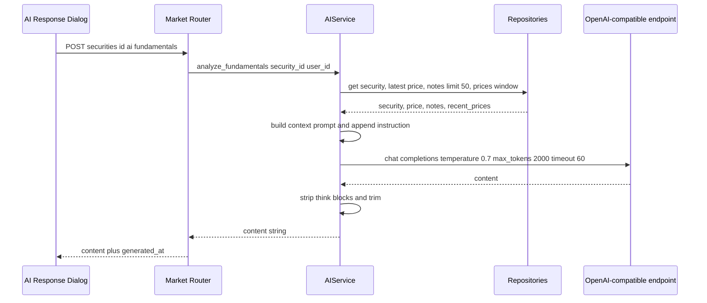
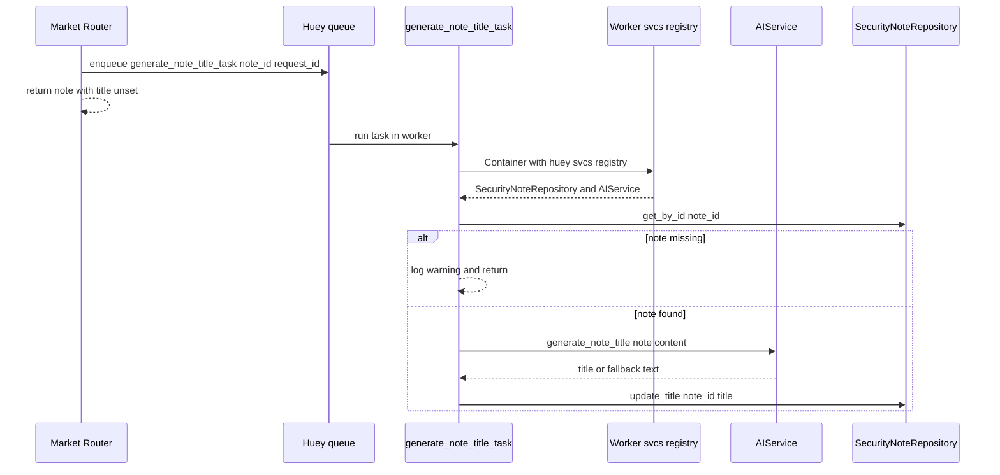

# AI Analysis Flows

The AI feature set is small and lives almost entirely in one service, `AIService` (`src/market/ai_service.py`), registered in the `svcs` container and consumed by two very different callers: three synchronous HTTP endpoints in the market router, and one asynchronous Huey task that generates note titles after a note is created or updated. Because both paths reach the same OpenAI-compatible client, the config, timeout and failure semantics described here apply to both. The transport-level details of the provider are catalogued in [External Services](../integrations/external-services.md); this page covers the flows, the payloads, and the invariants an agent must keep when editing prompts.

## Where AI sits in the stack

| Concern | Owner |
| --- | --- |
| Context assembly, prompt building, provider calls, title fallback | `AIService` (`src/market/ai_service.py`) |
| Request/response HTTP surface, rate limits, error mapping | `market_router` AI endpoints (`src/market/router.py` L1176–L1251) |
| Async title generation and note write-back | `generate_note_title_task` / `_generate_note_title` (`src/market/task.py` L26–L58) |
| Provider construction and settings | `ai_service_factory` (`src/market/ai_service.py` L360–L369), registered by `register_market_services` (`src/market/__init__.py` L108) |
| Stub implementation | `StubAIService` (`src/stubs/ai.py`), bound to `AIService` by `register_market_stub_services` (`src/config/services.py` L175) |
| Frontend client and UI | `frontend/src/lib/api/aiService.ts`, `frontend/src/lib/components/actions-sidebar/ai/` |

## Context assembly

Every public analysis method begins with `_gather_context(security_id, user_id)` (`src/market/ai_service.py` L57–L108), which fans out to three repositories before any provider call:

- `SecurityRepository.get_by_id_or_fail(security_id)` — the implementation (`src/market/repository_sqlalchemy.py` L81–L87) raises `SecurityNotFoundError` for an unknown id, so a bad security produces no partial prompt and **no provider call**. That error is an `EntityNotFoundError`, not a `RuntimeError`, so it reaches the app-level handler (`src/main.py` L252–L259) and the route answers **404** with an `{"error": ...}` body instead of the 503 mapping below.
- `PriceRepository.get_latest_price(security)` — the latest stored close, or `None` if the security has no price history. The concrete implementation is the EODHD-wrapping repository (`src/market/repository_eodhd.py` L62–L83), which also backfills through the gateway when the stored row predates the previous NYSE trading day (weekends and `holidays.NYSE()` are skipped), fetching up to seven days and returning the last row of the result.
- `SecurityNoteRepository.get_by_security_and_user(security_id, user_id, limit=50)` — the user's **most recent** notes for that security, ordered `created_at desc` and capped at 50 (`src/market/repository_sqlalchemy.py` L1088–L1107).
- `PriceRepository.get_prices(security, from_date, to_date)` — the window runs from **the first day of the current month minus 90 days** to today (`today.replace(day=1) - timedelta(days=90)`, `src/market/ai_service.py` L77–L78). The repository contract defaults to `limit=50` (`src/market/repository.py` L68–L76) and `_gather_context` passes neither `offset` nor `limit`, so the stored-row read is capped at 50 — but the live EodhdPriceRepository merges the gateway's rows for the same window into that set, saves the union and returns the merged list sorted by date (`src/market/repository_eodhd.py` L27–L59).

The assembled `AIContext` is a `TypedDict` with four keys: `security` (`symbol`, `name`, `exchange`, `currency`), `current_price` (`price`, `date`) or `None`, `notes` (each `{content, created_at}`), and `recent_prices` (each `{date, close}`, already trimmed to the **last 30 rows** of the fetched window at `src/market/ai_service.py` L106). Floats are converted from `Decimal`, dates to ISO strings, so the prompt never depends on provider-side serialization.

`_build_context_prompt` (`src/market/ai_service.py` L168–L224) renders that context into plain text and then appends the caller's instruction. Three details matter when changing it:

- Only **five** notes reach the model and each note body is truncated to 200 characters (`notes[-5:]`, `note['content'][:200]`). Because the repository returns the notes **newest-first**, that slice is the five *oldest* of the fetched page of 50 — not the five most recent. Whoever wants the newest notes in the prompt has to change the slice, not the repository.
- The price-trend block computes the percentage change between the first and last of the 30 recent closes and is labelled `Recent Price Trend (last 30 days)` — a fixed string, and the block is row-counted, not calendar-dated. If `recent_prices` is empty the whole block is omitted; if `current_price` is `None` the current-price line is omitted.
- The prompt always ends with a fixed "concise, well-structured analysis" instruction, so a caller-specific prompt is additive, not a replacement.

Degradation is therefore graceful but silent: a security with no price history and no notes still produces a prompt containing only the security fields plus the instruction, and nothing in the response tells the caller that context was missing.

## The three request/response endpoints

All three are `POST`, require an authenticated user (`Depends(current_user)`), are decorated `@limiter.limit("5/minute")` and return the same `AIAnalysisResponse` shape (`{content, generated_at}`, `src/market/schema.py` L312–L318) where `generated_at` is a fresh `datetime.now(UTC).isoformat()` stamped in the router — not a provider timestamp. Each handler wraps only the service call in `try/except`; resolving `AIService` from the container happens outside it.

| Endpoint | Service method | Request body | Notes |
| --- | --- | --- | --- |
| `POST /api/v1/market/securities/{security_id}/ai/fundamentals` | `analyze_fundamentals` | none — the handler takes only `Request`/`Response` for the limiter, `user`, `security_id` and the container, so a body is still ignored | Fixed prompt asking for valuation metrics, competitive position, growth drivers and risk factors. |
| `POST /api/v1/market/securities/{security_id}/ai/summarize-notes` | `summarize_notes` | none, same shape | Short-circuits to the literal `"No notes found for this security."` when the user has no notes — **no provider call is made**, so this path never returns 503/504. |
| `POST /api/v1/market/securities/{security_id}/ai/portfolio-debate` | `analyze_portfolio_fit` | the only one that declares `AIAnalysisRequest` (`portfolio_context: str \| None`) | The router substitutes `"No portfolio context provided."` for a missing or empty value before calling the service. |

All three handlers define the same exception mapping — `TimeoutError` → 504, `RuntimeError` → 503 with `str(e)` as `detail`, both raised `from None` (see below).

### Rate limiting

Each of the three routes carries its own `5/minute` decorator, evaluated by the shared slowapi limiter (`src/config/limiter.py` L12–L34) that is installed on the app with `app.state.limiter`, `SlowAPIMiddleware` and slowapi's default `RateLimitExceeded` handler (`src/main.py` L107–L110). Two consequences are worth knowing:

- The bucket key is `user_or_ip_key_func`: the `user_id`/`sub` claim of the `auth_token` cookie or `Authorization` header when it can be decoded with `settings.secret_key`, otherwise the remote address. Authenticated users are therefore limited per user, not per IP, and a request with an unreadable token falls back to IP.
- Storage is `memory://` when `ENVIRONMENT`/`settings.environment` is `test` and `settings.redis_url` otherwise, so limits are shared across API processes in production but never hit a Redis server in tests. Exceeding the limit yields HTTP **429** before the handler body runs — the AI service is never reached.

### Request sequence

Caption: one AI analysis request from the sidebar to the provider and back, including the repository fan-out that `_gather_context` performs before the call.

The frontend client `AIService` (`frontend/src/lib/api/aiService.ts`) mirrors exactly these three methods and posts `{}` as the body for the two bodyless routes. The sidebar group (`frontend/src/lib/components/actions-sidebar/ai/ai-analysis-group.svelte`), mounted by the security detail route, exposes them as "Explain Fundamentals", "Summarize Notes" and "Portfolio Debate"; the portfolio action currently sends the placeholder string `'Analyzing in isolation for now.'` as `portfolio_context` rather than real holdings. Results render in `ai-response-dialog.svelte`, which offers retry on failure and "Save as Note" — the latter posts to the notes endpoint and therefore itself re-triggers title generation. The sidebar that hosts these actions is documented in [Security Detail Page & Actions Sidebar](./security-detail-page.md).

`aiService.ts` has no colocated `*.test.ts` in this checkout and there is no rendering test for the two sidebar components, so the rule for frontend tests is a convention rather than an enforced one: **mock the `aiService` module** (as with every other API client), never call the endpoint.

## Provider call semantics and failure mapping

`_call_ai_api(prompt, context, timeout=60)` (`src/market/ai_service.py` L110–L166) wraps the SDK call and defines the failure contract the router depends on:

- The system message fixes the assistant persona ("helpful financial analysis assistant") and asks for markdown; the user message is the built context prompt.
- Request parameters are `temperature=0.7`, `max_tokens=2000`, `timeout=timeout` (60 s default). The model comes from `self._api_model`, i.e. `settings.ai_api_model`.
- Any exception is logged with `logger.exception("AI API request failed")` and re-raised as `RuntimeError("AI service unavailable: ...")` **from None**, so the traceback is suppressed, the message is the only signal, and the log line is the only place the underlying cause survives.
- Empty content calls `_raise_empty_response()`, which raises `RuntimeError("AI response content is empty")` **inside** the `try`, so the blanket `except` re-wraps it: what reaches the router is `RuntimeError("AI service unavailable: AI response content is empty")` — still a 503, but with the wrapped message.
- Non-string content is checked in the `else` branch, after the `try/except`, and raises `TypeError("AI response content is not a string")` (`src/market/ai_service.py` L153–L162). Nothing catches it in the route or the app's domain handlers, so it falls through to the catch-all handler at `src/main.py` L236–L249 and becomes a **500**; any change that makes content non-string is a behavior change, not a cosmetic one.
- DeepSeek-style ` thinking...` blocks are stripped with a DOTALL regex and the result is `.strip()`ed before returning.

The router maps these precisely: `TimeoutError` → **504** `"AI analysis timed out"`, `RuntimeError` → **503** with `str(e)` as `detail`. Both are raised `from None`, so the HTTP boundary carries no chained traceback. Only the provider call itself is normalized, though — everything `_gather_context` does happens *before* `_call_ai_api`, so failures there keep their own mapping:

| Failure | Where it is raised | HTTP result |
| --- | --- | --- |
| Provider timeout / SDK error / empty content | `_call_ai_api` | 503 (`TimeoutError` → 504) |
| Non-string content | `_call_ai_api` else-branch | 500 (catch-all handler) |
| Unknown `security_id` | `SecurityRepository.get_by_id_or_fail` | 404 (`EntityNotFoundError` handler) |
| Anything else from the price/note repositories, e.g. the EODHD client failing during `get_prices` | `_gather_context` | 500 (catch-all handler) |

The browser surfaces the `detail` string because `ApiClient.extractErrorMessage` reads `data.detail` first as the `ApiError` message (`frontend/src/lib/api/apiClient.ts`); note that a 404 from the `EntityNotFoundError` handler uses an `error` key instead, so the dialog falls back to a generic message on that path. The dialog always offers a retry button.

One operational side effect of that ordering: `_gather_context` calls the price repository directly, and the registered repository is synchronous underneath (`EodhdPriceRepository` calls `EodhdGateway`, which uses the blocking `requests`/EODHD client), so a cold price lookup inside an AI request blocks the event loop for the duration of the HTTP call rather than being pushed through `asyncio.to_thread` the way `MarketService` does it. In stub mode the gateway is `StubEodhdGateway` (`src/market/eodhd.py` L218–L223), so no network call happens at all.

## Model and credential configuration

`ai_service_factory` reads three settings and hands them to the constructor (`src/config/settings.py` L50–L53):

| Setting | Env var | Use |
| --- | --- | --- |
| `ai_api_endpoint` | `AI_API_ENDPOINT` | Base URL after `.replace("/chat/completions", "")` |
| `ai_api_key` | `AI_API_KEY` | `AsyncOpenAI` credentials |
| `ai_api_model` | `AI_API_MODEL` | Model for the three analysis calls |

The constructor builds `AsyncOpenAI(api_key=..., base_url=api_endpoint.replace("/chat/completions", ""))`, which is what allows `AI_API_ENDPOINT` to be either a bare base URL or a full completions path. Credential handling, the dev default endpoint and the "unset key only fails later" caveat belong to [External Services](../integrations/external-services.md) — do not duplicate them here.

**Configuration errors do not fail startup.** `Settings` validates `SECRET_KEY`, `MARKET_DATA_SERVICE_TOKEN` and the FMP/Polygon keys (`src/config/settings.py` L96–L153) but says nothing about `ai_api_key`, `ai_api_endpoint` or `ai_api_model`, and the lifespan hook eagerly resolves only `DataPlaneMarketGateway` (`src/main.py` L58–L66). `AIService` is built lazily on the first request, and `AsyncOpenAI` accepts an empty key, so a wrong endpoint or model surfaces as a **503 on the first analysis call** — or never at all, in stub mode.

One asymmetry is easy to miss: `generate_note_title` hard-codes `model="gpt-4-turbo"` and ignores `ai_api_model` entirely. It also uses very different parameters — `temperature=0.3`, `max_tokens=20`, `timeout=10` — so a provider that supports the analysis model but not `gpt-4-turbo` will silently degrade every note title to the fallback text.

## The note-title task path

Title generation is deliberately **not** part of the HTTP request. `market_create_note` and `market_update_note` (`src/market/router.py` L745–L783) persist the note and then enqueue `generate_note_title_task(created_note.id, request_id=get_request_id())`; the response returns the note with its title still unset.

The task flow through the worker registry:

1. `generate_note_title_task` is a plain `@huey.task()`. It reads the ambient `request_id` when none was passed, then calls `asyncio.run(_generate_note_title(...))` so the async body can run on a worker thread.
2. `_generate_note_title` returns immediately if `huey.svcs_registry is None` — the same guard the periodic price tasks use, and the reason tests must patch `src.market.task.huey.svcs_registry` (they patch it with a `MagicMock`). Note the difference in style: the price tasks raise on a missing registry, this one returns silently.
3. It rebinds the correlation id with `set_request_id(request_id)` and restores the context var token in a `finally` block, so the log line carries the originating request.
4. Inside `async with Container(huey.svcs_registry)`, it resolves `SecurityNoteRepository` and `AIService` from the registry, loads the note by id, and returns quietly with the warning `"Note %d not found for title generation"` if the note no longer exists (deleted between enqueue and execution).
5. On success it calls `ai_service.generate_note_title(note.content)` and writes the result back with `note_repository.update_title(note_id, title)`, whose SQLAlchemy implementation (`src/market/repository_sqlalchemy.py` L1152–L1160) is a no-op when the row is missing.

Two consequences are worth stating plainly. First, because `generate_note_title` never raises, the task body has no error path that could fail the note write: `market_create_note` and `market_update_note` return the persisted note regardless of what the provider does — including in stub mode, where `StubAIService` has no `generate_note_title` at all and the task raises `AttributeError` **after** the note is already committed (the default Huey behaviour leaves `title` unset; `huey.immediate = True` in tests would propagate it out of the request). Second, deleting a note between enqueue and execution is a supported race: the task logs and returns without touching the database, and `update_title` is itself a guarded no-op on a missing row.

The registry used here is the worker's own, built in `setup_worker_services` (`src/worker.py` L27–L50) on `@huey.on_startup` with a `NullPool` session manager, and it is the **same** `register_services` conditional that governs the HTTP process. `MemoryHuey` is selected when `settings.environment == "test"`, `RedisHuey` otherwise.

Caption: the asynchronous note-title path, from enqueue in the request to write-back through the worker's own `svcs` registry.

### Title constraints and the fallback

`generate_note_title(content)` is the only AI call with a resilience guarantee, and its shaping rules are part of the contract:

- The system prompt demands a title of **maximum 50 characters**; `MAX_TITLE_LENGTH = 50` (`src/market/ai_service.py` L21) is the enforced cap.
- After the call the result is stripped, a matching pair of surrounding double or single quotes is removed, and the string is finally sliced to `title_str[:MAX_TITLE_LENGTH]` — so an over-long title is truncated, not rejected.
- Empty content raises `RuntimeError("AI failed to generate a title")` and non-string content raises `TypeError("AI title is not a string")`, but **both are swallowed** by the enclosing `except Exception`, which logs and returns a fallback: `content[:MAX_TITLE_LENGTH - 3] + "..."` for long notes, else the raw content.
- Consequence: note creation and update can never fail because of the AI provider, and the stored `title` column can contain the note's own text. `SecurityNoteRead.title` is nullable (`src/market/schema.py` L248–L257), and the frontend note type marks it optional, so a title-less note is a normal state rather than an error.
- The two title helpers (`_raise_no_title` → `RuntimeError`, `_raise_title_type_error` → `TypeError`) exist only to be caught by the same `except Exception` a few lines below; they are documentation of the failure modes, not an exported error contract.

## Stub mode and testing

Stub selection is a single switch at the top of `register_services` (`src/config/services.py` L28–L33): when `settings.stub_external_api` is true it calls `register_integration_stub_services` and `register_market_stub_services` instead of the live `register_integration_services` / `register_market_services` pair. The two registrations of the AI key are what this page depends on:

- live: `register_market_services` (`src/market/__init__.py` L108) — `registry.register_factory(AIService, ai_service_factory)`;
- stub: `register_market_stub_services` (`src/config/services.py` L65–L66 and L175) — `registry.register_factory(AIService, StubAIService)`.

`StubAIService` (`src/stubs/ai.py`) accepts `*args, **kwargs`, so it is a drop-in for the constructor, and implements `analyze_fundamentals`, `summarize_notes` and `analyze_portfolio_fit` returning fixed markdown strings. It has **no** `generate_note_title` method — the stub therefore covers the three HTTP endpoints only, and any code path that resolves `AIService` and calls `generate_note_title` under stub mode will fail with `AttributeError`.

The test suite enables this mode globally: `tests/conftest.py` sets `os.environ["STUB_EXTERNAL_API"] = "true"` and `ENVIRONMENT="test"` at module import, before anything from `src` is imported, so the settings singleton and every registry built by `register_services` see stub mode. **AI calls must be stubbed in tests** — the suite never constructs `AsyncOpenAI` and requires neither an API key nor a reachable provider. Two mechanisms do the stubbing:

- Container-level: `STUB_EXTERNAL_API` resolves `AIService` to `StubAIService` for every test that goes through `register_services`; the same switch also selects `StubEodhdGateway` for the price context, so the AI flow is entirely offline in tests.
- Test-level: `tests/routers/test_notes.py` patches `src.market.task.Container` with a mock whose `aget` returns `AsyncMock(spec=AIService)` for `AIService` and a real `SqlAlchemySecurityNoteRepository` for `SecurityNoteRepository`, patches `huey.svcs_registry` with a `MagicMock`, patches `src.market.router.generate_note_title_task` to assert the enqueue arguments, and then awaits `_generate_note_title(...)` directly. This is the reference pattern for testing anything AI-related: mock the service, then drive the async inner function rather than the Huey wrapper. `huey.immediate = True` (set session-wide in `conftest.py`) keeps the rest of the worker synchronous.

That file is also the **only** test coverage this flow has: no test exercises the three analysis endpoints, `_gather_context`, or `AIService`'s provider call, and there is no frontend test for `aiService.ts` or the AI sidebar components. Any change to the prompt, the truncation rules or the error mapping is therefore unverified by the suite and must be reasoned about from the code.

## Invariants to preserve when changing prompts or payloads

- `_gather_context` is the only place that reads repositories for AI purposes; keep the ordering (security → latest price → notes → price window) so a failure still maps to the same error, and remember that `PriceRepository` is the EODHD-wrapping implementation, so `get_prices` can synchronously hit the market-data gateway and write the merged rows back to the database.
- The three analysis methods must keep returning `str` content suitable for `AIAnalysisResponse.content`; the router does no post-processing.
- The 60 s timeout default and the `temperature`/`max_tokens` values are the documented contract in [External Services](../integrations/external-services.md) — changing them changes the 504 boundary too.
- `summarize_notes` must keep its no-notes short circuit; removing it turns a cheap 200 into a provider call.
- `generate_note_title` must keep its total fallback and the 50-character cap, because the task writes the return value straight into the database with no validation.
- The title task must stay non-fatal: it may log, warn and return, but must never raise back into the note route or into the worker's task cycle.
- Any new AI method added to `AIService` that is reachable through the container should also be considered for `StubAIService`, or stub mode will surface it as an `AttributeError`.

## Related pages

- [External Services](../integrations/external-services.md) — provider credentials, endpoint configuration, stub counterparts and the security caveats of the AI boundary.
- [Security Detail Page & Actions Sidebar](./security-detail-page.md) — the route and sidebar that host the AI group and the note group.
- [Configuration, Dependency Injection & Cross-Cutting Runtime](../architecture/configuration.md) — `register_services`, the stub switch and the settings model behind the AI keys.
- [Backend Domains](../architecture/domains.md) — the layered structure `AIService` follows.
- [Testing](../operations/testing.md) — the suite-wide `STUB_EXTERNAL_API` setup and the mocking conventions used above.
- [Realtime, Background Jobs & the Worker](./realtime-and-background-jobs.md) — the Huey worker and `svcs` registry the title task runs inside.
