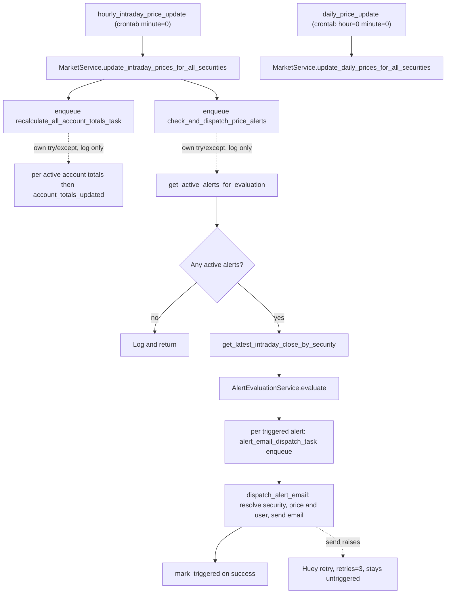
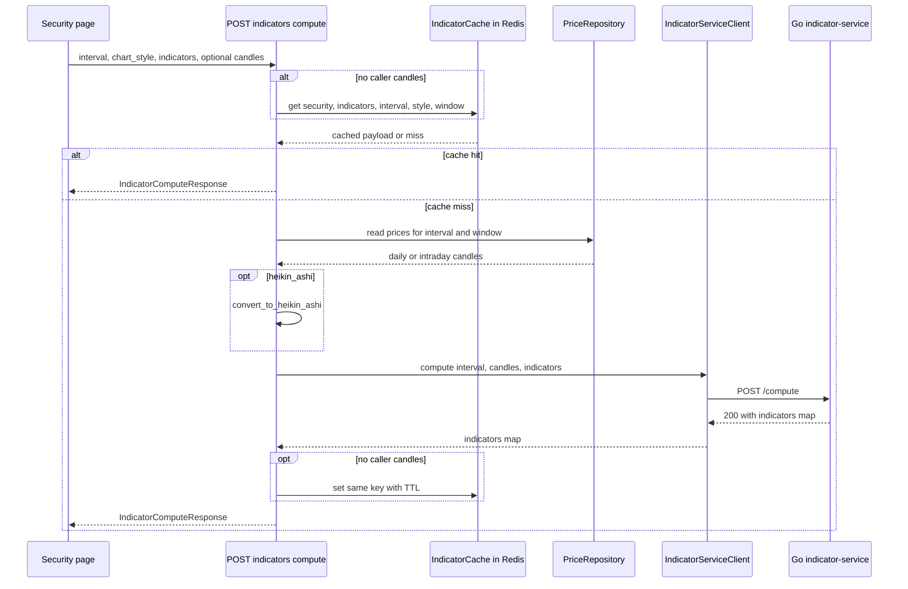

# Market Data, Indicators & the Price Update Cascade

Market data has three moving parts that must not be confused with one another:

1. **Ingestion** — prices are pulled from EODHD through the `MarketGateway` abstraction, persisted to Postgres, and re-read on demand (a *read-through* repository, `EodhdPriceRepository`).
2. **Scheduling** — three Huey periodic tasks live in `src/market/task.py`; two of them (`daily_price_update` nightly, `hourly_intraday_price_update` every hour) walk all active securities and, in the hourly case, fan out into a cascade of enqueued follow-up tasks.
3. **Derived series** — technical indicators are reachable through **two separate paths** on `market_router`: an in-process daily/weekly endpoint, and the chart's `POST /market/securities/{security_id}/indicators/compute` route that dispatches to a stateless Go sidecar (`services/indicator-service`) with Redis result caching.

The EODHD binding described here coexists with a second, provider-agnostic gateway (the FMP/Polygon composite) that serves only the service-to-service data plane; that split, its cache and its routes belong to [Market Data Providers](../architecture/market-data-providers.md) and are only summarised below.

See [Domains](../architecture/domains.md) for the module map and service registration, [Charting](../architecture/charting.md) for how the frontend consumes these series, [External Services](../integrations/external-services.md) for EODHD and the sidecar as outbound dependencies, and [Realtime & Background Jobs](./realtime-and-background-jobs.md) for the worker, its DI registries and the full task inventory.

## Ingestion: the EODHD-backed price repository

`EodhdPriceRepository` (`src/market/repository_eodhd.py`) decorates the SQLAlchemy `PriceRepository` with the `MarketGateway` and is the only implementation either registry binds to `PriceRepository` (`register_market_services` and the stub registry both use `eodhd_price_repository_factory`) — so *every* consumer, including accounts and portfolios, goes through the read-through path. It has five behaviours worth knowing:

- **`get_prices(security, from_date, to_date, …)` is read-through.** It reads the DB range, calls EODHD for the same range, then persists the union with **EODHD winning per date** (`merged = {p.date: p for p in new_prices}` and only DB dates absent from the EODHD result are kept). The merge is written back through the inner repository and returned as `(sorted_by_date_prices, total)`. A single date in the requested window therefore costs one API call and one write.
- **`get_latest_price` is lazy.** It returns the stored close only if it is already at or past the *last expected NYSE trading day* — computed by walking back from `today - 1 day` past weekends and `holidays.NYSE()` holidays. Otherwise it re-fetches the last 7 days through `get_prices` and returns the final row.
- **`get_price_on_date` falls back and persists.** A DB miss calls EODHD for that exact date, saves the result via the inner repository, and returns it; an EODHD miss returns `None`.
- **`get_by_security` is a pure DB read** — the one method that does *not* touch EODHD, which is why the indicator endpoints can call it for a whole price history without an API round trip.
- `save_price` / `save_prices` deliberately raise `NotImplementedError` — writes must go through the inner DB repository or `MarketService`.

The gateway itself (`src/market/eodhd.py`) is the only place that talks to EODHD. `EodhdGateway` uses `eodhd.APIClient` for prices and a raw `requests.get` for `https://eodhd.com/api/search/{query}`, and it builds the EODHD symbol as `f"{symbol}.{exchange}"`. `EodhdGateway.get_intraday_prices` supports **only the `1h` interval** and raises `ValueError` otherwise. Both the list-shaped and DataFrame-shaped EODHD responses are handled, and flat candles (`open == high == low == close` with zero volume) are dropped. `eodhd_gateway_factory()` (it takes no arguments) returns `StubEodhdGateway` when `settings.stub_external_api` is set — the same switch that makes tests hermetic.

### Which gateway serves which read

The two `svcs` keys are registered side by side in `register_market_services` and must not be conflated:

- `MarketGateway` → `eodhd_gateway_factory`, and `PriceRepository` → `eodhd_price_repository_factory`. The repository's factory builds its EODHD gateway *directly* (rather than resolving the container key), which is why the read-through path is permanently EODHD-backed regardless of what else is registered. Everything on the user-facing `market_router` (`/prices/{id}`, `/last-close`, `/search`, the indicator compute route) and everything the worker's `MarketService` writes goes through this binding.
- `DataPlaneMarketGateway` → `composite_market_gateway_factory`, the FMP/Polygon composite used only by the service-token `data_router` routes, whose responses are cached once by `EndpointResponseCache`. `CompositeMarketGateway.get_intraday_prices` forwards to FMP, which keeps the capability unsupported — so **intraday price data is EODHD-only**, never part of the data plane.

Provider routing, the data-plane cache, listing currency and the error taxonomy are documented in [Market Data Providers](../architecture/market-data-providers.md); do not re-derive them here.

### Reads from the API

`MarketService` (`src/market/service.py`) owns the scheduled writes and the ad-hoc backfill helpers; `market_router` owns the HTTP surface for reads:

| Endpoint | Handler | Behaviour |
|---|---|---|
| `GET /market/prices/{security_id}` | `market_get_prices` | Daily/weekly/monthly: `from_date` and `to_date` are **required** (else 422) and a reversed window is also 422; rows are read (limit 100000) and `1w`/`1m` are derived in-process by `aggregate_weekly_prices` / `aggregate_monthly_prices`. Intraday (`1h`/`4h`): reads `IntradayPriceRepository`, and if the result is empty or its first candle starts more than 4 days after `from_date`, calls `MarketService.fetch_and_save_intraday_prices` and re-reads. `4h` candles are produced by `aggregate_4h_candles`. |
| `GET /market/prices/{security_id}/last-close` | `market_last_close_price` | `PriceRepository.get_latest_price` — i.e. the read-through latest close. |
| `GET /market/search` and `GET /market/securities/search` | `market_search` (the same handler, aliased) | Cache-first against `SecuritySearchCache`, else `MarketGateway.search`, then cache write. |
| `POST /market/security` | `market_create_or_get_security` → `SecurityApi.create_or_get_from_search` | Creates the security if `code`+`exchange` are unknown and immediately backfills its history with `MarketService.fetch_and_save_price_history`, returning `has_price_data`. |
| `GET /market/securities/{security_id}/indicators` | `market_get_technical_indicators` | The in-process indicator path — see below. |
| `POST /market/securities/{security_id}/indicators/compute` | `market_compute_indicators` | The sidecar compute path — see below. |
| `GET` / `POST /market/securities/{security_id}/alerts`, `DELETE …/alerts/{alert_id}` | `market_get_alerts`, `market_create_alert`, `market_delete_alert` | Per-user, paginated alert CRUD over `PriceAlertRepository`; these are the write/read endpoints for the data the cascade evaluates. |

### Aggregation: two implementations with the same contract but different bucket dates

Aggregation is pure in both cases, and the two implementations are **not interchangeable**:

- **In-process legacy helpers** (`src/market/service.py`) power the user-facing routes: `aggregate_weekly_prices` groups by ISO `(year, week)`, `aggregate_monthly_prices` by `(year, month)`; both take open from the first candle, close/adjusted_close from the last, max high, min low and summed volume, and `aggregate_4h_candles` buckets by `hour // 4` on the same contract. All three are also exposed as static methods on `PriceAggregationService`. The bucket's `date` is the **first** candle's date.
- **The data-plane module** (`src/market/price_aggregation.py`) powers `data_router`'s `/prices/{symbol}`: `resolve_price_range` defaults `to` to today (UTC) and `from` to `to - 365 days`, raises **422** on a reversed window, and rejects a window whose estimated bar count exceeds `MAX_PRICE_BARS = 2000` (counted as weekdays, ISO weeks or calendar months depending on the interval, with a "use a coarser interval" hint in the message). `aggregate_bars` handles the `day`/`week`/`month` literal, returns the input sorted for `day`, and for buckets uses the **last** trading date as the bar's `date` while keeping the same OHLCV contract.

Two practical consequences: a weekly candle produced by `GET /market/prices/{id}?interval=1w` and one produced by the data plane for the same week carry *different* `date` values (first vs last trading day), and the two files disagree on their `PriceInterval` type — the legacy path uses the `PriceInterval` enum of `1d`/`1w`/`1m`/`1h`/`4h` from `src/market/enum.py`, whereas `price_aggregation.PriceInterval` is a `Literal["day", "week", "month"]`.

### The nightly and hourly jobs

`MarketService.update_daily_prices_for_all_securities` fetches all active securities and runs `_update_security_prices(security, today - 365 days, today)` for each in a single `asyncio.gather`, returning `{"success": n, "failure": m}`. Failures are swallowed per security (`_update_security_prices` catches `Exception`, logs, and returns `False`) so one bad symbol cannot abort the batch. `MarketService.update_intraday_prices_for_all_securities` is the same shape over the **last 7 days** at `1h`. `fetch_and_save_price_history` (used when a new security is created from search) fetches from `2000-01-03` to today; `fetch_and_save_intraday_prices` defaults to a 30-day window.

The jobs are Huey tasks in `src/market/task.py` that wrap async bodies with `asyncio.run`, resolving services from `huey.svcs_registry` inside an `svcs.Container`:

- `daily_price_update` — `@huey.periodic_task(crontab(hour="0", minute="0"))`.
- `hourly_intraday_price_update` — `@huey.periodic_task(crontab(minute="0"))`.
- `daily_fx_refresh` — `@huey.periodic_task(crontab(hour="17", minute="30"))`, the odd one out: it does not touch prices at all but downloads the ECB history into Redis for `FxRateProvider` (see [Market Data Providers](../architecture/market-data-providers.md)).

Like `_hourly_intraday_price_update`, the `_daily_price_update` body **raises** `RuntimeError` when `huey.svcs_registry` is `None`, whereas the two enqueued follow-ups (`_check_and_dispatch_price_alerts`, `_alert_email_dispatch`) return silently.

**These tasks only ever run under a `--periodic` consumer.** The dev worker command is `huey_consumer src.worker.huey -w 2 --worker-type thread --periodic` (wrapped in `watchfiles`), while prod compose runs the same command **without** `--periodic`, so the `crontab` schedules are never armed there. Nothing in a request path schedules any of them either: `update_intraday_prices_for_all_securities`, `check_and_dispatch_price_alerts` and `alert_email_dispatch_task` have no HTTP caller. The worker runtime, the registry and the `--periodic` regression test are covered in [Realtime & Background Jobs](./realtime-and-background-jobs.md).

## The price-update cascade

Only the hourly task fans out. After `update_intraday_prices_for_all_securities` completes, `_hourly_intraday_price_update` performs **two isolated enqueues**, each guarded by its own `if huey.svcs_registry is not None` check *and* wrapped in its own `try/except` that only logs via `logger.exception` — so a failure to enqueue one cannot abort the other or the periodic task itself. The two consumers are the account-totals recalculation from the account domain and alert evaluation from the market domain:

The nightly and hourly jobs, and the three-stage cascade the hourly one triggers: each enqueue point is isolated, and email dispatch is email-then-mark.

### Stage 2 — evaluation

`check_and_dispatch_price_alerts` (`@huey.task()`) evaluates all alerts whose `triggered_at IS NULL`, joined with security info (`PriceAlertRepository.get_active_alerts_for_evaluation`). No active alerts → it logs and returns **without** querying intraday prices. Otherwise it fetches one map of latest intraday close per security (`IntradayPriceRepository.get_latest_intraday_close_by_security`, a `DISTINCT ON` query ordered by descending timestamp that guarantees one row per security) and delegates to `AlertEvaluationService.evaluate`.

`evaluate` is a pure static method over `(alerts, latest_prices)`, which is why the behavioural tests live in `tests/market/test_alert_evaluation_service.py` while `tests/market/test_check_and_dispatch_price_alerts.py` only asserts delegation. Its rules:

- `condition == "above"` triggers when `latest >= target`; `condition == "below"` triggers when `latest <= target` — **both boundaries inclusive**.
- A security with no intraday close is skipped, not defaulted.

For each triggered alert the task enqueues `alert_email_dispatch_task(alert.alert_id, run_ts)` inside its own `try/except`; the run timestamp is threaded from Stage 2 so it is stable across retries, and a per-alert enqueue failure is logged and skipped rather than aborting the loop.

### Stage 3 — dispatch, retry and the triggered flag

`alert_email_dispatch_task` is declared `@huey.task(retries=3)`. `AlertEvaluationService.dispatch_alert_email` implements an **email-then-mark** invariant:

1. Re-fetch the alert and no-op if it is missing or already triggered — the idempotency guard against duplicate dispatch from a retry.
2. Resolve the security, then **re-resolve the latest price at dispatch time** rather than reusing the Stage 2 snapshot; a security with no price is skipped.
3. Resolve the recipient through `UserApi.get_email_for_user`; an unknown user is skipped.
4. Send the email. On failure the exception is **re-raised** so Huey retries, and `mark_triggered` is *not* called.
5. Only after a successful send is `PriceAlertRepository.mark_triggered(alert_id, run_ts)` called.

The consequence is deliberate: a failed dispatch leaves `triggered_at IS NULL`, so the next hourly run re-evaluates and re-enqueues the alert, and the 3 retries cover transient SMTP/DB errors within the same run. The retry / idempotency / ordering semantics of this cascade belong to the worker runtime and are stated in full — together with the task inventory and the periodic-scheduling command — in [Realtime & Background Jobs](./realtime-and-background-jobs.md).

## Indicator computation

There are **two distinct indicator paths**, and mixing them up is the most common source of confusion. The first is an in-process Python endpoint with a fixed daily/weekly feature set; the second is the path the chart uses, which posts candle arrays plus specs to the Go sidecar.

### Path 1 — the in-process endpoint

`GET /market/securities/{security_id}/indicators` (`market_get_technical_indicators`) computes a fixed set of indicators **in Python** from stored daily prices via `src/market/indicators.py` (`calculate_50_day_ma`, `calculate_200_day_ma`, `calculate_50_week_ma`, `calculate_200_week_ma`, `calculate_macd`, `calculate_rsi`). Weekly variants first reduce to weekly closes with `calculate_weekly_closes`. Results are assembled into `TechnicalIndicatorsRead` and cached in Redis via `IndicatorCache.get` / `IndicatorCache.set` with the `price_count` argument set to `len(prices)` (so the cached entry is invalidated implicitly when the price history grows).

Its request surface is deliberately narrow: a single `indicators` query parameter (`list[str] | None`) of indicator names. It has no interval, no chart style, no custom candles and no date window — it always reads the *entire* history through `PriceRepository.get_by_security`, sorts by date, and returns empty series for names it does not recognise. A cached hit short-circuits before any computation. The endpoint is retained for backward compatibility; the legacy frontend wrappers that still call it send a `?type=` query the backend does not read.

### Path 2 — the compute route to the Go sidecar

`POST /market/securities/{security_id}/indicators/compute` (`market_compute_indicators`) is the path the chart uses. Its request is `IndicatorComputeRequest` (`src/market/schema.py`): `interval` (a `PriceInterval`, default `1d`), `chart_style` (`candlestick` | `heikin_ashi`), `indicators` (`IndicatorSpecSchema[]`), optional `candles`, and optional `from_date`/`to_date`.

The handler's control flow is:

1. If both date bounds are present, normalize the date/datetime union to plain dates with `_normalize_to_date` and reject `from > to` with **422**. Comparing a naive datetime with a date raises `TypeError`, which is why the normalization exists.
2. **Cache lookup only when the caller supplied no candles** — a caller-supplied candle array describes a synthetic series (the chart's rewind slice) and must never be served from, or written to, the per-security cache.
3. Resolve candles:
   - Caller-supplied candles are used as given.
   - Daily/weekly/monthly: read `PriceRepository` over the date window (or filter `get_by_security` in-memory when a bound is only partly present), sort, aggregate `1w`/`1m`, and map into `IndicatorCandleSchema` with `time = p.date.isoformat()`. Each daily candle is **split-adjusted** before dispatch: the OHLC values are multiplied by `split_ratio = adjusted_close / close` when the two differ, and `close` uses `adjusted_close` directly.
   - Intraday: `_to_datetime_range` converts the bounds to a UTC datetime range (a bare `date` becomes `time.min` / `time.max`), read `IntradayPriceRepository` over that range, sort by timestamp, aggregate `4h`, and map with `time = int(c.timestamp.timestamp())` — epoch seconds, which the sidecar passes through untouched.
4. If `chart_style == "heikin_ashi"`, convert with `convert_to_heikin_ashi` **before** dispatch (the first candle uses `ha_open = (open+close)/2`; later candles chain from the previous HA open/close, and high/low expand to the extremes of the raw and HA values, while volume passes through unchanged).
5. `IndicatorServiceClient.compute(interval, candles, indicators)` → `POST <base_url>/compute`.
6. Cache the response (keyed identically to the lookup, with the same window, and still without a `price_count`) only when the caller supplied no candles.

The indicator round trip: cache and price reads are skipped for caller-supplied candles, and cache write-back only happens for the server-resolved path.

### The sidecar contract

`services/indicator-service` is a stateless Go calculator built on `github.com/cinar/indicator/v2`. It owns no data and no state between requests, and its HTTP concerns are split across `internal/httpapi` (`router.go` registers both routes, `handlers.go` holds the handlers, `dto.go` the request bounds, `middleware.go` request-id/logging), the math in `internal/indicators` (`calculator.go` the type switch, `types.go` the spec and parameter resolution, `timeframe.go` `ScalePeriod`) and the binary in `cmd/indicator-service`.

- **`POST /compute`** takes `{interval, candles, indicators}`; `interval` defaults to `"1d"` when omitted or empty. It returns `200` with `{"indicators": {<ResultKey>: <series>}}`, where `ResultKey` is the spec `id` when set and the spec `type` otherwise. Each series is an array of points carrying the input candle `time`; **too few candles yields an empty array, not an error**, and output points drop `NaN`/`Inf` values.
- **`GET /health`** returns `{"status": "ok", "service": "indicator-service"}`. Both handlers return `405` with an `Allow` header (`GET` / `POST` respectively) for any other method.
- **`400`** covers an invalid JSON body (`{"error": "invalid json body: …"}`), an unsupported indicator type (`{"error": "unsupported indicator type: <type>"}`), and a request that fails the fixed bounds checked *before* computation: **≤ 32 indicators**, **≤ 50 000 candles**, resolved `period`/`fast`/`slow`/`signal` within `[1, 1000]`, and `stdDev` within `(0, 10]` — each violation naming the parameter and the spec's result key. The body is capped at 10MB via `http.MaxBytesReader`.
- Requests are logged with an `X-Request-ID` propagated from the caller (generated when absent) and echoed back on the response; the `/compute` body is additionally logged at debug level.
- Supported types: `sma`, `ema`, `bb` (`bollinger`, `bollinger_bands`), `macd`, `rsi`, `obv`, and the `ma50`/`ma200`/`ma50w`/`ma200w` family with day/week aliases (`ma_50`, `ma_50_day`, `50ma`, …). Type matching is case-insensitive and whitespace-trimmed. Parameter resolution is **top-level field (> 0) → `settings` map → built-in default** (numbers in `settings` may be numeric strings). The `ma*` types rescale their period to the requested interval (`ScalePeriod`), e.g. `ma50` on `1h` becomes an SMA over 350 candles (`50 × 7`); unknown intervals are left unscaled.

**There is no authentication and no rate limiting on this service.** It is intended for the internal Docker network only and must never be exposed publicly; the FastAPI backend is its only intended client. **A new indicator type belongs in the Go sidecar** (`internal/indicators/calculator.go`), not in Python — adding it to `src/market/indicators.py` would only serve the legacy endpoint and would be invisible to the chart.

### Caching and error mapping

Two separate Redis caches live in `src/market/cache.py`, and the data plane's `market:ep` cache is a third, unrelated one ([Market Data Providers](../architecture/market-data-providers.md)):

- **`IndicatorCache`** — key is `indicators:<security_id>:<interval>:<chart_style>:<sha256 digest>` with `:<price_count>` appended when a price count is supplied. The digest is computed over a canonical payload: each indicator spec is canonicalized (strings become `{"type": …}`, models are dumped `by_alias=True, exclude_none=True`, dicts pass through), each item is `json.dumps(..., sort_keys=True)`, the items are **sorted**, and the whole `{indicators, from_date, to_date}` object is hashed. Window bounds are normalized to date-only ISO strings, so an equivalent `date` and `datetime` bound share one key. This makes the key order-insensitive to indicator order and sensitive to interval, chart style and window. The **TTL is 3600 seconds** (1 hour), applied with `setex`. `invalidate_security` scans and deletes `indicators:*<security_id>*`; `flush_all` deletes `indicators:*`. Every Redis operation is wrapped so a cache error logs a warning and degrades to a miss / no-op rather than failing the request.
- **`SecuritySearchCache`** — key is `market:search:<normalized query>`, where normalization is strip + lowercase + collapse internal whitespace. **Its TTL is `DEFAULT_SEARCH_CACHE_TTL = 2_592_000` seconds (30 days)**, and `set` accepts a per-call `ttl` override. A non-list cached payload is treated as a miss (`Invalid cache payload format`). It is used both by the search endpoints and by `SecurityApi.get_or_create_from_broker`.

Note the distinction: the indicator cache is a short-lived (1h) result cache keyed by a semantic digest, whereas the search cache is a long-lived (30d) cache of external lookup results keyed by literal normalized text — which is why a wrong or stale search answer lingers so much longer.

`IndicatorServiceClient` (registered as a request-scoped async-generator factory, `indicator_service_client_factory`) maps sidecar outcomes to backend statuses:

| Sidecar outcome | Backend response |
|---|---|
| `httpx.TimeoutException` (default timeout `10.0`s) | `504` "Indicator service timed out" |
| `httpx.ConnectError` / `httpx.NetworkError` | `503` "Indicator service unavailable" |
| `400` | `400`, with the sidecar's `error` text as detail |
| any `5xx` | `503` "Indicator service unavailable" |
| any other non-`200` | propagated status, response text as detail |

On success it unwraps the `indicators` envelope (`data["indicators"]` when present, else the raw body). Both failure families degrade gracefully but differently: a **cache** failure is invisible — `IndicatorCache` logs and returns a miss, so the request proceeds to a real computation — whereas a **sidecar** failure surfaces as `503`/`504` from the route (and, on the frontend, as a logged error that leaves the chart with no indicator series). The client owns one long-lived `httpx.AsyncClient` created on first use and closes it on container teardown — but **only a client it created itself**; an injected client is left alone, which is what lets tests pass an `httpx.MockTransport` client.

### Configuration

`settings.indicator_service_url` defaults to `http://localhost:8080` and is set via `INDICATOR_SERVICE_URL`; `.env.example` sets `http://indicator-service:8080` for Compose (the compose service name). Dev compose publishes the sidecar on `127.0.0.1:${INDICATOR_SERVICE_PORT:-8004}` → container `8080`; **prod compose publishes no host port at all** (internal network only, `restart: always`). Both compose files healthcheck `GET /health` with `wget` every 30s. The binary reads `PORT` (default `8080`) and shuts down gracefully on `SIGINT`/`SIGTERM` with a 10s grace period.

## Frontend consumption

- **`MarketService`** (`frontend/src/lib/api/marketService.ts`) wraps `/market/search`, `/market/prices/{id}` (`interval`, `from_date`, `to_date`), `/market/prices/{id}/last-close`, `/market/securities/{id}`, `/market/security`, and the watchlist calls.
- **`IndicatorsService`** (`frontend/src/lib/api/indicatorsService.ts`) exposes `computeIndicators(securityId, {interval, chart_style, indicators, candles?, from_date?, to_date?})` plus two thin legacy wrappers (`getIndicatorData`, `getAllIndicatorData`) that call the in-process `indicators` endpoint. Its TypeScript types — `IndicatorSpec`, `IndicatorCandle`, `IndicatorComputeResponse` — mirror the Pydantic schemas, and `IndicatorConfig`/`IndicatorSettings` are the same types the preference store and the finance helpers (`rsi.ts`, `macd.ts`, `obv.ts`, `bollinger-bands.ts`) import.
- The **security page** (`frontend/src/routes/security/[security_id]/+page.svelte`) is the main consumer. `refreshActiveIndicators` collects every enabled indicator into `IndicatorSpec[]` (skipping `volume` and `avgPrice`: volume is rendered locally from the displayed candles, and `avgPrice` is a dashed price line, not an indicator series), builds one compute request for the whole set, and adds one series per requested key. `onIndicatorToggle` computes a single spec. Both guard against out-of-order responses with a monotonic `sequenceCounter` plus a per-indicator `indicatorSeq` map and discard stale results; the shared refresh also synchronizes every active indicator's sequence before the request. Failures are caught and logged — a sidecar outage degrades the chart to "no indicator series", it does not break the page. A series is looked up under the spec's `id` first and its `type` second, which matches the sidecar's `ResultKey` rule.
- `buildIndicatorSpec` sends `id` and `type` both equal to the indicator id, copies the persisted `settings` bag, and duplicates the numeric fields (`period`, `fast`, `slow`, `signal`, `stdDev`) at the top level when they are positive — exactly the two sources the sidecar's parameter resolution walks. The config modal's flat fields are folded back into `settings` by `buildIndicatorEntry` so they survive preference save/restore.

The chart's rewind feature is the reason `candles` is in the request at all: `getRewoundCandlesPayload` returns `undefined` unless the chart is rewound, and otherwise slices the raw candles up to the timeline position and sends them as the request's candle array — so an oscillator shows the values it *would have had* then. Per the cache rule above, that request bypasses the cache entirely. The chart surface itself is documented in [Charting](../architecture/charting.md) and [Chart Drawings, Plugins & Rewind](../architecture/chart-drawings-and-rewind.md).

## Tests

Backend tests stub both EODHD and the sidecar; **no test requires a live EODHD account or a running sidecar**. `IndicatorServiceClient.compute` is patched, or an `httpx.MockTransport` client is injected.

- `tests/market/test_indicator_client.py` — `httpx.MockTransport` against `IndicatorServiceClient`: success unwrapping, `504` on timeout, `503` on connect error and on upstream `500`, `400` pass-through, single owned client reuse, and `aclose` closing only an owned client.
- `tests/market/test_indicator_compute_api.py` — router-level: `401` unauthenticated, `404` unknown security, `422` for a reversed and for a mixed timezone date range, custom candles with `heikin_ashi`, interval/timestamp shaping (`1h` sends integer epoch `time`), weekly/monthly aggregation, split-adjusted candle mapping, cache hit/miss behaviour (sidecar called once), the read/write cache window being identical, and `503`/`504` propagation.
- `tests/market/test_indicator_cache.py`, `tests/market/test_indicators.py`, `tests/market/test_heikin_ashi.py` — key structure (5 or 6 colon-separated parts), canonical ordering independence, interval/chart-style differentiation, date/datetime window equivalence, window isolation, graceful Redis-error handling, `invalidate_security`/`flush_all`; the legacy Python math; and the Heikin-Ashi formulas (first candle and chaining).
- `tests/tasks/test_market.py` — the periodic tasks: success/failure logging, the `RuntimeError` when the registry is missing, membership of `huey._registry.periodic_tasks` for both price tasks, both isolated enqueues and their failure paths, and `test_worker_command_enables_periodic_scheduling`, which reads `docker-compose.yml` and asserts `huey_consumer` and `--periodic` are present.
- `tests/market/test_alert_evaluation_service.py` — inclusive boundaries, missing-price skip, already-triggered/not-found no-ops, email-then-mark, and that a send exception propagates for retry. `tests/market/test_check_and_dispatch_price_alerts.py` and `test_alert_email_dispatch_task.py` cover task wiring (early return with no alerts, one enqueue per triggered alert, isolated enqueue failure, `retries=3`).
- `tests/market/test_eodhd.py` — list vs DataFrame response shapes, flat-candle filtering, and the `1h`-only interval guard; `tests/market/test_search_router.py` and `tests/market/test_security_search_cache.py` — cache hit skips the gateway, miss queries it and writes the cache.
- `tests/market/test_price_aggregation.py` — the data-plane aggregator: weekday/ISO-week/calendar-month counting, `422` for a reversed window and for a window over 2 000 estimated bars, default date resolution, and week/month bucket boundaries (including the last-trading-date bucket date).
- Go: `cd services/indicator-service && go test ./...`, covering `internal/indicators/calculator_test.go`, `internal/indicators/timeframe_test.go`, `internal/httpapi/handlers_test.go`, `internal/httpapi/middleware_test.go`, `internal/config/config_test.go` and `internal/logging/logger_test.go`.

The data plane's own suites (`test_gateway_registration.py`, `test_composite_gateway.py`, `test_data_router.py`, `test_endpoint_cache.py`) are documented with that layer in [Market Data Providers](../architecture/market-data-providers.md).

`src/commands/flush_market_data.py` is the operational escape hatch: `--security-id <uuid>` deletes that security's `PriceModel` and `IntradayPriceModel` rows and calls `IndicatorCache.invalidate_security`; `--all` deletes both tables and calls `IndicatorCache.flush_all`. Both modes print the row counts and require interactive confirmation.
